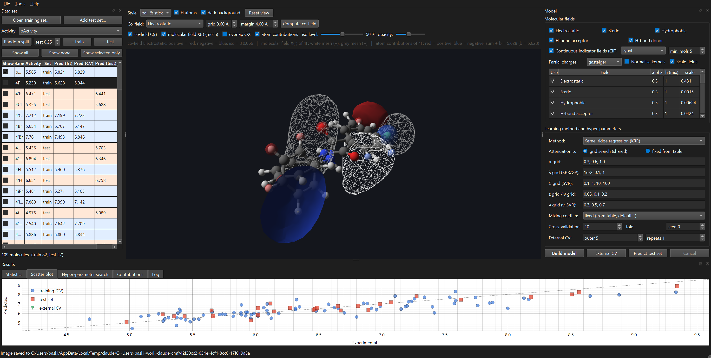

# CMF 3D-QSAR — desktop application for the Continuous Molecular Fields approach

[](https://doi.org/10.5281/zenodo.24043660)

A Python/Qt desktop application (plus a library and a command-line tool) that implements the
**Continuous Molecular Fields (CMF)** approach to 3D-QSAR. The approach is described in the following
publications; the three the program follows most closely are the 2013, 2015 and 2019 papers, which the
text below refers to by year.

**The method**

* Zhokhova N.I., Baskin I.I., Bakhronov D.K., Palyulin V.A., Zefirov N.S. *Method of continuous molecular
  fields in the search for quantitative structure–activity relationships.* Dokl. Chem. **429** (2009) 273–276.
  [doi:10.1134/S0012500809110056](https://doi.org/10.1134/S0012500809110056)
* Baskin I.I., Zhokhova N.I. *The continuous molecular fields approach to building 3D-QSAR models.*
  J. Comput.-Aided Mol. Des. **27** (2013) 427–442.
  [doi:10.1007/s10822-013-9656-4](https://doi.org/10.1007/s10822-013-9656-4)
* Baskin I.I., Zhokhova N.I. *Continuous molecular fields approach applied to structure–activity modeling.*
  In: Gorb L., Kuz'min V., Muratov E. (eds) *Application of Computational Techniques in Pharmacy and
  Medicine.* Challenges and Advances in Computational Chemistry and Physics, vol. 17. Springer, Dordrecht
  (2014) 433–459. [doi:10.1007/978-94-017-9257-8_13](https://doi.org/10.1007/978-94-017-9257-8_13)
  ([arXiv:1311.1495](https://arxiv.org/abs/1311.1495))
* Sitnikov G.V., Zhokhova N.I., Ustynyuk Y.A., Varnek A., Baskin I.I. *Continuous indicator fields: a novel
  universal type of molecular fields.* J. Comput.-Aided Mol. Des. **29** (2015) 233–247.
  [doi:10.1007/s10822-014-9818-z](https://doi.org/10.1007/s10822-014-9818-z)
* Baskin I.I., Zhokhova N.I. *Descriptors based on continuous indicator fields for 3D-QSAR studies.*
  Proceedings of MOL2NET 2016, International Conference on Multidisciplinary Sciences, 2nd edition (2017).
  [doi:10.3390/mol2net-02-03854](https://doi.org/10.3390/mol2net-02-03854)
* Baskin I.I., Zhokhova N.I. *Continuous molecular fields and the concept of molecular co-fields in
  structure–activity studies.* Future Med. Chem. **11** (2019) 2701–2713.
  [doi:10.4155/fmc-2018-0360](https://doi.org/10.4155/fmc-2018-0360)

**One-class classification and virtual screening with CMF**

* Karpov P.V., Baskin I.I., Zhokhova N.I., Zefirov N.S. *Method of continuous molecular fields in the
  one-class classification task.* Dokl. Chem. **440** (2011) 263–265.
  [doi:10.1134/S0012500811100016](https://doi.org/10.1134/S0012500811100016)
* Karpov P.V., Baskin I.I., Zhokhova N.I., Nawrozkij M.B., Zefirov A.N., Yablokov A.S., Novakov I.A.,
  Zefirov N.S. *One-class approach: models for virtual screening of non-nucleoside HIV-1 reverse
  transcriptase inhibitors based on the concept of continuous molecular fields.* Russ. Chem. Bull. **60**
  (2011) 2418–2424. [doi:10.1007/s11172-011-0372-8](https://doi.org/10.1007/s11172-011-0372-8)



*The HIF-2α series of the Merck free-energy benchmark, 38 ligands: a kernel ridge model with q² = 0.62,
its electrostatic co-field drawn as ± isosurfaces, and the binding site of the reference crystal
structure, which the data set brings with it and which needs no superposition.*

## What it does

| Stage | Implementation |
|---|---|
| Molecular fields | One conformation per molecule by default, or a **conformational ensemble** whose mean field is the fourth dimension of 4D-QSAR (see below). Every field is a sum of atom-centred Gaussians `w exp(-α/2 |r-r_l|²)` (Eq. 4 of the 2013 paper). Five physico-chemical fields (electrostatic, steric, hydrophobic, H-bond acceptor, H-bond donor) and **continuous indicator fields** (one per Sybyl atom type, 2015 paper). The steric field uses radius-scaled widths `α/R_vdW²` (Eq. 10–11). |
| Kernels | Overlap integrals of the fields computed **analytically** for all atom pairs (Eq. 5 / Eq. 11), summed per field type (Eq. 2) and mixed with coefficients `h_f` (Eq. 1). Optional cosine normalisation. Vectorised NumPy implementation; a 300-molecule set takes a few seconds per α value. An optional **nonlinear kernel layer** (Gaussian or arc-cosine) and **multiple kernel learning** for the mixing coefficients are described below. |
| Learning | **Regression**: kernel ridge regression with bias term (Eq. 12), **kernel PLS** (the kernel form of CoMFA's learner, its number of components chosen by cross-validation; see below), ε-SVR / ν-SVR (precomputed kernel), a Gaussian-process view of KRR giving predictive variances, which a library can be **ranked by a lower confidence bound** on rather than by the point estimate (see below), and the **Laplacian-regularised ridge**, which brings molecules that carry no measured activity into the fit through a smoothness penalty over the graph of field similarity, so that a co-field can be drawn over a library rather than over a training set (it gains no accuracy on these series; see below). **Binary classification**: C-SVC / ν-SVC, or a **Gaussian-process classifier** fitted by the Laplace approximation, which adds calibrated probabilities, a posterior variance per molecule and model selection by marginal likelihood (see below), or **kernel Fisher discriminant analysis**, the only classifier here found in closed form and the only one whose score is a linear functional of the field, so that a classification model has a co-field (see below), or **kernel logistic regression**, which is the same Laplace mode the Gaussian-process classifier finds with its ridge chosen on the folds and no posterior variance, so its probability is the likelihood at the mode and scoring a library costs an order of magnitude less (see below). **One-class classification** (novelty detection) for similarity-based virtual screening: the 1-SVM, or the centroid, k-nearest-neighbour, Gaussian-process and kernel-PCA descriptions of the active class, or the eight **data-fusion** rules, which combine the similarities to the individual actives and fit nothing at all (see below). **Several endpoints on one kernel**, tied by a task covariance -- one shared correlation, a free-form low-rank matrix chosen by the marginal likelihood, or a covariance read off descriptors of the endpoints themselves, which is what lets an endpoint with no measurements at all be predicted from its neighbours -- so that a selectivity is the difference of two co-fields rather than a ratio (see below). |
| Validation | k-fold cross-validation, external (nested) CV with repeats, and, for a series of several scaffolds, **leave-one-chemotype-out** folds that never put a molecule's own scaffold-mates in the training part, with an alignment-free fragment model as the baseline that the aligned model has to beat (see below). |
| Model selection | Grid search over α (shared) and λ (or C/ε/ν) minimising RMSE in k-fold cross-validation (shuffled or interleaved folds), optional continuous Brent minimisation over λ as in the 2013 scripts; optional coordinate-descent optimisation of the mixing coefficients `h_f` or their choice by **centred kernel alignment** (multiple kernel learning), and a grid over the bandwidth of the Gaussian kernel layer; **external (nested) cross-validation** with repeats (q²ex, RMSEcvex), kernels computed once per α and sliced for the outer folds. |
| Statistics | Regression: r², RMSE (fit); q², RMSEcv (internal CV); R²pred, RMSEpred (test set, both variance conventions); q²ex, RMSEcvex (external CV). Classification: accuracy, balanced accuracy, sensitivity, specificity, Matthews correlation, AUC and ROC curves, for the fit, the cross-validation and the test set. |
| Interpretation | **Molecular co-fields** `C_f(r) = Σ_j a_j X_fj(r)` (Eq. 9) rendered as ± isosurfaces; molecular field `X_f(r)` of any molecule in the same colours, with or without a model (co-fields are drawn as solid surfaces and molecular fields as a mesh by default; both styles are switchable); overlap `C·X` whose integral is the field's contribution to the prediction (Eq. 7); the three decomposition rules of the 2019 paper: training-molecule contributions `a_j K(X,X_j)` and **atom contributions** (Eq. 14 of the 2015 paper) shown as red/blue spheres; **Shapley values** over atoms, substituents or field types, which replace the co-field when a nonlinear kernel layer is used and reproduce the atom contributions exactly when it is not, with second-order interaction indices; for a nonlinear kernel layer also the **local co-field** (the co-field of the tangent linear model at one molecule), the **spread** of those over the training set and a **non-linearity index** per field. |
| Tools | **Protein binding sites** fetched from the PDB or read from a local file and drawn behind the molecules and their fields, with atom codes on the molecule and residue names on the alpha carbons; **field complementarity** of the molecules and of the co-fields with the pocket, as numbers, as a coloured surface and **resolved by receptor residue** into an interaction profile that can be compared with a reference ligand's or with the pattern a series conserves (see below); the **field difference** from a reference molecule, by the cosine or by Tversky's asymmetric index, which is what a fragment of that reference needs (see below); MCS-based alignment to a reference molecule, optional pose refinement by maximising the CMF kernel similarity (the alignment criterion proposed in the 2013 paper), **alignment by prediction confidence** (see below), **alignment by matching the typed extrema of the fields themselves**, which needs no common substructure, no overlapping starting pose and no model (see below), 3D generation from SMILES, model save/load, CSV/SDF/Gaussian-cube export, screenshots. |

### Conformational ensembles: the fourth dimension

A 3D-QSAR model represents a molecule by one conformation, and the answer depends on which one was
picked. 4D-QSAR (Hopfinger et al., J. Am. Chem. Soc. 119 (1997) 10509) replaces the choice with an
ensemble and averages over it. *Model -> Conformations* switches between the two (CLI:
`--conformations single|ensemble`); **single is the default and is untouched**, which the tests
assert by comparing its fields with those built before conformations existed.

In the CMF framework the averaging needs no new mathematics. A field is a sum of atom-centred
Gaussians and the kernel is bilinear in the fields, so the mean field of an ensemble

```
X_f(r) = sum_k w_k X_f^(k)(r)
```

is itself a field, whose atoms are the atoms of every conformation with their weights multiplied by
that conformation's weight. The kernel of two ensembles then comes out as

```
K(A, B) = sum_k sum_l w_k^A w_l^B K(X_A^(k), X_B^(l))
```

which is the mean-map kernel of the two conformational distributions and is positive definite by
construction. A test checks that identity against the pairwise kernels of the conformations. The
model stays linear in that mean field, so **co-fields, the decomposition rules, the Shapley machinery
and the complementarity scores all keep working**; contributions arrive per atom per conformation and
fold back onto the atoms by summation.

*Tools -> Generate conformations* builds the ensembles with ETKDG and MMFF94s, keeping the pose a
molecule already has as its first conformation, so an alignment made earlier survives. A
multi-conformer file can be read instead, with `--ensemble-by name` grouping the records of each
compound. Weights are uniform or Boltzmann from the stored energies, with kT and a cap on the number
of conformations kept; the viewer draws the ensemble as superimposed conformations.

Where the *other* conformations go is a choice of its own, and not a small one. The kernel compares
molecules with each other, so what matters is not where a conformation sits relative to its own
molecule but where it sits relative to the rest of the series; a conformation superimposed on its own
molecule alone is still arbitrarily oriented with respect to every other molecule in the set.
*Place the conformations* in the dialog (CLI: `--conformer-align`) offers four answers, all of them
leaving the molecule's own first conformation exactly where it was:

| `--conformer-align` | where each generated conformation is put |
|---|---|
| `self` | on the molecule's own pose, over all heavy atoms - all that `rdMolAlign.AlignMolConformers` can do, and the default, so nothing changes silently |
| `core` | on the molecule's own pose, over the atoms of the maximum common substructure with a reference molecule only, so the scaffold stays where the published alignment put it and only the flexible part moves |
| `reference` | on a reference molecule of the series, through that same common substructure, which puts every conformation of the series in one frame |
| `field` | as `reference`, then refined by maximising the normalised CMF kernel with the reference - the alignment criterion of the 2013 paper, applied to each conformation |

The reference is the largest molecule of the set unless `--conformer-align-ref` names another one;
its common substructure with the others is the most likely to be the scaffold of the series. The
field set needs no new setting for this: where a conformation is placed is a property of the
geometry, not of the field.

The cost is quadratic in the number of conformations. With five conformations per molecule, the
default settings of `cmf_cli.py build` (RDKit parameterisation, field kernels scaled to unit mean
diagonal, the α grid 0.2–3 and the λ grid 10⁻⁴–10, shuffled 10-fold CV) and the published
train/test split carried by the SD files:

| set | representation | q²cv | R²pred |
|---|---|---|---|
| steroids, rigid | single conformation | 0.810 | **-0.304** |
| steroids, rigid | ensemble, on its own pose (`self`) | 0.831 | -0.961 |
| steroids, rigid | ensemble, own pose, common scaffold (`core`) | 0.839 | -0.937 |
| steroids, rigid | ensemble, on the reference (`reference`) | 0.779 | -0.441 |
| steroids, rigid | ensemble, reference + field (`field`) | **0.883** | -2.293 |
| ACE, flexible | single conformation | **0.741** | **0.604** |
| ACE, flexible | ensemble, on its own pose (`self`) | 0.697 | 0.564 |
| ACE, flexible | ensemble, own pose, common scaffold (`core`) | 0.681 | 0.525 |
| ACE, flexible | ensemble, on the reference (`reference`) | 0.671 | 0.411 |
| ACE, flexible | ensemble, reference + field (`field`) | 0.697 | 0.385 |
| THR, flexible | single conformation | **0.696** | **0.373** |
| THR, flexible | ensemble, on its own pose (`self`) | 0.501 | 0.100 |
| THR, flexible | ensemble, own pose, common scaffold (`core`) | 0.514 | 0.106 |
| THR, flexible | ensemble, on the reference (`reference`) | 0.492 | 0.126 |
| THR, flexible | ensemble, reference + field (`field`) | 0.489 | 0.195 |

Read the table, not the expectation: **none of the three new criteria recovers the loss on thrombin**.
Anchoring every conformation on the molecule's own published scaffold lifts q²cv from 0.501 to
0.514 and forcing the whole series into one frame gives 0.492, against 0.696 for the
single conformation; R²pred stays near 0.1 where the single-conformation model reaches 0.373.
On ACE every ensemble is worse than the single conformation as well, and on the steroids R²pred is
negative for every representation, the single-conformation model included, so that column says
nothing there; the higher q²cv of the ensembles on that set is backed by no test-set gain at all.

That is an answer, just not the expected one. Adding conformations to thrombin hurts however they
are placed, which points at the conformations rather than at their orientation: the series carries
poses its authors aligned as bound-like, and ETKDG conformations of an isolated molecule are not
those poses, so averaging them into the field dilutes exactly the arrangement the model depends on.
The ensemble size says the same thing - on thrombin, with the placement varied and everything else
the default:

| conformations per molecule | `self` q²cv | `core` q²cv |
|---|---|---|
| 1 (single) | 0.696 | 0.696 |
| 2 | 0.672 | 0.728 |
| 3 | 0.570 | 0.732 |
| 5 | 0.501 | 0.514 |

The decay is monotone in the number of generated conformations, and `core` only delays it: holding
the scaffold on the published pose keeps two or three conformations harmless (q²cv 0.728 and 0.732,
above the single-conformation 0.696, though R²pred does not follow at 0.150 and -0.221) and then
collapses at five. So the alignment of the ensemble was worth fixing and is now there to use, but it
is not what was wrong on thrombin.

#### Keeping only the conformations near the aligned pose

If gas-phase geometries are the problem, the remedy is to use only those close to the pose the
series was aligned to. `--conformer-window` (the *Keep within* field of the Tools dialog) keeps the
conformations standing within a given heavy-atom RMSD of the pose the molecule arrived in, measured
where they are rather than after a best fit, so the ensemble covers the local flexibility around
that pose instead of the whole conformational surface. The arrival pose is always kept, and a wider
pool is embedded because most of it is discarded.

It does not work either, and the reason is instructive. On thrombin, five conformations requested:

| window | conformations kept | q²cv | R²pred |
|---|---|---|---|
| single conformation | 1.0 | **0.696** | 0.373 |
| 1.0 Å | 1.0 | 0.696 | 0.373 |
| 1.5 Å | 1.0 | 0.696 | 0.382 |
| 2.0 Å | 1.1 | 0.686 | **0.385** |
| 2.5 Å | 1.9 | 0.590 | 0.313 |
| 3.0 Å | 3.7 | 0.600 | 0.275 |
| no window | 5.0 | 0.501 | 0.100 |

ACE behaves the same way: 0.741 for the single conformation, 0.721 at a 1.5 Å window keeping 1.8
conformations, 0.693 at 2 Å keeping 2.9, and 0.692 for the full ensemble. The quality is monotone in
how far the ensemble strays from the arrival pose, and the window recovers the baseline only by
emptying the ensemble: generated conformations of these ligands stand about 3 Å from the aligned
pose even after being superimposed on it, so any window tight enough to be *local* keeps nothing but
the pose itself. There is no intermediate setting in which the ensemble both differs from one
conformation and predicts better.

Averaging over generated conformations therefore does not help an aligned 3D-QSAR series, and three
placements and six windows did not find a case where it does. What remained was to stop averaging.

#### Letting the model choose the conformation

`cmfqsar/mil.py` (CLI: `cmf_cli.py mil`; in the application, the third entry of
*Model -> Conformations*) treats a molecule as a *bag* of conformations whose label
belongs to the bag, and gives each conformation a weight driven by the model's own score for it,

```
w_ik = exp(beta f(x_ik)) / sum_l exp(beta f(x_il))
```

with two limits that bracket everything: `beta = 0` is the ensemble mode exactly, and a large beta
puts all the weight on the single highest-scoring conformation, which is the witness assumption of
mi-SVM and of multi-instance regression. In between the weighting stays soft, which keeps the bag
kernel a weighted mean of conformation kernels, `W K W^T`, hence positive definite, and keeps the
model linear in the mean field, so co-fields and the decomposition rules survive. Fitting
alternates, as multi-instance methods do: fit, score every conformation, re-weight, repeat; the
conformation kernel is computed once and the rest is matrix algebra. The weights are fitted to the
activities, so they are relearned inside every cross-validation fold, and the folds split molecules,
never conformations.

On synthetic bags that obey the assumption, where the label is the best score among five instances,
the method does what it should: it recovers the hidden instance in 98 % of bags and lifts q²cv from
0.398 to 0.999, where averaging cannot help. That is the test that proves the machinery, and it is
in the suite.

On real series it does not help, and how it fails is the interesting part. Five conformations per
molecule, the kernels cosine-normalised, α and λ chosen by cross-validation:

| set | representation | q²cv | R²pred | conformations that count |
|---|---|---|---|---|
| THR | single conformation | 0.652 | **0.545** | 1.00 |
| THR | ensemble, `beta = 0` | 0.290 | 0.309 | 5.00 |
| THR | selection, `beta = 3` | **0.656** | 0.547 | 1.09 |
| ACE | single conformation | 0.656 | **0.358** | 1.00 |
| ACE | ensemble, `beta = 0` | **0.717** | 0.284 | 5.00 |
| ACE | selection, chosen by CV | 0.717 | 0.284 | 5.00 |

On thrombin the selection repairs exactly the damage that averaging did, and it does so by choosing
the pose the molecules arrived in for 97 % of them, 100 % under hard selection. In other words the
model, given five conformations and free choice, re-selects the alignment the authors published and
matches the single-conformation result to three decimals. On ACE cross-validation prefers no
selection at all, and the gain it reports does not survive on the test set.

The alternation is a local search, and that shows: started from equal weights instead of from the
arrival pose, the same fit ends at q²cv -0.29 and keeps the published pose for 2 % to 24 % of
molecules. Annealing beta upwards from a soft start, which `anneal_weights` does, lifts that to
0.23 but is still far below, and it *degrades* a run that started at the published pose. So the
method cannot find a bioactive conformation among gas-phase ones; it can only confirm that the pose
already there is the best of what is offered, which is a useful diagnostic and not a better model.

#### Placing the conformations in the pocket

The remaining idea was to stop generating ensembles in the gas phase and let the receptor place
them. `cmfqsar/docking.py` (CLI: `cmf_cli.py mil --dock`; in the application, *Tools -> Dock into the
pocket*) is a small rigid-body docking written
against what the program already has: the pocket fields, the exact overlap integrals, a soft clash
term, a burial term and a tether. A pose is scored by

```
complementarity with the pocket + burial - clash - tether
```

and the six rigid-body parameters of each conformation are optimised from where it stands. A
restart turns the pose by at most 30 degrees, which is what a conformation already placed in the site
needs; `max_rotation_deg` sets it, and 180 lets every restart draw a completely different orientation,
which is what a pose with no known orientation needs (see *What a bounded restart cannot do* in the
manual). The internal geometry is never touched, so the conformations stay as generated and
only their placement changes. It is not a docking program: there is no desolvation, no entropy and
no torsional search, and the scoring function is not fitted to binding data.

It does what it is asked to. On the thrombin set of the Open Force Field collection the clash
dropped from 7.8 to zero and the score from -15.1 to +0.54, the poses moving 3.0 Å; on the HIF-2α
set of the Merck collection, where the ligands were already well placed, the poses moved 1.0 Å and
the small residual clash vanished. Both took about ten minutes for a hundred to two hundred poses.

It does not help the model, which is the fourth answer of the same kind:

| set | representation | q²cv |
|---|---|---|
| HIF-2α, 38 ligands | single conformation | **0.623** |
| HIF-2α, 38 ligands | gas ensemble | 0.610 |
| HIF-2α, 38 ligands | docked ensemble | 0.582 |
| HIF-2α, 38 ligands | selection on the gas ensemble | 0.528 |
| HIF-2α, 38 ligands | selection on the docked ensemble | 0.537 |

The thrombin set of that collection says nothing either way: with 22 ligands no representation
models it at all, the single conformation included, at q²cv -0.06 and worse.

Two things temper this. These benchmark ligands arrive in bound-like poses already, so the
experiment really asks whether *re-docking a good pose* helps, and it does not; a series with no
trustworthy alignment is a different question. And a proper docking program with a flexible-ligand
search would place poses better than this one does.

That second point suggests where this code is actually worth using. Placing a molecule in a site by
optimising a pocket score is an *alignment* method, and for a series whose alignment is a guess from
a common substructure it may well beat that guess. The ensemble question is closed; docking as an
alignment criterion has since been measured, by the pose protocol and on the four FEP sets with a
receptor structure: from a destroyed pose it recovers a median 1.12 A, with 74 % of the molecules
within 2 A of the crystal pose. On mcl1 the two settings of the corrected search were varied
separately for this criterion as well: the number of restarts takes it from 3.00 A to 1.00 A, and a
restart from any orientation takes it to 0.93 A, so here the restarts do most of the work. That is far better than nothing and well behind the confidence
criterion's 0.11 A on the same four sets, which is the answer *Alignment inside the pocket* in the
manual reports in full.

Both are in the application as well as on the command line. *Model -> Conformations* has a third
entry, "ensemble, weights learned", with the hardness beside it and a box for choosing exactly one
conformation; the fit learns the weights, writes them onto the molecules and then proceeds as an
ordinary ensemble model, so co-fields, the decomposition rules and the Shapley machinery stay
available and report the weighting the model was actually fitted with. *Tools -> Dock into the
pocket* places every conformation of every molecule in a loaded structure, reports what the score
and the clash did, and discards the current model, since the molecules it was fitted on have moved.

**The verdict on the fourth dimension.** Averaging, placement, windowing, selection and
receptor-placed ensembles all fail to beat one well-chosen conformation on an aligned series. Five
routes, one answer. The mode stays because it is exact and costs nothing when unused, and because
the pieces it needed, conformer generation, multi-instance weighting and pocket docking, are useful
on their own. Treat it as something to test against the single-conformation model on each series,
with the number of conformations, the window and beta as parameters of their own, rather than as an
improvement to switch on; which is why the default remains a single conformation.

The earlier version of this table reported different numbers for the single-conformation rows, with
a protocol that was not recorded and could not be reproduced; every row above was measured again
with the settings stated, so the rows are comparable with each other.

Boltzmann weighting was worse than uniform on all three sets, because the conformations are generated
from one input pose and their energies then concentrate the weight on a few of them; uniform weighting
is the safer default and is what the application starts with.

One last source of error: a seed of exactly zero makes RDKit return the same geometry for every
conformation, which would silently collapse an ensemble; the generator maps it to a fixed non-zero
seed and a test guards that.

### The variance of an ensemble

The ensemble mode represents a molecule by the mean of the fields of its conformations. The
variance across them is a flexibility map, and it is a field of the same class: a product of two
Gaussians is a Gaussian, so the variance is again a sum of Gaussians, at the midpoints of atom
pairs and at twice the width (`cmfqsar/fluctuation.py`, plan item D10). No new kernel is needed,
so it can be added as a block with a mixing coefficient and the coefficient asked whether it
carries anything.

**It does not help, and that is the answer the plan expected.** On the 31 CBG steroids, glycogen phosphorylase b, thrombin, every mixture that includes the variance is at or below the mean alone: the best of -0.009 [-0.079, +0.062], +0.002 [-0.015, +0.020], -0.006 [-0.032, +0.023]. Alone it reaches q2 +0.425 on the 31 steroids, +0.180 on the 66 of GPB and -0.013 on the 88 of thrombin: something on a small set of one rigid scaffold, nothing on a larger and more varied one, and on none of them something the mean does not already have. Keep it as a map of where a series is rigid, not as a block of the kernel.

```bash
python benchmarks/run_fluctuation.py        # results/fluctuation/table.md
```

### Scoring a conformational restriction

Tying two parts of a molecule into a ring, so that a bond can no longer rotate, is one of the few
moves in medicinal chemistry whose effect is meant to be purely conformational, and the variance
field above is a map of what such a move is supposed to change. Plan item MC9 turns it into two
numbers (`cmfqsar/restriction.py`). The square of the co-field is a weight -- positive
everywhere, large where the model reads the field -- and with it every molecule has the
**relevant** field it places (the integral of the squared co-field times the squared mean field)
and the **intermittent** part of it (the same weight on the variance field). A pair of a flexible
molecule and its restricted analogue is then two shares: how much of the relevant field the
closure **kept**, and how much of the intermittent part it **removed**.

The pairs come from a mechanical rule and not from eye: one ring more, at least one rotatable
bond fewer, at most two heavy atoms more, nearly the same atom composition, and a common
substructure covering at least 80 per cent of the smaller member. A fingerprint is deliberately
not used -- butylphenol and 2-methylchroman, the same eleven atoms with one bond more, are 0.15
alike as Morgan fingerprints, so a useful threshold would throw away exactly the pairs the item
is about.

**The score does not pass the gate, and the mean field does.** On 439 pairs from four Sutherland
sets, the share of intermittent field a ring closure removes correlates with the potency gain at
+0.043 [-0.030, +0.111], an interval that contains zero; counting the rotatable bonds the closure
removed reaches +0.236 [+0.151, +0.317] on the same pairs and needs no model at all. Rebuilding
the co-field without both members of each pair leaves +0.020, so there was nothing for the weight
to learn. What does track the gain is how much of the activity-relevant field the restricted
analogue still places, +0.220 [+0.120, +0.315]: a ring closure helps when the molecule still puts
its field where the model reads it. This is the third measured place where the conformational
ensemble carries less than it promises, after the fourth dimension and the variance block, and
the variance field stays a map.

```bash
cmf restriction model.cmf --molecules series.sdf --activity pIC50 --csv pairs.csv
python benchmarks/run_restriction.py        # results/restriction/table.md
```


### Heterogeneous series: several chemotypes, no one common substructure

Everything above rests on the molecules sharing a frame, and a congeneric series supplies one:
superimpose on the common substructure and the fields become comparable. A series of several
scaffolds has no such substructure, and the usual recipe quietly stops meaning anything — one
reference molecule, one maximum common substructure, and a random cross-validation that puts a
molecule's own scaffold-mates in the training part, which is the most optimistic split available.

`cmfqsar/chemotypes.py` is the workflow for that case, in the order the problem imposes.

1. **Cluster by scaffold.** `chemotype_labels` groups the molecules by their Bemis-Murcko
   framework, either as drawn or made generic so that elements and bond orders stop mattering.
   Groups below a minimum size are pooled into one "other" group, so that a handful of singletons
   does not turn the validation into leave-one-molecule-out.
2. **Align within each cluster**, where a common substructure does exist and does the job well:
   `align_within_groups` superimposes every molecule on the largest member of its own group.
3. **Place the clusters relative to one another**, the step a congeneric series never needs.
   `place_groups` moves each cluster as a rigid body, so step 2 survives intact: either by
   maximising the CMF kernel between its reference and the reference of a chosen cluster (their
   centroids are brought together first, since the kernel is flat where two molecules do not
   overlap and there is no gradient to follow), or by docking that reference into the binding site,
   which needs a structure but no reference cluster at all.
4. **Judge it by leave-one-chemotype-out.** `grouped_folds` never splits a group, and
   `grouped_cv_predict` holds out a whole chemotype at a time; `max_folds` bundles the groups
   when there are many small ones.
5. **Compare with a baseline that needs no alignment.** `count_kernel` is the continuous
   indicator fields at vanishing attenuation. Writing the overlap integral of two such fields
   out,

   ```
   K_t(A,B) = (π/α)^{3/2} Σ_{l∈A} Σ_{m∈B} exp(−α |r_l − r_m|² / 4)
            = (π/α)^{3/2} [ n_t(A) n_t(B) − (α/4) Σ_lm d²_lm + O(α²) ],
   ```

   so as α tends to zero every exponential tends to one, the kernel tends to the dot product of
   the atom-type count vectors, and nothing of the geometry survives. By default the baseline is
   that limit, written down from the counts themselves: each field scaled to unit mean diagonal,
   which in the limit is a division by the mean of n_t², and the cosine of what is left. It is
   exactly pose-free rather than nearly so — it never reads a coordinate — and it costs one pass
   over the atoms instead of a kernel over every pair of them, which is 10 to 34 times faster on
   the sets in `examples/`. `alignment_free_q2` then runs that kernel through the same grouped
   folds, with its own λ.

   An explicit attenuation takes the Gaussian route instead, which is the thing the limit is a
   limit of. Two details decide whether that route arrives, and both are measured in the tests:

   - **The attenuation has to be far smaller than a modelling one.** The first correction is
     linear in α and carries the separation of the two molecules' centroids, so the pose
     dependence dies only as fast as α does. A rigid motion of every molecule still moves the
     kernel by 0.70 at α = 0.02 and by 0.12 at 2·10⁻³; at `BASELINE_ALPHA` = 2·10⁻⁴ it is 0.013,
     and the two routes agree to 4·10⁻⁵ by α = 2·10⁻⁶.
   - **The cosine normalisation has to be applied to the joint kernel, not field by field.** A
     field normalised on its own tends to `n_t(A) n_t(B) / (n_t(A) n_t(B))` = 1, so the counts
     cancel against themselves and what is left is the indicator of "both molecules contain type
     *t*" — the baseline would lose the very descriptors it is built from, and the kernel would
     collapse towards a matrix of ones.

   If the aligned model cannot beat this baseline, the alignment is not worth its cost, and on
   a heterogeneous set that is the first thing worth knowing.

`evaluate` runs steps 4 and 5 together and returns the three numbers with a verdict, plus the
alignment-free *geometry-aware* kernel of the next section as a fourth.

**What it shows.** Five sets with more than one scaffold, molecules in their published poses (no
realignment), all five physico-chemical fields, KRR with α over 0.3/0.5/1.0 and λ over 0.01/0.1/1,
groups of at least three molecules; the baseline gets the same λ grid on the same folds:

| set | n | chemotypes | random folds | leave-one-chemotype-out | alignment-free |
|---|---:|---:|---:|---:|---:|
| sutherland/COX2 | 282 | 14 | +0.537 | **+0.425** | +0.174 |
| sutherland/DHFR | 361 | 31 | +0.623 | **+0.463** | +0.159 |
| sutherland/BZR  | 147 | 12 | +0.388 | +0.088 | **+0.144** |
| sutherland/AChE | 111 |  7 | +0.510 | **+0.275** | −0.060 |
| mittal/ACHE     | 111 |  7 | +0.168 | −0.304 | **−0.058** |

Random folds overstate the quality of every one of them, by 0.11 to 0.47 in q²; on ACHE they
turn a model that cannot predict a new scaffold at all into a modestly positive number. That gap
is the reason the grouped folds are here. Across scaffolds the aligned model still justifies its
cost on COX2, DHFR and Sutherland's AChE, and does not on BZR or on Mittal's ACHE, where a
fragment-count model that ignores the geometry entirely does as well or better. Which it is cannot
be guessed from the random-fold number, and the per-chemotype table says where the failure is: on
DHFR one group of five molecules is predicted 2.07 log units too low whatever is done with it.

How strict the baseline is matters, and shows how little attenuation it takes to bring the
geometry back in. The same column taken by the Gaussian route at α = 2·10⁻⁴ instead of at the
limit reads +0.282 on COX2 and +0.250 on DHFR, against +0.174 and +0.159 here — the residual pose
dependence at that attenuation is worth around 0.1 in q² on the two large sets. It does not
change any verdict, but a baseline is only as reliable as its limit.

Realigning first did not rescue the sets that fail. Under the same protocol, Mittal's ACHE goes
from −0.304 in its published poses to −0.392 after step 2 and −0.390 after step 3, and BZR from
+0.088 to +0.097 and then +0.050: the same answer the conformational ensembles gave, seen from a
different direction. A placement chosen to maximise field overlap is not a bioactive-pose hypothesis,
and the model can tell. What the workflow is for is the question in step 4, not the realignment in
steps 2 and 3, which are there for a set that arrives with no usable poses at all.

The hyper-parameters are chosen on the same grouped folds the model is reported on, which is
optimistic in the usual way of any selection on the reported statistic; what matters here is the
comparison between representations, which share the protocol. The Murcko framework is one grouping
among several reasonable ones — a different clustering gives different folds, and the workflow
takes any labelling, not only the one it computes.

```bash
python cmf_cli.py hetero examples/sutherland/COX2.sdf --charges file --min-group 3 --out cox2_groups.csv
```

`--align-within` and `--place field|dock` add steps 2 and 3, `--generic-scaffolds` merges
chemotypes that differ only in their heteroatoms, `--max-folds` bundles the groups, and
`--baseline-alpha` takes the baseline by the Gaussian route at that attenuation instead of at its
limit. In the application the same choice is the "Baseline α" box of step 4, which reads "the
limit (atom counts)" at zero.

In the application the same five steps are a submenu, *Tools -> Heterogeneous sets (several
chemotypes)*, in the order they have to be taken. Step 1 adds a "Chemotype" column to the data-set
table, coloured by group, with the scaffold as its tooltip; steps 2 and 3 move the molecules and
discard a model fitted on where they were; step 4 fills a "Chemotypes" tab with the three q²
values, the verdict and every chemotype's RMSE and bias while it was the one held out.

### Alignment-free, but geometry-aware

The alignment-free baseline above is pose-free because it is two-dimensional: as α → 0 the
indicator fields become atom counts and the geometry is gone. That leaves a gap in the
comparison, because "the alignment was not worth its cost" and "three dimensions were not worth
their cost" are different statements, and the count kernel cannot tell them apart.

[invariant.py](cmfqsar/invariant.py) fills it. For every pair of field types it takes the
distance distribution of the field weights inside one molecule,

```
Φ_fg(d) = Σ_l Σ_m w_lf w_mg exp(−(|r_l − r_m| − d)² / 2σ²)
```

on a grid of distances. A rigid motion moves every atom and leaves every interatomic distance
where it was, so the descriptor is invariant to rotation and translation by construction — no
superposition, no reference molecule, no common frame — while still describing the
three-dimensional arrangement: where a donor sits relative to an acceptor, how far the charge is
from the hydrophobic bulk. The kernel is the cosine of those features, normalised jointly rather
than block by block, for the reason the count kernel has to be.

The channels come in blocks, one per pair of field types, each scaled to unit root mean square
before the blocks are taken together; what the overlap kernel does with its mixing coefficients
h_f the three invariant sources (autocorrelation, surface, periodic) do with **block weights**, one
coefficient per block applied to the scaled features before the normalisation
(`ac_block_weights` on `CMFModel`, `--block-weights` on `build` and `build-crystals`). A block's
share of the kernel goes as the square of its weight and a weight of zero removes the block
exactly — a test checks that the eight-field model with the indicator blocks at zero *is* the
three-field model. They are set in three ways: `balanced` gives every kind of block — within a
group of fields, across two groups — the same share of the kernel however many blocks the kind
has; a mapping names the kinds' weights (`{"indicator": 0.3, "indicator*physchem": 0.5}`,
`--block-weights indicator=0.3,indicator*physchem=0.5`); `align` or `alignf` derive one weight per
block by centred kernel alignment of the per-block kernels, `align_mixing` carried over to the
blocks and computed in feature space so the seventeen hundred block kernels of a crystal set are
never formed. The aligned weights are re-derived from the training part of every cross-validation
fold, inside the grid search and the nested validation alike, so no reported q² has seen the
left-out activities. The groups default to the continuous indicator fields against the rest;
`ac_block_groups` / `--block-groups` names others, and the fitted weights are reported by kind
(`block_weight_report`) and saved with the model.

The connection to the CMF kernel is exact at one point. The overlap integral of two fields of the
same molecule is `(π/α)^{3/2} Σ_lm w_lf w_mg exp(−α d²_lm/4)`, which is the channel at `d = 0`
with `σ² = 2/α`, up to the prefactor — a test asserts it. The further channels resolve what that
single number collapses: the overlap integral says how much the fields of a molecule coincide,
the autocorrelation says at which distances they do.

**Measured on the five chemotype-split sets**, leave-one-chemotype-out, same folds throughout.
The attenuation α is a parameter of the overlap integral and does not enter this descriptor at
all — the distance axis has its own width σ — so the invariant columns are searched over the
regularisation alone (three settings) and, in the last column, over three distance grids as well,
which is the same nine settings the aligned model gets from its three attenuations and three
regularisations:

| set | aligned CMF (9) | fragment counts (3) | invariant, one grid (3) | invariant, three grids (9) |
|---|---:|---:|---:|---:|
| COX2 | **+0.425** | +0.174 | +0.355 | +0.364 |
| DHFR | **+0.463** | +0.159 | +0.384 | +0.424 |
| BZR | +0.088 | +0.144 | +0.130 | **+0.148** |
| AChE | **+0.275** | −0.060 | +0.128 | +0.174 |
| mittal/ACHE | −0.304 | **−0.058** | −0.137 | −0.111 |
| mean | **+0.189** | +0.072 | +0.172 | +0.200 |

At equal freedom — nine settings each — the invariant kernel is slightly ahead of the aligned
model, +0.200 against +0.189; held to a single fixed distance grid, a third of that freedom, it
is 0.017 behind. Either way it more than doubles what the pose-free count kernel achieves. Per
set the aligned model keeps a real lead on COX2, DHFR and Sutherland's AChE, the invariant kernel
wins on BZR — the set where the alignment had already lost to counts — and neither helps on
Mittal's ACHE, where nothing does. Five sets are not enough to decide the near tie at the top, but they
are enough to say that most of what the geometry contributes does not need the frame.

So for a series of several chemotypes, most of what the three-dimensional fields contribute
survives without any superposition at all. That is the useful half of the answer. The other half
is what it costs: there is no co-field, because a map in space needs a space to exist in. The
decomposition that remains is in the descriptor's own terms — which pair of field types at
which distance carries the weight, which `channel_labels` names.

`evaluate` reports it as the fourth number, the `hetero` command prints it, and the Chemotypes
tab carries it beside the other three.

#### The three-point signed channels: what a distance distribution cannot see

A distance distribution is the same for a molecule and its mirror image, so everything above is
blind to chirality: a test asserts that the two-point descriptor of an enantiomer pair is
identical bit for bit. The signed quantity that is not blind is the triple product of three
displacement vectors, and `--ac-chirality` adds it as a second block of channels.

Summing the signed volume over every triple of atoms would cost O(N³). It does not have to,
because the determinant is trilinear and the sum factorises exactly:

```
Σ_lmn w_lf w_mg w_nh · det[r_l − c, r_m − c, r_n − c]  =  det[A_f, A_g, A_h],
      A_f = Σ_l w_lf (r_l − c),   c the centroid of the atoms
```

So each channel is the signed volume spanned by three field-weighted first moments, and the whole
block costs one pass over the atoms. Under a proper rotation all three vectors turn together and
the determinant is unchanged; under a reflection it changes sign; a translation moves the centroid
with the atoms and cancels. A test checks the factorisation against the explicit triple sum, and
another checks that a planar molecule gives zero in every channel, which it must, since three
vectors in a plane span no volume and a planar molecule is achiral. The signed volume is
antisymmetric in its three arguments, so only the field triples f < g < h are independent: ten
channels for five fields, times the radial shells they are resolved over.

**The invariance gap is closed exactly, and the practical gain is small.** Both halves of that
are measured. The kernel between a molecule and its mirror image was exactly 1.000000, meaning
indistinguishable; on the signed block alone it is **−1.000000**, an exact antipode, and in the
combined kernel it is 0.808. On the four Sutherland sets with several chemotypes, leave-one-
chemotype-out q² moves by +0.042 on COX2, +0.010 on DHFR, −0.035 on BZR and +0.062 on AChE: a
small positive on three of four, mean +0.020.

What it does **not** do is make a hand effect predictable for an unseen substituent. On a
congeneric chiral series built for the purpose — one scaffold, ten substituents, both
enantiomers of each, activity set to the substituent effect plus a fixed ±0.75 for handedness,
leave-one-enantiomer-pair-out — the plain kernel predicts the two hands identically and recovers
exactly none of the ±0.75 gap, as it must. With the signed block it recovers 0.108 of a true
1.500 and predicts the hand correctly 60 % of the time. Up-weighting the block until it carries 98 % of
the squared norm raises that to 0.311 and 70–80 %, while the overall q² falls from +0.223 to
+0.025 as the substituent signal is suppressed. A per-atom-triple version binned by the
triangle's size, which does not factorise and costs O(N³), recovers 0.496 and is the direction to
take if more is needed; it is not implemented, because three times a small number is still a
small number.

The reason is worth stating, because it is a property of the descriptor and not a bug. The signed
volume is built from three field-weighted moments of the whole molecule, so changing a substituent
changes all three; the sign flips within an enantiomer pair, exactly, but the direction and
magnitude in channel space vary between substituents, and a kernel method has no consistent
handedness coordinate to generalise along. Enantiomers are no longer identical, which is what was
claimed; a transferable chirality model is a different and harder thing.

```bash
python cmf_cli.py build examples/sutherland/BZR.sdf --charges file --kernel autocorrelation \
       --ac-chirality --lams 1e-2,0.1,1 --test-fraction 0.25
```

It is off by default, so a model built before the block existed is unchanged, and a test asserts
that the pair part of the feature vector is bit-identical with the block switched on.
`--ac-chirality-shells` sets how many radial shells about the centroid the volume is resolved
over, one being the single global invariant per field triple. In the application it is the
*Signed three-point channels (chirality)* box beside the distance resolution.

**It is also a kernel to model with, not only to compare against.** `CMFModel` takes a
`kernel_source`, so every learner, the grid search, the cross-validation, the external CV, the
posterior variance, the screening scores and model save/load work on it unchanged:

```bash
python cmf_cli.py build examples/sutherland/BZR.sdf --charges file --kernel autocorrelation        --lams 1e-2,0.1,1 --test-fraction 0.25 --save bzr-invariant.cmf
```

In the application it is the *Kernel from* box of the Model panel; choosing it reveals the
distance resolution σ and greys out the α grid, which this kernel does not use. A test asserts
what the box promises: a model fitted on one set of poses and asked about a molecule moved
fifteen ångström away and turned at random returns the same number to nine decimals, and a model
fitted on randomly re-posed copies of the same training molecules is the same model.

What the model loses with the frame, it says so: `cofield_coefficients` and `atom_contributions`
raise rather than return something meaningless, while the contributions of the training molecules
— the dual form, which needs no frame — still add up to the prediction.

### The bond graph as a kernel view: the graph neural tangent kernel

The field kernel is the kernel of an infinitely wide radial-basis network on the aligned fields;
the graph neural tangent kernel (Du et al., NeurIPS 2019) is the kernel of an infinitely wide
graph network on the bond graph, computed in closed form with no training. [gntk.py](cmfqsar/gntk.py)
(plan item ND7) computes it in a few hundred lines of NumPy -- atom types as one-hot features,
two blocks of neighbourhood averaging and rectified units whose expectations are the arc-cosine
terms, the sum over atom pairs normalised to a cosine -- and `mixing.with_views` stacks it under
the field kernels, where the evidence gives it a weight like any field and `drop_one` the Bayes
factor against it doing nothing. The model stays a kernel model; the graph knows which atom is
bonded to which and not where any atom is, so the co-field is read from the field views alone.

**Measured** on the eight Sutherland sets and 2,000 molecules of COMPAS-1D, ten folds, every variant
under the weights of the evidence, against the fields alone and against the fields with the
invariant kernel of item C5 (`benchmarks/run_gntk.py`). Against the fields alone the graph view
changes q2 by +0.016 on average over the Sutherland sets and +0.470 [+0.438, +0.503] on COMPAS-1D;
against the fields with the invariant kernel, -0.023 (1 set in its favour with an interval
excluding zero, 3 against) and +0.004 [-0.002, +0.011]. The evidence gives it 25% of the joint
kernel on average with a Bayes factor of +2.3 nats. Against the invariant kernel the graph view wins
on DHFR and loses on COX2, BZR, ACE. On DHFR the evidence hands the graph 95% of the kernel with a
Bayes factor of +16.1, and the bond graph alone predicts better than the aligned fields (q2 +0.712
against +0.641): that is the largest and most varied of the eight series, the one an alignment
serves worst, and there the graph takes over from the fields rather than adding to them. Everywhere
else the graph holds a few per cent of the kernel and changes q2 within its interval, and what the
fields with the invariant kernel gain over the fields alone, the graph does not give. On COMPAS-1D
the aligned fields are weak (q2 +0.439), the graph alone reaches q2 +0.908, the same as the
invariant kernel (+0.004 [-0.002, +0.011]), and the two together gain +0.025 [+0.020, +0.030] over
the invariant kernel alone, an interval well clear of zero. The gate asked for a gain the invariant
kernel does not already give: it is met on the two largest series (DHFR with 361 molecules and
COMPAS-1D with 2,000) and on none of the seven small ones. Whether the graph needs the molecules or
the poor alignment these two series share, this benchmark cannot separate. The view stays in the
library as one more term for the weights of item E6 to judge series by series, which is what they
did here.

### A series on one lattice: the periodic overlap kernel

For a doped, substituted or defective series on one parent lattice the cells share a frame, so the
overlap integral applies with the integral taken over one cell and the periodic images summed in
(`periodic.periodic_overlap_kernels`, plan item M4; `CMFModel(..., pbc_overlap=True)`). It is the
ordinary kernel evaluated against an image-expanded table, so the normalisation, the learners, the
per-site contributions and the co-field are the same code as for a molecule -- and the co-field is
then periodic, which is what an autocorrelation can never give: it says *where* in the cell.

Measured on 1,500 cells of `matbench_perovskites`
(`benchmarks/results/periodic_overlap/table.md`), five Matbench folds: the autocorrelation reaches
R² +0.497, the periodic overlap +0.479 once every cell is put on one lattice and +0.350 in the
cells as they come. The frame is the whole story -- it is worth +0.129 to the overlap kernel,
nothing to the autocorrelation (which is invariant) and -0.069 to the same overlap with the images
left out. The overlap kernel does not beat the autocorrelation here, because giving a set of
different compounds a common lattice takes the lattice constant out of the kernel, and that is a
strong predictor of a formation energy. It is the kernel for a series where the lattice is fixed
by construction, and there it brings the co-field with it.

That co-field is the thing an autocorrelation cannot give. Drawn inside the perovskite cell
(`benchmarks/results/periodic_overlap/cofield.png`) it is periodic and its strongest features sit
on the sites: the steric co-field is deeply negative at the B site and at the oxygen and positive
at the A site. The per-site form of decomposition rule 3 says the same in numbers -- A +2.37 ±
0.58, B -6.16 ± 0.81, X -3.87 ± 0.55 eV over 150 cells -- where the spread is the part
that carries information: the B site's contribution varies most from compound to compound.

### A defect series on one host: the host symmetry and the arrangement kernel

The perovskites are different compounds forced onto one lattice. A defect series is the case the
kernel was built for (plan item M14): one host, one supercell, cells that differ by which sites
are changed. Two things are added for it in [periodic.py](cmfqsar/periodic.py). A cell is
written as the host plus a signed change on the changed sites (`defect_fields`, `defect_table`):
the kernel is bilinear, so the kernel of the differences is exact, and a model with a bias on
them is the model on the whole cells. And the kernel is averaged over the space-group operations
of the host (`host_symmetry`, from spglib; `CMFModel(..., pbc_symmetry=...)`), because two
arrangements of the same defects that differ by a host operation have the same energy but, in a
fixed frame, fields that do not overlap. The linear average is a count kernel: additive over the
defects and blind to their arrangement. The arrangement is kept by averaging the Gaussian layer
over the group instead (`symmetry_averaged_kernels`), which is the orbit mean in the layer's
feature space and so a kernel in its own right. A compiled loop takes every atom pair at its
nearest image, and the 768-operation average of an 8 x 8 supercell costs 125 s for 2,000 cells.

Measured on 2DMD (Huang et al. 2023): one to three vacancies and substitutions on the 8 x 8
supercell of MoS2 and of WSe2, DFT formation energy of the cell, 2,000 random cells per material
and then all 5,933, five random folds (`benchmarks/results/2dmd/table.md`). MAE per defect site
in meV:

| kernel | MoS2, 2,000 cells | WSe2, 2,000 cells | MoS2, all 5,933 | WSe2, all 5,933 |
|---|---:|---:|---:|---:|
| fixed frame, no symmetry | 60 | 57 | 42 | 42 |
| counts (the linear symmetry average) | 41 | 42 | 41 | 41 |
| periodic autocorrelation | 8.3 | 15.7 | 3.0 | 6.0 |
| arrangement (the symmetry-averaged layer) | 1.8 | 5.2 | 1.9 | 4.4 |

The arrangement kernel beats the autocorrelation by 6.5 [5.3, 7.7] and 10.5 [9.1, 12.1] meV per
site on 2,000 cells (paired bootstrap, 95 %), which is the half of the M4 gate the perovskites
could not test. On all 5,933 cells the autocorrelation gains most from the extra training cells
and the lead shrinks to 1.0 [0.8, 1.2] and 1.5 [1.3, 1.9] meV per site, still with intervals that
exclude zero. The published errors on this set, on the authors' own split of all 5,933 cells, are
2.6 / 4.8 meV for a sparse graph network and 11.8 / 14.7 for gradient boosting on descriptors.
Trained on the 131 cells with one or two defects and predicting those with three (1,869 in the
2,000-cell sample, 5,802 in the full set), the arrangement kernel reaches 4.3 and 4.7 meV per
site on MoS2 and 54 and 38 on WSe2, where the additive count kernel gives 38 on both, and the
autocorrelation does not extrapolate at all (R² near zero). The per-defect
contributions of the linear model (decomposition rule 3) are one number per kind of defect, to
four decimals, and match the single-defect cells of the set to 0.2 eV: a sulfur vacancy in MoS2
costs 2.59 eV against 2.65 measured, a molybdenum vacancy 6.98 against 7.12.

### Crystals: the periodic autocorrelation

The autocorrelation above is the real-space counterpart of a reciprocal-space object. Averaged over
orientations, the product of two typed structure factors is the sine transform of the typed
pair-distance distribution (the Debye scattering equation), so the kernel compares two molecules
by what a powder diffraction experiment on each would see, field type by field type. Nothing in
that needs a finite molecule, and [periodic.py](cmfqsar/periodic.py) takes it to crystals, where
three things change:

* **The pair sum runs over a neighbour list.** One atom per cell times every neighbour out to a
  cutoff radius, periodic images included, divided by the number of atoms in the cell so that the
  descriptor is intensive. A supercell, a different choice of cell, origin or orientation all give
  the same channels — tests assert it to twelve digits.
* **The uniform background is removed.** In an infinite solid the number of pairs at a distance r
  grows as r², the same for every structure, and overwhelms everything else at long range. What the
  Faber–Ziman partial structure factors keep is the deviation of each field pair from a uniform
  distribution over the cell, and that is what is subtracted, with the shell integral of the
  Gaussian channels computed once per grid. The self term stays, as it does for molecules: it
  carries the composition.
* **The cutoff is tapered.** The last two ångström before the cutoff are weighted by a half-cosine,
  so that a pair walking out of the sphere leaves the descriptor continuously instead of abruptly.

A molecule placed in a box larger than the cutoff, with the background and the taper off, gives
exactly the molecular autocorrelation per atom; a box of randomly placed atoms, with them on,
gives channels that are nothing but noise about zero. Both are tests.

**Fields for solids.** Hydrophobicity and hydrogen bonding mean nothing in an oxide.
`inorganic_fieldset` builds what does: the electrostatic field with oxidation states as weights
(guessed from the composition with pymatgen, or read from an `oxi_states`/`charges` array of the
structure file — Bader charges, for instance), the steric field with the atomic volume, the Pauling
electronegativity and the atomic mass or its inverse square root as property fields, and one
**continuous indicator field per element**, whose
pair products are the partial structure factors of each element pair — the quantity a diffraction
experiment measures. Elements rarer than a threshold share one `other` field, and any per-atom
array of the file can be a field as `prop:<name>`.

```python
from cmfqsar.model import CMFModel
from cmfqsar.periodic import (crystal_table, elements_in, inorganic_fieldset,
                              periodic_channel_labels, read_structures, top_channels)

atoms = read_structures("structures.extxyz")                  # anything ASE reads: CIF, POSCAR, ...
fs = inorganic_fieldset(elements_in(atoms, min_structures=5))
model = CMFModel(fieldset=fs, kernel_source="periodic", normalize=True,
                 ac_sigma=0.5, ac_d_max=10.0, params={"lam": 1e-2})
model.fit(crystal_table(atoms, fs), y)
for label, weight, spread in top_channels(model, periodic_channel_labels(fs, model._ac_spec())):
    print(f"{weight * spread:+.3f}  {label}")
```

```bash
python cmf_cli.py build-crystals structures.extxyz --target band_gap --external-cv 5 --save gaps.cmf
```

`CMFModel` takes `kernel_source="periodic"` like the other two invariant sources: the grid search,
the nested cross-validation, every learner, the nonlinear layers and save/load work unchanged, and
`build-crystals` is the command line for it (`--cutoff`, `--sigma`, `--taper`, `--no-background`,
`--elements`, `--charges`). What the model loses with the frame is the co-field; what it keeps is
the **co-pattern**: the kernel is a dot product of scaled, normalised channels, so the fitted model
is a weight per channel — which pair of field types at which distance raises the property and
which lowers it — and `top_channels` ranks them by weight times spread over the training set.
Enantiomorphs and homometric structures look the same to a pair-distance kernel, and so does
anything beyond the cutoff: a property set by local bonding is the right target, a property set by
long-range periodicity is not.

**Layers and chains.** A monolayer, a slab or a polymer chain is periodic in two directions or
one, and the structure's periodicity flags say which (`--pbc ab` on the command line for a layer
with the vacuum along c; `atoms.pbc` in the library). The neighbour list then stops at the vacuum
and the uniform background is taken per unit area or repeat length, with the height difference of
each pair in it, so the descriptor does not depend on how wide the vacuum was made, on an in-plane
supercell or on where the layer sits in the cell; `centre_layer` gathers a layer that a database
file leaves split across the cell boundary. A layer can also be described by its **height
channels** (`--heights Z`, `PeriodicSpec(z_max=Z)`): the in-plane distance of each pair resolved
by the heights of both atoms above the mean plane of the layer, with the background removed per
unit area, averaged over the two faces unless `--oriented` says the file's third lattice vector is
a physical up. The images of the periodic overlap kernel read the same flags, so a layer is never
compared with its own copy across the vacuum. The measurement on the 1,103 JARVIS-DFT 2D
monolayers is in `benchmarks/results/jarvis2d/table.md` and in the manual.

With the indicator fields alone the real-space side of this kernel is the partial radial
distribution function of Schütt et al. (2014) and the Valle–Oganov fingerprint of USPEX; with the
molecular transform of Soltzberg and Wilkins (1977) and 3D-MoRSE on the molecular side, the idea has
predecessors. What is added is the kernel formulation with typed weights beyond element identity, the
cross terms between field types, and the co-pattern.

**Measured on a Matbench task.** `matbench_phonons`: 1,265 inorganic crystals from the Materials
Project with the frequency of the highest peak of the phonon density of states, computed by DFPT,
on the five Matbench folds, the channel width and the regularisation chosen by 10-fold
cross-validation inside every training fold
([benchmarks/run_matbench_phonons.py](benchmarks/run_matbench_phonons.py), results in
[benchmarks/results/matbench_phonons/table.md](benchmarks/results/matbench_phonons/table.md)).
Mean absolute error in cm⁻¹, mean ± sd over the folds:

| fields | n | block weights | MAE |
|---|---|---|---|
| element indicators only (typed partial pair distributions) | 55 | ones | 196 ± 7 |
| electrostatic, steric, electronegativity | 3 | ones | 150 ± 11 |
| the three plus 1/√m | 4 | ones | 117 ± 10 |
| the four with a Gaussian kernel layer | 4 | ones | 106 ± 5 |
| the four, background kept | 4 | ones | 92 ± 5 |
| the four and the indicators, background removed (the default) | 59 | ones | 179 ± 9 |
| | 59 | balanced | 148 ± 9 |
| | 59 | aligned | 152 ± 10 |
| | 59 | jointly aligned | 157 ± 10 |
| the four and the indicators, background kept | 59 | ones | 119 ± 13 |
| | 59 | balanced | 112 ± 10 |
| | 59 | aligned | 97 ± 18 |
| the three and the indicators, hard cutoff | 58 | ones | 205 ± 10 |

The leaderboard runs from 324 for the dummy predictor through 67.6 for a random forest on
Coulomb-matrix and composition features to 28.8 for the best graph network, so the linear kernel
sits in the lower middle of that range, and three things it says are worth more than the number.
The single most useful field is the inverse square root of the atomic mass, added because the top
of a phonon spectrum goes as 1/√m: it takes the three physico-chemical fields from 150 to 117,
and its co-pattern is the steric × 1/√m and electronegativity × 1/√m channels at the
bond distances — a light atom on a stiff bond to an electronegative one. The taper proves its
value: the hard cutoff is the worst row. And the background subtraction, argued for above on
physical grounds, costs accuracy here: with the uniform term kept the 58-field model improves
from 181 to 119, and its co-pattern becomes the one a spectroscopist would write down, the H × O,
H × N and H × S channels with positive weight, because the top of the spectrum in a hydrogen-
containing solid is the O–H or N–H stretch. The uniform term carries the composition times the
density, which this property depends on and the subtraction removes; `background=False` in the
library and `--no-background` on the command line keep it, and the four-field model kept it too
goes from 117 to 92. The 55 indicator fields hurt in the joint cosine kernel, where seventeen
hundred equally scaled element-pair blocks overwhelm the ten that matter, and the block weights of
the section above are the remedy, measured: with the background removed they take the 59-field
model from 179 to 148 (balanced) and 152 (aligned); with the background kept, from 119 to 112
(balanced) and 97 (aligned), the aligned weights giving the physico-chemical blocks eight times
the share of the kernel they had at equal weights and a co-pattern led by the H × O and H × N
channels. What they do not do is make the indicator fields worth their cost: the four
physico-chemical fields alone, background kept, reach 92 ± 5 cm⁻¹ — the best linear model on
this task, better than the four with the Gaussian layer — and no weighting of the 59 fields beats
it. On a property set by the stiffest bond in the cell the element identity adds nothing the
electronegativity, the volume and the mass do not already say, and the weights can at most stop
it from hurting. The joint alignment (`alignf`) is no better than the per-block one here and
three times slower; the weights cost nothing otherwise, a few seconds per fold.


ASE is needed for the neighbour list and to read structure files, pymatgen for the oxidation
states and electronegativities (`pip install cmfqsar[crystals]`); both are imported lazily, and the
tests that need them skip where they are missing.

### Order a cutoff cannot reach: the structure factors of a cell

The autocorrelation above stops at its cutoff radius. The quantity that does not is the typed
structure factor, `S_f(G) = sum_l w_lf exp(i G . r_l)`: a sum over the atoms of **one cell**, with
no neighbour list, which is the Fourier transform of the field of the whole infinite crystal at a
reciprocal-lattice vector `G` and the intensity a diffraction experiment measures
(`cmfqsar/reciprocal.py`, plan item M6). Binned by the length of `G` it gives one channel block
per pair of field types, as the distance channels do, and
`CMFModel(kernel_source="reciprocal")` fits them with the code a set of cells already uses. Three
properties come with the definition rather than as approximations: the uniform background is the
`G = 0` term and is simply left out; the descriptor is independent of the choice of cell exactly,
because the one quantity that does not depend on `G` is added from its integral and not summed
over the grid; and the width of the Gaussian field is a **resolution**, `exp(-a^2 q^2)`, so a
wide field keeps only the first few reflections. A channel at `q` describes the structure on the
scale `2 pi / q`.

The two descriptions are one object, which is testable: the real-space lattice sum of a Gaussian
and the sum over the reciprocal lattice are the same number (Poisson summation, the identity an
Ewald sum is built on), and `parseval_residual` computes both sides from the two independent
pieces of code — the neighbour list and the structure factors.

**What it measured.** On three Matbench tasks (1,200 structures each, the five published folds,
`benchmarks/run_reciprocal.py`) the reciprocal channels alone are level with the best real-space
cutoff — R² +0.518 against +0.528 on the formation energy of the perovskites, +0.778 against
+0.773 on the bulk modulus, +0.728 against +0.735 on the shear modulus, every interval
containing zero. Added to the real-space descriptor as a second kernel they gain +0.066
[+0.045, +0.090] on the formation energy, +0.015 [+0.002, +0.027] on the shear modulus and
nothing on the bulk modulus. The useful result is the third one: taking the real-space cutoff
from 4 to 10 Å *loses* about 0.10 of R² on both moduli, because a longer sum adds many weakly
informative distance channels, and adding the reciprocal channels to that 10 Å descriptor gives
it back (+0.102 and +0.076). Long-range information is worth having, and the number of
reciprocal channels does not grow with the range. The width of the field behaves as the
resolution it is: accuracy falls steadily as the field widens (+0.785 to +0.587) and changes by
at most 0.002 when the sum over `G` is taken half as far again. The identity agrees to one part
in 1e13 over 120 real crystals.

### Designing a crystal: a prototype, a budget and a loop

Every measurement above asks how well a model predicts. A design study asks whether the model can
find a better structure than the ones it was fitted on, within a budget of calculations
(`cmfqsar/prototypes.py`, plan item M11). A **prototype** is a cell whose sites are grouped into
classes, each with the elements it may take; substituting them enumerates candidates, in
composition mode (every site of a class takes the same element) or in arrangement mode (a fixed
number of sites take a substituent, which is the point-defect case). Symmetry operations of the
prototype say which candidates are one structure. An **oracle** computes the property of a
proposal: a table for a retrospective test, or any ASE calculator -- a machine-learned potential
or VASP -- for a real one. The **loop** fits the model on what the oracle has answered, scores the
candidates by one of the rules of `cmfqsar/active.py`, asks about the best one and refits.

**What is measured.** On 4,000 cells of `matbench_perovskites`, with 100 calls after a start set of
100 computed cells, the greedy rule reaches the best cell of the pool (median rank 1 of 4,000) and
improves on its start set in 7 of 10 runs; with a start set of 25 it still reaches median rank 1
with the three-body kernel of item M10 and only rank 15 with the two-point kernel. Random choice
reaches median rank 27 and 14, which is what chance gives for the number of cells it computes. On
the 2DMD defect series the same loop reaches median rank 1 of 2,000 on WSe2 in 10 of 10 runs and
**fails** on MoS2 (median rank 10, the best one per cent reached in 0 of 10 runs, worse than random
choice), and the stage that measures how the model orders the candidates says why: on MoS2 the
model is accurate (rank correlation +0.87, R² +0.84) but puts the best arrangement at place 894 of
1,900, because that arrangement lies 0.41 eV below the rest of the best one per cent, while on WSe2
the best one per cent lies within 0.002 eV of the best cell. For a design loop the number that
matters is not the accuracy of the model but the place it gives the best candidate. A third stage
closes the loop with an ASE EMT calculator instead of a table: 8 of the 32 sites of an fcc copper
cell take gold (10,518,300 arrangements, a pool of 400 drawn and reduced by symmetry), every value
is computed inside the loop at 0.22 s per call, and every rule that uses the model finds the best
candidate of the pool in 5 of 5 runs against 1 of 5 for random choice.

### Three atoms at a time: what a histogram of distances cannot see

Every descriptor of a crystal above counts how much field weight sits at each distance from how
much other field weight, and two limitations follow from that alone (`cmfqsar/threebody.py`,
plan item M10). Two structures can have exactly the same multiset of distances without being the
same structure — they are called **homometric** — and a mirror image has the same distances as
the structure it reflects. The three-body block resolves the triangle around every atom of the
cell: the two distances to a pair of neighbours and the distance between them. The handedness
block is the signed volume spanned by three field-weighted vectors about each centre, which
changes sign under a reflection and vanishes for a centrosymmetric structure.

Both blocks cost one pass over the pairs of neighbours of each atom. The development plan
expected the handedness block to need a sum over triples, because the factorisation used for a
molecule needs an origin and a periodic structure has no centroid; with the centre atom as that
origin the factorisation survives in full.

**What the measurement says** (`benchmarks/run_threebody.py`). On constructed structures: a
homometric pair of cells gets a two-point kernel of 1.00000000 and a three-body kernel of 0.9372;
a cell of four species and its mirror image get a handedness kernel of -1.000000, and a
centrosymmetric structure gives zero. On three Matbench tasks of 600 structures, the three-body
channels reach R² +0.542 on the perovskite formation energies against +0.453 for the two-point
descriptor, a gain of +0.089 [+0.041, +0.140], and are level on the bulk and shear moduli.

The result the item was built for is on the 2DMD defect series, where one lattice carries a
different arrangement of one to three defects in every cell. Trained on the cells with one or two
defects and asked about the cells with three, the two-point description fails (R² -0.015 and 1,222
meV per site on MoS2, +0.060 and 1,096 on WSe2) and the three-body channels hold (+0.940 and 240
meV per site, +0.954 and 198). Mixing the two kernels fails with the two-point one, because the
weight is chosen inside the training fold on a random split, where both descriptions look nearly
perfect.

### A measured curve as the sample: no structure needed

A diffraction experiment on a powder, a glass or a nanoparticle gives one curve and no
coordinates, and that curve is the **untyped** version of the descriptor this program already
computes (`cmfqsar/scattering.py`, plan item M12). Every descriptor above has one channel block
per pair of field types; an experiment cannot separate them, because every atom scatters into
the same detector. What it measures is the single block of one field whose weight is the atom's
scattering length, and the reduced pair distribution function is that block divided by `r`, by
the mean scattering length squared and by the integral of the channel's Gaussian — the
background term of the descriptor is exactly the `-4 pi r rho_0` the standard definition
subtracts. `read_curve` reads the two-column text the common programs write, `curve_kernel`
compares a measured curve with computed ones, and `measured_like` puts a computed curve through
what an instrument does to it: a finite range in Q, counting noise, an error in the number
density, a limited range in r.

**What the typing is worth, measured.** On the three Matbench tasks of the section above, 600
structures each and the same folds, the typed descriptor reaches R² +0.771 on the bulk modulus,
+0.684 on the shear modulus and +0.418 on the perovskite formation energies; the one X-ray curve
of the same structures reaches +0.303, +0.192 and +0.012, a difference of -0.469, -0.492 and
-0.406 whose 95 % intervals are all far from zero. On the formation energies the curve alone is
no better than predicting the mean, so this is a route to materials without a structure and not a
cheaper descriptor for materials with one.

**Two readings that matter for anyone who tries it.** First, a curve as computed is too sharp for
a kernel to compare: at a channel 0.05 Å wide the 20 Å curve predicts nothing (R² +0.003 on the
bulk modulus), and cutting the transform at Q_max = 20 1/A, which broadens every peak by about
0.16 Å, raises the same curve to +0.327. The resolution of the instrument is a width the
comparison needs. Second, a model fitted on computed curves cannot predict measured ones: over
36 settings of the degradation stage the transfer R² never reaches +0.06. The computed curves
must go through `measured_like` at the instrument's resolution before the model is fitted. Of the
instrument effects, counting noise is the one that costs accuracy (10 % takes the bulk modulus
from +0.327 to +0.150); an error of 10 % in the number density costs nothing measurable. 25
curves written as a two-column file and read back all match the structure they came from, with a
kernel of 0.891 against their own and 0.001 against the others.

No experimental data is used here and none is implied: there is no public set of measured curves
with measured properties to fit, so the measurement says how good an instrument would have to be,
not that an instrument worked.

### Topomer fields: a frame that comes from the topology

The alignment-free kernel above throws the frame away. The topomer construction of
[topomer.py](cmfqsar/topomer.py) takes the opposite approach, Cramer's (topomer CoMFA, 2003): cut the
molecule at the bond that attaches a substituent and build that fragment into a pose that is a
*deterministic function of its topology* — canonical atom numbering, one embedding with a fixed
seed, every rotatable torsion set to 180°, the attachment atom at the origin with its open
valence along −x, and the remaining roll fixed by the principal axis of the heavy atoms. The same
R-group then always takes the same position, whatever molecule it was cut from and however its
atoms were numbered — a test asserts the coordinates are identical, not merely close.

Two things make this fit CMF better than it fits CoMFA. There is no grid: a fragment's field is
its atoms and weights, and a fragment–fragment kernel is an analytic number, so the fragment
library can be tabulated once and reused. And each attachment point keeps its **own region of
space** — the substituent of position *k* is placed at *x* = 100 k Å, far enough that no Gaussian
of one site reaches another — so the overlap integral of two molecules is exactly the sum of
their per-position overlaps, which is what topomer CoMFA obtains by giving every position its own
block of columns. A test checks that identity to 1e-9.

**Measured against the alignment it replaces**, on all eight Sutherland sets
([benchmarks/run_topomer.py](benchmarks/run_topomer.py), table in
[benchmarks/results/topomer](benchmarks/results/topomer)). A topomer model is a congeneric-series
method, so the series has to be found before it can be measured: the maximum common substructure
of a whole Sutherland set is useless for this — those sets are chemotype mixtures, and their MCS
is a fragment like `CCO` or a bare benzene that is fused into every ring system and cuts nothing
off (on GPB it loses all 66 molecules). The core here is instead the **Bemis–Murcko framework of
the set's largest chemotype**, and the series is every molecule of the set that framework comes
cleanly off, at acyclic single bonds. Both models then see exactly the same molecules, the same
five fields, the same α grid (0.1–5), the same λ grid and the same 10-fold CV, and both choose
(α, λ) on the CV they are scored on, so both are optimistic to the same degree.

| set | series | core | aligned q² | topomer q² | counts q² |
|---|---|---|---:|---:|---:|
| ACE | 50/114 | `C1CCNC1` | +0.645 | +0.545 | **+0.722** |
| AChE | 29/111 | `O=C(NCCC1CC[NH+](Cc2ccccc2)CC1)c1ccccc1` | +0.499 | **+0.506** | +0.376 |
| BZR | 62/147 | `O=C1CN=C(c2ccccc2)c2ccccc2N1` | +0.612 | **+0.678** | +0.293 |
| COX2 | 62/282 | `c1ccc(-c2ccnn2-c2ccccc2)cc1` | **+0.416** | +0.148 | +0.108 |
| DHFR | 42/361 | `c1ccc(NCc2cnc3ncncc3c2)cc1` | **+0.260** | +0.199 | −0.029 |
| GPB | 60/66 | `C1CCOCC1` | **+0.590** | +0.544 | +0.258 |
| THER | 63/76 | `c1ccccc1` | **+0.458** | +0.264 | +0.144 |
| THR | 22/88 | `O=C(C(Cc1ccccc1)NS(=O)(=O)c1ccc2ccccc2c1)N1CCCCC1` | **+0.076** | −0.137 | +0.105 |

Mean 0.101 q² in favour of the alignment — but the mean is the least informative number in the
table. On two sets the rule-built poses beat the published superposition (AChE by 0.007, BZR by
0.066); on the rest the alignment wins, by 0.05 to 0.27. On ACE neither field model beats
atom-type counts, which reflects the heterogeneity of that series rather than anything about
poses, and THR is no evidence either way: 22 molecules and q² below 0.1 everywhere means there is
no model there to compare.

**Which half of the construction costs that?** The topomer route does two separable things — it
cuts the molecule up and places the pieces at separate sites, and it rebuilds each piece by rule.
A third column separates them: the same cut substituents at the same separated sites, each left
exactly where the published superposition put it. Identical atoms and identical weights to the
topomer column, only the coordinates differ.

| set | whole molecules | substituents, as aligned | substituents, posed by rule | the cut costs | the pose costs |
|---|---:|---:|---:|---:|---:|
| ACE | +0.645 | +0.604 | +0.545 | +0.041 | +0.059 |
| AChE | +0.499 | +0.531 | +0.506 | −0.032 | +0.025 |
| BZR | +0.612 | +0.714 | +0.678 | −0.102 | +0.036 |
| COX2 | +0.416 | +0.312 | +0.148 | +0.103 | +0.165 |
| DHFR | +0.260 | +0.315 | +0.199 | −0.054 | +0.116 |
| GPB | +0.590 | +0.611 | +0.544 | −0.021 | +0.067 |
| THER | +0.458 | +0.321 | +0.264 | +0.137 | +0.056 |
| THR | +0.076 | −0.131 | −0.137 | +0.207 | +0.006 |

**The pose rule costs 0.066 q² on average, and at most 0.165.** The cut costs less, 0.035 on
average — and it is a cost only where the scaffold contributes. Separate sites
throw away the scaffold's own field *and* the geometry between one substituent and another, so
THR (+0.207, where the core is most of the molecule) and THER (+0.137, a benzene core with
21-heavy-atom peptide arms whose relative placement *is* the molecule) lose their accuracy when
cut. Where the scaffold is constant and the substituents small, cutting it away *helps* — BZR
gains 0.102 q², DHFR 0.054 — because a core identical in every molecule adds the same large term
to every kernel entry and dilutes the contrast between the parts that actually differ.

Both costs are real and neither dominates. The pose rule is cheap on five of the eight sets
(0.006 to 0.067 q²) and expensive on two, COX2 at 0.165 and DHFR at 0.116, where the substituents
are large enough that a canonical anti torsion is a different molecule from the one the
superposition shows. What is gained for that is reproducibility and speed: the same substituent
gives the same field for ever, so a virtual library is scored from a fragment table rather than a
superposition search, and the frame exists where no superposition is possible at all. Choose the
core so that the scaffold really is the invariant part of the series, and keep the substituents
small enough that their mutual geometry — and their own flexibility — is not the pharmacophore.

*(These numbers are the second measurement of this. The first was made while a defect hid the
electrostatic field of every fragment: Gasteiger charges come back as nan for a molecule carrying
an attachment point, and a nan field is read as no field, so the topomer models were fitted on
four fields instead of five. Capping the open valence with hydrogen before the charges are
computed fixed it, and the whole benchmark was re-run. It moved the mean loss from 0.073 to 0.101
q² and, more usefully, it made the pose rule's cost visible: electrostatics is the field most
sensitive to where an atom sits, and a model with no charges could not be penalised for misplacing
them.)*

**The same measurement where the alignment is automatic reverses the verdict**
([benchmarks/run_topomer.py --mittal](benchmarks/run_topomer.py)). `examples/mittal` holds 38 of
the 40 benchmark sets of Mittal, McKinnon & Sorich (*J. Chem. Inf. Model.* 49 (2009) 1810), whose
supplementary data are two-dimensional: the conformers here are RDKit ETKDG, and the frame is a
maximum-common-substructure superposition onto a reference molecule chosen by rule. The fit is on
record per molecule in the `align_rmsd` tag — median 1.29 Å across the collection, above 1 Å in
25 of 38 sets, 2.5–3.2 Å in the flexible ones (HIVPR, AMPH1, GHS, THR). Thirty-one of the sets
have a scaffold with enough cuttable molecules to carry a topomer model, and on those:

| | sets | topomer wins | mean q² aligned | mean q² topomer | the cut costs | the pose costs |
|---|---:|---:|---:|---:|---:|---:|
| Sutherland, curated frame | 8 | 2 | **+0.445** | +0.343 | +0.035 | +0.066 |
| Mittal, automatic frame | 31 | 23 | +0.200 | **+0.261** | -0.027 | -0.033 |

The pose rule costs 0.066 q² against a careful superposition and *gains* 0.033 against an
automatic one, and the whole picture reverses with the quality of the frame it replaces: the rule
wins 23 of 31 sets there. Where it loses, it loses for a clear reason — the sets it
loses on are the ones whose ring system is the pharmacophore and whose substituents
contribute little.

How much the frame itself is worth is measurable directly, because nine targets occur in both
collections — the same compounds, curated superposition against automatic
([benchmarks/run_alignment.py](benchmarks/run_alignment.py)):

| target | q² curated | q² automatic | median fit | geometry gains, curated | geometry gains, automatic |
|---|---:|---:|---:|---:|---:|
| ACE | +0.651 | +0.470 | 1.27 Å | −0.003 | −0.142 |
| AChE | +0.547 | +0.243 | 1.61 Å | +0.337 | +0.078 |
| BZR | +0.424 | +0.361 | 1.29 Å | +0.162 | +0.039 |
| COX2 | +0.552 | +0.248 | 1.01 Å | +0.244 | −0.095 |
| DHFR | +0.651 | +0.490 | 0.50 Å | +0.272 | +0.225 |
| GPB | +0.593 | +0.260 | 1.12 Å | +0.285 | −0.063 |
| THER | +0.538 | +0.043 | 1.60 Å | +0.292 | −0.236 |
| THR | +0.701 | +0.021 | 2.71 Å | +0.691 | −0.163 |
| STEROIDS | +0.719 | +0.515 | 1.40 Å | +0.219 | +0.065 |

Mean +0.597 against +0.295: an automatic alignment costs half the model. "Geometry gains" is the
aligned model minus its own count baseline — +0.25 on average with the curated frame, −0.06 with
the automatic one, so on five of the nine targets the fields in an automatic frame predict *worse
than atom-type counts*. And on the automatic files the rotation-invariant autocorrelation kernel,
which uses the same coordinates with no superposition at all, beats the aligned model on six of
nine (THR +0.452 against +0.021, THER +0.264 against +0.043): the conformers are usable, the
superposition is not. Two caveats — the molecule sets are not identical (147/282/361 here against
Mittal's 163/322/397, and 31 against 21 steroids), so a few hundredths are composition rather
than alignment, and every model picks (α, λ) on the CV it reports.

Taken together the three measurements say one thing: **CMF needs geometry, not a superposition.**
Where a curated frame exists it is worth about 0.25 q² over counts and the topomer rule gives up
0.10 of it; where the frame has to be produced automatically it is worth nothing, and both
frameless routes in this program — the topomer poses and the invariant kernel — are the better
choice.

The cuttability number is reported, not hidden: `cuttable_fraction` says what share of a series a
core comes cleanly off, and a core that is fused to the rest — the whole-set MCS of the
benzodiazepines, say, which is a benzene ring inside a fused system — is refused with that number
in the log rather than quietly dropping nine molecules out of ten.

```bash
python cmf_cli.py topomer examples/benzamides_synthetic.sdf --activity pActivity        --core "c1ccccc1C(=O)N" --alphas 0.3,0.5,1 --lams 1e-2,0.1,1
python benchmarks/run_topomer.py --sets BZR,COX2        # the comparison above, set by set
```

Without `--core` the **Bemis-Murcko framework of the largest chemotype** is used (the first
entry of the dialog's *Core* list, `--core-mode framework`): that is the scaffold of one
series, and the series is every molecule it comes cleanly off. The maximum common
substructure is still there for a set known to be congeneric (`--core-mode mcs`), found on
hydrogen-suppressed copies so that it matches molecules whose hydrogen counts differ - but on
a mixture of chemotypes it is a fragment fused into every ring system: `CCO` on GPB, which
cuts nothing off any of the 66 molecules, where the framework keeps 60 of them. Substituents that attach at two points,
such as a fused biphenyl bridge, are reported and skipped: the construction is defined for one
open valence.

In the application it is *Tools → Replace molecules by their topomer substituents…*, and it is a
**transformation of the data set** rather than a switch: the molecules are replaced by their
posed substituents, keeping names, activities and the train/test split, and the data-set line
says *[topomer substituents of …]* so the change is never silent. That is the correct form for
it, because a topomer model's co-field, contributions and Shapley values exist in the substituent
frames and not around the original ligands — a hidden switch would produce maps that cannot be
drawn next to anything. The sites stand 100 Å apart by default, adjustable in the dialog, and the
view opens on the first of them, since the whole row at once is a line of specks. Reloading the
file brings the molecules back.

### Property fields against indicator fields

Three of the five physico-chemical fields are not read off the molecule but fitted: the
hydrophobic field and the two hydrogen-bond fields are one-atom fragment increments obtained by
linear regression of experimental logP and of Abraham's hydrogen-bond acidity and basicity on
counts of atom types, over large heterogeneous sets, keyed by Sybyl type and the number of
attached hydrogens ([increments.py](cmfqsar/increments.py), the `tripos` parameterisation; the
`rdkit` one uses Wildman–Crippen's logP and molar-refractivity contributions, fitted the same
way). The regression coefficients become the atomic weights, and the field is the usual sum of
Gaussians on them. The continuous indicator fields are the same atom types left unweighted, one
field per type.

So a property field is a weighted sum of indicator fields, `Φ_prop(r) = Σ_t c_t Φ_t(r)`, which
suggests it can add nothing. That is true of the fields and false of the kernels, and the model
sees only the kernels:

```
K_prop(A,B) = ⟨Σ_t c_t X_t(A), Σ_u c_u X_u(B)⟩ = Σ_{t,u} c_t c_u ⟨X_t(A), X_u(B)⟩
```

The indicator representation carries only the diagonal terms `t = u`, each as a separate kernel
with its own mixing coefficient. The property field carries the whole cross-type overlap matrix —
the part that says an atom of one type sits where an atom of another type sits in the other
molecule — with coefficients fixed by the external regression. Neither hypothesis space contains
the other, so the comparison is a question for measurement.

Leave-one-chemotype-out q² on the five sets of the section above, identical α and λ grids
throughout, molecules in their published poses:

| representation | fields | COX2 | DHFR | BZR | AChE | ACHE |
|---|---:|---:|---:|---:|---:|---:|
| property fields (Wildman–Crippen) | 5 | **+0.425** | +0.463 | +0.088 | **+0.275** | −0.304 |
| property fields (2013 increments) | 5 | +0.406 | +0.473 | **+0.138** | +0.074 | −0.280 |
| indicator fields | 9–16 | +0.326 | +0.454 | +0.098 | +0.196 | **−0.242** |
| property + indicator | 14–21 | +0.351 | **+0.518** | +0.137 | +0.267 | −0.302 |
| electrostatic and steric only | 2 | +0.305 | +0.401 | +0.103 | +0.180 | −0.244 |
| alignment-free counts (the floor) | — | +0.174 | +0.159 | +0.144 | −0.060 | −0.058 |

**Fitted weights prove their value.** Five property fields beat the 9 to 16 indicator fields on
three sets and tie on a fourth: +0.10 on COX2, +0.08 on AChE, +0.01 on DHFR, −0.01 on BZR,
−0.06 on Mittal's ACHE. The three increment-derived fields are worth +0.05 to +0.12 over
electrostatic and steric alone on every set. A coefficient fitted on thousands of outside
molecules is information the hundred molecules of a QSAR set do not have to supply.

**The gain is the weighting, not the capacity.** Putting both representations in one model helps
on DHFR (+0.055 over the best single one) and is neutral or slightly worse on the other four,
which is what the kernel argument predicts: the cross-type overlaps the property field carries
are most of what the extra fields would have supplied, and twenty fields on a hundred molecules
is more freedom than the folds can support.

**Which increments, matters.** The two parameterisations differ by 0.20 on AChE (+0.275 against
+0.074) and by 0.05 on BZR, in opposite directions. Atomic contributions from a counts regression
are identified only up to the null space of the count matrix — types that always occur together
can trade coefficients with no change in the property fit — and that freedom, invisible in the
property model, moves weight from one place in space to another once the contributions become a
field. Two fits of equal quality give different 3D models. Regularise the fit, pool the rare
types, and treat the result as one defensible decomposition rather than the true one.

**No representation rescues a bad frame.** On BZR and Mittal's ACHE, where the aligned model
already lost to the alignment-free floor, every row is still below it. Representation is not the
limiting factor there; the alignment is.

One aside. The random-fold numbers would have ranked these differently — on AChE electrostatic
and steric alone look best of all under random folds (+0.567) and second worst under grouped ones
(+0.180). Random folds mislead in the choice of a representation, not only in the reporting of
one.

```bash
python cmf_cli.py hetero examples/sutherland/COX2.sdf --charges file                  # property fields
python cmf_cli.py hetero examples/sutherland/COX2.sdf --charges file --param tripos   # 2013 increments
python cmf_cli.py hetero examples/sutherland/COX2.sdf --charges file --fields "" --cif
python cmf_cli.py hetero examples/sutherland/COX2.sdf --charges file --cif            # both
```

### Nonlinear kernel layers and multiple kernel learning

The CMF kernel is an inner product of molecular fields, and the model is linear in the field. That is
what makes the co-field interpretation possible: the dual coefficients turn into a field of regression
coefficients, and a prediction is its overlap integral with the molecule's own field. Two ways of making
the model more expressive are available in the *Model* panel, as *Nonlinear kernel* just below the
method and as *Mixing coeff. h* below the grids (CLI: `--kernel-layer`, `--mkl`), and they differ
exactly in whether that interpretation survives.

**A nonlinear layer on top of the kernel** (`cmfqsar/model.py`, `CMFModel.apply_layer`) composes a
second kernel with the CMF kernel, which is what a deep kernel is:

* `gauss` — a radial basis function of the distance between the fields,
  `exp(-γ d²)` with `d² = K(i,i) + K(j,j) - 2 K(i,j)`, the distance being taken in the Hilbert space of
  the fields. The bandwidth is expressed in units of the inverse median squared distance of the training
  molecules, so `γ = 1` is the median heuristic whatever the size of the fields, and the `γ` grid is
  searched together with α and λ.
* `arccos1` / `arccos2` — the degree-1 arc-cosine kernel of Cho & Saul (2009), the kernel of an
  infinitely wide neural network with one or two hidden layers, applied once or stacked twice. Its
  self-kernel is the base one, so the same diagonals serve every layer.

On the eight Sutherland sets (five physico-chemical fields, cosine-normalised kernels, α, λ and γ by
10-fold cross-validation on the training set, the published test set used once):

| Set | q²cv linear | gauss | arccos1 | arccos2 | R²pred linear | gauss | arccos1 | arccos2 |
|---|---|---|---|---|---|---|---|---|
| BZR | 0.430 | **0.530** | 0.518 | 0.535 | 0.032 | 0.084 | 0.067 | **0.096** |
| COX2 | 0.620 | 0.641 | **0.646** | 0.645 | 0.301 | 0.274 | **0.322** | 0.313 |
| DHFR | 0.669 | **0.679** | 0.675 | 0.678 | 0.533 | **0.632** | 0.569 | 0.581 |
| THR | 0.674 | **0.680** | 0.674 | 0.675 | 0.428 | 0.540 | 0.446 | **0.558** |
| THER | 0.447 | **0.526** | 0.485 | 0.518 | 0.283 | **0.349** | 0.244 | 0.315 |
| GPB | 0.603 | **0.625** | 0.607 | 0.616 | **0.558** | 0.487 | 0.498 | 0.510 |
| ACE | **0.699** | 0.679 | 0.680 | 0.677 | 0.464 | 0.518 | 0.532 | **0.546** |
| AChE | 0.516 | **0.589** | 0.579 | 0.585 | 0.407 | **0.760** | 0.644 | 0.719 |
| mean | 0.582 | **0.619** | 0.608 | 0.616 | 0.376 | **0.456** | 0.415 | 0.455 |

The Gaussian layer raises q²cv on seven of the eight sets and R²pred on six, by 0.08 on average; the
largest gain is on acetylcholinesterase (R²pred 0.41 -> 0.76), the only loss on test is glycogen
phosphorylase. A second arc-cosine layer is worth almost nothing over the first, as is usual for these
kernels: depth beyond one layer adds little when the base kernel is already rich.

The cost is interpretation. With a layer active the model is no longer linear in the molecular field,
so there is no single co-field and no decomposition into atoms; the application refuses to compute them
and says why, rather than drawing quantities that no longer mean what they claim. What does survive is
decomposition rule 2, the contributions `a_j K(X, X_j)` of the individual training molecules, which is
defined for any kernel and is still shown in the Contributions tab.

**The co-field of a nonlinear model is one per molecule** (`cmfqsar/nonlinearity.py`). The layered
prediction is still a differentiable function of the field, and its derivative at molecule X is a
field: `C_fX(r) = Σ_j a_j g_s(X, X_j) x_fj(r)` plus, without cosine normalisation, a term along X's
own field, with `g_s` the derivative of the layer (`2γg` for the Gaussian layer, `(π − θ)/π` for the
arc-cosine one). It is the co-field of the linear model tangent to the nonlinear one at X: a molecule
close to X is predicted by the overlap of its field change with it. For the linear kernel it is the
ordinary co-field for every X; for the Gaussian layer it is the ordinary co-field with the training
molecules weighted by their similarity to X. Built on it: the **spread** of the local co-fields over
the training set (their mean is the one co-field to draw for such a model, their standard deviation a
map of where the model is not additive) and a **non-linearity index** per field, the share of the
local co-fields' squared norm that their spread makes up, 0 for a linear model, computed from the
training kernel matrix without a grid. `cmf cofield --kind local --molecule FILE` and `--kind spread`
write them as cube files. Measured on the Hammett set (`benchmarks/run_nonlinearity.py`): the index
orders the targets as it should, 0.10 for σp, 0.20 for σm, 0.32 for π and 0.41 for the product σp·π
made non-additive on purpose; the spread maps survive refitting on four-fifths of the set at a
correlation of 0.96 or better except on π, whose near-interpolating fit (λ = 10⁻⁴) also makes its mean
map unstable (0.54), which is what the stability check is for. Second derivatives, how the effect of
field at one place depends on the field at another, are a two-point function and are not drawn. The
recommended use is still to keep the linear model for interpretation and to report the nonlinear one
beside it when prediction is the goal, now with the spread map saying where the two differ.

**Second derivatives: the pair-interaction field and the interaction modes.** Whether the effect of
field at one place depends on the field at another is a second derivative. The same module takes it
with respect to the amplitudes of probe atoms (Gaussians of the field's own width added to the raw
field), which keeps it finite and differentiates the kernel normalisation exactly; the unit tests
check it against second differences of the prediction. Three readings: the **pair-interaction
field** (`cmf cofield --kind pair --molecule FILE --probe-atom K`), one probe fixed on an atom and the
other scanned over the grid; the **curvature field** (`--kind curvature`), its diagonal; and the
**atom interaction matrix** with its eigenmodes (`--kind modes`), the second derivatives between the
weights of every pair of the molecule's atoms, beside the first derivatives that take the place of
the atom contributions under a layer. A linear model without normalisation has none of this; the
arc-cosine layers are refused (a cusp where two molecules coincide). Measured on a set made for it
(`benchmarks/run_interactions.py`: 105 para-disubstituted benzenes with an additive activity
σ(X) + σ(Y) and one that adds 1.5 σ(X) σ(Y)), the fitted cross derivative between the two
substituents regressed on the designed one has slope 1.9 (correlation 0.73) for the interacting
activity and 0.06 (0.30) for the additive one, and the pair field near the second substituent slope
1.4 against 0.08; the maps are stable under refitting (0.97). Two cautions came with it: the layer
overstates the pair term and is curved within a substituent too (2.4 times the designed cross term),
and *where* the curvature sits does not separate the two activities — the signal is the size of the
second derivative, to be judged by its product with realistic amplitudes.

**Multiple kernel learning** keeps the kernel linear. The joint kernel is a weighted sum of the per-field
kernels, `K = Σ_f h_f c_f K_f`, so choosing `h_f` *is* the multiple-kernel-learning problem, and the
co-fields of the result are as valid as ever. The weights are set by centred kernel alignment with the
ideal kernel `y yᵀ` (`align_mixing`), either per field (Cristianini et al. 2001) or jointly by
`min_{h ≥ 0} ‖Σ_f h_f K_f^c - y^c y^cᵀ‖_F` (Cortes et al. 2012), the joint solution being shrunk towards
equal weights because the field kernels of a congeneric series are strongly correlated and the
unshrunk solution is nearly sparse. The weights are re-derived inside every cross-validation fold, so the
reported q²cv does not use the left-out activities, and they are rescaled to keep the mean diagonal of
the joint kernel unchanged so that the λ grid stays comparable.

What it is worth depends on how different the fields are, and on the shrinkage. With the five
physico-chemical fields alone it gains nothing: their kernels are strongly correlated on a congeneric
series, so data-driven weights mostly add variance. Over the eight Sutherland sets, with those five
fields:

| mixing | q²cv | R²pred |
|---|---|---|
| fixed at 1 | 0.582 | 0.376 |
| align | 0.591 | 0.317 |
| alignf, default shrinkage | 0.596 | 0.311 |
| alignf, shrinkage off | 0.571 | 0.301 |

Cross-validation barely moves, and the fall in test-set prediction comes almost entirely from one set
(AChE, 0.407 -> -0.02), which is too weak a basis for a general claim; a benchmark over 86 data sets of
the other collections (`docs/benchmark.md`) finds the per-field alignment neutral in external validation
at the default shrinkage (+0.004 q²ex). Turning the shrinkage off is the one setting that does real harm
(-0.069 q²ex there): the unshrunk solution puts about three quarters of the weight on a single field and
zeroes two of the five, which on thrombin collapses the model (q²cv 0.674 -> 0.536, R²pred 0.428 ->
0.053). With the continuous indicator fields added, which really do differ in relevance, it helps:

| Set | fields | q²cv none | align | alignf | R²pred none | align | alignf |
|---|---|---|---|---|---|---|---|
| BZR | 18 | 0.420 | **0.452** | 0.451 | 0.039 | **0.040** | 0.000 |
| COX2 | 17 | 0.630 | **0.642** | 0.635 | 0.263 | 0.280 | **0.292** |
| DHFR | 19 | 0.635 | 0.650 | **0.651** | 0.583 | **0.593** | 0.588 |
| THR | 15 | 0.671 | 0.711 | **0.728** | 0.617 | 0.637 | **0.660** |
| THER | 15 | 0.546 | **0.549** | 0.496 | 0.400 | 0.426 | **0.440** |
| GPB | 12 | **0.647** | 0.607 | 0.574 | 0.544 | 0.547 | **0.566** |
| ACE | 17 | 0.723 | 0.721 | **0.724** | **0.635** | 0.606 | 0.562 |
| AChE | 14 | 0.532 | **0.537** | 0.529 | 0.577 | 0.601 | **0.625** |
| mean | | 0.601 | **0.609** | 0.599 | 0.457 | 0.466 | **0.467** |

The average gain is small (about 0.01 in both statistics) and not uniform: the joint solution helps
thrombin clearly (q²cv 0.671 -> 0.728, R²pred 0.617 -> 0.660) and hurts glycogen phosphorylase. The
weights themselves are informative, and that is arguably the better reason to use them: on thrombin the
H-bond donor field receives four times the weight of the others, which agrees with what the co-field of
that series shows.

A second level over the weights does not change this. `pool_priors` (`cmfqsar/mixing.py`) learns from
the posteriors of many series what a typical series needs and how much series differ (a two-level
prior over the log-shares, fitted by empirical Bayes), and a series then takes its weights from the
evidence under that prior. On the 38 Mittal sets, each set's prior learned from the other 37
([benchmarks/run_pooled_mixing.py](benchmarks/run_pooled_mixing.py)), the collection's answer is
clear (steric 0.49 of the kernel, hydrophobic 0.25, electrostatic 0.11, the two hydrogen-bond fields
0.16 together) and prediction does not move: pooled weights are -0.003 in R²pred against equal
weights (95 % interval [-0.027, +0.017]), +0.009 on the fifteen sets below forty molecules. Against
the weights fitted on the series alone they gain +0.022 [+0.002, +0.047], which is the variance of
fitting five weights on one series removed, and nothing more.

### A map instead of one number: the prediction place by place

A model answers with one number per structure. A coarser model needs a map: a barrier per site, a
reactivity per surface site, a growth rate per patch. [sitemap.py](cmfqsar/sitemap.py) (plan item
MS2) writes one, and it holds two different maps behind one entry, because they must not be
confused.

**The split of one prediction.** `site_map(model, structure)` splits a molecule over its atoms by
decomposition rule 3 and a periodic cell over its sites, so the caller does not have to know which
kernel the model carries. It returns the numbers, where each place is, and the fitted constant as a
place of its own, so the column adds up to the prediction exactly — `SiteMap.check()` verifies it
and the entry runs it by default. `region_map` groups the places and sums them, which needs no new
mathematics because a split is additive: by element, by distance from one place (through the images
of a periodic cell), or by any grouping given. On the command line `cmf sites MODEL STRUCTURES
--out map.csv` writes one row per place with its position, and `--regions elements` or `--regions
shells --centre I` group them first. Four kernels are refused by name with the reason — the surface
channels with their heights, the reciprocal-space structure factors, the three-body channels whose
shares belong to triangles, and the periodic overlap kernel — as is a nonlinear layer, where the
Shapley values take over.

**A prediction per site.** The second map is not a split. A site model (plan item M5) takes one site
of a cell as its sample, so `site_predictions` asks it about every site of a cell and returns one
answer per site in the units of the property. A contribution is a share of one structure's answer; a
prediction is an answer of its own. `check` refuses a map of predictions for that reason: it has no
total.

**Measured** on the single-atom catalyst set -- 133 catalysts with a measured value, 119 for OOH --
in five folds, with both models fitted on the same cells and the same kernel so that only the
sample differs (`benchmarks/results/sites/table.md`, `benchmarks/run_sites.py --agreement`). The
arithmetic half of the gate holds exactly: the sum of the places and the constant differs from the
prediction by at most **3.5e-13**. The split also locates the property. The binding energy of these
catalysts belongs to the metal site, and the split puts its largest number there in **62 to 77 %**
of the cells, giving it 8.1 to 11.7 % of the weight where an even spread over the 127 sites would
give 0.8 %. What it does **not** do is reproduce the site model's ordering of all the sites of a
cell: the mean rank correlation inside a cell is +0.025 to +0.476, above +0.7 on at most 13 % of
the cells, and across the cells at the measured site it is -0.001 to +0.743, which passes +0.7 on
one target of the four. Two reasons, and neither is a fault in either model. A contribution and a
prediction are different quantities, so the places a cell model leans on need not be the places
that bind most strongly; and the site model was fitted on the metal site of every cell and no
other, so its answers at the carbon and nitrogen sites are extrapolation -- the gate compares the
split against a model that was never shown the places the comparison runs over. Compared as
models, where both stay inside their training data, the two predictions agree at +0.968 to +0.992
and both track the measurement (+0.771 to +0.952 and +0.762 to +0.956). So the map is an output
mode and an interpretation; a number per site to hand to a coarser model comes from a site model.

### Shapley decomposition: interpretation that survives a nonlinear kernel

The decomposition rules of the papers are exact, but rule 3 splits a prediction into atoms only
because the model is linear in the field. A kernel layer destroys that, and with it the co-field and
the atom contributions. The Shapley value restores an additive attribution for any kernel, and it is
available in the *Shapley* tab of the results panel and as `cmf_cli.py explain`.

Its usual obstacle elsewhere in machine learning does not arise here. Shapley attribution needs a
meaning for "feature absent", which for ordinary descriptors has none, so a background sample and an
imputation rule have to be invented. The field of a subset of atoms is a genuine molecular field, and
because the kernel is bilinear the kernel of any subset against any training molecule is a sum of rows
of one array that the application already computes. Every coalition value is therefore the model's own
prediction for a real field, with no surrogate model and no background set:

```
v(S) = sum_j a_j kappa( K(X_S, X_j), K(X_S, X_S), K(X_j, X_j) ) + b
```

Three sets of players are offered. **Atoms** give one value per atom, which the viewer draws as red and
blue spheres exactly where the atom contributions of a linear model would be. **Substituents** hold the
maximum common substructure of the series fixed, so the baseline is the scaffold rather than empty
space and the values explain the difference from the reference compound; there are then few enough
players to enumerate every coalition. **Field types** say what each field contributes, which is what the
overlap integral of co-field and molecular field reports for a linear model and nothing reports for a
nonlinear one.

Two properties make this an extension of the published rules rather than a competitor. For the linear
kernel without normalisation the game is additive, so the Shapley value of an atom is exactly its
contribution under rule 3 and every interaction index is zero; both are asserted in the tests to about
1e-16. The field game is additive for any linear model, normalised or not, because each field is
normalised on its own, so there the Shapley values reproduce the published per-field contributions
exactly. And because a nonlinear layer is precisely what makes the game non-additive, the second-order
Shapley interaction indices of Grabisch and Roubens measure what the linear model cannot express,
namely the part of a prediction that two substituents produce only together.

| Case | Players | Cost |
|---|---|---|
| phenol, 13 atoms, exact | 13 | 8194 coalitions, well under a second |
| thrombin ligand, 75 atoms, sampled | 75 | 15202 coalitions, about a second, standard error 0.003 in pKi |
| substituents over a scaffold, exact | 2 to 10 | tens to thousands of coalitions |

#### Shapley fields

Taking the players to be (atom, field type) pairs gives one value per atom per field, and those values
can be put back where they came from: each is given the shape of its atom's own Gaussian, with the
prefactor that makes the Gaussian integrate to one,

```
Phi_f(r) = sum_l phi_lf (b_l / 2 pi)^(3/2) exp(-b_l/2 |r - r_l|^2)
```

so that the integral of the map over space is the sum of its values, which is the part of the
prediction attributed to that field. It is the same relation that holds between partial charges and
the charge density they generate, and it is what makes the picture quantitative rather than
merely illustrative. The result is one map per field type, drawn with the same isosurfaces, colours
and iso level as a co-field, which is what a model with a nonlinear kernel otherwise cannot have. Switch
players to *atoms x field types* in the Shapley tab, then tick **Shapley field Φ(r)** above the 3D
view; *File -> Export current Shapley field* writes a Gaussian cube, so the map opens beside the
protein in any viewer. On the command line it is `--players atomfields`, with `--cube` to write one
cube per field.

For a linear kernel without normalisation these values are exactly the per-field atom contributions of
rule 3, to about 1e-14, so the map is a strict generalisation of what the papers already decompose.
A CDK2 ligand of 49 atoms gives 245 players, which 120 permutations settle in about a second with a
standard error of 0.005 on the pAffinity scale.

The difference from a co-field is not the width of the Gaussians, which only smooths the picture, but
the scope: a co-field belongs to the model and is the same for every molecule, while a Shapley field
belongs to the model *and one molecule*. With a nonlinear kernel no global object exists to be
approximated, and averaging the maps over a series, or over the actives minus the inactives, is the way
back to a picture of the series as a whole.

Three caveats are worth stating. The baseline decides the answer, and the empty field is an
extrapolation no training molecule resembles, which is why the scaffold baseline exists. Cosine
normalisation couples the atoms through the norm of the whole molecule, so even a linear model is not
additive under it and the Shapley values then redistribute what rule 3 assigns; both still sum to the
prediction. And the result is a per-molecule explanation. A nonlinear model has no global co-field, and
no attribution method invents one.

### What a candidate is missing: the field difference

A model says how well a candidate scores; it does not say what is wrong with it. For scaffold
hopping and for peptidomimetics the useful readout is the difference between the fields of the
molecule being imitated and those of the candidate, and
[fielddiff.py](cmfqsar/fielddiff.py) reports it in two ways, both exact.

**Per field type, in closed form.** The squared distance between two fields is an overlap
integral like any other,

```
‖X_fa − X_fb‖² = K_f(a, a) + K_f(b, b) − 2 K_f(a, b)
```

so the mismatch of every field needs no grid at all, and the cosine comes from the same three
numbers. A test checks the identity against the map integrated on a fine grid.

**Where in space**, on the grid: `X_f(candidate) − X_f(reference)`, whose negative lobes are what
the candidate fails to reproduce and positive lobes what it adds. Those lobes are turned into the
same typed features with tolerance radii that the pharmacophore section uses, so the report reads

```
Electrostatic      cosine +0.707  distance 3.143  |ref| 4.368  |cand| 3.655  missing 51.96  added  7.67
Hydrophobic        cosine +0.643  distance 9.712  |ref| 12.419 |cand| 9.971  missing  9.27  added 118.01
...
  extra hydrophobic     at ( 10.24,-11.66, 24.14)  radius 1.77 A  weight +35.215
  missing electrostatic at ( 10.49,-10.27, 25.06)  radius 2.34 A  weight −17.112
  missing h-bond donor  at (  9.54,-12.50, 24.00)  radius 1.87 A  weight −15.279
```

which is a design instruction rather than a score. Without a candidate the command ranks the whole
file by how closely each molecule's fields match the reference — the field-based scaffold-hopping
search, with no substructure anywhere in it.

```bash
python cmf_cli.py difference examples/openff/thrombin.sdf --activity pAffinity --reference lig_4
python cmf_cli.py difference examples/openff/thrombin.sdf --activity pAffinity        --reference lig_4 --candidate lig_2e --cube diff --out diff.csv
```

In the application it is *Tools → Field difference from a reference molecule…*: the per-field
table and the lobes go to the log, and the **difference from reference** tick box draws the map of
the current field type for the molecule selected in the data-set table, in the co-field colours —
added in the positive colour, missing in the negative one.

Both molecules must already be in the same frame. A difference map of two molecules that were
never aligned measures the alignment, which is the same caveat that governs everything else here.

#### Asymmetric similarity: Tversky's index

The cosine weighs the two molecules alike, which is the wrong question for half of what this
section is for. A fragment cut from a lead reproduces part of its fields and nothing else, so the
cosine divides what it does reproduce by the norm of the whole lead and reports a poor match for a
perfect sub-structure. Tversky's index weights the two one-sided parts separately,

```
T = O_cr / (O_cr + α (O_rr − O_cr) + β (O_cc − O_cr))
```

where `O_cr` is the overlap integral of the two fields and `O_cc`, `O_rr` their self-overlaps —
the same three numbers the table above already prints as the cosine and the two norms. So `α`
penalises the candidate for what the reference presents and it fails to reproduce, and `β` for what
it adds, which is exactly the `missing` and `added` vocabulary of that table. Four settings matter:

| `--tversky` | what it asks |
|---|---|
| `1,1` | the Tanimoto index of the two fields |
| `0.5,0.5` | the Dice index |
| `0,1` | `O_cr/O_cc`: how much of the **candidate** the reference accounts for — the setting for growing a fragment, or screening a library of smaller molecules against a lead |
| `1,0` | `O_cr/O_rr`: how much of the **reference** the candidate covers, which rewards leaving nothing out |

The cosine is the geometric mean of those last two, since their product is `O_cr²/(O_cc O_rr)`, so
it is a compromise between the two questions and answers neither. A test asserts that
identity, and the other two.

**A one-sided index can exceed one, and that is the containment signal rather than a bug.** An
overlap integral is an inner product, not the measure of an intersection, so the set identity
`|A − B| ≥ 0` has no counterpart: where the reference field exceeds the candidate's everywhere,
`O_cr` exceeds `O_cc` and `O_cr/O_cc` passes one. A fragment of the reference, in the frame it was
cut from, therefore scores exactly one or a little above, and the amount above measures how much
reference field surrounds it. Nothing is clamped, because clamping would give a tidier range at the
price of the two identities above; the shape literature reports Tversky scores the same way. On the
thrombin set of the Merck benchmark, ranking the 22 ligands against `lig_4` at `0,1` puts `lig_7f`
first at **1.003** — a molecule whose fields the reference more than covers.

```bash
python cmf_cli.py difference examples/openff/thrombin.sdf --activity pAffinity \
       --reference lig_4 --tversky 0,1 --top 6
python cmf_cli.py difference examples/openff/thrombin.sdf --activity pAffinity \
       --reference lig_4 --candidate lig_2e --tversky 0.5,0.5
```

`--tversky` adds the per-field table and ranks the file by the index instead of by the cosine;
`rank_against` takes the same two weights in the library.

### A pharmacophore read out of the co-field

A pharmacophore is a handful of typed points with tolerance spheres; a co-field is a continuous
function saying, at every point in space, how much field of one type raises or lowers the
predicted activity. The two are the same statement at different resolutions, and the fields here
carry exactly the classical feature types — donor, acceptor, hydrophobic, steric, electrostatic —
so the discretisation is a matter of finding the lobes.
[pharmacophore.py](cmfqsar/pharmacophore.py) does that:

* a connected region where a co-field exceeds a fraction of its largest value is one feature; its
  centre is the field-weighted centroid of the region and its **tolerance radius** the radius of
  the sphere of the same volume, so a broad lobe gives a loose feature and a tight one a strict
  feature;
* the **sign says what the feature asks for**. A positive electrostatic lobe asks for a positive
  partial charge, a negative one asks for a negative charge — both are features to satisfy. For
  every other field a negative lobe is a warning, and a negative steric lobe is an **exclusion
  volume**: the model's own statement that atoms there lower the activity;
* each feature carries the integral of the co-field over its region, which is what it is worth
  for a unit of field density there, and the features are ranked by it;
* with a protein loaded, `pocket_exclusions` adds exclusion volumes of the harder kind — the
  positions the receptor already occupies, thinned to one sphere every 2.5 Å — which a model
  fitted on ligands alone cannot know.

On the thrombin set of the Merck benchmark, at a contour of 0.6, the strongest feature is a
**positive** one in the S1 pocket (weight +1.6), followed by favourable bulk, a donor, a
hydrophobic feature, and a warning that an acceptor at one position lowers the activity — a
readable hypothesis, derived from a fitted model rather than guessed.

```bash
python cmf_cli.py build examples/openff/thrombin.sdf --activity pAffinity --alphas 0.5 \
       --lams 0.1 --save thrombin.cmf
python cmf_cli.py pharmacophore thrombin.cmf --level 0.6 --max-features 8 \
       --structure examples/pockets/openff/thrombin.pdb --out ph.csv --pdb ph.pdb
```

In the application it is *Tools → Extract pharmacophore from the co-field…*: the features are
listed in the log with their weights and meanings, drawn in the 3D view as translucent spheres
coloured by type, and can be written out. The **pharmacophore** tick box in the viewer controls
takes them off the view and puts them back without recomputing; they are dropped for good when
the model is rebuilt, the molecules move or another data set is loaded, since the features belong
to one fitted model. The CSV carries everything; the PDB holds the features
as pseudo-atoms with the tolerance radius in the B-factor and the weight in the occupancy, so any
viewer can draw them beside the molecules.

The purpose of the extraction is what a pharmacophore is good at and a field is not: matching
molecules of unrelated scaffolds into one frame, filtering a library before the field model
scores it, and stating a hypothesis compactly enough to argue about. Discretising throws away
what the continuous description exists for, so the sensible division of tasks is to let the
pharmacophore do the matching and the filtering and leave the scoring to the field.

### Protein binding sites behind the fields

The free-energy benchmark collections (`examples/openff`, `examples/schindler`) give their ligands in
the coordinate frame of a reference crystal structure, and every record carries the identifier of that
structure, so nothing has to be superimposed: fetching the entry puts the protein exactly around the
training set. Co-fields, molecular fields and Shapley maps are computed on a grid built from the same
coordinates, so they fall in the site as well.

`examples/pockets/` holds the sites of the benchmark sets, already trimmed and already in the frame of
their ligands, so **opening a free-energy set brings its protein with it**: `examples/openff/cdk2.sdf`
finds `examples/pockets/openff/cdk2.pdb` and the pocket appears around the molecules without a single
further click. Each file holds the residues within 8 Å of any ligand of the set, taken whole, without
waters and without the co-crystallised ligand, and records its provenance in `REMARK 400` lines. They
are small, 23 to 61 kB each and 2.9 MB for all 73, and `examples/make_pocket_examples.py` rebuilds or
extends them.

*File -> Fetch protein from the PDB* downloads an entry from RCSB and caches it under `~/.cmfqsar/pdb`;
the dialog is pre-filled with the code the data set names. *File -> Load protein structure* reads a
local PDB or mmCIF file instead. The **protein site** controls above the 3D view then draw the residues
within a chosen distance of the molecules on screen, as a wire frame or as sticks, with hydrogens and
crystallographic waters optional and the residue names available in the legend. Residues come in whole,
ions and cofactors are kept, and the co-crystallised ligand is removed so that it does not sit on top of
the series. The reader is deliberately independent of RDKit, because crystal structures carry alternate
locations, missing elements and non-standard residues that a chemistry toolkit would refuse to sanitise,
and none of that matters for drawing.

Loading reports the closest approach between the molecules and the polymer, which is the frame check:

| data set | structure | closest approach | site at 5 Å |
|---|---|---|---|
| openff/cdk2 | 1H1Q | 1.64 Å | 25 residues, 200 atoms |
| schindler/eg5 | 3L9H | 0.26 Å | 63 residues, 492 atoms |

A few ångström means the two are in the same frame. Tens of ångström means they are not, which happens
when the structure belongs to a different series, or when the molecules were realigned after loading:
the alignment tools, the confidence alignment and *Unalign* all leave the crystal frame, and the
Sutherland and Mittal sets were aligned by their authors in arbitrary frames with no protein at all.

The same check decides what `examples/pockets/` contains. Of the 98 sets of the three free-energy
collections, 73 have ligands sitting in the frame of the entry they name, within 2.4 Å of the protein
in every case; the other 25 are off by 8 to 58 Å and no pocket is stored for them. Those sets are not
broken, their poses were simply prepared in some other frame, and the application will say so if a
structure is loaded for them by hand.

Both sides can be labelled. **Labels** above the 3D view writes a code at every atom of the selected
molecule, either element and number as the contribution tables number them, or the Sybyl atom type that
the indicator fields use, or the partial charge that enters the electrostatic field; the numbering is
that of the whole molecule, so it still matches the tables when hydrogens are hidden. **Residue labels**
in the protein row writes the name and number of each residue of the site at its alpha carbon, or at the
centroid of a residue that has none, such as an ion or a cofactor, and drops the chain letter when the
site has only one chain.

Overlaying a co-field on the site is a real test rather than a picture that adds nothing. The model
never sees the protein, so its favourable lobes should fall into open subpockets and its unfavourable
ones against the walls; where they do not, the alignment or the model is suspect.

### Complementarity with the pocket, as numbers

A pocket is a set of atoms, so the parameterisation that builds the fields of a ligand builds the
fields of the protein, and the overlap of two Gaussian fields has the same closed form on either
side. The *Complementarity* tab of the results panel (CLI: `cmf_cli.py complement`) turns that into
three answers, in `cmfqsar/complementarity.py`.

**How complementary is a molecule to the pocket.** Overlap integrals between the ligand fields and
the pocket fields, exact and without a grid, each divided by the two norms so that it is a cosine in
[-1, 1] and does not grow with molecular size. Complementarity is not similarity: the electrostatic
term carries a minus sign, because a positive ligand region should meet a negative protein region,
the hydrophobic term carries a plus, and the hydrogen-bond terms pair the donors of one side with
the acceptors of the other. Steric overlap is reported separately as burial, since bulk against the
protein is contact and clash at once, and the number of clashing heavy-atom pairs is reported beside
it, because a complementarity score says nothing about whether the molecule fits at all.

**Where on the molecule it holds.** The same quantities on a smooth van der Waals surface of the
molecule give a value per vertex, which the viewer draws as a green-to-red surface, and a
correlation per field over the surface. For electrostatics the comparison uses potentials rather
than the Gaussian charge densities, because the potential is what the other side feels; that number
is the electrostatic complementarity score of the literature (Bauer & Mackey, J. Comput. Aided Mol.
Des. 2009, and J. Med. Chem. 62 (2019) 3036), reported so that positive means complementary.

**Whether the model agrees with the protein.** A co-field says where more field raises activity; the
pocket says what it offers. Their agreement over the space the series occupies, weighted by that
occupancy because a co-field is unconstrained where no molecule reaches, is a test of a model that
never saw the structure. The default statistic is the magnitude-weighted agreement of sign, which is
how a co-field is read; a cosine, which also demands matching shapes, and a correlation, which only
asks whether the variations track, are available too. The steric row compares the co-field with the
free space around the protein rather than with the protein's own steric field, which is positive
everywhere and would merely report the sign of the co-field.

Two practical findings from building this. Ionising the side chains matters more than anything else:
a PDB file carries no charges, so a reader leaves aspartate protonated and lysine neutral, and with
that left alone the thrombin series gives an electrostatic surface score that correlates **-0.31**
with activity, while setting the standard charges at pH 7 turns the same number into **+0.56**, as a
P1 group meeting Asp189 should. And agreement is a per-field, per-target diagnosis rather than a
score to rank models by: over six targets with 37 to 44 ligands each, the mean agreement ranged from
-0.18 to +0.20 with no clear relation to q²cv, while the hydrophobic agreement reached +0.69 on all
three HIF-2α sets, whose cavity is a buried hydrophobic one.

What this is not is a binding energy. Desolvation, entropy, bridging waters and side-chain motion are
all absent, charges on a truncated pocket are approximate at the cut ends, and the structure is one
rigid snapshot.

#### Which residues say so: the interaction profile

A score for the whole pocket does not say where it came from, and neither does the ligand RMSD: a
pose can move very little and still lose the one interaction that mattered. The overlap integral is
a double sum over atom pairs, so keeping the per-atom column sums instead of the grand total costs
nothing, and grouping them by receptor residue resolves every number above residue by residue.
`field_overlap_by_atom` does the splitting and `interaction_profile` the grouping, with the same
normalisation the global score uses, so **each column of a profile sums over the residues to exactly
the global term** — the decomposition rule of this program applied to a pocket instead of to a
prediction. A test asserts it, and on the thrombin set the five columns reproduce the printed
`+0.091`, `+0.063`, `+0.119`, `+0.072` and `0.265` to four decimals.

The pocket fields go through RDKit and gain hydrogens, so their atom order is not the structure's
and the residue information cannot be carried across directly. `pocket_residues` assigns every
field atom to the nearest atom of the structure, which is exact for a heavy atom and right for an
added hydrogen, since a hydrogen sits about one ångström from its parent and no atom of another
residue can be that close. It also returns the residues in the order the structure lists them,
which is the fixed order a comparison needs; a whole series shares one pocket, so every profile is
automatically commensurable.

What the profile is then for:

* **Compare a candidate with a reference ligand.** `profile_similarity` is the cosine of the two
  flat profiles, which keeps the strength of every interaction, or with `binary=True` the Tanimoto
  coefficient of the interactions above a threshold, which is the cruder form the
  interaction-fingerprint literature reports and does not care about the scale of the terms.
* **Find what the target conserves.** `consensus_profile` gives the frequency of every interaction
  over a set of complexes and its mean strength. An interaction seen in most of them is a property
  of the target; one seen in a single complex is more likely a property of that ligand. The
  frequencies are the weights with which a candidate should be rewarded, and a threshold on them
  gives the conservative query. Requiring the union of every complex's contacts, the other obvious
  choice, makes a query only close analogues of one reference can satisfy.

On the 22 thrombin ligands of the Merck benchmark against their own crystal pocket, 67 residues and
five interaction types, the strongest interaction of `lig_4` is **Asp189 electrostatic, +0.082**,
followed by Trp215 burial and the Gly216 hydrogen bonds — the S1 aspartate and the canonical
thrombin contacts, recovered from the fields alone by a program that was told nothing about them.
Three interactions are conserved across all 22: Trp215 burial and the two Gly216 hydrogen-bond
directions.

The same run also shows what a consensus is worth, and the answer is not favourable. Twenty-one of
the 22 ligands match the consensus at a cosine of 0.99 and a Tanimoto of 1.000; `lig_4`, the one
molecule that reaches Asp189, matches it at **0.644**. Similarity to the consensus therefore
correlates **−0.51** with the activity on this set, while similarity to `lig_4`'s own profile
correlates **+0.39** by the cosine and **+0.59** by the Tanimoto. A consensus built from a series
dominated by one interaction pattern describes that pattern, not the pattern of the best ligand, and
on this set the two answers have opposite signs. Which reference a profile is compared against is
therefore a decision about the chemistry and not a default to be left alone.

```bash
python cmf_cli.py complement examples/openff/thrombin.sdf --activity pAffinity \
       --structure examples/pockets/openff/thrombin.pdb --residues --no-surface \
       --profile-out thrombin_profiles.csv
```

`--residues` prints each molecule's strongest interactions, the pattern conserved across the series,
and every molecule's similarity to it; `--reference NAME` compares against one ligand's profile
instead of the consensus, `--residue-threshold` sets what counts as an interaction when a profile is
reduced to bits, and `--profile-out` writes one row per molecule and residue.

A profile is still made of the same overlap integrals, so the caveat of the section above is
unchanged: it is a geometric and electrostatic compatibility resolved by residue, not a set of
measured interactions and not a binding energy.

### Chemical space and activity landscapes (kernel GTM)

*Tools -> Chemical space map (GTM)* (CLI: `cmf_cli.py map`) builds a two-dimensional map of a data set
from its CMF kernels, in `cmfqsar/gtm.py`. Molecular fields are not vectors, so Generative Topographic
Mapping (Bishop, Svensen & Williams 1998) cannot be applied to them directly; only the kernel is
available. The CMF kernel is an inner product in the Hilbert space of the fields, so kernel PCA on it is
functional PCA and its leading components reproduce the feature-space distances exactly. Running the
ordinary expectation-maximisation GTM in those coordinates is equivalent to a kernelised GTM (cf. Olier,
Vellido & Giraldo, ESANN 2010) and keeps the out-of-sample projection a single kernel row, which a map
needs in order to place new molecules.

The molecules drawn over the landscape can be coloured by their value, or shown as white markers with a
black outline when the landscape itself is the message, or hidden altogether; their size is adjustable.
The control sits above the map and redraws without refitting.

From the responsibilities follow the **activity landscape** (responsibility-weighted mean activity per
node), the **class landscape** (weighted fraction of actives) and the **data density**, which is the
applicability domain; nodes without support are left blank. A property can also be *predicted* from a
landscape, so the map is a model and not only a picture: on the thrombin training set the landscape
reproduces the activities with R² 0.92.

Two points specific to fields. Cosine-normalised kernels are used, otherwise the leading components
follow molecular size. And a CMF kernel between molecules that are not aligned in a common frame is
meaningless, so a map spanning several series would partly show alignment quality — unless the
alignment-free option is used: as the attenuation factor tends to zero a continuous indicator field tends
to the count of atoms of that type (Sitnikov et al. 2015), so the kernel becomes a fragment-descriptor
kernel. With α = 0.02 and indicator fields only, a map of 120 molecules drawn from three different
targets separates them cleanly (centroid separation 1.56 against a within-target spread of 0.60), with no
alignment at all. At α = 0.02 the kernel is not yet strictly pose-free — the dependence dies only
linearly in α, see the heterogeneous-series section — but the separation is: rotating and translating
every molecule at random leaves it at 1.48, and with the strictly pose-free kernel of
`chemotypes.count_kernel` it is 1.40 before and after, to the last digit.

#### Descriptors the program computes itself

A file with no numeric tags has nothing to offer the row above, so four descriptors are always
available, computed by RDKit: `calc:mw`, `calc:clogp`, `calc:tpsa` and `calc:rotatable`. They have
their own row in the model panel and are **off by default**. Those four are shortcuts: any of
RDKit's ~200 descriptors can be named directly (`calc:NumHAcceptors`, `calc:FractionCSP3`,
`calc:BalabanJ`), typed into the box at the end of that row or passed to `--descriptors`; a name
that does not exist is refused before the fit with the nearest ones that do.

They are off by default for a reason the measurement makes plain (four Sutherland sets, same
grids, 10-fold CV):

| set | n | five fields | + the four computed | the four alone |
|---|---|---:|---:|---:|
| THR | 88 | **+0.671** | +0.634 | +0.620 |
| GPB | 66 | **+0.534** | +0.525 | +0.494 |
| ACE | 114 | +0.657 | +0.707 | **+0.712** |
| THER | 76 | **+0.509** | +0.496 | +0.480 |

On ACE four numbers that know nothing of the geometry predict better than the whole 3D model -
which is a warning about that data set, and agrees with what the alignment-free baseline says
about it elsewhere. Use them to *test* a model rather than to improve it: if adding them changes
nothing, the geometry is carrying the model; if they take it over, the 3D part contributed nothing.

### A pre-image for kernel PCA: a decoder of pseudo-atoms

Kernel PCA on the CMF kernel reconstructs a field as a weighted sum of training fields, which can be
drawn and is not a set of atoms. `cmfqsar.fieldae` (plan item E11, PyTorch optional) trains a decoder
whose output is a fixed number of **pseudo-atoms**, each with a position and one weight per field, on
the closed-form field distance `k(f,f) - 2 k(f,f') + k(f',f')`: the loss is exact, differentiable in
the pseudo-atoms, and uses no grid. On the 8,678 molecules of COMPAS-1D, held-out relative
reconstruction error `||f - f'||/||f||` with 32 pseudo-atoms against kernel PCA at the same number of
latent dimensions (`benchmarks/results/fieldae/table.md`):

| latent dimensions | 2 | 4 | 8 | 16 | 32 |
|---|---:|---:|---:|---:|---:|
| the decoder | **0.291** | **0.217** | **0.132** | **0.083** | **0.070** |
| kernel PCA | 0.340 | 0.285 | 0.216 | 0.145 | 0.082 |

The decoder wins at every width, by most at eight dimensions. Fitting pseudo-atoms to one molecule
directly says what limits it: with 8 pseudo-atoms the decoder is at that floor (0.200 against 0.188),
with 32 it is far above it (0.132 against 0.043), so there the code and not the representation is the
bottleneck. The activity model is untouched -- a code enters a prediction as one more kernel -- and
the decoded field is a target a design step can aim at, exported as a cube file for the viewer.

The item's second gate **fails**, and that is the useful half: as an applicability-domain score the
reconstruction error is the worst of seven (rank correlation with the model's actual errors -0.059
against +0.120 for the plain distance to the centre of the training set). The property that wins
gate (a) is what loses gate (b) -- a decoder trained to reconstruct every field generalises that to
molecules unlike the training set, so reconstructing well stops meaning being near it. Use the
one-class scores of `cmfqsar.oneclass` for the domain and the decoder for the pre-image.

### GRID-like probe fields

*Probe fields* (`--probes water,carbonyl`) add a field per probe: what a water, methyl, carbonyl
oxygen, amine nitrogen or cation would gain by sitting at each point, after Goodford's GRID. A
Lennard-Jones term is not a Gaussian and has no closed-form overlap, so each atom's contribution
is fitted by a few Gaussians ([probes.py](cmfqsar/probes.py)) and every kernel stays a closed form
over atom pairs - the analytic kernel agrees with numerical integration of the fields to 4e-7.

Three measurements shaped the construction. The repulsive wall cannot be carried (fitting it gives
coefficients of +/- 1e7 that cancel), it is a truncation artefact anyway, and the steric field
already is a van der Waals envelope - so a probe field carries the attraction only. A well at a
radius is a shell, which atom-centred Gaussians cannot represent, so each term is capped at its
own optimum and becomes monotone. And the r^-6 tail is tapered to zero by 7 A, as GRID's own
cut-off does. What remains reproduces the attraction to about 15% in the norm the kernel sees.

**Measured against the fields it would join** (same molecules, same grids, 10-fold CV):

| set | n | the five fields | + water probe | probes only |
|---|---|---:|---:|---:|
| GPB | 66 | +0.539 | +0.539 | +0.406 |
| THER | 76 | +0.538 | +0.543 | +0.428 |
| THR | 88 | +0.672 | **+0.699** | +0.665 |
| ACE | 114 | +0.647 | +0.648 | +0.607 |

A water probe is worth between nothing and 0.027 q2 beside the five fields, and probe fields alone
are worse than the fields they would replace. That is the expected result - CoMSIA replaced
GRID-like energies with Gaussian similarity indices for much the same reason - and it is why these
fields are offered for *interpretation*: a probe co-field says where a water would be bound, which
is easier to act on than "more acceptor character here". The directional part of GRID's
hydrogen-bond term is not represented, and alignment by field similarity refuses to run on a probe
field rather than quietly ignoring it.

### Atoms with a direction, and why they are not the default

Every field in this program is a sum of isotropic Gaussians on the nuclei, and there is one thing
that shape cannot be: a lobe. `cmfqsar/cdft.py` established the problem — a conceptual-DFT field
is a frontier-orbital density with a node in the molecular plane, and a function that is positive
everywhere and centred on a nucleus cannot make a node, so an isotropic fit loses 84% of the
field. `cmfqsar/anisotropic.py` implements the smallest extension that can make one: multiply each
Gaussian by a linear factor, giving every atom three p functions, which are odd about their own
centre and so have the node and the two lobes. The overlaps stay closed-form —

```
<s_A|s_B>     = S                        S = (2 pi/p)^{3/2} exp(-ab|d|^2/2p),  p = a+b, d = B-A
<p_A^u|s_B>   = (b/p) d_u S
<s_A|p_B^v>   = -(a/p) d_v S
<p_A^u|p_B^v> = [delta_uv/p - (ab/p^2) d_u d_v] S
```

— all four checked against numerical quadrature in `tests/test_anisotropic.py`, which is how they
were derived. A kernel between two such fields is still a double sum over atom pairs, sixteen
terms per pair of widths instead of one.

The plan set two conditions for keeping it: the fit error has to drop, and the model has to
notice. On 4 corrosion series with finished ORCA runs (101 molecules,
`benchmarks/run_anisotropic.py`):

<!-- ANISOTROPIC-TABLE -->
| series | n | field | error, s only | error, s and p | coefficients per atom |
|---|---:|---|---:|---:|---|
| `12_c1ccoc1` | 27 | fukui_plus | 78% | **61%** | 4 → 16 |
| `12_c1ccoc1` | 27 | dual | 87% | **66%** | 4 → 16 |
| `13_c1c_nH_nn1` | 25 | fukui_plus | 79% | **61%** | 4 → 16 |
| `13_c1c_nH_nn1` | 25 | dual | 87% | **67%** | 4 → 16 |
| `161_c1ccc2scnc2c1` | 20 | fukui_plus | 81% | **61%** | 4 → 16 |
| `161_c1ccc2scnc2c1` | 20 | dual | 91% | **68%** | 4 → 16 |
| `7_c1nncs1` | 29 | fukui_plus | 80% | **63%** | 4 → 16 |
| `7_c1nncs1` | 29 | dual | 91% | **69%** | 4 → 16 |
<!-- /ANISOTROPIC-TABLE -->

**The fit improves decisively** — 84% to 64% relative error, and the fitted kernel
agrees with the exact one +0.920 → +0.977 — **and the model does not notice**: the p
functions change q² of the field alone by -0.017 and of the field added to the five
ordinary ones by -0.004, over 8 series-field pairs.

The two findings are consistent, and the explanation is the one the isotropic measurement already
gave: a kernel is an inner product between molecules, and an error that falls the same way for
every molecule cancels in it. The p functions recover the π lobes above and below a ring, every
molecule of a congeneric series has a ring in the same place, so every field gets better by about
the same amount and the distances between molecules do not move. A model needs a field that
differs between molecules in a way activity follows, not a more faithful field.

So the extension is implemented and tested and is **not** wired into the ordinary field
machinery, which keeps one isotropic Gaussian per atom. It is there for the case that would earn
its four-fold cost: a series whose members differ in the shape of a frontier orbital rather than
in where their atoms are.

### Pharmacophore features as indicator fields

An indicator field puts a Gaussian of weight one on every atom of one kind and nothing elsewhere,
so its co-field is a map of where that kind of atom helps. Keyed by Sybyl atom type — the 2015
paper's continuous indicator fields — there are twenty-odd of them in a series.
`cmfqsar/pharmtypes.py` offers six instead, from RDKit's own feature definitions: **donor,
acceptor, aromatic, hydrophobe, cation, anion** (`build --pharm`). Each is carried by
70% of the molecules of a set on average, and each reads as a pharmacophore feature
with no translation, so a pharmacophore extracted from such a model comes out typed as donors and
acceptors rather than as field names.

Measured on both collections, each set on its own alignment, same grids, same ten-fold
cross-validation. The Sutherland sets cannot answer the question — the smallest of the eight has
66 molecules and the claim is about series below forty — so the 38 Mittal sets carry
it, 15 of them being smaller than that:

<!-- PHARMFIELDS-TABLE -->
| sets | how many | median n | five | five + pharm | pharm | five + cif | cif |
|---|---:|---:|---:|---:|---:|---:|---:|
| Mittal, below 40 molecules | 15 | 29 | +0.342 | **+0.368** | +0.358 | +0.344 | +0.335 |
| Mittal, 40 and above | 23 | 92 | +0.299 | +0.305 | +0.228 | **+0.345** | +0.321 |
| Sutherland (none below 66) | 8 | 112 | +0.574 | +0.586 | +0.538 | **+0.597** | +0.580 |
<!-- /PHARMFIELDS-TABLE -->

**Below forty molecules the claim holds.** The six features add
+0.027 q² to the five physico-chemical fields where the Sybyl
indicators add +0.002, and alone they reach
+0.358 — above the five fields themselves and above the Sybyl indicators.
**Above forty it reverses**: Sybyl +0.047 against
+0.006, with the six alone collapsing to +0.228.
The eight Sutherland sets, all large, agree with the second half.

The reason is not the one the item gave. Rarity was already being filtered out: `--cif-min` keeps
only the types in five molecules or more, 11 of 14 on these sets, median
coverage 88%. What changes with set size is the number of molecules per field —
3.4 per Sybyl field below forty against
6.4 per pharmacophore field, and 8.9 against
20.9 above it. At three molecules per field a vocabulary cannot be
estimated however common each of its members is; at nine the more descriptive one wins because it
is more descriptive. The rule is about size: `--pharm` below about forty molecules, `--cif` above,
and the six features whenever the model will be read as a pharmacophore.

### Protonation and tautomer ensembles

A series measured in acid is modelled in one protonation state, chosen when the data was prepared,
and an azole is written with its proton on one of its nitrogens. Both choices are guesses. The
mean-map kernel of the previous sections needs only bilinearity, and nothing in that argument
requires the members of an ensemble to be conformations of one molecule: they can be protonation
states or tautomers, which are different molecules with different numbers of atoms
(`cmfqsar/protonation.py`, `cmfqsar/tautomers.py`, `build --ph 0`, `build --tautomers score`). The
states are built on the molecule's own heavy-atom geometry, so an aligned series stays aligned, and
the weights of the protonation states are Henderson-Hasselbalch populations at each site's pKa.

Measured on all 23 corrosion-inhibitor series in 1 M HCl (997 molecules), same five
fields, same grids, same ten-fold cross-validation and same scaffold alignment as the corrosion
tables above:

<!-- PROTONATION-TABLE -->
| model at pH 0 | mean q² | best on | difference from `file` |
|---|---:|---:|---:|
| `file`, the state the data file gives | **+0.324** | 13 of 23 | — |
| `dominant`, the likeliest state by pKa | +0.260 | 3 of 23 | -0.064 |
| `ensemble`, the pKa-weighted mean | +0.261 | 1 of 23 | -0.063 |
| `tautomer`, the mean over the forms | +0.314 | 6 of 23 | -0.010 |
<!-- /PROTONATION-TABLE -->

**The ensemble has almost nothing to average over at this pH.** A pKa two units from the pH
settles the question, so only 1% of the molecules are a real
mixture in 1 M HCl and the averaging itself is worth +0.001. The
whole difference between the columns is which state is chosen — and the pKa choice is the worse one
here, -0.064 against the prepared state. The likeliest state by pKa
carries the charge the file gives it for only 52% of the molecules,
and its mean charge is +1.57 against
+0.77 in the file, because treating the sites as independent
protonates a second and a third basic nitrogen that would not both carry a proton. **So what fails
is the pKa model, not the ensemble**, whose mean-map identity is checked against the pairwise
kernels of the members in the tests, and whose conformational case reproduces the 4D numbers atom
for atom.

Averaging the tautomers is a draw: -0.010 on average, best on
6 of the 23 series, over the 5% of molecules with more than
one form worth keeping. Its weights are the weakest part of the construction — a tautomer has a
population only if the free energies are known, and none are computed here.

Mixtures are rare in strong acid and common in between: 1% of the
molecules at pH 0, 18% at pH 2, 83%
at pH 3, 27% at pH 7.4. Repeating the measurement at pH 3 keeps the order -- `file` +0.324, `dominant` +0.255, `ensemble` +0.246 -- so the averaging does not rescue the pKa choice even where there is something to average. Use the ensemble as a
check rather than as a default: where it disagrees with your chosen state, that molecule's pKa is
near the pH of the assay and the state is worth looking at. The mean charge the program prints
beside the ensemble says when the independent-site assumption has added protons a real molecule
would not carry. The pKa values are Dimorphite-DL's and cannot yet be replaced from the command
line.

### Increments fitted to the data

The hydrophobic field and the two hydrogen-bond fields are built from one increment per (Sybyl
atom type, hydrogen count), taken from regressions of logP and of Abraham's solute constants. An
increment gives every atom of a type the same weight, so the kernel is a quadratic form in the
increments: the overlap integral summed over the atom pairs of each pair of types does not depend
on them at all. `cmfqsar/learnincrements.py` builds that tensor once per attenuation and minimises
the model's own cross-validated squared error in the increments, with an exact gradient through
the fold solves and the cosine normalisation, the published values as the starting point and a
penalty on the distance from them (`build --learn-increments`, `--increments FILE`).

Measured on the eight Sutherland sets, on their published training and test split, with the same
five fields, grids and ten-fold cross-validation:

<!-- INCREMENTS-TABLE -->
| model | mean q2 (training CV) | mean R2 on the test set | better than the table on |
|---|---:|---:|---:|
| published increments | +0.596 | **+0.383** | — |
| fitted on this set | **+0.816** | +0.310 | 2 of 8 sets |
| fitted on another set (mean of seven) | +0.593 | +0.363 | 3 of 8 sets |
| the best of those seven | +0.646 | +0.449 | |
<!-- /INCREMENTS-TABLE -->

**Fitting improves the number it is fitted on and nothing else.** The cross-validated q2 rises
from +0.596 to +0.816 — it must, that is what is minimised — while
R2 on the held-out test set goes from +0.383 to +0.310. The
difference between those two movements is the selection bias of reading a q2 off the
cross-validation that chose the parameters, measured here rather than assumed.

**And what one set learns does not carry to another.** Increments fitted elsewhere give
+0.363 against +0.383 for the published table, and beat it on
3 of the 8 sets. Picking the best of the seven donor sets would reach
+0.449, but that pick is made with the test set in hand, so it is an upper bound
and not a rule. The fitted
vectors do not even agree with each other: the mean cosine between two sets' fitted increments is
+0.89 (hydrophobic), +0.72 (acceptor) and +0.54
(donor), although every fit started from the same table. The increments are a per-set nuisance
parameter, so the published table stays the default and `--learn-increments` is a diagnostic, not
a setting to turn on.

### What an invariant model says about a guest

The rotation-invariant kernel is the best of the three on six of the seven cyclodextrin tables,
and it has no co-field: there is no frame to draw a field in. It does have an exact decomposition
over atoms, though. Every channel is a double sum over atom pairs and the prediction is a fixed
linear functional of the channels, so a pair is one term of the prediction; divided equally
between its two atoms it gives one number per atom that adds up to the prediction, to the last
digit (`CMFModel.atom_contributions`, which now answers for this kernel as it does for the
aligned one, so the report and the viewer show it).

`benchmarks/run_guest_atoms.py` asks whether those numbers name the group that enters the cavity.
The contributions come from models fitted without the guest being explained, hydrogens are
reported on their heavy neighbour, and the statistic is the mean share per heavy atom inside a
group minus the mean outside it:

<!-- GUESTATOMS-TABLE -->
| group on beta-cyclodextrin (1162 guests) | | guests | inside minus outside |
|---|---|---:|---:|
| adamantyl | enters the cavity | 6 | +0.0646 ± 0.0368 |
| cyclohexyl | enters the cavity | 122 | +0.0378 ± 0.0202 |
| phenyl | enters the cavity | 817 | +0.0158 ± 0.0041 |
| carboxyl | stays in the water | 347 | -0.0366 ± 0.0046 |
| hydroxyl | stays in the water | 221 | -0.0916 ± 0.0126 |
| amine | stays in the water | 217 | -0.0886 ± 0.0270 |
<!-- /GUESTATOMS-TABLE -->

**On beta-cyclodextrin the split names the right groups**: the three that enter the cavity take
+0.0394 more of the prediction per atom than the rest of their molecule,
the three polar ones -0.0723 less, and the order adamantyl, cyclohexyl,
phenyl is the order of the affinity those groups are known to give. **On the other two hosts it
does not**: alpha-cyclodextrin, whose cavity is too narrow for a benzene ring, puts phenyl at
-0.0158, and gamma-cyclodextrin, whose cavity none of these
groups fills, puts all three below zero. The arithmetic is exact on all three; what changes is
whether the group a chemist would name is the one that host's data makes the model lean on.

Within one guest the group does not stand far above the spread of its own atoms — the z-score
against shuffling the numbers among the molecule's atoms is +0.35 for
phenyl — so this is a statement about a series of hundreds of guests, not a reading for one
compound.

### A design loop with more than one objective

Lead optimisation has more than one objective and since the two-task model they live on one
kernel. `cmfqsar/multiobjective.py` (plan item MC11) is what goes between that model and a
chemist's list: the Pareto front of the predicted objectives, an acquisition that adds the
expected improvement of each one, the batch rule of plan item MC2 generalised to several tasks,
and for every suggestion a sentence saying what it gains and what it loses against the best
compound already made.

**Run backwards on a series that came in two parts**, the gate is not met. The loop is trained
on the 78 compounds of part 1 with their H3 affinity and their hERG activity, and scores 425
candidates -- every other H3 ligand in ChEMBL that fits the frame -- of which 16 are the
compounds the same authors made next. The Pareto front holds 5 of the 425 and none of the 16;
those 16 sit at Pareto layer 23 of 47 against 19 for the pool and at rank 343 of 425 against
208, so the loop puts them in the worse half.

The model does see that they are good -- their measured affinity averages 9.15 against 7.98,
and it predicted 8.68 against 8.59 -- but it predicts their hERG at 6.29 against 5.89, and an
acquisition that adds improvements prefers a candidate extreme in one objective to one that is
good in both. No hERG number was ever measured for them, so that prediction cannot be checked,
which is the honest limit of a two-objective test on a series where only one objective was
followed up.

```bash
python benchmarks/run_designloop.py        # results/designloop/table.md
```


### An anti-target beside the potency

Where may field be added for the target that is not also added for the off-target? The two-task
model answers it as a difference of co-fields; what plan item MC4 needed was data in the
program's format. `examples/antitarget/h3_herg.sdf` is 78 histamine H3 ligands with their hERG
activity, from one paper (Lazewska and co-workers, Bioorg. Med. Chem. Lett. 21 (2011) 5378,
through ChEMBL) whose own subject is taking the hERG activity out of the series. One assay each,
one laboratory, and the assay descriptions travel with the file as columns, because an
anti-target number from another paper is a different measurement.

**The potency does not suffer from the sharing.** The task correlation chosen by the evidence is
-0.431; the potency reaches q2 +0.341 with the second endpoint against +0.319 on its own, a
paired +0.022 [-0.005, +0.048]. The selectivity itself is predicted at q2 +0.471, better than
either endpoint alone.

**The difference co-field puts its weight where the question is.** What one more atom would do
to the predicted selectivity, read with `cofields.atom_effect`: at the basic nitrogen, steric
+12.84 [+9.68, +15.99] and hydrophobic +6.96 [+5.46, +8.47]; at the carbons within 5 A of it,
+11.56 and +7.35; over every other heavy atom, +0.03 [-2.39, +2.45] and +0.70 [-0.77, +2.17],
neither clear of the noise. The weight is of one sign and it is concentrated exactly at the
groups hERG is driven from.

The sign is positive, which is the opposite of the expectation, and the reason is worth keeping:
cLogP correlates +0.38 with hERG and -0.31 with the selectivity, so lipophilicity does cost
selectivity here -- but a co-field is about a place and cLogP is about a molecule. In this
series the lipophilicity that costs is the lipophilicity far from the amine, while the amine
region is where the H3 affinity is made, which is what the paper itself exploited.

```bash
cmf build examples/antitarget/h3_herg.sdf --activity pKi_H3 --second-endpoint pIC50_hERG
python benchmarks/run_antitarget.py        # results/antitarget/table.md
```


### Choosing ten compounds at once

A laboratory makes ten compounds at a time, and a plate has to be chosen before any of it is
measured. The cheap rule in `cmfqsar/active.py` takes the best acquisition scores and skips a
candidate too similar to one already picked, which needs a threshold. Plan item MC2 adds the
rule the posterior implies: condition the covariance on each pick, which is one Cholesky step,
and score again from the conditional standard deviations. With the variance acquisition that is
the batch of largest determinant, the classical D-optimal design.

Measured with the protocol of the active-learning section -- eight Sutherland sets, twenty
molecules to start, ten repeats, the hyper-parameters reselected by the evidence at every fit --
in batches of ten:

| how the batch is chosen | fits | best acquired | error on what is left |
| --- | ---: | ---: | ---: |
| one at a time | 35 | 8.878 | 1.034 |
| ei, similarity filter | 3 | 8.902 | 1.041 |
| ei, covariance | 3 | 8.939 | 1.025 |
| variance, similarity filter | 3 | 8.540 | 1.029 |
| variance, covariance (largest determinant) | 3 | 8.403 | 1.043 |

**The gate is not met and that closes the item.** None of the four paired comparisons favours
the covariance rule beyond its interval and one favours the filter, so the cheap filter is
enough -- which is what E2 predicted, the posterior standard deviation being nearly flat over
these pools. **What a batch costs is nothing measurable**: against one at a time, the batch
differs by +0.025 [-0.025, +0.079] in the best acquired and +0.008 [-0.016, +0.033] in the
error, at a tenth of the fits.

```bash
cmf suggest model.cmf --candidates library.sdf --kind ei -n 10 --batch-rule covariance
python benchmarks/run_batch.py        # results/batch/table.md
```


### Growing a bound fragment into the gap

A fragment that binds leaves the rest of the site empty, and the next question is what to put
there. The pocket's offer, with the sign convention of the complementarity section, taken in the
space that is free of the protein and of the fragment, is the **gap** (`cmfqsar/fraggrow.py`,
plan item MC7). A candidate group is built from its SMILES, placed on the growth vector by rule
with the turn about the new bond scanned, and scored by how much of the gap its own field fills.
Nothing about the answer enters the geometry: the true group is built and placed like every
other candidate.

Measured on 25 growing cases from the Schrodinger fragment sets -- the only public sets here with
a pocket and with the fragment and the compound it grew into in one crystal frame -- against a
library of 201 groups:

| ranking | median rank of the true group | among the first ten |
| --- | ---: | ---: |
| at random | 82 | 0% |
| by whether it fits, at random inside that | 15 | 40% |
| by whether it fits, then by the size of the group | 28 | 12% |
| by whether it fits, then by the field score | 25 | 28% |

**The gate is not met, and the field score is worse than not scoring at all.** Refusing the
placements that clash and shuffling the rest beats sorting them by the score, 15 against 25 and
40 against 28 per cent. The score rewards whatever fills most of the gap, so it prefers the
largest group that still fits, while these additions are a fluorine, a methyl, a chlorine. What
ranks is the geometry. Under rule 5 the gap stays a display tool: a picture of where there is
room beside a bound fragment and what the pocket would reward there.

```bash
python benchmarks/run_fraggrow.py        # results/fraggrow/table.md
```


### A matched pair as a field placed in space

A matched molecular pair is usually a row in a table: a transformation and the activity change it
produced. In a series whose molecules are in one frame it is also a difference of two fields -- a
local object with its shape and charge kept (`cmfqsar/transformfield.py`, plan item MC6). The
difference field is placed in a frame of its own, the origin at the core atom that carries the
group and the x axis along the bond to it, so that the same transformation in two series can be
compared. The overlap kernel is bilinear, so reversing a pair reverses its kernel row, and a
ridge with no intercept predicts exactly the opposite change for the reverse of a pair.

The question is the one plan item D5 asked of increments and answered no: does a transformation
carry its effect from one series to another? Measured on 3814 matched pairs from the 17 FEP
series with a crystal pose for every ligand (Merck KGaA and Schrodinger), holding out a whole
series at a time:

| what predicts the change | q2 against each series' own mean |
| --- | ---: |
| no change at all | -0.025 |
| the transformation as a field, inside one series (no transfer) | +0.465 |
| the transformation as a number (plan item D5) | -0.073 |
| the transformation as a field, without a frame | -0.025 |
| the transformation as a field | -0.025 |

**The gate is not passed, and the construction is not what fails.** Across series the field model
predicts nothing, -0.025 [-0.118, +0.035], and the ridge chosen in every fold sits at the strong
end of its grid. Describing the same pairs without a frame gives the same number, so the frame is
not the problem. Inside one series, with whole molecules held out, the same difference fields
reach +0.465: the descriptor works and the transfer does not.

The data say it before any model is fitted. Of the twelve transformations that occur in the most
series, eleven raise the activity in one series and lower it in another; replacing a methyl by a
chlorine is worth +0.15 log units on average and anything from -0.93 to +1.07 depending on the
protein. There is no one effect for a field or a number to carry.

```bash
python benchmarks/run_transformfield.py        # results/transformfield/table.md
```


### Which groups are interchangeable: a bioisostere table

`cmf design` ranks substituents by the predicted activity of the whole molecule. The table a
medicinal chemist asks for answers the other question: which groups can replace each other at
this position, so that one of them can be chosen for a property the model knows nothing about --
solubility, cost, a patent, a metabolic liability (`cmfqsar/bioisostere.py`, plan item MC1).

It needs no new model. The prediction of the overlap kernel is a sum over the atoms, so the part
of it that belongs to a substituent is the sum over that substituent's own atoms, and exchanging
group A for group B is the difference of two such sums: one integral per pair of groups instead
of one model fit per group. The masking is exact, because the kernel is a sum over pairs of
atoms; a test checks that for any division of a molecule in two, K(whole, whole) is K(a,a) +
2K(a,b) + K(b,b).

**The co-field weighting earns its place.** On matched molecular pairs found by RDKit's `rdMMPA`,
each measure of how far apart two groups are is compared with the size of the measured activity
difference by rank correlation, with the model refitted without both members of every pair:

| set | pairs | fingerprint | field distance | co-field (pair left out) |
| --- | ---: | ---: | ---: | ---: |
| GPB | 730 | -0.025 | +0.005 | +0.561 |
| THER | 142 | +0.084 | +0.162 | +0.277 |
| THR | 751 | +0.144 | +0.242 | +0.335 |

On GPB and THR the predicted change beats both references by more than the interval of rule 4
(against the fingerprint +0.586 [+0.505, +0.669] and +0.191 [+0.106, +0.279]; against the field
distance +0.556 [+0.479, +0.632] and +0.093 [+0.008, +0.181]); on THER, the set with the fewest
pairs, it is ahead of both but the interval contains zero. The field distance is not a weak
reference -- it compares the two groups in their poses -- and the co-field still adds to it,
which is the part neither reference can have: whether the activity depends on the place where
the two groups differ.

What the table is read for is the size rather than the ranking. A predicted change smaller than
twice the conformal half width is a change the model cannot see, and the groups inside that
bound are the ones the table calls interchangeable.

```bash
cmf isosteres model.cmf --molecules series.sdf --activity pKi --csv table.csv
python benchmarks/run_bioisostere.py        # results/bioisostere/table.md
```


### Designing on a table that has no scaffold

The design loop needed a topomer model, because a substituent nobody has made has no pose and the
topomer rule is what gives it one. A rotation-invariant model needs no pose: a candidate is built
as a whole molecule, embedded once, and scored, and nothing is superimposed on anything
(`cmf design --kernel autocorrelation`, plan item SC7). That is what makes the loop possible on a
guest table, where the molecules share no scaffold. In place of the field difference, which needs
a frame, each candidate carries how much of its prediction comes from the group that was put in —
the exact atom split of the invariant kernel.

`benchmarks/run_guest_design.py` tests the ranking by **leave one group out** on the 1162
guests of the beta-cyclodextrin table: every guest carrying a group is removed, a model is fitted
on the rest, and the eleven-group library is ranked by it, so a group's prediction comes from a
model that never saw a molecule containing it.

<!-- GUESTDESIGN-TABLE -->
| group | guests removed | predicted | rank | measured |
|---|---:|---:|---:|---:|
| methyl | 1 (molecule only) | +1.545 | 11/11 | +1.301 |
| propyl | 1 (molecule only) | +1.864 | 10/11 | +1.505 |
| butyl | 1 (molecule only) | +2.022 | 9/11 | +1.954 |
| pentyl | 1 (molecule only) | +2.397 | 6/11 | +2.467 |
| hexyl | 261 | +2.483 | 3/11 | +2.041 |
| phenyl | 1 (molecule only) | +2.081 | 8/11 | +2.127 |
| 4-methylphenyl | 1 (molecule only) | +2.435 | 5/11 | +3.225 |
| cyclopentyl | 83 | +2.134 | 7/11 | +3.204 |
| cyclohexyl | 122 | +2.243 | 6/11 | +3.620 |
| cyclohexylmethyl | 111 | +2.613 | 2/11 | +3.519 |
| adamantyl | 6 | +3.297 | 1/11 | — |
<!-- /GUESTDESIGN-TABLE -->

Over the 10 groups whose acid is a measured guest, Spearman +0.709.
**The two kinds of row are not equally hard**: removing the molecule alone leaves the model its
relatives and a mean absolute error of 0.26, while removing every guest that
carries the group gives 0.95 with a bias of -0.73 — a group the
table no longer contains is pulled towards the mean. **The order at the top survives it**:
adamantyl, the strongest group the cavity takes and one whose own acid is not in the table at
all, comes first of the 11 with all six of its guests removed; cyclohexylmethyl comes
second. The list is worth reading at the top and not in the middle, which is what a design loop
can fairly claim.

### The gradient of a prediction: which way, not which of these

The design loop ranks candidates somebody enumerated. A prediction is also a differentiable
function of the molecule, and that answers the other question. The kernel is a sum of Gaussian
overlaps over pairs of atoms, and a Gaussian overlap is an analytic function of the distance
between the two atoms, so the prediction has a closed-form derivative with respect to every atom
position and every per-atom field weight (`cmfqsar.gradients`):

```python
from cmfqsar.gradients import prediction_gradient

g = prediction_gradient(model, mol)
g.coords      # (N, 3): which way each atom would have to move to raise the prediction
g.weights     # (N, F): how much more of each field the model wants on each atom
```

The chain rule covers everything the model puts between the atom pairs and the prediction: the
cosine normalisation, the field scaling and mixing, the nonlinear kernel layers and the
interpolation between attenuation grid points. For an unnormalised linear model the result is the
co-field read as a potential -- the derivative for one atom is its weight times the gradient of
the co-field at its position, smoothed by the atom's own Gaussian -- and `cofield_gradient` gives
that field anywhere, with no molecule needed. This is what lets a three-dimensional generative
model be steered by a fitted CMF model instead of only judged by it, and it also refines a pose
or a conformation by predicted activity, the way `varalign` refines it by confidence.

**Measured** by `benchmarks/run_gradient.py` against central finite differences of `predict`
itself, which is the only independent check. The disagreement falls as the square of the step
until round-off takes over, which is the signature of a correct derivative; the best agreement is
**6e-9** relative on the steroid set (54 atoms) and **5e-9** on a thrombin ligand (75 atoms).
The analytic form costs 5.6 ms where the finite differences it replaces cost 1.07 s, a gain of
**190 times** on the steroid set and 258 times on the thrombin one, because a molecule of N atoms
with F fields has 3N + NF degrees of freedom and each needs two predictions.

**And what following it actually does**, which is the honest part. Twenty steepest-ascent steps
on one held-out steroid, no atom moving more than 0.05 A per step, raise the prediction from
+7.93 to +10.33 -- and triple the posterior standard deviation, from 0.234 to 0.701, while
pulling one bond length 0.80 A out of shape. The gradient knows nothing about valence, so it
raises the number and damages the molecule. It is a term to add to a generator or a force field
that enforces geometry, not an optimiser to run on its own; and the per-atom weights are not free
parameters of a real molecule, since the charges of one sum to its total charge and follow from
its structure.

**The same gradient without a frame** (plan item MS3). The rotation-invariant kernel is
differentiable in the same closed form, with one term more: its channels are built from the
distances inside one structure, so a position enters through the pairs that contain that atom, the
model collapses into one vector in channel space, and the cosine normalisation contributes the
derivative of the row length. Measured the same way, the closest agreement with finite differences
is **3e-9** on the steroid set and **2e-8** on a local environment of the public hop set -- 935
channels, ten fields, 22 atoms, which is the descriptor the lithium hop model uses -- and the
analytic form is **414 to 565 times** faster. Because no channel knows where the structure sits,
this gradient moves a conformation and never a pose. The surface, periodic, reciprocal-space and
signed three-point channels each need their own derivative and are refused with that reason.

**A relaxation under it.** `cmfqsar.relax.relax_pose` moves a molecule as a rigid body, six
parameters about its own centroid, so the conformation and the field weights are untouched and
only the pose changes. Driven by the analytic gradient it reaches the same value of its objective
as the same search without one and needs **24 to 86 times fewer** evaluations. It does **not**
reach the pose the confidence alignment finds: started from the same place, the two end 1.0 to
2.2 Å apart, the posterior variance at the prediction's pose is 11 to 33 times the variance
confidence reaches, and the prediction at the confidence pose is 1.4 to 2.2 units lower. The two
answer different questions -- the prediction moves a molecule towards the training molecules that
are active, confidence towards the training set as a whole -- so a pose meant for predicting from
is still the confidence one, which uses no activity value of the molecule being placed.

### A warped process: when the scale of the activity is the problem

A Gaussian process assumes that what the kernel does not explain is Gaussian noise on one scale,
and a pIC50 series often is not: a skewed scale, a floor of inactive compounds, a handful of very
active ones. [warp.py](cmfqsar/warp.py) (plan item ND11) learns a monotone transform of the
activity *together with* the process, as Snelson, Ghahramani and Rasmussen proposed in 2003 --
a straight line plus two smooth tanh steps, six parameters, fitted by the marginal likelihood of
the original activities -- models the transformed activity, and carries every prediction and
interval back through the inverse. The prediction in the original units is the median and the
interval is no longer symmetric about it, which is the point. The transform is kept only if its
evidence beats the penalty for its parameters, so a series already close to normal is left alone;
`cmf build --warp 2` reports which happened, and that the co-field is then read in the warped
units.

**Measured** on the eight Sutherland sets and the 38 Mittal sets, five 70/30 splits each, the
central 90 % interval of the warped process against the plain process's and the conformal interval
(`benchmarks/run_warped.py`; two sets of the collection, with fewer than twenty molecules, are left
out). The warped interval is closer to the promised 90% than the plain process's on 8 of the 44
series and further on 14; over the Sutherland sets it changes coverage by -0.2% [-0.5%, -0.0%] and
q2 by -0.002 [-0.012, +0.007], over the collection by -1.1% [-2.1%, -0.2%] and -0.045 [-0.086,
-0.016] (paired bootstrap over the sets). The transform was kept on 32% and 41% of the splits.
Coverage does not improve on more series than it worsens, so the warp stays an option (`--warp`) and
not a default, as the item's own rule says.

### A deviation that scales: the low-rank path reads its own uncertainty

The standard deviation of plan item MS1 needed the training kernel, factorised once, and the
low-rank path of item B6 exists precisely to avoid building that kernel; until now it could
predict but not say how sure it was. [surrogate.py](cmfqsar/surrogate.py) now holds
`LowRankSurrogate` (plan item MS6): every quantity the exact reading computes -- the scale that
puts the deviation in the units of the activity, the posterior variance, the term of the unknown
mean -- has an m-by-m form through the Woodbury identity, and the Gram the fit already stores
holds all of it. `predict_with_sd` and `calibration` are the same calls as for the exact model,
nothing of size n is built, and a model read back from a file gives its deviation without its
training set.

**Measured** on the stored splits of the eight Sutherland sets, same attenuation and ridge, so the
only thing that differs is the path (`benchmarks/run_surrogate.py --low-rank`). With the training
molecules as landmarks the kernel is the same matrix computed another way, and the root mean square
of z agrees with the exact path to **1.1e-08** on the folds and on the test set -- round-off, as the
tests also fix. With half the molecules as landmarks the difference is at most 0.60, and with a
quarter 1.20; the gate asked for 0.1. So the gate holds where the landmarks span the data, which is
the reading's own claim, and the approximation loosens it in one direction: with half the molecules
as landmarks the root mean square of z falls below the exact path's on every split, by 0.07 on the
folds and 0.11 on the held-out molecules on average, and with a quarter by 0.16 and 0.23 -- the
deviation of the approximate model is larger than its error. That is the term which keeps the
variance from falling to zero where the landmarks span nothing being conservative by construction,
not an error in reading it; the largest single-split differences, 0.60 and 1.20, are both GPB, where
46 training molecules leave a quarter at twelve landmarks. What is not yet measured is the deviation
on a set of a hundred thousand structures: the path can do it, but the large set the plan names is
held here as a sample whose hop model uses the invariant kernel, which has explicit features and
never goes through this path. Writing it found two faults in the low-rank path itself, both
invisible on a set where every molecule carries every field: the path scaled every field by one
where the exact fit scales a field by one over the mean of its normalised diagonal, which is above
one when some molecules have that field identically zero (no donor, no acceptor), so its kernel
missed the exact one by 1 % on ACE; and the self-kernel it kept for the variance counted a zero
field as one, inflating the deviation of exactly those molecules. Both are repaired and tested, and
`cmf build --low-rank --calibration`, which used to pass over the calibration without a word,
reports it.

### The model as a component: reading it from another program

A multiscale scheme needs the model inside somebody else's calculation, as the fast level between
an electronic-structure method and a coarse model. [interfaces.py](cmfqsar/interfaces.py) (plan
item MS7) is the three ways in that other programs ask for. None of them is a new model.

**An ASE calculator.** `CMFCalculator(model, sign=-1.0)` answers an `ase.Atoms` object with the
prediction as its energy and minus the analytic gradient as its forces, so anything that drives
atoms through the ASE interface -- a relaxation, a molecular-dynamics run, a nudged elastic band --
can drive them with a fitted model. `sign` picks the direction, because an ASE optimiser minimises
and a design loop wants the prediction raised. What the calculator calls the energy is in the units
of the activity and not in eV; nothing converts, because a predicted activity has no energy scale.
Forces exist for the two kernels the gradient covers and the calculator reports `energies only`
for the rest, naming the kernel and the reason instead of returning zeros. Writing it found a real
gap: the periodic **overlap** kernel evaluates the ordinary overlap against an image-expanded
table, so moving one atom moves every image of it, and that term is not in the derivative. It was
not refused before, because the refusals are written per kernel source and this kernel carries the
ordinary one. It is refused now.

**A barrier per migration path.** `HopBarriers` takes a structure, enumerates the
symmetry-distinct paths of the mobile ion, builds each environment the way the training set was
built, and returns a table: each path's end sites, length, midpoint, how many paths it stands for,
and its predicted barrier, with `percolation()` for the thresholds a conductivity estimate starts
from. The envelope width, the reach, the mobile element and the length limits are arguments, not
guesses, because an environment built differently is a different descriptor.

**A field on a grid.** `write_cofield_cube` writes the co-field as a Gaussian cube file. For a
molecular model that is the export the command line already had; what is new is the periodic case,
where the cube is one cell with the **lattice vectors as its own axes**, so the file is the
periodic field itself rather than a box cut out of one. The earlier export could only write a cubic
cell. On the command line: `cmf cofield MODEL --cell STRUCTURE`.

**Measured** as a reproduction, which is what an interface has to pass
(`benchmarks/run_hops.py --interfaces`). The public hop model is rebuilt at its stored width and
ridge and read twice: by the route the benchmark script uses, and through `HopBarriers`, which is
handed a structure. On the three hosts of the lithium interface study, which that model has never
seen, the two routes agree to **1.2e-11 eV** over all 48 distinct paths; the two barriers the
stored table lists against a DFT elastic-band calculation come back exactly, to every digit that
table keeps (0.7979 and 0.5610 eV); and the percolation thresholds -- the lowest barrier at which
the paths connect in one, two and three dimensions -- come back as well, on all three hosts and
including the direction in which the borate does not connect at all. What this does not buy is
speed: both routes pay for the same environments and the same kernel against the training set, 106
seconds against 113. What it buys is that the number a coarse model reads through the interface is
the number this program measured.

### A macrocyclic host as a pocket

`complement` read proteins. A cyclodextrin is a pocket too, and arrives as a molecule file with no
residues: `cmfqsar.protein.read_molecule_host` reads one and names the host's repeating units by
its small ring systems — one glucose, one glycoluril — so every per-residue tool becomes a
per-unit tool, and `cavity_frame` gives the middle of the ring and the axis of the channel.
`complement --place-in-cavity` threads each guest into the cavity and refines it there (plan item
SC3). `examples/make_host_structures.py` builds the hosts from their SMILES, keeping the most
symmetric of forty conformations; the three cyclodextrins come out with cavity radii of 2.6, 3.0
and 3.9 Å against published values near 2.4, 3.1 and 4.0.

That makes the largest test a complementarity score has had: one cavity and 1162 guests with
a measured constant, where no protein set here offers more than a few dozen ligands per pocket.

<!-- HOSTPOCKET-TABLE -->
| host | units | guests | score vs log K | burial vs log K | heavy atoms vs log K | score, size held constant |
|---|---:|---:|---:|---:|---:|---:|
| beta | 7 | 1162 | -0.348 | -0.077 | +0.348 | -0.285 |
| alpha | 6 | 827 | -0.206 | -0.102 | +0.184 | -0.160 |
| gamma | 8 | 292 | +0.025 | -0.022 | +0.383 | -0.072 |
<!-- /HOSTPOCKET-TABLE -->

**The score does not predict the constant and on the largest table it points the wrong way**:
-0.348 on beta-cyclodextrin, against +0.348 for the guest's
heavy-atom count alone, and -0.285 once the size is held constant. **That is the
limit of a one-body score rather than a fault in the structures.** Binding to a cyclodextrin is
driven by the water that leaves the cavity, and an overlap between the guest's fields and the
host's has no term for the solvent it displaces. The score is a check on a pose — does this
molecule fit, does it clash — and not an affinity.

### A target that belongs to an atom

A field is built from a property every atom has; a **target** of that shape is a different object,
and `cmfqsar/atomtargets.py` is the data model for it (plan item LP1). A carbon shift or a local
acidity is a number per atom, and such a table differs from a per-atom field in the way that
decides everything downstream: most atoms have no value, and the atoms that do are not
independent samples, because they share a molecule. So reading keeps the blanks (`1.2, , 3.4` is
three atoms of which the middle one was not measured), the index remembers which molecule each
sample came from, the folds hold out **whole molecules** — two shifts of one molecule on opposite
sides of a split would let the model see the molecule it is tested on — and a prediction is
written back onto the atom it belongs to, in RDKit's `atom.dprop.<name>` spelling.

```bash
cmf atoms shifts.sdf --list                  # what in this file could be a target
cmf atoms shifts.sdf --target shift          # how much was measured, and how it would be split
```

There is no model over atoms yet: this is the part that has to be right before one can exist, and
the local kernel is the item that adds one.

### A model over atoms: the field around one atom

A carbon shift or an acidity belongs to an atom, not to a molecule, so the sample has to be the
atom and its surroundings. `cmfqsar/localenv.py` builds that sample (plan item LP2): the
molecule's fields multiplied by a Gaussian envelope about the atom. A CMF field is a sum of
atom-centred Gaussians and the envelope keeps that form, so an environment **is** a field and the
whole program applies to it; the rotation-invariant autocorrelation then turns it into a
descriptor that needs no alignment, which matters here because a common frame for carbons of
unrelated molecules does not exist. The reference every such model has to beat is an atom-centred
count: the type of the centre and the atom types in distance shells around it, which is what a
per-atom increment scheme is. The folds hold out whole molecules, and the bootstrap interval
resamples molecules, because the atoms of one molecule are not independent samples.

**On 13C shifts it works.** 5096 assigned carbons in 400 molecules of
nmrshiftdb2, measured in chloroform: the local field gives q2 +0.973 and an error of
8.8 ppm at an envelope width of 1.0 A, against +0.853 and
20.5 ppm for the count, a difference of +0.120 [+0.107, +0.133]. The width decides it: 2.0 A
gives +0.902, which says a shift is a property of the atom and its first shells.

**On carboxylic acid pKa it does not.** 912 acids: the best local field is +0.582, at the much
wider envelope of 3.2 A that an acidity turns out to want, against +0.541 for the count, a difference of +0.041 [-0.013, +0.094], inside the interval. The
**difference field** of the acid and its anion, which the plan proposed as the sample because
acidity is the free energy of that change, is much worse, and the measurement says why: the mean
kernel between two difference-field samples is 0.9999, because every carboxylic acid
loses its proton in nearly the same way. What distinguishes two acids is not the change but what
surrounds it, and the difference removes exactly that.

```bash
cmf local examples/local/shifts_cdcl3.sdf --target shift --reference
cmf local examples/local/carboxylic_pka.sdf --target pka --rho 0.1 0.5 --reference
```


**Averaging over conformations costs rather than gains here.** A measured shift is a
conformational average, so plan item LP4 asks what the single prepared geometry costs:
`localenv.ensemble_environment` averages an atom's environment over the conformations of its
molecule, each centred on that conformation's own copy of the atom, and `localalign.posed_ensemble`
does the same with a frame, posing each conformation before averaging. On 5096 carbon shifts the prepared geometry gives an error of 8.82 ppm and a five-conformation average 11.63 ppm, a difference in q2 of -0.020 [-0.024, -0.017]; on the 912 acidities the ensemble is -0.020 [-0.061, +0.025]. The control that makes this readable is a second single conformation, the lowest in energy of the same pool, which costs -0.000 [-0.001, +0.000] -- nothing. So the model does not care which conformation it is given and is worse when given several: the mean field smears each atom over the positions it takes, and inside the envelope the conformations agree anyway. Five force-field conformations are not the populated set that a measured shift averages over, which is what a trajectory would be.


**Many atoms at once, and what scale is worth.** A per-atom target is a large
problem: 400 molecules are 5096 carbons and the free databases hold hundreds of thousands. The
rotation-invariant local kernel needs no approximation to get there, because it is a linear kernel
on 255 features: `cmfqsar/locallarge.py` solves the ridge in the space of those
coefficients instead of the space of the samples, which is the same model -- the predictions agree
to 2e-06 ppm -- at 5% of the memory and 0.8% of the time for the folds. A set of 58705 carbons, which an exact kernel could not hold at 26 GB, cross-validates in 7 seconds.

**And it buys nothing.** On that set the error is 10.84 ppm at 100 molecules and 9.75 ppm at 6000, flat from about eight hundred molecules onwards: sixty times the data is worth 1.23 ppm. Halving the width of the distance bins, at the same size, is worth 1.40 ppm and halving again 1.99 ppm in all. The model is representation-limited, not data-limited, so a richer descriptor is the route to a shift predictor and a larger training set is not.

The overlap kernel does need landmarks, and they work: 200 landmark environments of 1225 samples reproduce the exact q2, and 100 give a relative kernel error of 0.001.


### A co-field around one atom

The local kernel above needs no frame, and that is its limit: with no frame there is no co-field,
so it cannot say where around the atom a feature acts. For one site a frame costs nothing
(`cmfqsar/localalign.py`, plan item LP3): an aromatic carbon of a six-membered ring with its two
ring neighbours fixes one to within a mirror image, so every such carbon of every molecule can be
put in one frame by a rule -- the bond that leaves the ring on +x, the ring in the xy plane, both
mirror images kept and averaged, nothing fitted. The frame is decided by the atom type and nothing
else, because a frame that depended on which of two ring bonds is a hundredth of an angstrom
longer would not be a rule. In that frame the ordinary overlap kernel and the co-field of this
program apply to an environment exactly as they apply to a molecule.

**The frame gains where the envelope is wide.** On 1225 aromatic carbons of 170
molecules of the shift set, with folds that hold out whole molecules, the posed overlap kernel
reaches q2 +0.899 and an error of 4.22 ppm, against +0.768 and 6.38 ppm for
the atom-centred count and +0.847 for the rotation-invariant local kernel at its own best
width (a difference of +0.052 [+0.033, +0.071]). At equal width the difference runs from +0.756 [+0.718, +0.791] at an envelope width of
4.5 A down to +0.025 [-0.015, +0.060] at 1.0 A, which is inside the interval: an invariant descriptor of a
wide environment has only distances, and the directions it throws away are exactly what separates
an ortho position from a meta one.

**The co-field it allows does not yet reproduce the ring picture.** In the frame above the places
a substituent occupies are fixed numbers, so the co-field is read at the ipso, ortho, meta and
para positions, with the error that the noise in the shifts allows and with the correlation
between the positions taken into account. One feature stands far above the rest: the steric co-field at the **ipso** position, +15.5 +- 1.3, 12 standard deviations from zero where nothing else reaches four. It says that putting anything bulkier than hydrogen on the measured carbon raises its shift, which is the dominant term of the 13C substituent effect and true of nearly every group (methyl +9 ppm, chlorine +6, nitro +20, methoxy +31). What the co-field does not reproduce is the alternation around the ring: the electrostatic co-field differs between the para and meta positions by -18.54 +- 24.73, the wrong sign and inside the noise, and no other field reaches two standard deviations either way. The signs are closer to the chemistry -- 3 of the four agree with what a methoxy group measurably does to an aromatic shift -- but a correlation over four points is not sharp enough to call that a result. A nitro group, whose first atom is positively charged, moves an aromatic shift the same way methoxy does, so no model linear in fragment charges can follow both: that part is resonance, the same wall the Hammett co-fields met for sigma_p, and quantum charges are the way past it.

**With the atom type instead of the charge, it does.** One continuous indicator field per atom type turns the co-field into a table. `cofields.atom_effect` says what one atom of that type at that ring position adds to the predicted shift, in ppm -- the closed-form overlap of the co-field with that atom's own Gaussian -- and over the 15 (type, ring position) pairs with a published value the correlation is +0.89, at about 46 per cent of the measured size. The amino nitrogen lowers the para carbon (-5.9 +- 1.4 ppm, measured -9.8) and the sp2 carbon raises it (+0.7 +- 0.7, measured +4.2): the donor against acceptor distinction that a partial charge cannot make, and that this program's Hammett co-fields could not make for sigma_p either.

```bash
cmf local examples/local/shifts_cdcl3.sdf --target shift --align --site ring --cofield co.cube
```


### A vibrational band as the local target

A band belongs to a bond, so it is a local target like a shift. Plan item SP2 computes the
carbonyl stretch of 189 substituted benzoic acids (the 95 substituents of the Hammett set, meta
and para to the carboxyl group) with ORCA at r2SCAN-3c
([make_band_examples.py](examples/make_band_examples.py),
[examples/spectra/](examples/spectra/README.md)). The frequency run is `orca.run_band`: a cached
optimisation-and-frequencies job per molecule. The band is the normal mode that moves the two
atoms of the bond apart most inside a window (`orca.bond_stretch_mode`), scaled by the
conventional factor of the level and written on the carbonyl carbon as a per-atom property that
`cmf local` reads like a shift. A molecule that ends with an imaginary frequency is moved along
that mode and optimised once more (`orca.retry_band`), and a molecule whose optimisation breaks
or makes a bond is reported as failed (`orca.changed_bonds`).
[run_band.py](benchmarks/run_band.py) predicts the band from the field around the carbonyl
carbon, with the invariant local kernel and the posed overlap kernel at eight envelope widths,
against the atom-centred count and against two linear regressions of the band: one on the
Hammett constant and one on the C=O bond length. It does this twice: on the optimised
geometries and on the force-field geometries the optimisation started from.

**The optimised geometries give a result that does not count.** There the field at a width of
1 A reaches q2 +0.978, but a linear regression on the C=O bond length of the same
geometries reaches +0.973: a shorter bond has a higher stretching
frequency, and the optimisation that gives the band also gives the length. The field is above
that regression by +0.005 [+0.002, +0.009] only.

**From the structure alone the field equals the regression on the Hammett constant.** On the
force-field geometries the
narrow field falls to q2 +0.191 to +0.326. At a width of 7 to 10 A, which reaches the
substituent (4.8 to 6.4 A from the carbonyl carbon), the invariant kernel reaches
+0.742 and +0.746. The count gives
+0.616 (the difference at 10 A is +0.130 [+0.043, +0.209]).
The regression on the Hammett constant gives +0.740 with one equation for all acids, and
+0.781 with separate equations for the meta and the para acids. The
margin over the count is small and not robust: without the five acids that keep an imaginary
frequency its interval begins at -0.005. The electrostatic co-field at 10 A is positive at
the meta and para carbons (+3.68 and +5.01 cm⁻¹ per unit
of field), which is the direction of the Hammett slope; at 3.2 A it cannot be read. The rule that
follows: a local target computed on its own optimised geometry is predicted from the start
geometries.

**One field per atom type reaches the separate Hammett regressions and does not pass them.**
The last part of the benchmark adds the continuous indicator fields, one Gaussian field for
each of 15 Sybyl atom types, on the force-field geometries at a width of 10 A. The
cross-validation is repeated ten times with other folds. With whole acids held out the five
fields give q2 +0.741, the indicator fields alone +0.749 and both together +0.776. The
separate Hammett regressions give +0.782, and the difference is -0.005 [-0.090, +0.072].
The series holds each substituent twice, meta and para, and the two bands of a substituent
correlate with r +0.80. When both acids of a substituent are held out together, the five
fields fall to +0.676 and both field sets to +0.705 (-0.076 [-0.229, +0.033] from the
separate Hammett regressions). The Hammett regressions stay at +0.782, because the Hammett
constant is a measured value of the substituent. Over the ten repeats the margin of the five
fields over the count is +0.091 [+0.017, +0.162] with whole acids held out, and
+0.053 [-0.097, +0.168] with whole substituents held out, which does not exclude zero.

**Quantum charges in the electrostatic field reach the separate Hammett regressions and do not
pass them.** Gasteiger charges come from the bond graph. They are the same on the carboxyl
group of every acid, and they do not hold the effect of a substituent through the pi electrons
of the ring (resonance). Part 8 of the benchmark takes the charge of every atom from one
GFN2-xTB calculation on the force-field geometry, without an optimisation (stage `--xtb` of
the builder, 13 seconds; [benzoic_acids_xtb.sdf](examples/spectra/benzoic_acids_xtb.sdf)). The
envelope width and the ridge are chosen inside the folds. With whole acids held out the
electrostatic field alone goes from q2 +0.562 with Gasteiger charges to +0.824 with quantum
charges, and the five fields with quantum charges and one field for each of the two Fukui
indices reach +0.837. Against the separate Hammett regressions (+0.782) these two are
+0.042 [-0.005, +0.093] and +0.056 [-0.006, +0.120]. With whole substituents held out they
reach +0.799 and +0.823 (+0.017 [-0.038, +0.074] and +0.042 [-0.050, +0.115]). No interval
excludes zero. Both sets are also not separated from a multiple linear regression on the
quantum charges of the four atoms of the carboxyl group (+0.786 and +0.783), so most of what
they predict is in those four charges.

The difference between the para acid and the meta acid of one substituent is the part of the
band that resonance decides. The electrostatic field with quantum charges predicts it with
q2 +0.41 and +0.44, the separate Hammett regressions with +0.42, and the five fields with
Gasteiger charges with -0.30 and +0.18. Two cautions come from this part. At a width chosen by
the result (2 A) the set with the Fukui fields would be +0.08 above the separate Hammett
regressions with an interval that excludes zero; the choice inside the folds removes that
margin. And the five fields with quantum charges alone fail (q2 +0.651 and +0.361) because of
one substituent, SF5: the charge of its sulfur atom (+2.05 e) is outside the range of all
other acids (at most +1.40 e). A field from quantum charges needs a check of that range before
a prediction.

```bash
python examples/make_band_examples.py --orca --jobs 10   # 189 acids, about 9 hours, cached
python examples/make_band_examples.py --xtb --jobs 8     # GFN2-xTB charges, 13 seconds
python benchmarks/run_band.py                            # the measurement, 8 minutes
```

### A spectrum as a one-dimensional field

A spectrum is an intensity over one variable: a wavenumber, a diffraction angle, a binding
energy, a chemical shift. `cmfqsar/spectrum.py` (plan item SP1) treats it as a field on a line.
A stick spectrum (positions and intensities, as a quantum program writes a vibrational spectrum
and as a calculated powder pattern is) or a measured curve on the grid of an instrument is a
`Spectrum`. Every stick is replaced by a Gaussian of a chosen width, and the kernel of two
spectra is the overlap of the two, `sum_ij a_i b_j exp(-(x_i - y_j)^2 / 4 sigma^2)`, divided by
the norms of the two: the steric kernel of the molecular fields in one dimension. A kernel
ridge model on it is linear in the broadened spectrum, and its weight over the axis is the
**co-spectrum** (`co_spectrum`), the analogue of the co-field. `orca_sticks` reads the infrared
spectrum of an ORCA frequency job, `powder_sticks` calculates an X-ray or a neutron powder
pattern with pymatgen, and `read_sticks` and `read_measured` read two-column text.

**A calculated powder pattern as the sample, measured.**
[run_spectra.py](benchmarks/run_spectra.py) takes the 1,265 crystals of the Matbench phonons
task (the frequency of the highest peak of the phonon density of states) and describes each by
its calculated powder pattern alone, which is what a diffraction experiment gives when no
structure is known. The folds are the five Matbench folds, and the width, the power of the
intensity and the ridge are chosen inside them. The X-ray pattern has a mean absolute error of
294.2 cm⁻¹ and the neutron pattern 278.3. The mean of the training part gives 324.0, the
composition (the fractions of the elements) 97.6 and the structural kernel 92.7. A Gaussian
kernel on top of the pattern kernel lowers the two errors to 257.4 and 196.1, which is still
+98.4 [+84.2, +113.1] above the composition. Joined with the structural kernel as one more
kernel (`mixing.with_views`), the pattern gets a share of 0.00 and changes the error by
+0.3 [-1.2, +1.7]; joined with the composition it changes the error by -0.6 [-2.5, +1.3]. The
gate of the item is not met.

**Why, and what follows.** The frequency depends on which elements the crystal holds, most of
all on their masses, and a powder pattern does not name the elements. Hydrogen is a part of the
reason and not the whole: for the crystals without hydrogen the pattern has an error of 247.9
against 273.8 for the mean and 81.9 for the composition. One number that needs no fit said this
in advance: the correlation of a kernel with the products of the centred targets is +0.181 for
the structural kernel, +0.140 for the composition and +0.009 for the pattern. Two more things
come from the run. The co-spectrum of a model that predicts this little cannot be read. And the
run found a fault in `mixing.drop_one`: it gave a log Bayes factor of +53.9 for a kernel with a
share of 0.00, because it took the best of five fixed ridges that end at 0.001, and the best
ridge here is 2.1e-05. `drop_one` now searches the ridge relative to the scale of the kernel
and gives -1.4. The Bayes factors of the mixing benchmark and of the graph view on the
Sutherland sets were computed again; they moved by 4.5 at most and no reading changed.

**An infrared spectrum as the sample: the pair where the spectrum holds the answer.**
[run_spectra_ir.py](benchmarks/run_spectra_ir.py) takes the infrared spectra of the 189 benzoic
acids of the section above (every normal mode of the ORCA frequency job as a stick,
[benzoic_acids_ir.json](examples/spectra/benzoic_acids_ir.json)) and predicts the Hammett
constant of the substituent, which is a measured number that the calculation is not told. Ten
repeats of ten folds, every setting chosen inside the folds. With whole substituents held out
the spectrum reaches q2 +0.809. The atom-centred counts reach +0.629, the five fields +0.697
and the electrostatic field with quantum charges +0.798. The spectrum is
+0.111 [+0.023, +0.244] above the five fields and not separated from the field with quantum
charges. It is also +0.067 [+0.015, +0.130] above a linear regression on the position of the
carbonyl band, the one band a chemist would read. Joined with the five fields the q2 is +0.831
(+0.134 [+0.056, +0.253] above the five fields alone), so the gate of the item is met on this
pair. The correlation of the kernel with the target before any fit was +0.438 here, against
+0.009 for the powder pattern.

The co-spectrum cannot be read point by point, but it can be read by region, with the
substituent of an acid held out: what the region of the O-H stretch adds to a prediction
correlates with the constant at +0.82, the C=O stretch at +0.79 and the ring stretch at +0.67,
against +0.20 at most in models on constants in random order. Two limits. The kernel reads the
position of one line less exactly than a regression on that position does (the C=O bond length
from the spectrum: q2 +0.858 against +0.973). And the spectrum here is computed by a quantum
program, so its gain over the five fields is what a quantum calculation knows; no measured
spectrum is used yet.

```bash
python benchmarks/run_spectra.py          # the measurement, 3.5 hours with the two Gaussian rows
python benchmarks/run_spectra.py --report
python examples/make_band_examples.py --ir   # the infrared stick spectra of the 189 acids
python benchmarks/run_spectra_ir.py       # the infrared spectra against the Hammett constant, 50 minutes
```

### The spectrum as the bridge: which acid fits a spectrum

Plan item SP3 uses a spectrum as the link between two things known for one molecule
([run_spectra_bridge.py](benchmarks/run_spectra_bridge.py)). It needs a spectrum at a second
level of theory, so the xtb driver gained a route for normal modes: `xtb.run_vibrations`
optimises a molecule with GFN2-xTB and computes its frequencies and infrared intensities in
one call, and the 189 benzoic acids take less than a minute
([benzoic_acids_ir_xtb.json](examples/spectra/benzoic_acids_ir_xtb.json)). The two levels put
the lines at different places, as a measured and a computed spectrum do: the carbonyl band
differs by 29 cm⁻¹ and the O-H stretch by 182 cm⁻¹.

**Which acid fits a spectrum.** The ORCA spectra are a library with one spectrum per candidate
acid, and a spectrum of a second level is the query. The candidates are ranked by the spectrum
kernel. The width, a map of the axis and the centring of the spectra are fitted on the acids
of half of the substituents and used on the other half, ten times. The gate of the item asks
that the query ranks its own acid first in most cases.

*With a second density functional the gate is met.* Every acid was optimised again at B97-3c
(stage `--orca-ir` of the builder, 4.6 hours;
[benzoic_acids_ir_b97-3c.json](examples/spectra/benzoic_acids_ir_b97-3c.json)); its lines are
5 cm⁻¹ from those of the library at the median. A B97-3c spectrum ranks its own acid first in
99.6 % of the cases, and as a measured-like curve (4 cm⁻¹ resolution, 2 % noise) in 96.3 %.
The position of the carbonyl band alone gives 6.4 %.

*With GFN2-xTB it is not met for the whole series.* A GFN2-xTB spectrum ranks its own acid
first in 42.3 % of the cases and among the first three in 66.9 %; chance gives 0.5 % and the
carbonyl band alone 2.7 %. A control with GFN2-xTB started from the ORCA geometries gives
43.3 %, so the method and not the start geometry is the reason. GFN2-xTB is enough for the
question that the composition cannot answer: among the candidates with the formula of the
query, which are mostly the meta and the para acid of one substituent, the spectrum is right
in 70.6 % of the cases, against 45.0 % for the composition alone. Centring the spectra by the
mean spectrum of each level matters most (27.0 % without it). A map of the axis does not help,
and the calibration chooses a width of 50 to 100 cm⁻¹: the two levels agree on regions of the
spectrum and not line by line.

**What moves which part of the spectrum.** A kernel canonical correlation analysis of a
structural kernel and the spectrum kernel, judged on held-out substituents against a shuffled
pairing, finds the chemistry without a target. The first pair of directions is the electronic
effect of the substituent (both variates follow the Hammett constant, r -0.79 and -0.83; held-out
correlation +0.822) and is carried by the O-H and the C=O stretch. The second is the position
of the substituent (para against meta, r +0.86) and is carried by the region of the bending
modes, where a chemist reads the substitution pattern. With quantum charges the first pair is
strongest with an envelope of 1 A around the carbonyl carbon (+0.893); with Gasteiger charges
it vanishes there (+0.105) and needs 10 A.

```bash
python examples/make_band_examples.py --xtb-ir --jobs 8    # the GFN2-xTB spectra, under a minute
python examples/make_band_examples.py --orca-ir --jobs 16  # the B97-3c spectra, hours, cached
python benchmarks/run_spectra_bridge.py                    # all parts, 15 minutes
```

### A measured spectrum against other measured spectra

The first test on measured spectra
([run_spectra_measured.py](benchmarks/run_spectra_measured.py)). The set is Chemotion IR
(https://doi.org/10.22000/OGoEQGlsZGElrgst, CC BY-SA 4.0): infrared spectra that chemists
measured of their own research compounds, with the SMILES of every compound. Its licence is
share-alike, so no file of it is in this repository:
[prepare_chemotion_ir.py](benchmarks/prepare_chemotion_ir.py) downloads it (47.5 MB) into the
cache. `spectrum.read_jcamp` reads the JCAMP-DX files with their compressed forms, and
`spectrum.absorbance` turns a transmittance into an absorbance.

Some compounds were measured on two or more samples. One spectrum is the query, and the
library holds one spectrum of every compound: another sample for the compound of the query.
Nothing is computed from a structure, so the result is the ceiling for a measured query
against a computed library.

- 27 curves of the set are copies: 19 files are attached to two samples of one compound, and
  8 files to the samples of two different compounds. They are left out. 2,079 spectra of 1,912
  compounds stay, and 138 compounds have two or more.
- A measured spectrum finds the other sample of its compound among 1,912 compounds in 87.6 %
  of the queries, and puts it among the first ten in 95.4 %. The form of the kernel and the
  width are chosen on half of the compounds and scored on the other half.
- The form matters most. A measured curve stands on a baseline, and the plain kernel counts it
  as intensity: it finds 59.9 %. The kernel of the slopes of the spectra (`spectrum.slope`,
  with the closed form `spectrum.slope_overlap`) does not see a constant baseline and finds
  27.9 points more (95 % interval +21.8 to +34.4). The width chosen is 4 cm⁻¹.
- The region from 700 to 1800 cm⁻¹ alone gives the same result (87.9 %): between two measured
  spectra the region of the O-H and N-H stretch bands can be left out at no cost.
- A wrong answer is a relative of the right compound: Tanimoto similarity 0.59 on average,
  against 0.10 for a compound drawn at random.

```bash
python benchmarks/prepare_chemotion_ir.py     # once: downloads 47.5 MB into benchmarks/cache
python benchmarks/run_spectra_measured.py     # 10 seconds
```

### A measured spectrum against a library of computed spectra

The question of plan item SP3 with a measured query
([run_spectra_computed.py](benchmarks/run_spectra_computed.py)). The queries are the measured
Chemotion IR spectra. The library holds one GFN2-xTB spectrum for every candidate, computed
from the SMILES alone ([prepare_chemotion_xtb.py](benchmarks/prepare_chemotion_xtb.py)): of
up to ten RDKit conformers the one of lowest force-field energy, optimised by xtb, one
molecule in the gas phase. 1,645 of the 1,925 compounds get a spectrum (no salts, no metal
complexes, at most 100 atoms); the jobs took 81 minutes and none failed.

- With the form of the kernel, the width, a factor on the wavenumbers, the region and three
  more options chosen on half of the compounds, the measured spectrum finds its compound
  first in 5.6 % of the queries of the other half and among the first ten in 24.5 %. Chance
  gives 0.06 %, and a measured library spectrum gives 87.6 %.
- The right compound is in the best one per cent of the library for 31 % of the queries, and
  its median rank is 56 of 1,645. A GFN2-xTB library is a coarse filter and not an
  identification. The gate of SP3 is not met for a measured query at this level of theory.
- The width that is chosen is 64 cm⁻¹, against 4 cm⁻¹ between two measured samples: the two
  spectra agree on the regions that hold intensity and not line by line.
- The region from 700 to 1800 cm⁻¹ alone finds 2.8 %. The expectation that the region of the
  O-H and N-H stretch bands can be left out was wrong for a computed library.
- Flexible and rigid compounds are found equally often (6.3 % and 7.0 %), and compounds with a
  hydrogen-bond donor a little less often (4.8 % against 7.6 %). So the level of theory is
  the probable limit, and not the one conformer or the gas phase.
- *The test of that reading: two levels of theory on the same compounds.* The 231 compounds
  with at most 25 atoms were computed again with ORCA at the density functional B97-3c, from
  the geometry of xtb ([prepare_chemotion_dft.py](benchmarks/prepare_chemotion_dft.py);
  13.5 hours with 14 jobs, 230 spectra). With these 230 compounds as the candidates, the
  same queries and the same splits, the measured spectrum finds its compound first in 32.3 %
  of the queries with the B97-3c library and in 11.3 % with the GFN2-xTB library. The
  difference is 21.2 points (95 % interval 16.5 to 26.2). The compound is among the first
  ten in 71.9 % against 37.2 %, and its median rank is 3 against 20.
- So the level of theory is a large part of the limit, and not the whole of it: the gate of
  SP3 is not met with B97-3c either. With B97-3c the width that is chosen is the width of a
  band (4 to 32 cm⁻¹ give the same result), and the region from 700 to 1800 cm⁻¹ alone is
  enough. A compound without a hydrogen-bond donor is found first in 46 % of the cases and
  one with a donor in 29 %: the molecule alone in the gas phase is the next limit.

```bash
python benchmarks/prepare_chemotion_xtb.py --jobs 14   # once: the library, 81 minutes
python benchmarks/run_spectra_computed.py              # 17 minutes
python benchmarks/prepare_chemotion_dft.py --jobs 14   # once: 231 compounds at B97-3c, 13.5 hours
python benchmarks/run_spectra_computed.py --subset     # the two levels on those compounds
```

### Mixtures and quantification

The first half of plan item SP6 ([run_mixtures.py](benchmarks/run_mixtures.py)); no new data
and no quantum calculation. By the Beer-Lambert law the spectrum of a mixture is the sum of
the spectra of its components times their amounts, and the kernel is linear in each spectrum.
So the kernel of two mixtures is the weighted sum of the kernels of their components:
`spectrum.mix` makes the spectrum of a mixture and `spectrum.mixture_kernel` this product
(the two agree to rounding error).

Mixtures of four components are synthesised with a varying total amount, a baseline and
noise, from the computed spectra of the benzoic acids and from the measured Chemotion IR
spectra. The reference is partial least squares regression (PLS) on the same rows, and the
floor is a least-squares fit with the known pure spectra.

- *Amounts.* Kernel ridge on the linear kernel finds the amounts with an error 9 to 11 %
  above the floor and equals PLS. The gate of this half is met; no gain over PLS was expected
  in a linear problem.
- *Fractions.* The cosine form of the kernel removes the total amount, but a fraction is
  then a ratio and not a linear function: the error is 7 to 19 times the floor. The predicted
  amounts divided by their sum give 1.07 to 1.10 times the floor.
- *A baseline that the fit never saw.* The plain rows fail (80 times the floor), for the
  kernel and for PLS. The slopes of the spectra lose almost nothing (1.25 times the floor).
- *A bent calibration curve (stray light).* The models that learn from mixtures stay at
  0.0040 where the fit with the pure spectra is at 0.054. The Gaussian layer adds nothing
  clear to the linear kernel here.
- *Reading.* The co-spectrum of the model for an amount is the net signal of that component,
  the part of its spectrum that the other components cannot make (cosine 0.99 and 0.97).

```bash
python benchmarks/run_mixtures.py     # 11 minutes
```

### A migration path as the sample: the barrier of a Li hop

Ionic conductivity in a solid electrolyte is set by the barrier a mobile ion meets between two
sites, not by either site, and that barrier is a field property: the ion moving through the
bottleneck feels the electrostatic potential, the repulsion and the polarisability of the
framework around the path. `cmfqsar/hops.py` (plan item BT7) makes the hop the sample. The
environment is cut from the periodic cell about the midpoint of the two sites, with the migrating
ion removed and every periodic image within reach of the envelope kept, so an environment is an
ordinary field and the local machinery above applies to it. The frame is the hop itself, z from
the first site to the second, and the rotation about that axis is not chosen but **averaged in
closed form**: the mean of the overlap kernel over the rotation group about the hop is the plain
kernel with the cosine term replaced by a modified Bessel function, one evaluation per atom
pair, which is what 96 finite poses approximate to machine precision at the cost of 96 squared.
The co-field is then a profile along the hop and away from its axis. The folds hold out whole
structures, and `percolation_thresholds` turns per-hop barriers into the energy at which the
network of hops connects through the cell in one, two and three directions, which is what the
activation energy of a conductor is read from. `cmfqsar/vasp.py` (plan item M3) reads the Bader
charges and magnetic moments of a VASP run onto the atoms, so that a relaxed cell with its DFT
charges is one call away from being a sample.

The labels come from the bond-valence site-energy landscape of the softBV model (`bvlain`), as
the lowest level at which two sites are connected through a box around the path, or from a table
of measured or DFT barriers.

**Measured on 472 lithium oxides of the Materials Project** (1732
distinct Li hops with bond-valence barriers, folds holding out whole structures): the count of
atoms in shells about the midpoint gives q2 +0.491 and the hop length with the
bottleneck distance +0.103; the rotation-invariant local kernel +0.657; the
overlap kernel in the hop frame +0.662 at a width of 2.0 A, an
error of 0.469 eV, +0.170 [+0.112, +0.265] against the counts and
+0.005 [-0.060, +0.071] against the invariant kernel at the same
width. A site-resolved model of the same hops -- the two end sites, each described as plan item
M5 describes a single site of a cell -- reaches +0.446, so the frame kernel is ahead of it by
+0.216 [+0.109, +0.334], which is the gate of the item.
The predicted barriers, run through the percolation step, reproduce the percolation
thresholds of the labelled network with a correlation of +0.808 in one
direction and +0.754 in three. Applied unchanged to the three hosts of the Li
interface study (`examples/hops/`) the model gives q2 -1.415. The frame kernel beats the counts by +0.170 [+0.112, +0.265] and matches the invariant kernel at
its best width, gaining over it only at the widest envelope, as the ring carbons did. The
co-field profile says what a chemist would: anything on the axis raises the barrier, a ring of
oxygens about 2 A from the axis at the midpoint lowers it (four standard deviations, the
bottleneck rule), and lithium or a cation within 3 A of a site raises it (five). The predicted
barriers reproduce whether each structure percolates in every case and the threshold to within
0.35 eV. On the hosts the model ranks the hops of the two phosphates (correlations +0.84 and
+0.78) and does not carry the scale over, which is what the negative q2 says: the public set is
cathode chemistry, and a model for electrolytes wants a set of their own.

**Against published numbers on the same labels** (`benchmarks/run_litraj.py`). The nebBVSE122k
part of the LiTraj collection (Dembitskiy et al., npj Comput. Mater. 11, 131 (2025), MIT licence)
holds 122,421 bond-valence barriers of single Li hops over 1,644 chemical systems, and its split
holds out whole structures as the folds here do. On a sample of it -- 1801 hops of 393 structures,
which is what a kernel can hold -- the count reference gives q2 +0.468, the invariant kernel
+0.600 and the frame kernel +0.580, against +0.95 for the graph network of the paper, fitted on
forty times as many hops. The ordering inside this program holds on a chemistry it was not built
on (the field kernels are ahead of the counts by +0.132 [+0.056, +0.209]), the distance to the
published model is not explained by the size of the training set (+0.028 in q2 for every doubling
of it, and 4.5 doublings separate this sample from their 8,945 structures), and the hop frame is
again worth nothing in accuracy over the invariant kernel (-0.020 [-0.073, +0.039]).

**What that distance is made of.** The published models closest to the graph network are forests
on hand-made features, not kernel models, so the same run fits a forest on this program's own
descriptions over the same hops and folds. On exactly the rows the kernel is built from -- the
same description, nothing added -- a forest reaches q2 +0.758 and a mean absolute error of 0.488
eV where the kernel reaches +0.600 and 0.726 eV (+0.158 [+0.110, +0.212]), and the comparison
favours the kernel, which alone is given a ridge chosen on the same folds it reports. So the
description of a hop was not what was behind; fitting it with a kernel ridge was. Handing the
forest the raw rows as well, which the cosine normalisation of the kernel divides out, gains a
further +0.086 and reaches 0.374 eV against the published 0.21 eV on fifty times as many hops.
That normalisation is in every kernel built on `cmfqsar.invariant.autocorrelation_kernel`, so the
plan opens it as item M15; no default changes until it is measured where that kernel is used. On
migration the field model still offers its cost and its readable co-field rather than the lowest
error, but the fields describe a hop better than the first table suggested.

**Can a kernel hold what the forest found?** These kernels are linear, so kernel ridge on one is a
linear model in the feature space. A Gaussian kernel on the same rows -- for unit rows the squared
distance is `2 - 2K`, so the whole family is a function of the matrix already computed -- is worth
+0.052 [+0.023, +0.080] with its width and ridge chosen inside each training part, which is about
30 per cent of the +0.171 between that kernel and the forest; the Gaussian kernel remains
-0.119 [-0.170, -0.071] behind. On the counts the width is worth nothing. So the response being
curved is part of the answer and not most of it.

**The repair that works: the window the ion passes through.** A barrier is set by the narrowest
place along the path, a window of three or four atoms, and the two-point description resolves the
distance between two neighbours but not the two sides that meet at the centre -- so it does not
know the angle at the midpoint. `cmfqsar.triangles` resolves it for an environment whose first
atom is the centre, which a hop environment's marker at the midpoint is. With the reach, spacing,
exponent and row length chosen inside each training part, that kernel reaches q2 +0.789 at a mean
absolute error of 0.421 eV: **+0.217 [+0.159, +0.286]** over the same two-point description fitted
the same way, four times what a width was worth, +0.209 [+0.145, +0.274] over the frame overlap
kernel, and past the random forest on the two-point rows (+0.047 [-0.004, +0.096]). It is still a
linear kernel on fields, so the co-field survives. A forest on the **raw** two-point rows remains
ahead by -0.055 [-0.090, -0.023]; two paragraphs below say what that forest has.

**A Voronoi volume is a ratio of fields.** The published models' strongest feature is the smallest
volume of the Voronoi polyhedra around the three sites of a hop. A cell is a minimum over atoms,
but it is the narrow-width limit of `exp(-beta d(centre)) / sum_i exp(-beta d(i))`, whose
denominator is a steric field of unit weights -- so the volume is an integral of a ratio of
fields. Measured both ways, the field version is level with the cell (q2 +0.468 against +0.465)
and the nested arm chose a field over the cell in every fold, so this program's own terms carry
the quantity. Four such numbers match the whole count reference (-0.000 [-0.074, +0.092]), but
they add +0.010 [-0.005, +0.023] to the three-distance kernel, which does not clear zero: the
triangles around the midpoint already hold it. That mixture is the best kernel model here,
q2 +0.799 at 0.418 eV, still -0.045 [-0.080, -0.013] behind the forest on raw rows.

**And what the forest has is the fitting method, not the description.** The last arm gives a forest
the three-distance rows, over the same hops, the same folds and the same forest settings as every
other forest here. It reaches q2 +0.846 at a mean absolute error of 0.354 eV, this item's best
model of any kind, and it is +0.058 [+0.029, +0.089] over the kernel on the same rows -- clear of
zero, so a flexible learner still finds something a linear kernel on this description does not.
But against the forest on the raw two-point rows it is +0.003 [-0.026, +0.028], which does not
clear zero: the better description is worth nothing to a forest, while it was worth +0.217 to the
kernel. So the description side of the distance to the published models is closed, and the
remainder -- about +0.05 in q2 -- is the fitting method. The kernel keeps the co-field and a forest
does not, so that is a trade rather than a loss.

**Partial occupancy is exact and free (plan item M2).** A disordered site is a configurational
ensemble, and for independently occupied sites its mean field is closed form: every site gets
the occupancy-weighted weights of the species that share it, the overlap kernel of two mean
fields is the mean kernel of the two ensembles exactly, and the periodic autocorrelation keeps
the second moments of each site where a site meets itself (`cmfqsar/periodic.py`;
`read_disordered` reads a CIF with occupancies). Tests enumerate every configuration of a small
cell and check it to 1e-10. With it the hop model reads the garnets, perovskites, LGPS, NASICON
and LISICON of `examples/hops/disordered/` as their refinements report them: {dis['n_hops']}
hops, {dis['n_distinct']} distinct, and percolation thresholds of the hop network that agree with
the bond-valence grid (cubic LLZO 0.40 against 0.41 eV, LGPS 0.53 to 0.59 against 0.57 to 0.60,
Li3PS4 0.25 to 0.40 against 0.27 to 0.42). The model does not carry over to them (q2
{f(tr['q2'])}, correlation {f(tr['r'])}) and cannot be measured within thirteen structures;
what the item delivers is the data model, not a result on conductors.

```bash
cmf hops examples/hops/phosphate.extxyz examples/hops/borophosphate.extxyz examples/hops/borate.extxyz \
    --charges file --bvse --reference --invariant --profile --percolate --out hops.csv
cmf hops calcs/phosphate/pristine --charges file --list      # a VASP run directory
```

### A single-atom site as the sample: two reactions on one metal

A metal atom held by four atoms of a graphene divacancy is the active site of the
metal-nitrogen-carbon catalysts of oxygen reduction and hydrogen evolution, and a catalyst that
does both is one whose H binding is near zero while its OH binding sits on the top of the oxygen
reduction volcano. `benchmarks/run_sac.py` (the pilot of plan item EC8) makes the bare site the
sample: its environment is cut from the periodic sheet by the hop machinery above, in the frame
the shared template gives for free (origin under the metal in the plane of the sheet, the metal
on the +z side), and the four binding energies are the targets, one model each and the four
together. The data are the 140 M@C(4-x)Nx catalysts of He, Wang and Ouyang (Chem. Mater. 2023),
28 metals in five motifs (`examples/sac/`). The pilot found a fault in them and works around it:
the bare sheets of eight metals were relaxed with DFT+U while every adsorbed state was relaxed
without it, which puts their binding energies 10 eV off; 35 of those 40 sheets have since been
recomputed with plain PBE (the five of tungsten cannot be, its pseudopotential is not on this
machine), so 133 catalysts carry targets (`examples/sac/README.md`).

**Measured on those 133, with folds that hold out random catalysts, a whole metal, or a whole
motif:** the overlap kernel of the site with the inorganic fields and the tabulated properties
of the atoms as fields gives mean q² +0.76, +0.68 and +0.71 over the four endpoints: OH to
0.4 eV (q² 0.92), OOH and H to 0.7 eV (H at q² 0.52, the hard one), O to 0.8 eV. That does not
beat the periodic autocorrelation of the whole cell (+0.80, +0.74, +0.74), the tabulated
properties of the metal with the nitrogen count (+0.75, +0.74, +0.76) or the invariant local
kernel of the same environment (+0.79, +0.74, +0.74): on O in every design, and on OH with a
motif held out, the site kernel is worse than the references by 0.04 to 0.17 with the interval
clear of zero, and every other difference is inside its interval, so the frame adds nothing.
The gate is not passed, as it was not on the 98 catalysts of the pilot. The field set that is
read is chosen by the mean over the three fold designs, because the random folds alone choose
the indicator fields of the metal by a margin inside the interval, and those collapse on an
unseen metal (q² +0.30) as a one-hot does. Sharing the four endpoints in one fit gains nothing
(+0.78 shared against +0.78 apart). What the site kernel gives that the references cannot is
the **two-reaction reading**: the difference dE_H - dE_OH is predicted with q² +0.81 (0.53 eV on
an sd of 1.22 eV), the oxygen reduction overpotential derived from the out-of-fold energies
ranks the sites with a rank correlation of +0.88 (+0.79 on unseen metals), and of the ten best
bifunctional sites by DFT, now led by the cobalt sites the recompute brought in, the three
designs recover 4 to 6. The GP interval covers 86 to 96 % at the nominal 95 % and its width does
not rank the errors, so it is not an acquisition rule. **The co-field reading of the pilot is a
property of a smooth kernel, not of the data:** at the pilot's kernel (envelope 0.2, attenuation
0.5, raw overlap, ridge 0.1) the difference co-field of the electrostatic field at the metal is
+0.23 eV per unit on the 133 catalysts and +0.16 on the pilot's 98, the same sign at the same
place, which says again that an electropositive metal binds OH more than H; at the sharper
kernel the full set chooses by accuracy (attenuation 2, cosine overlap, ridge 0.001) the weights
are ten times larger and change sign between the two subsets, so the maps the benchmark draws
at that kernel are not readable. A co-field is read at a kernel smooth enough to be stable, and
the accuracy does not choose that kernel. The table, the co-field maps in the plane of the sheet
and the scatter plots are in `benchmarks/results/sac/`.

### A site of a cell as the sample, without cutting it out

The pilot above cuts the site out of the sheet. It does not have to. The periodic autocorrelation
is a sum over ordered pairs of the cell, so it splits exactly into one row per site, and the row
of a site is the typed radial profile around it with the periodic images summed in
(`cmfqsar/sites.py`, plan item M5). Nothing is cut and nothing is terminated, and the mean of the
rows is the descriptor of the whole cell to machine precision. A site is then an ordinary sample:
`site_fields` names the site in the record, `site_table` builds the table, and
`CMFModel(kernel_source="periodic")` fits it with the code a set of cells already uses. The
targets are the per-atom data model of plan item LP1, one array per cell with blanks where a site
was not measured, and its folds, which hold out whole structures.

**On the catalysts above it does what the cut does, without cutting, and nothing more.** The same
139 sheets (133 with targets, thirty-five bare sheets having been recomputed since the pilot
ran, so every reference is recomputed here as well), the same three fold designs, every
descriptor a family that chooses its settings in an inner cross-validation of the same kind: mean
q² over the four endpoints +0.786 with random catalysts, +0.695 with a metal held out and +0.763
with a motif held out, against +0.802 / +0.738 / +0.725 for the invariant kernel of the cut
cluster, +0.761 / +0.658 / +0.712 for its overlap kernel, +0.796 / +0.747 / +0.719 for the
autocorrelation of the whole cell and +0.720 / +0.144 / +0.722 for counts in shells around the
site. In the twelve paired comparisons the site profile is level with every descriptor built from
fields -- four better and none worse against the cut-cluster overlap, two better and two worse
against its invariant kernel, one better and two worse against the whole cell -- and clearly
better than the counts in nine. So the site resolution saves cutting and terminating a cluster, which is worth
having where a site cannot be cut out cleanly, and buys no accuracy here. The counts are the
other lesson of that table: a descriptor made of element labels collapses when the metal is new,
where every descriptor built from fields keeps most of its accuracy. The set is small enough to
move -- one recomputed sheet took every method's OOH q² from about +0.93 to about +0.77 between
two runs -- so the differences are worth reading and the absolute values are not.

**Where it fails, it fails for a reason the folds make.** The second set is the bond-valence site
energy of all 104 lithium sites of the three electrolytes of `examples/hops`, where a fold is a
whole compound. The model cannot place an unseen compound on the energy scale -- the offsets are
-0.12, +0.04 and +0.13 eV, and the overall q² is negative for every method including the mean of
the other compounds -- because with three compounds nearly all of the variance is between them.
Inside a compound it ranks the sites: Spearman +0.78, +0.84 and +0.55, and q² about the compound's
own mean +0.60 and +0.77 for the two whose sites differ at all.

**The other direction: a whole-cell model read site by site.** A model on the whole-cell
descriptor is linear in the channels and a cell's channels are the mean of its site rows, so its
prediction minus the bias is a sum of one number per site, exactly (`sites.site_contributions`;
rule 3 for the autocorrelation kernel). It is the local reading that kernel could not give: not
only which pair of field types at which distance raises the property, but which site carries it.
On a model of the OH binding over the 133 catalysts (q² +0.908 in five folds) the metal site
carries 8.6 % of the weight, nearly eleven times an even share, the metal with its four
neighbours 16.4 % against 3.9 %, and the channels at the metal name the d electron count for Pt@C4 and the
electrostatic field at 2.0 Å for Fe@N4. The table and the map are in `benchmarks/results/sites/`.

### Which atom is attacked: a site of metabolism

Blocking a metabolic position is a standard move in medicinal chemistry and a question about one
atom: of the twenty-odd heavy atoms of a drug, which one does a cytochrome P450 attack? Plan item
MC8 measures the per-atom machinery above on that question, on drug-like molecules rather than on
the small ones the two sections above use. `examples/local/metabolism.sdf` holds 636 molecules,
1301 sites among 14 488 heavy atoms, from the benchmark of Zaretzki, Matlock and Swamidass (2013)
as the FAME.AL project publishes it under the MIT licence; the sites are merged over the P450
isoforms, so the target is whether the atom is attacked at all.

A q2 on a target of zeros and ones is not what a chemist needs, so the measure is the one the
site-of-metabolism literature uses: in what share of the molecules is a true site among the one,
or the two, atoms the model ranks highest, the ranking taken inside each molecule
(`localenv.top_hits`). The baseline the item names is a model with no geometry: the same atom
types counted over **bonds** instead of over distance (`localenv.topological_counts`), which is
what an atom's topological fingerprint holds.

**The field adds next to the count, not instead of it.** On ten folds that hold out whole
molecules (`benchmarks/run_metabolism.py`), the count over bonds puts a site among the first two
atoms in 70.9% of the molecules. The local field on its own reaches 71.1% at its best width,
+0.2% [-3.3%, +3.8%], which is no better. The same atom types counted over distance instead reach
73.9%, +3.0% [+0.3%, +5.5%]: geometry is worth something here, and in its simplest form. The
count and the field together reach **76.9%**, +3.0% [+0.5%, +5.7%] over the count alone and +6.0%
[+3.3%, +8.8%] over the two-dimensional baseline, which is the gate of the item.

Most of what the count contributes to that mixture is the name of the atom being asked about:
replacing the whole count by its first block, the centre's own atom type, already reaches 74.8%.
The autocorrelation of an environment never names its centre -- it is built from distances between
pairs of weighted atoms, and the centre is only the atom the envelope weights most. How easily an
atom is oxidised depends first of all on what the atom is, so the invariant local field starts
without the most informative variable and has to recover it indirectly. On the shift set that
costs little, because there every sample is a carbon; here the candidates are carbons, nitrogens,
oxygens and sulfurs at once.

This is also the first set large enough for the exact kernel to be the wrong route: 14 488 atoms
give a kernel of 1.7 GB. `--primal` solves the same model in the space of the 255 features, and
`--rank` reports the ranking measure next to the q2; the two together take about fifteen seconds.

```bash
cmf local examples/local/metabolism.sdf --target som --rho 0.25 --primal --rank --reference
```


### Descriptors that are not fields

Some things a molecule's activity depends on are not functions of space: a measured logP, the
medium a series was recorded in, a temperature, an energy from a quantum calculation. The
*Descriptors (per molecule)* row of the model panel (`--descriptors A,B`) adds them to the kernel
as a block of its own, `h_d c_d z(A).z(B)`, with `z` standardised on the **training set** so that
kilojoules cannot dominate log units, and `h_d` a mixing coefficient like a field's
([descriptors.py](cmfqsar/descriptors.py)).

The block is *scaled* to unit mean diagonal rather than cosine-normalised, because dividing by
the norms would send a molecule sitting at the training mean in every descriptor - an
unremarkable molecule - to a zero row and out of the model. The statistics are stored with the
model, so a test set is never standardised by itself. And because the block is a dot product the
model stays linear in its inputs: a prediction splits into a field part and a descriptor part,
and the descriptor part into one number per descriptor, which the program prints beside the
statistics as the mean absolute contribution of each.

That last number is there for one reason. A descriptor derived from the activity will dominate
the model and make the geometry look worthless while q2 rises; the program cannot detect it, so
it shows how much of the prediction each descriptor is carrying and leaves the judgement where it
belongs.

```bash
python cmf_cli.py build series.sdf --activity pIC50 --descriptors clogp,mw,tpsa
```

### Chance, domain and uncertainty: the three checks around a q²

A cross-validated q² answers one question and three others go with it, none of which the program
could answer before: whether the same number could have come from meaningless activities, whether
a given molecule is close enough to the training set for its prediction to mean anything, and how
much of the number is the particular molecules it was computed over. All three are in
[validation.py](cmfqsar/validation.py), all three work on kernels the fit has already computed,
and all three appear in the model panel's *Validation* row and as `build` options.

**y-randomisation** (`--y-scramble N`, *shuffles*) refits and cross-validates on N shuffles of the
activities and reports where the real q² falls among them: the scrambled mean and spread, the
largest of them, the z-score and the permutation p-value. Two details the program insists on, for
fairness. A permutation test cannot report a p below 1/(N+1), so ten shuffles cannot go below 0.091
whatever the model is worth; rather than printing a chance-correlation warning the data cannot
support, the program says *"no shuffle came close, but 10 of them cannot support a p below
0.091"* and names the number of shuffles that would. And the hyper-parameters are held fixed while
the activities are shuffled, so the test asks whether the *fit* can be reached by chance; the
stricter question is one tick away (*redo the search*, `--y-scramble-select`), and it matters:
on the steroid set with a 3 x 3 grid the best scrambled q2 rises from -0.08 to **+0.32** once the
search may pick the grid point that fits the noise best, against +0.78 for the real activities.

**The applicability domain** (`--domain`) measures each non-training molecule's similarity to the
training set in the model's own kernel, averaged over the three nearest training molecules, and
compares it with a threshold taken from the training set's own spread — the 5th percentile of the
same quantity computed among the training molecules, so close analogues get a tight domain and a
diverse set a loose one. On the steroid benchmark nine of the ten test compounds are inside and
4-pregnene-3,11,20-trione is outside. Training on BZR's largest chemotype and scoring the rest,
all 20 molecules of the training chemotype are inside and 29 of 40 from other chemotypes are
outside. The field-space distance is reported beside the similarity, since a scaled-up analogue
points the same way but sits far off.

The similarity also fills an **AD** column in the data-set table, which sorts like any other, and
the exported predictions carry it with a yes/no verdict, so an extrapolation stays marked after
it leaves the program.

**Bootstrap intervals** (`--bootstrap N`) resample the (observed, predicted) pairs and give a
percentile interval for q² and R²pred — the uncertainty of the statistic given these predictions,
which is what decides whether two settings that differ by 0.02 differ at all. On the 21 training
steroids, q² = 0.768 has a 95 % interval of [0.47, 0.89]. `--bootstrap-refit N` adds Cramer's
bootstrap: resample the training set, refit, score the out-of-bag molecules. The kernel is never
recomputed — a resample is an index into the matrix — so a hundred refits cost about one
cross-validation.

```bash
python cmf_cli.py build examples/steroids_cbg.sdf --alphas 0.5 --lams 0.1 --folds 5 \
       --y-scramble 100 --bootstrap 1000 --domain
```

#### Ranking by a bound rather than by the prediction

A regression model used to prioritise a library has always been read here as a point estimate:
predict, sort, take the top. The objection is that a screening library is by construction
dominated by molecules unlike the training set, that a kernel method returns the training mean
presented as a prediction for exactly those, and that a point estimate cannot tell that answer
from a real one. `CMFModel.rank_score` ranks by a lower bound instead,

```
score = prediction − beta × posterior standard deviation
```

so a molecule is promoted only when the model is both optimistic and sure. The quantity is the
one the applicability domain reports and the one-class Gaussian process already divides by; the
only choice is `beta`, and one standard deviation is the conventional starting point. On the
thrombin set the effect is visible molecule by molecule: compound 84 is predicted at 7.917, which
would place it fourth, and its posterior deviation of 0.456 is the largest in the set, so at one
deviation it falls to eighth.

**Measured** by `benchmarks/run_bound.py` on the eight Sutherland sets, in two regimes that differ
in how much the uncertainty varies across the library: random folds, and one Bemis-Murcko
chemotype held out at a time. A molecule counts as active when its activity is above the median
of the *training* part, so no label depends on anything held out.

| beta | random: AUC | random: EF 10 % | random: BEDROC | chemotype: AUC | chemotype: EF 10 % | chemotype: BEDROC |
|---|---:|---:|---:|---:|---:|---:|
| 0 (the prediction) | 0.857 | 1.874 | 0.917 | 0.732 | 1.578 | 0.741 |
| 0.25 | 0.861 | 1.874 | 0.927 | 0.735 | 1.651 | 0.754 |
| 0.5 | 0.864 | 1.888 | 0.935 | 0.735 | 1.655 | 0.745 |
| **1** | 0.868 | 1.913 | 0.951 | 0.739 | **1.779** | **0.770** |
| 2 | 0.868 | 1.940 | **0.959** | 0.744 | 1.769 | 0.767 |

The bound helps, consistently and modestly, and it helps in the way it should. BEDROC rises by
0.042 across random folds and by 0.029 across chemotype folds while the AUC moves by about 0.01:
the bound reorders the top of the list without changing how well the model separates overall,
which is exactly the difference between an early-recognition metric and an average-recognition
one. One standard deviation is the best setting on the harder regime and two on the easier, so the
conventional choice is also the safe one. The enrichment factors are near their ceiling
throughout, 2.05 at both fractions in the random regime, because about half of a held-out part is
active by this definition; that is why BEDROC is the column to read.

One expectation was wrong and the measurement says so. The chemotype regime was supposed to be
where a bound has the most to gain, since a held-out chemotype has no scaffold-mate in the training set.
Its relative spread of the posterior deviation is **0.330**, *below* the 0.486 of a random split.
Holding out a whole chemotype raises the uncertainty of every molecule in it together, and a bound
acts on the differences within a ranked list rather than on their level, so a uniformly distant
part gives it less to work with, not more. The gain is real in both regimes and larger where the
spread is larger, which is the rule the numbers actually support.

```bash
python cmf_cli.py predict thrombin.cmf library.sdf --rank-bound 1
python cmf_cli.py predict ic50.cmf library.sdf --rank-bound 1 --smaller-is-better
```

`--rank-bound BETA` sorts the output by the bound and prints the arithmetic behind each row;
`--smaller-is-better` adds the deviation instead of subtracting it, for an activity where a
smaller value is more active. It needs the linear kernel and the `krr` or `gp` method, since that
is where a posterior exists, and says so rather than silently ranking by the mean.

### Classification and virtual screening

The continuous molecular fields enter only through the kernel, so any kernel method can be used with
them; the 2013 paper lists regression, classification, clustering, ranking, dimensionality reduction and
novelty detection, and states that fields of model coefficients exist for classification too, where "in
the case of SVM models they describe the angular orientation of the hyperplane separating active from
inactive compounds in the infinite-dimensional feature space". Both classification modes are available in
the Task selector of the Model panel (CLI: `--task classification` / `--task oneclass`):

* **Binary classification** (C-SVC, ν-SVC, or the Gaussian-process classifier described below).
  Classes come either from a threshold on the activity
  (`--threshold`, with `--active-below` when a smaller value means more active) or from an SD property
  (`--class-property`). The hyper-parameters are selected by cross-validation, minimising 1 − AUC.
* **One-class classification**, fitted to the actives alone, which is the similarity-based
  virtual screening of the 2019 paper: the 1-SVM, or one of the four other descriptions of the
  active class described just below, which beat it on every set tested. No cross-validated objective exists without negatives, so α (the
  level of generalisation, Fig. 5 of that paper) and ν (the expected fraction of outliers) are set
  directly rather than searched, and the program says so.

The **Scatter plot** tab means something for a classifier only when the classes come from a threshold on
a continuous activity. It then shows the decision value against that activity, coloured by true class
(circles for training, squares for test), with the threshold and the decision boundary drawn as dashed
lines, so the four quadrants are the true and false positives and negatives. When the classes come from a
property instead, or no activity values exist, the tab is hidden: a classifier is judged by its ranking
and its ROC curve, not by a regression-style scatter.

Both modes report their scores: the **Scores** tab holds the ranked decision values of every molecule
with a histogram of their distribution (actives against inactives where the classes are known, inside
against outside the boundary otherwise) and the decision boundary marked, and the **ROC** tab the curves
with their AUC. For a one-class model the statistics also give the number of support vectors and the
range of the decision values, so a screening run without any class labels still reports its ranking.
`--predictions` writes the decision values as CSV and `--json` the whole result.

All three decomposition rules carry over unchanged, because the kernel is still a sum over atom pairs:
the co-field is a weighted sum of training-set fields, now signed by class (`a_j = α_j y_j`), so its
positive zones mark field values that push a compound toward the active class; a prediction decomposes
into contributions of training molecules, and support vector machines make this sparse, so a
classification is explained by a few reference compounds; and atom contributions are computed exactly as
for regression. This is covered by a test asserting that atom and training-molecule contributions sum to
the decision value.

**Evaluating a screening model needs a background set.** Every screening metric requires negatives, so
without decoys the program reports only the ranking and the distribution of the scores, never a
performance figure. Load a background file with *Add decoys…* in the data-set panel (CLI: `--decoys FILE`):
those molecules are presumed inactive, are never fitted or cross-validated on, survive a random split,
and are used only to compute the AUC, the enrichment factors in the top 1, 5 and 10 % and the
accumulation curve in the **Enrichment** tab. They need not be verified inactives; random library
molecules or property-matched sets (DUD-E, DEKOIS, MUV) are the usual choice. The resulting numbers are a
property of the background as much as of the model: decoys unlike the actives in size, charge or shape
make the task trivial, and in a field method a decoy may also score low merely because it was aligned
badly, so the evaluation measures the alignment and the model together.

**Decoys must be posed, and the program poses them automatically.** A background molecule has to be
placed in the frame of the training actives before its fields can be compared with theirs, and a
molecule posed badly scores low for the wrong reason, which overstates the quality of the model.
*Tools -> Align decoys to the training set* (CLI: `--align-decoys`) therefore gives every decoy its
**best** pose: it maximises
a smooth maximum of the cosine-normalised CMF similarity between the decoy and the training molecules,
over the six rigid-body parameters, with analytic gradients and several random starting orientations
(`cmfqsar/decoys.py`). The evaluation is then conservative, since whatever enrichment survives is not an
artefact of sloppy placement. On the thrombin example the similarity of 25 unrelated ligands rises from
0.31 to 0.49 on average, and the enrichment is unchanged.

That alignment is **rigid**: it turns and moves a conformation but never changes it, so a decoy is
judged on whatever conformation its file happened to carry — for the sets here, a pose modelled for a
different target. `--decoy-conformers N` (GUI: *Conformations per decoy* in the align-decoys dialog)
generates N conformations of each decoy, poses every one of them and keeps the best; the conformation
from the file is always among the candidates, so the result can only improve, and the cost is
multiplied by N. Measured against the rigid alignment under identical settings, on the hundred
matched decoys of each target:

| background | mean similarity to the nearest active | a generated conformation won | time |
|---|---:|---:|---:|
| THR, rigid | 0.639 | — | 82 s |
| THR, 4 conformations | 0.680 | 66 / 100 | 439 s |
| THR, 12 conformations | 0.691 | 87 / 100 | 1304 s |
| AChE, rigid | 0.722 | — | 68 s |
| AChE, 4 conformations | 0.741 | 63 / 100 | 373 s |

So the decoys do look better: a generated conformation beats the one in the file for most of them,
and twelve conformations gain about twice what four do, at four times the cost. The screening
numbers do not move at all — AUC 1.000 and BEDROC 1.000 in every row — which is one more way of
saying that these backgrounds are separated by composition rather than by pose.

`examples/decoys/` holds ready-made background sets built this way by `examples/make_decoy_sets.py`:
for each target the decoys are ligands of the *other* example series, presumed inactive against it and
already aligned into its frame, tagged `subset = decoy` so they load as a background set directly.

**`--matched` builds the harder kind, and it turns out hardly to be harder.** The DUD-E recipe is to
pick, for every active, molecules that match its molecular weight, logP, donors, acceptors, rotatable
bonds and net charge while staying topologically unlike it (here: ECFP4 Tanimoto below 0.35 to every
active), drawn from the 3805 unique molecules of the other example series. Those files are shipped too,
as `*_decoys_matched.sdf`. Measured against them, with the five one-class descriptions swept over their
parameters on THR, GPB, ACE and AChE, the mean AUC falls only from 0.986–1.000 to 0.978–0.998, and on
AChE every method still scores exactly 1.000 on both backgrounds.

The reason is worth stating, because it limits what any decoy set can do here. Matching six scalar
properties does not match a three-dimensional field: the actives of a congeneric series resemble one
another far more than anything from another series does, whatever its molecular weight.

**Nor does early recognition rescue it.** An AUC near 1 is usually a sign that enrichment at a small
fraction should be looked at instead, and the enrichment factor was useless here for a second reason —
with 30 actives against 100 decoys the active rate is 23 %, so the top 1 % is a single molecule and
every method sits at the ceiling of 4.3 immediately. Rebuilding the background at 1000 matched decoys
brings the active rate to 2.9 % and raises the ceiling to 34, and `screening_scores` now also reports
EF at 0.5 %, the ceiling beside every factor, and the RIE and BEDROC of Truchon and Bayly (2007),
which weight an active by `exp(−α r / N)` and keep discriminating after a factor has saturated. On
THR and AChE, over every one of the 15 to 60 settings of each of the five descriptions, the result is
the same in all of them: AUC 1.000, BEDROC 1.000 at both α = 20 and α = 160.9, EF at its ceiling.
The separation is total rather than merely good — on THR the worst held-out active scores −0.50 and
the best decoy −1.50, a gap of one full unit, with mean kernel similarity 4.65 inside the actives
against 2.55 to the decoys — and no ranking metric can rank what is already perfectly separated.

So for a congeneric series, decoy-based screening metrics cannot tell two methods apart, whichever
metric is chosen. The discriminating negatives are the *weaker molecules of the same series*
(AUC 0.6–0.8, see the one-class section above), or genuinely measured inactives — and those have
now been used: **ESR1_ant, TP53** from LIT-PCBA, 152 measured actives against 2999 measured
inactives, posed here by one rule that knows nothing about which class a molecule belongs to
(`examples/make_litpcba_examples.py`, `benchmarks/run_screening.py`). The result is the least
favourable in this file. The best one-class field description reaches
**0.544 AUC** against **0.685** for the maximum ECFP4
Tanimoto to the same actives; sweeping the attenuation and every description's own parameter
(45 fits per set) and keeping the best *on the test set* lifts it only to
0.574; and on TP53 the distance to the centre of the actives scores 0.365,
below chance, because the AVE debiasing of this benchmark exists precisely to remove the
resemblance those methods depend on. What survives is the kernel used *discriminatively*: with the
inactives treated as unlabelled rather than negative (bagging PU, `cmfqsar/pu.py`) the same kernel
reaches **0.689**, level with the fingerprint and
+0.110 above the same learner told the inactives were
negatives. And the posing is half of any such figure: the same inactives posed to maximise their
similarity to the actives — the generous placement the decoy sets above are given — move the
one-class AUCs by +0.141 while the fingerprint shifts by +0.000.

The decoy sets here are useful for checking that a screening model works at all, not for comparing
models. A thousand-molecule background takes about three minutes to build, and is not shipped:

```bash
python examples/make_decoy_sets.py --targets THR --matched --n-decoys 1000 --align-ref-max 10
```

A one-class model scores how typical a molecule is of the training actives in field space. That is what
it is for, and it is not the same as activity. Fitted to the 31 thrombin actives (α = 0.5, ν = 0.2) and
used to rank the 13 test actives against 30 COX-2 molecules placed in the thrombin frame by maximising
their field similarity to the reference ligand, it gives **AUC 1.000** and the maximal possible
enrichment in the top 10 %. The same model ranking those actives against the closely related *inactives*
of the thrombin series itself gives only AUC 0.69, because molecules of the same scaffold look equally
typical. Use binary classification for that case, and one-class models for screening against a
structurally different background.

**One-class models need normalised kernels**, and the program switches them on for this task. On raw
kernels the decision value scales with the self-kernel, so the ranking follows molecular size rather than
similarity to the target class: the same thrombin model scores AUC 0.34 on raw kernels against 0.69 on
normalised ones.

#### Four other descriptions of the actives

A one-class SVM encloses the actives in a ball in the field Hilbert space. That is one geometry
among several, and the others are cheap here because the kernel is already computed, so
[oneclass.py](cmfqsar/oneclass.py) adds four more, all with the same meaning of ν (the fraction
of the training actives left outside) so that they can be compared without re-tuning:

| key | description |
|---|---|
| `ocmean` | distance to the centroid of the actives — with a normalised kernel this is one minus the mean field similarity, the similarity ensemble of the screening literature, with nothing fitted |
| `ocknn` | distance to the k-th nearest active, the classical similarity search |
| `ocgp` | a Gaussian process regressed on a constant target of one (Kemmler et al. 2013); `mean_over_sd` divides by the posterior standard deviation, so a molecule the model knows nothing about is punished as well as one that is unlike the actives |
| `ockpca` | distance from the principal subspace of the actives (Hoffmann 2007) — a congeneric series lies on something much flatter than a ball |

*SVDD*, the usual alternative, is deliberately absent: for a kernel with a constant diagonal the
minimum enclosing hypersphere and the ν-SVM solve the same problem, and a one-class model here
always normalises its kernels, because an unnormalised one-class score ranks by molecular size.

`ocmean` and `ocgp` are linear in the kernel row, `score(x) = Σ_j a_j K(x, x_j) + b`, so the
co-field and the atom contributions carry over unchanged; `ocknn` and `ockpca` are a minimum and
a quadratic form, and the program says so rather than drawing a co-field that does not exist.

**Measured.** The actives of each set (activity above the median) are the training class, scored
by five-fold cross-validation so that no active is ever scored by a model that saw it; α = 0.5,
ν = 0.1, k = 5, five components, nothing tuned for any method. AUC against the inactives of the
same set, which are already in the same frame:

| set | 1-SVM | centroid | k-NN | GP | GP/sd | kernel PCA |
|---|---:|---:|---:|---:|---:|---:|
| COX2 | 0.776 | **0.800** | 0.726 | 0.685 | 0.772 | 0.756 |
| DHFR | 0.685 | 0.785 | 0.789 | 0.748 | **0.833** | 0.799 |
| BZR | 0.569 | 0.557 | **0.717** | 0.652 | 0.634 | 0.641 |
| AChE | 0.505 | 0.522 | 0.609 | **0.740** | 0.647 | 0.605 |
| THR | 0.651 | 0.751 | 0.792 | 0.775 | 0.735 | **0.794** |
| mean | 0.637 | 0.683 | **0.727** | 0.720 | 0.724 | 0.719 |

The ball comes last. It is beaten on every single set, by 0.02 on COX2 and by 0.15 to 0.24 on
DHFR, BZR, AChE and THR, and the enrichment in the top 1 % says the same more directly: the
molecules the 1-SVM ranks highest are inactives on four of the five sets (EF 0.00), while k-NN
and kernel PCA reach the ceiling that the roughly equal class sizes allow (EF ≈ 2) on all five.

Nothing above was tuned, so it is a comparison of defaults. Sweeping each description over the
attenuation, over ν and over its own parameter — 15 to 75 settings each — separates two
questions. At its best setting the 1-SVM reaches 0.727 and is fourth of five, ahead of the
parameter-free centroid (0.710) and behind kernel PCA (0.781), the Gaussian process (0.767) and
k-NN (0.824). Taken over all its settings it is last: median AUC 0.672, against 0.685, 0.695,
0.713 and 0.730. So the ball is not hopeless, it is fragile — and since a one-class model has no
cross-validated criterion to tune against, the median is the number a screening run should
expect, not the best. k-NN is first on both counts, and on four of the five sets.

**And a warning the program already gives, now with a number.** The same five methods were also
scored against 150 molecules drawn from the other four targets and posed into the frame by the
decoy aligner. Every method scored AUC between 0.965 and 1.000 there, and the enrichment factors
were identical across methods to the last digit. A background that unlike the actives measures
nothing: it separates on size and shape before any field model is involved. The inactives of the
same series are the harder and more reliable negatives, and the decoy numbers in that experiment
say more about the background than about the model — which is exactly what the section above
warns of.

**Against fingerprints.** The Tanimoto coefficient of binary fingerprints is itself a positive
semi-definite kernel, so the same five descriptions run on it unchanged and only the meaning of
"similar" changes: an overlap integral of molecular fields in a common frame, or a count of
shared substructures with no geometry at all. Under the same sweep and the same protocol, mean
AUC of the best description (k-NN, on every one of the six similarities):

| similarity | k-NN, best setting | k-NN, median over settings |
|---|---:|---:|
| CMF fields, α = 1 | **0.807** | **0.730** |
| CMF fields, α = 0.5 | 0.798 | 0.728 |
| ECFP4, 2048 bits | 0.802 | 0.718 |
| ECFP6, 2048 bits | 0.791 | 0.717 |
| MACCS, 166 keys | 0.764 | 0.654 |

On average the three-dimensional fields gain 0.005 over ECFP4 at their best setting and 0.012 at
the median — nothing. The averages hide a real disagreement, though: per target the gap is large
and changes sign. Fields win on COX2 (0.826 against 0.713) and THR (0.816 against 0.763),
fingerprints win on AChE (0.836 against 0.738) and BZR (0.790 against 0.732), and DHFR is a draw.
The two representations see different things, and neither dominates; what the mean says is only
that no one of them is a safe default. MACCS is clearly behind both, so the measurement does
discriminate between representations when there is something to discriminate.

Two further things follow from that run. k-NN is the best description on *all six* similarities,
so its advantage is a property of the geometry rather than of the fields. And the ball recovers
on fingerprints — the 1-SVM is last on every field kernel (median 0.656 to 0.676) but competitive
on ECFP6, where its median of 0.724 is the best of the five. Its weakness above is specific to
the kernel it was asked to enclose.

This is a screening task judged on same-series inactives, not a QSAR regression, so it says
nothing about what the fields are for — co-fields, atom contributions and complementarity with a
pocket have no fingerprint counterpart. It does say that for *ranking by similarity to a set of
actives*, the alignment and the overlap integrals do not gain what one might hope.

```bash
python cmf_cli.py build examples/sutherland/THR.sdf --charges file --task oneclass \
       --threshold 6.7 --method ockpca --alphas 0.5 --nus 0.1 --oc-components 5
```

In the application the five descriptions are the method list of the one-class task, with the
neighbours or the subspace dimension beside them; the one-class Gaussian process takes its ridge
from the first value of the λ grid.

#### Several actives and no inactives: data fusion

A one-class description fits *something* to the actives, even if only a radius. The screening
literature's older answer fits nothing at all: compute the similarity of each library molecule to
every known active and combine the results by a fixed rule. That is data fusion (Willett 2013,
through the group-fusion rules of Fox & Shaw 1994), and [fusion.py](cmfqsar/fusion.py) adds the
eight rules of the standard table. The input is one matrix, the similarity of each molecule to
each active, so the rules run unchanged on a CMF field kernel and on a fingerprint Tanimoto, and
that is what makes the two representations comparable on one task.

Two of the rules the program already had under other names. **SUM** is the centroid description:
for a normalised kernel the distance to the centroid of the actives is one minus their mean
similarity. **MAX**, the similarity to the single best-matching active, is the one-nearest-neighbour
description, and a test asserts that the two rank a library identically. The remaining six are
new here: MIN, the median, Fox and Shaw's ANZ and MNZ, the Euclidean norm of the row, and
reciprocal rank fusion, the only one that uses ranks rather than similarity values and so the only
one indifferent to whether two actives' similarity scales agree.

**Measured on the same sets and the same folds as the one-class table above**, by
`benchmarks/run_fusion.py`: AUC of the held-out actives against the inactives of the same set,
five folds over the actives, nothing tuned. The best attenuation per set, and beside it the median
over the three tried, because a screening run has no criterion to pick the attenuation with:

| | CMF fields, best α | CMF fields, median over α | ECFP4 |
|---|---:|---:|---:|
| fusion MAX | 0.696 | 0.686 | 0.738 |
| fusion MIN | 0.669 | 0.627 | 0.537 |
| fusion SUM = centroid | 0.652 | 0.643 | 0.686 |
| fusion MED | 0.629 | 0.622 | 0.586 |
| fusion EUC | 0.653 | 0.643 | 0.709 |
| fusion RRF | 0.692 | 0.679 | 0.654 |
| fusion ANZ, threshold swept | **0.729** | 0.666 | **0.765** |
| fusion MNZ, threshold swept | 0.721 | 0.644 | 0.745 |
| one-class k-NN = MAX, refitted | 0.703 | 0.695 | 0.707 |
| one-class GP | **0.736** | **0.721** | 0.750 |
| one-class GP/sd | 0.720 | 0.715 | **0.792** |
| one-class kernel PCA | 0.725 | 0.713 | 0.752 |

Three things worth taking from it. **MAX does beat the rule the program had**, by 0.044 on fields
and 0.052 on ECFP4, which is the literature's finding reproduced on both representations and the
reason the rule was worth adding. **It does not beat a fitted description**: the Gaussian process
leads on fields at both the best and the median setting, and on fingerprints the GP divided by its
own standard deviation leads by a wide margin. So fusion's value here is not that it wins but that
it needs nothing fitted and has nothing to overfit. And **ANZ and MNZ are meaningless as the
literature states them.** Both divide or multiply the total by the number of actives a molecule
matches, which presupposes that some it does not match; on these sets no normalised field
similarity is below 0.6, so at the usual threshold of zero that count is a constant and both rules
collapse onto SUM *exactly*. Given a threshold drawn from the similarity distribution they become
the strongest fusion rules by best-of-settings — and the median column shows how much of that is
the extra freedom of a swept parameter rather than a better rule.

```bash
python cmf_cli.py build examples/sutherland/THR.sdf --charges file --task oneclass \
       --threshold 6.7 --method fuse-max --alphas 0.5 --nus 0.1
python benchmarks/run_fusion.py
```

The rules are the `fuse-*` methods of the one-class task, with `--fusion-threshold` for the two
that need one and `--rrf-k` for reciprocal rank fusion. The program warns when ANZ or MNZ is asked
for at a threshold of zero, because silently computing SUM under another name is worse than
refusing. None of the rules is a kernel expansion with fixed weights, so none has a co-field, an
atom contribution or a Shapley value; SUM is linear in the row and is the exception in principle,
but it is the centroid description, which the program already offers as `ocmean` *with* its
co-field, and a second linear path to the same map would only be a way of getting it wrong twice.

### A Gaussian-process classifier, for the posterior rather than the accuracy

A support-vector classifier returns a decision value and nothing else: a probability has to be
obtained by fitting a sigmoid to it afterwards, and there is no posterior at all. The third
classification method, `gpc` ([gpc.py](cmfqsar/gpc.py)), is a Gaussian process with a Bernoulli
likelihood, fitted at the posterior mode by the Laplace approximation (Rasmussen and Williams,
chapter 3: the Newton iteration of Algorithm 3.1, the predictions of 3.2 and the marginal
likelihood of 3.3). It works from the same precomputed kernels, and it was added for three
things the hinge loss cannot give.

**Calibrated probabilities.** `p(active)` comes from the likelihood, averaged over the latent
posterior — exactly for the probit link, by MacKay's approximation for the logistic one — so a
molecule the model knows nothing about is reported near one half instead of confidently. The
cross-validated probabilities are close to correct; predicted against observed, in bins, on COX2
(Brier 0.128) and DHFR (0.137):

| predicted | 0.0–0.2 | 0.2–0.4 | 0.4–0.6 | 0.6–0.8 | 0.8–1.0 |
|---|---:|---:|---:|---:|---:|
| COX2 observed | 0.05 | 0.19 | 0.45 | 0.77 | 0.91 |
| DHFR observed | 0.03 | 0.18 | 0.47 | 0.80 | 0.93 |

The deviation that remains is the known conservatism of the Laplace approximation at the ends,
and it is in the safe direction: the model is slightly less sure than it turns out to be.

**A posterior variance per molecule.** The latent variance returns to the prior for a molecule
unlike anything in the training set, which is what makes "active" and "no idea" different
answers, and it is what the confidence-based alignment of [varalign.py](cmfqsar/varalign.py)
needs in order to work on a classification set at all.

**The marginal likelihood.** It scores a kernel without holding anything out, so the attenuation
and the amplitude can be chosen from the training molecules alone — one fit per candidate instead
of ten. Measured against the usual cross-validated search on the six sets, it picks a different
pair on five of them and loses nothing in ranking: mean AUC 0.789 by evidence against 0.788 by
cross-validation. By Matthews correlation it is 0.033 behind on average, which is what one should
expect, since the cross-validated search is choosing on exactly that statistic and the evidence
has never seen it.

Accuracy itself is a draw, which is why this method is not the default. Best cross-validated MCC
over the same α grid, ten folds:

| set | GP classifier | C-SVC | Brier (GPC) |
|---|---:|---:|---:|
| THR (cut 6.7) | +0.389 | **+0.411** | 0.201 |
| COX2 | **+0.704** | +0.646 | 0.128 |
| DHFR | +0.662 | **+0.673** | 0.137 |
| BZR | +0.485 | **+0.497** | 0.173 |
| AChE | +0.534 | **+0.576** | 0.195 |
| mittal/ACHE | **+0.243** | +0.207 | 0.242 |

The mean difference is +0.001 in MCC and −0.009 in AUC: the two are the same classifier as far as
these sets can tell. That was the expected answer — a plain ridge on ±1 labels, which is what
`method="gp"` already was, reaches within 0.02 MCC of the SVMs once its decision threshold is
chosen on the training folds rather than left at zero, so most of the apparent gap between the
squared loss and the hinge loss was never about the loss. What the Bernoulli likelihood adds is
the principled way of placing that boundary, and the three things above.

The latent mean stays a kernel expansion, `f(x) = Σ_j a_j K(x, x_j)`, so unlike a nonlinear
kernel layer this classifier leaves the interpretation intact: the co-field, the training-molecule
contributions and the atom contributions are computed exactly as for kernel ridge regression. In
the application the method sits in the Model panel's classification list, takes its amplitude from
the C grid, prints its evidence and Brier score in the Statistics tab, and fills the Scores tab
with probabilities rather than decision values.

```bash
python cmf_cli.py build examples/sutherland/AChE.sdf --charges file --task classification \
       --threshold 6.84 --method gpc --Cs 1,10,100
```

### A classifier that has a co-field: kernel Fisher discriminant analysis

A co-field exists only where the model is linear in the field. That rule had an awkward
consequence for classification. The Gaussian-process classifier above passes it, since its latent
function is a kernel expansion. C-SVC does not, in the sense that matters: its decision function
is a kernel expansion too, but the coefficients solve a quadratic program on the hinge loss, so
they are not a linear map of the class labels and the uncertainty of the co-field cannot be
written down. So a chemist who wanted a *picture* of a classification model had one method and no
second opinion. `kfda` ([model.py](cmfqsar/model.py), `kfda_fit`) is that second opinion, and it
is found in closed form.

It is Fisher's discriminant written on the kernel (Mika et al. 1999): the direction in field space
along which the two classes are furthest apart relative to their own spread, which in the dual is
one linear solve, `a = (N + lam t I)^-1 (m_+ - m_-)` with `m_c` the mean kernel row of class `c`
and `N = K W K` the within-class scatter on the kernel. `N` has rank at most `n - 2`, so the ridge
is not a refinement but what makes the direction defined at all; it also bounds the length of the
discriminant, which is the usual control of overfitting. `lam` is relative — the ridge added is
`lam` times the mean diagonal of `N` — so one λ grid means the same thing whatever the size of the
kernel. The coefficients are then scaled so that the within-class standard deviation of the
training scores is 1, which makes two fits on different numbers of molecules comparable; the
threshold is chosen on out-of-fold scores by balanced accuracy, and the same scores give Platt's
logistic map from score to probability.

Everything downstream reads it with no special case: the co-field, the atom and training-molecule
contributions, the Shapley values, the applicability domain, and `cmf cofield` on a saved model
file.

**Measured against the other classifiers.** [benchmarks/run_kfda.py](benchmarks/run_kfda.py) puts
four learners on one kernel and one set of folds, on the two LIT-PCBA classification sets of the
screening measurement above — measured actives against measured inactives, 1587 and 1564 molecules
with 88 and 64 actives. The fourth is kernel ridge regression on the labels +1 and −1, which is
the simplest learner that can be put to this task, and not a straw man: as the ridge goes to zero
the discriminant *is* that regression with the labels weighted by class size. Each learner chooses
its own setting inside every fold by cross-validated AUC. Means over the two sets:

| mean of the two sets | discriminant | C-SVC | GP classifier | ridge on ±1 labels |
|---|---:|---:|---:|---:|
| balanced accuracy, each learner's own boundary | **0.582** | 0.515 | 0.500 | 0.495 |
| balanced accuracy, one boundary rule for all four | 0.529 | 0.517 | 0.525 | 0.529 |
| AUC | 0.605 | 0.607 | 0.567 | 0.600 |
| Brier score | 0.0457 | — | 0.0707 | — |

**It does not order molecules better.** Every AUC difference contains zero, against all three
references, on both sets: −0.003 [−0.071, +0.065] against C-SVC, +0.038 [−0.032, +0.108] against
the GP classifier, +0.005 [−0.051, +0.063] against the ridge, as 95 % paired bootstraps over the
molecules. The ordering belongs to the kernel, which all four share.

**The advantage it does show is its threshold, not its model.** With each learner's own boundary
the discriminant leads by +0.067 [+0.005, +0.128] over C-SVC, +0.082 [+0.023, +0.140] over the GP
classifier and +0.087 [+0.029, +0.143] over the ridge, intervals excluding zero. That is real but
it is not a better classifier: the discriminant is the only one of the four that chooses a
boundary at all, and the others leave theirs where the fit put it, which on a set with one active
in twenty calls nearly every molecule inactive and scores 0.50 whatever ordering lies behind it.
Give the same out-of-fold rule to all four and the lead goes: +0.012 [−0.047, +0.070],
+0.003 [−0.037, +0.045] and −0.001 [−0.066, +0.067]. **The practical advice is the useful part of
this result**: on an imbalanced set, move the threshold of whichever classifier you use. The
discriminant is the one that does it for you.

**Its calibration is better than the GP classifier's, and that says less than it sounds.** The
Brier score is lower on both sets, by 0.025 with an interval of [−0.029, −0.021]. But predicting
the share of actives for every molecule and saying nothing else scores 0.0458 on these two sets,
and the discriminant scores 0.0457. Its probabilities are the base rate to three decimal places;
the GP classifier's, at 0.0707, are worse than the base rate. The discriminant is better
calibrated only in the sense of being less overconfident, neither carries usable probability
information on these sets, and so calibration is no reason to prefer either as the default. C-SVC
stays the default classifier.

**The co-field, against the support-vector classifier's.** Both fitted on all the molecules of a
set, compared by the cosine of plan item F3: 0.681 on ESR1_ant and 0.233 on TP53, positive in
every one of the five fields on both sets. The two classifiers ask the chemistry for the same
thing, clearly on one set and weakly on the other.

**Where to cut the score, also measured.** The out-of-fold search is one of two rules; the other
is the plain midpoint of the two projected class means, the Fisher threshold for equal class
priors, which fits nothing. On eight balanced two-class problems made from the Sutherland sets by
cutting each at its median activity, the two give mean balanced accuracies of 0.773 and 0.770, a
difference of −0.003 whose interval contains zero on seven of the eight sets. The search gains
nothing measurable over the midpoint and loses nothing; it is the default only because it assumes
nothing about the class priors.

**So the verdict is a negative one on accuracy and a positive one on interpretation.** On these
sets the four learners are one classifier as far as the measurement can tell, and `kfda` is not
promoted to the default on that evidence. It is kept for what it was added for: it is the
classification model this program can draw, because its score is one linear functional of the
field and is found in closed form. One limit to state: the error band of the co-field propagates
noise in the *activities*, and a class label carries none, so the band is not available for this
classifier or for any other — `cmf cofield` says so and draws the map unmasked. The full table is
[benchmarks/results/kfda/table.md](benchmarks/results/kfda/table.md).

```bash
python cmf_cli.py build examples/sutherland/AChE.sdf --charges file --task classification \
       --threshold 6.84 --method kfda --lams 0.01,0.03,0.1,0.3,1,3 --normalize
```

### Kernel logistic regression: separating what the Gaussian process does

The Gaussian-process classifier above does two separable things. It finds the mode of the latent
function under a Bernoulli likelihood and then averages its probability over a posterior around
that mode; and it picks its one hyper-parameter from the marginal likelihood rather than from
held-out molecules. `klr` ([gpc.py](cmfqsar/gpc.py), `klr_fit`) is the same mode with neither:
logistic loss plus a ridge `lam` on the norm of the latent function, `lam` chosen on the folds,
and the probability read straight off the likelihood at the mode.

It is not a second implementation. The problem it minimises *is* the Laplace mode with the
logistic likelihood at amplitude `1/lam`, so `klr_fit` runs that iteration instead of repeating
it, and [tests/test_klr.py](tests/test_klr.py) checks both that the two agree and that they agree
with linear logistic regression on explicit features when the kernel is linear. What is skipped
is the factorisation afterwards, which is where the posterior variance and the marginal
likelihood come from; `klr` has neither and says so rather than returning something wrong. The
stationarity condition is the readable part: `lam * a_i = t_i - pi_i`, so a coefficient is the
amount by which the model still gets that molecule wrong.

One thing it has that the discriminant of the previous section does not: `f = 0` is `p = 0.5`, so
the class it reports and the probability it reports never disagree. The price is that `p = 0.5`
follows the larger class on an imbalanced set; `klr_threshold` set to `cv` moves the boundary to
the best out-of-fold balanced accuracy, and is off by default.

**Measured, with the likelihood held fixed.** [benchmarks/run_klr.py](benchmarks/run_klr.py) uses
the protocol of the previous section on the same two LIT-PCBA sets, and runs the Gaussian-process
classifier with the **logistic** likelihood rather than its own probit default — otherwise the two
would differ in three things at once and nothing could be attributed to any of them. It appears
twice, choosing its amplitude on the folds and from the marginal likelihood, which separates the
two differences. Means over the two sets:

| mean of the two sets | AUC | Brier score | balanced accuracy (common rule) |
|---|---:|---:|---:|
| kernel logistic regression, ridge by CV | 0.596 | 0.0519 | 0.511 |
| GP classifier, amplitude by CV | 0.587 | 0.0559 | 0.508 |
| GP classifier, amplitude by the marginal likelihood | 0.598 | **0.0472** | 0.514 |
| C-SVC | 0.607 | — | 0.517 |
| kernel Fisher discriminant | 0.605 | **0.0457** | 0.529 |
| the share of actives, predicted for every molecule | 0.500 | 0.0458 | 0.500 |

**The tie on accuracy is confirmed, which is what it should be.** Against the Gaussian process at
the same likelihood and the same selection, the AUC difference is −0.001 [−0.012, +0.010] on one
set and +0.019 [−0.059, +0.085] on the other. They are the same mode, so they are the same
classifier. Against C-SVC the mean is −0.011 [−0.061, +0.041] and against the discriminant −0.008
[−0.065, +0.048]. No accuracy gain anywhere.

**On calibration the expectation written into the plan fails, and the result is more interesting
than the expectation.** E9 was written expecting this learner to become the reference the
Gaussian process's probabilities are judged against, on the reasoning that cross-validation is
the honest way to choose a hyper-parameter. Taken apart, the two differences pull opposite ways.
Dropping the variance averaging gains a little: the Brier score is lower than the cross-validated
Gaussian process's, by differences of −0.0034 [−0.0056, −0.0010] and −0.0046 [−0.0075, −0.0015]
that exclude zero on both sets. Choosing the amplitude by the marginal likelihood gains more the
other way: the
evidence-selected Gaussian process beats this learner by 0.0041 [+0.0020, +0.0064] and 0.0053
[+0.0025, +0.0083]. **The evidence is the better selector for calibration here** — a point for the
Gaussian process, and the second time in this repository that its evidence has held its own
against a cross-validated search — the first was on ranking, in the section above.

**None of them beats the base rate, and the reliability table says why.** Predicting the share of
actives for every molecule scores 0.0458; only the evidence-selected Gaussian process and the
discriminant come back to that, and neither beats it. Every learner puts almost every molecule in
the lowest probability bin, where about 5 % turn out active, and the handful it places higher turn
out active about one time in ten rather than the one in two or three it predicted. Read these
probabilities as a ranking, not as a frequency.

**What "cheaper" is worth, measured.** One fit on these ~1570-molecule kernels takes 490 ms
against 567 ms, and 499 ms against 531 ms: 6 to 16 %, because Newton's method takes the same
number of steps either way and only the final factorisation is saved. Scoring every molecule
takes 0.6 ms against 37.9 ms and 0.3 ms against 30.2 ms — **61 and 112 times less**, because the
variance costs a triangular solve per molecule scored. The saving is at prediction time, which is
where a screen spends its time.

So `klr` is kept for what it is rather than for a win: the plain regularised logistic regression
in the field space, with one hyper-parameter chosen the way every other learner here chooses its
own, nothing approximated beyond the mode, and the cheap way to put a probability on a large
library. For a probability that admits ignorance about a molecule unlike the training set, `gpc`
is still the method — and its evidence is the better way to choose its amplitude. The full table
is [benchmarks/results/klr/table.md](benchmarks/results/klr/table.md).

```bash
python cmf_cli.py build examples/sutherland/AChE.sdf --charges file --task classification \
       --threshold 6.84 --method klr --lams 0.01,0.03,0.1,0.3,1,3 --normalize
```

### Molecules without an activity: the Laplacian-regularised ridge

A screening library, a set of decoys, a batch synthesised but not yet measured: molecules with
fields and no activity, and usually far more of them than there are measurements. `--method
lapkrr` is the standard way of using them, **manifold regularisation** (Belkin, Niyogi and
Sindhwani 2006). Kernel ridge regression gains a second penalty `gamma g' L g` over the Laplacian
of the graph of field similarity, with `g = K a` the prediction without its bias term. That
penalty is small when the prediction changes slowly between molecules the kernel calls similar,
whether or not they carry an activity. The dual is one solve
over all `n` molecules, `(J K + lambda I + gamma L K) a = J y` with `J` the indicator of the
labelled ones, so the fitted model is still one kernel expansion — with the unlabelled molecules
among its terms, which is what lets a co-field picture see the library. The activity of an
unlabelled molecule is `nan`, so one training table and one expansion over it serve every reader
of the model; the folds hold out only labelled molecules and every statistic is taken on them.

**On the eight Sutherland sets with half the training activities hidden, it recovers none of what
the hidden measurements are worth.** Three models, scored on the published test set that none of
them saw, each choosing its own settings by cross-validation on the molecules it may see, means
over five halvings:

| mean of the eight sets | R2pred |
|---|---:|
| ridge, the visible half only | 0.258 |
| lapkrr, the hidden half unlabelled | 0.235 |
| ridge, every activity measured (the ceiling) | 0.376 |

The hidden activities are worth +0.118 of R2pred; the penalty gains **-0.023**, is ahead on two of
the eight sets, and on no set does its interval exclude zero above. On BZR (-0.032 [-0.062,
-0.007]) and GPB (-0.051 [-0.177, -0.004]) it measurably loses.

**It is the method, not the choice of its weight.** Choosing both settings by looking at the test
activities — an oracle that cannot be used, and is here only to separate the two explanations —
gains +0.009 of R2pred on average, with the interval excluding zero on none of the eight sets.
There is no weight at which the penalty is worth anything on these series.

**The activity cliffs do not explain the loss.** They are counted, because the plan item asked for
a loss to be read against them: a pair of labelled molecules is similar at a field cosine of 0.9
or more and a cliff when it is similar and the activities also differ by at least one log unit.
Between 22 % (BZR) and 63 % (THER) of the similar pairs are cliffs, but the rank correlation
between that share and the gain is -0.33, and between the mean activity difference of a similar
pair and the gain -0.38. What lines up is the **size of the set**: the rank correlation between the
number of labelled molecules and the gain is +0.74, so the penalty loses most on the smallest sets
and nothing on the largest.

**On the screening sets no enrichment is lost.** The two LIT-PCBA targets, with the held-out fold
of each split given to the learner as an unlabelled library: no difference in AUC, in the
enrichment factor at the top 1 % or 5 %, or in BEDROC against either kernel ridge regression on
±1 labels or C-SVC excludes zero below it. That half of the gate passes, and passes quietly — on
ESR1_ant the folds chose a penalty weight of zero in all five folds, so the model fitted there
*is* kernel ridge regression.

So the learner is kept and labelled as what it measures: the correct implementation of the
standard method (`tests/test_lapkrr.py` shows it turning an R2 of +0.02 into +0.91 on data built
to satisfy its assumption) which gains nothing on an aligned congeneric series of a few dozen
molecules. It is worth having for the co-field over a library, and it is safe to try because the
weight zero is inside its grid: the cross-validation can switch the penalty off, and on half of
these fits it did. Kernel ridge regression stays the default. The full table is
[benchmarks/results/lapkrr/table.md](benchmarks/results/lapkrr/table.md).

```bash
python cmf_cli.py build examples/sutherland/GPB.sdf --charges file --method lapkrr \
       --unlabelled library.sdf --lams 0.01,0.1,1 --manifold-weights 0,0.1,1 --normalize
```

### Alignment by prediction confidence

The Conclusions of the 2019 paper propose aligning molecules by maximising the confidence of their
prediction, that is by minimising the posterior variance `sigma^2(x) = K(x,x) - k(x)^T (K + lambda I)^-1 k(x)`,
which moves a molecule into the applicability domain of the model. This is implemented in
`cmfqsar/varalign.py` (GUI: *Tools → Align by prediction confidence*; CLI: `cmf_cli.py predict
--align-variance`). `K(x,x)` depends only on the interatomic distances inside the molecule, so it is
invariant under rigid motion; minimising the variance is therefore exactly maximising the quadratic form
`k(x)^T (K + lambda I)^-1 k(x)`, i.e. similarity to the whole training set with redundant training
molecules down-weighted by the inverse kernel matrix. The search is a six-parameter rigid-body
optimisation with analytic gradients (L-BFGS, random restarts) and an optional guard on the displacement
from the input pose. No activity value of the aligned molecule is used, so the procedure is valid for
prospective prediction.

Two properties of the criterion are built in and reported by the program:

* It aligns molecules against a **fixed** training alignment. Applied to the training set itself the
  optimum is degenerate, because superimposing all molecules maximises mutual similarity and drives
  every variance to zero while destroying the structure-activity signal. The tool therefore refuses to
  move training molecules.
* Because the pose is chosen to make the model confident, the posterior variance of an aligned molecule
  is no longer an independent measure of its applicability domain.

On the thrombin set (59 training, 29 test molecules) every test molecule was rotated by 40° and translated,
giving 3.35 Å mean deviation from the published alignment. Minimising the variance returned 28 of the 29
to within 1 Å (0.27 Å on average) and restored the prediction error from 1.49 to 0.84 log units, against
0.83 for the published poses.

**The restarts were bounded, and correcting that changed this section more than anything else in
it.** Until 30 October 2026 a restart turned the pose it had arrived at by at most about 63°. That
is enough for the thrombin test above, where the disturbance is a 40° rotation, and it is useless
when the orientation is unknown, because a bounded turn cannot undo a uniformly random one however
many restarts are spent on it. Every restart can now draw a completely different orientation:
`--align-any-orientation` on `predict`, `--any-orientation` on `align`, `any_orientation` in the
library. Judged by the pose protocol on all sixteen FEP sets, with the held-out poses destroyed by
a random placement **and a uniformly random orientation** and recovered without any held-out
activity, mean over the sets:

| method, and how its restarts start | median RMSD | within 1 Å | recovery | R²pred |
|---|---:|---:|---:|---:|
| the confidence criterion, 2 restarts turned by at most 63° | 1.35 Å | 64 % | 74 % | −0.219 |
| the confidence criterion, 20 restarts from any orientation | **0.11 Å** | **100 %** | **98 %** | **+0.312** |
| substructure alignment, for comparison | 0.25 Å | 94 % | 95 % | +0.329 |
| the crystal poses, the ceiling | 0.00 Å | 100 % | — | +0.334 |

The criterion now reaches the ceiling with no common substructure to align on, no receptor and no
activity. Both halves of the change are needed, and a control on two sets varies
them separately. Each alone brings the median down -- on thrombin from 5.00 Å to 0.11 Å with the
orientation alone and to 0.10 Å with the restarts alone -- and neither removes the last misplaced
molecule: one ligand of seven stays 7.6 Å out, which holds R²pred at about zero. With both, that
molecule comes back to 0.33 Å and the same model predicts at +0.440. The manual's *What a bounded
restart cannot do* has the full control. The guard on the
displacement has to be off, because a reorientation is a large displacement, so this setting is for
molecules whose pose is unknown and not for refining one that is roughly right.

#### Unalign: the control experiment

*Tools → Unalign (randomise poses)* (CLI: `cmf_cli.py unalign in.sdf out.sdf`) gives every chosen
molecule a random pose: a rotation about its own centroid and a translation, either bounded (a maximum
angle and displacement) or a uniformly random orientation that destroys the alignment completely. The
transformation is rigid, so the internal geometry, and with it the self-kernel of every molecule, is
unchanged; only the mutual arrangement is scrambled. This is the control for any alignment method:
randomise, realign, and measure how much of the original arrangement comes back. The GUI remembers the
poses from before the randomisation and a subsequent alignment reports its recovery against them.

#### Aligning the training set as well

The criterion can also be applied to the training set, cross-validated so that in every fold the held-out
molecules are aligned against a model fitted to the remaining ones and no molecule is ever aligned against
a model that contains it (GUI: *Tools → Align training set by prediction confidence*; CLI:
`cmf_cli.py build --align-train-variance`). The iteration converges: steps shrink by about a factor of two
per round and the contraction of the ensemble is mild.

**The predictive gain is not reliable, and q² must not be used to judge it.** Realigning the training set
changes the geometry q² is computed on, and in the tests below q² and the external R²pred repeatedly moved
in *opposite* directions. Judge the result on a test set that was not realigned.

| Set, starting alignment | q² before → after | R²pred before → after |
|---|---|---|
| Thrombin, published | 0.674 → 0.706 | 0.428 → 0.192 |
| Glycogen phosphorylase, published | 0.540 → 0.493 | 0.545 → 0.554 |
| Glycogen phosphorylase (Mittal), automatic | 0.130 → 0.082 | 0.269 → 0.010 |
| Catechol-O-methyltransferase (Mittal), automatic | 0.468 → 0.385 | −0.213 → 0.103 |

Three rounds each, no displacement limit. One set improved, one degraded badly, two were neutral, and
rounds after the first consistently made the external prediction worse. The defaults are therefore a
single round with a 1 Å displacement guard, and the hyper-parameters are refitted on the new geometry.

### An alignment out of the field points themselves

Every alignment above is a superposition on something shared, and each needs something the hard
cases do not have. The substructure alignment needs a common substructure, which a series of
several scaffolds has not got. The kernel refinement needs a pose that already roughly overlaps,
because the CMF kernel is flat where two molecules do not touch and there is no gradient to follow,
which is exactly the position two chemotypes are in. The confidence alignment needs a fitted
model, so it cannot align the training set the model is fitted on.

[fieldgraph.py](cmfqsar/fieldgraph.py) is the third approach, and an old one: field graphs
(Thorner, Willett, Wright & Taylor 1997), the field points of Cresset's methodology, and
maximum-common-subgraph matching. Reduce each molecule's **own** fields to a handful of typed
extrema, treat those as the vertices of a graph whose edges carry the distances between them, and
superimpose two molecules on the largest set of extrema whose mutual distances agree. Nothing is
shared in advance: no substructure, no frame, no model. What is matched is what the molecule
presents to a binding partner, which is what the fields are a description of in the first place.

In the order the code does it: a connected region where one field exceeds a fraction of its own
peak is one point, with the position, tolerance radius and integrated weight that the pharmacophore
section already reads out of a co-field lobe, applied here to a molecule's own field; one vertex
per pair of points **of the same type**, joined when they reuse no point and the distance between
two points of one molecule agrees with the distance between their partners in the other; the
cliques of that graph by Bron-Kerbosch with pivoting, budgeted, since the count of maximal cliques
is exponential in the worst case and a screening run must not run without end; then Kabsch on each
candidate, with the proper-rotation correction, so a mirror-image arrangement is never accepted as a
match.
A graph can have several maximum cliques and they are *alternative hypotheses* about which features
correspond, not interchangeable descriptions, so each is superimposed and then scored by the
quantity the program actually cares about — the cosine of the two molecules' fields. That is the
only step that uses the kernel, and it ranks finished hypotheses rather than searching with it,
which is what keeps it out of the flat region that defeats the kernel refinement.

**The steric field is left out, and that is measured rather than assumed.** At every contour from
0.2 to 0.8 of its peak the steric field of a drug-sized molecule has exactly one connected region:
it is a single blob covering the molecule, its one extremum sits near the centroid, and it would
contribute a vertex that matches everything and constrains nothing. A test asserts that
single-region behaviour. What is left — electrostatic with both signs, hydrophobic with both signs
because the Crippen contributions are signed, and the two hydrogen-bond fields — gives nine to
thirteen points for a ligand of thirty to sixty atoms, which is the regime the field-point
literature works in.

**Judged by the pose protocol**, which is the only reliable judge the program has, on all sixteen
FEP sets with crystal poses, 30 % held out, poses destroyed and recovered without any held-out
activity:

| method | median RMSD | within 1 Å | within 2 Å | R²pred | needs |
|---|---:|---:|---:|---:|---|
| crystal (ceiling) | 0.00 Å | 100 % | 100 % | +0.334 | — |
| scrambled (floor) | 5.29 Å | 0 % | 0 % | −0.683 | — |
| substructure (`mcs`) | **0.25 Å** | **94 %** | **98 %** | **+0.329** | a common substructure |
| kernel refinement (`field`) | 0.48 Å | 89 % | 97 % | +0.293 | a substructure first |
| field points (`fieldgraph`) | 0.67 Å | 79 % | 94 % | +0.206 | **nothing** |
| field points, then kernel | 0.57 Å | 85 % | 93 % | +0.273 | **nothing** |
| field points, then confidence | **0.12 Å** | **96 %** | 96 % | +0.299 | a fitted model |
| substructure, then confidence | 0.11 Å | 99 % | 99 % | +0.313 | both |

Read the table, not the expectation. On congeneric series the substructure alignment wins, as it
should: a shared scaffold with a known atom mapping is the strongest information available, and
field points do not beat it on any count. What they do is reach 0.67 Å and 79 % within one
ångström **with no substructure at all**, against a floor of 5.29 Å and 0 %, and when they supply
the starting frame for the confidence search the combination comes within 0.01 Å of the median and
three points of the within-one-ångström of the substructure route that it was meant to do without.
The failure case is named rather than averaged away: on eg5 the field points give 3.54 Å where the
substructure gives 0.10, and that one set accounts for most of the gap in the mean.

**On a heterogeneous series**, which is what the construction is actually for, it becomes the third
option of the cluster-placement step of the chemotype workflow (`--place fieldgraph` beside
`field` and `dock`). Leave-one-chemotype-out q², molecules in their published poses against the
two re-placement routes:

| set | published poses | placed by field similarity | placed by field points |
|---|---:|---:|---:|
| COX2 | **+0.425** | +0.341 | +0.385 |
| DHFR | +0.463 | **+0.506** | +0.464 |
| AChE | +0.275 | +0.523 | **+0.529** |
| BZR | +0.088 | **+0.094** | −0.128 |

Best on AChE, where re-placing the chemotypes is worth a quarter of a q² whichever route does it;
a draw on DHFR; better than the kernel route but worse than the published poses on COX2; and
clearly worse on BZR, the set where the alignment had already lost to a fragment-count baseline.
So it is a third route that is sometimes the best one and is not a cure, which is the same answer
every other re-placement experiment in this repository has given.

```bash
python cmf_cli.py hetero examples/sutherland/AChE.sdf --charges file --min-group 3 \
       --align-within --place fieldgraph
# the search settings the table above was measured with, which are no longer the defaults; the
# file names come from --suffix, so without them this run would overwrite the table with others
python benchmarks/run_poses.py --sets all --methods scrambled mcs field fieldgraph \
       fieldgraph+field fieldgraph+variance --suffix _fg \
       --restarts 2 --max-rotation-deg 30 --force
```

**One reading of that table is overtaken by the correction of the pose search** (*What a bounded
restart cannot do*, in the manual). Its two confidence rows were measured with two restarts of a
turn of at most 63°; with twenty restarts from any orientation the confidence criterion recovers a
destroyed pose to 0.11 Å with no starting frame at all. So "field points, then confidence" is no
longer a way of giving that search a frame it could not find for itself, and what the field points
are worth is what their own two rows say: 0.67 Å and 79 % within one ångström, from nothing. The
table is left as it was measured, and the rows that depend on the pose search have not been
measured again.

What it does not do: it never changes a conformation, so a molecule is placed only as well as the
conformation it arrives in allows, and it does not know which of its own points matter, because a
molecule's field says what it presents and not what the target needs. A fitted model knows the
second thing, which is why the two are worth running in series and why that series is the row that
does best.

### Posed by rule: the surface frame without the slab

The surface kernel of the previous sections reads a molecule on a surface without any in-plane
registration, and on the Fe(110) sets it found that the height is the information and the
lattice site is not. What it cannot do is draw a co-field, because it has no fixed frame. The
overlap kernel can, if the molecules are posed in the surface frame — the normal along z, the top
layer at z = 0 — and so far the only way into that frame has been to relax every molecule on a
slab with a machine-learned potential, about five minutes of GPU each.
[planealign.py](cmfqsar/planealign.py) poses a molecule there by rule in milliseconds, the same
rules the adsorption script uses for its *starting* poses:

- **flat**: the plane of the two longest principal axes parallel to the surface, the longest axis
  along x, the lowest heavy atom at a chosen height, and the flattest face down (the atoms off the
  plane point away from the surface); `flat-up` is the other face;
- **upright**: the most basic nitrogen (aliphatic amine > pyridine-type > imine > aniline >
  pyrrole-type N–H; never an amide, nitro or quaternary N; a thioether S or ether O failing that)
  points its lone pair at the surface, tilted by the least that leaves every other atom above it;
- **auto**: all of those as candidates, keeping the one most similar in field to one reference
  pose, optionally after a refinement that moves it only as a surface allows — in the plane and
  about the normal, or also in tilt and height.

```bash
cmf align poses.sdf --by plane --pose flat --height 1.9 --out onsurface.sdf
cmf align poses.sdf --by plane --pose auto --refine plane --reference 0 --out onsurface.sdf
```

A pose is judged by the RMSD over heavy atoms *after* the best rotation about the normal and
translation in the plane, so a molecule over a different lattice site is not misplaced.
[run_fe110.py](benchmarks/run_fe110.py) measures the rules against the UMA-relaxed poses of the
two Fe(110) nodes
([table](benchmarks/results/fe110/table.md)), starting from the relaxed geometry turned at random
and from an ETKDG+MMFF conformer of the SMILES, and then fits the E_ads model in every frame with
the same nested cross-validation as before (5 outer folds, 10 repeats, paired bootstrap intervals).

**The poses.** For the 35 benzimidazoles that UMA left lying flat, the flat rule from the relaxed
geometry lands within **0.36 Å** of the relaxed pose — with the right face. With the face the rule
chooses it is 2.18 Å, because a chemisorbed ring bends its substituents *towards* the metal and
the "flattest face down" rule reads that bending backwards; and for a planar molecule the face is
a mirror in the plane that no rule can decide, a coin toss that the field similarity to one
reference does not call either (`auto` ≈ `flat`; refining the tilt makes everything worse). From a
gas-phase conformer the same molecules land at 1.6–1.9 Å, of which 1.2 Å is the conformer itself —
the relaxed ring is bent and the MMFF one is not. The third of the chemisorbed molecules that UMA
left upright or oblique are 3 Å from any rule pose. On the quinoline node, where half the
molecules detach, the better face gives 1.8 Å and 35 % within 1 Å.

**The models.** The first thing the measurement found is about the relaxed frame, not the rule.
The lowest heavy atom of a relaxed pose sits at 1.9 Å when the molecule chemisorbed and at 4.3 Å
when it detached, and E_ads averages −83 kJ/mol for the first and −8 for the second: a straight
line on that one height predicts E_ads with a leave-one-out q² of **0.47** (benzimidazoles) and
**0.42** (quinolines). That is the outcome of the relaxation written into the frame, and the
0.5–0.66 the relaxed frame gave earlier was mostly it. Lowering every relaxed pose to one common
height removes it:

| E_ads, q² (all molecules / chemisorbed only) | benzimidazole (72 / 54) | quinoline (63 / 31) |
|---|---:|---:|
| overlap, relaxed poses as written | 0.51 / 0.35 | 0.56 / 0.34 |
| overlap, relaxed, lowered to 1.9 Å | 0.27 / 0.23 | −0.01 / 0.14 |
| overlap, **flat rule from an MMFF conformer** | 0.27 / 0.15 | −0.03 / −0.14 |
| overlap, MCS frame of the conformers | −0.01 / 0.01 | −0.07 / −0.33 |
| surface kernel, relaxed as written | 0.66 / 0.50 | 0.52 / 0.15 |
| surface kernel, relaxed, lowered | 0.55 / 0.40 | 0.34 / 0.17 |
| surface kernel, flat rule from a conformer | 0.31 / 0.28 | 0.00 / −0.03 |
| a linear regression on the lowest height alone (LOO) | 0.47 | 0.42 |

- On the benzimidazoles the overlap kernel in the rule frame recovers exactly what it recovers in
  the relaxed frame once the outcome is removed, 0.27 against 0.27, from a conformer and no slab;
  the MCS frame gives nothing. So the rule *is* the surface frame for the overlap kernel, and the
  co-field can be drawn in it. But the surface kernel on the same rule poses does as well (0.31),
  and on the relaxed-and-lowered poses better (0.55): the bending and tilt the relaxation produced
  carry signal that a rigid rule from a gas-phase conformer does not have.
- On the quinolines nothing from a rule carries signal, and nothing from the relaxed frame does
  either once its height is removed from the overlap kernel; only the surface kernel on the
  lowered relaxed poses keeps a third of its q².
- The co-fields of the two frames ([figure](benchmarks/results/fe110/cofields_benzimidazole.png))
  agree only at the height of the ring and only in places: at 2 Å the hydrophobic co-field of
  the benzimidazoles correlates at 0.59 between the frames, the steric and donor co-fields of the
  quinolines at about 0.6, and every other field below 0.3; 1.5 Å higher nothing correlates
  above 0.3. A co-field can be drawn in the rule frame, but it is not the picture the relaxed
  frame draws.

**What this settles.** The number to quote for "can CMF predict a machine-learned adsorption
energy from the structure alone" is about 0.3 on the benzimidazole node and 0 on the quinoline
node, not 0.5–0.65; the rest was the relaxation telling the model which molecules it had bound.
The rule aligner does not beat the surface kernel, which was the gate the plan set it, and it
stays as what the plan said it would then be: a display tool, the way to put a set in a surface
frame and draw a co-field in it, with the face of a planar molecule left to the user. Which it
can do in milliseconds, and the slab cannot be avoided for anything more.

### A frame by rule: the gap of polybenzenoid hydrocarbons

A planar molecule needs no slab and no reference: its frame is its own inertia tensor, and
[pbh.py](cmfqsar/pbh.py) fixes the signs of the axes by a rule, so a series of rigid planar
molecules is the cleanest test the overlap kernel can get. The test is COMPAS-1 (Gershoni-Poranne
group, 2022): every cata-condensed polybenzenoid hydrocarbon of one to eleven rings, 8,678
molecules at B3LYP-D3BJ/def2-SVP with their HOMO–LUMO gap, downloaded by
[run_compas.py](benchmarks/run_compas.py) (CC-BY-NC-SA, kept in `benchmarks/cache`). Beside the
steric field, GFN2-xTB charges and indicator fields of the three carbon classes of a benzenoid
(rim, two-ring, three-ring; `--cif-scheme pbh`), the study adds **ring-centred fields**: one
Gaussian per ring centroid, in one field per annulation class (terminal, linear, angular,
branched) or weighted by the ring's share of the Clar sextets, carried as pseudo-atoms so that
the kernel, the co-field and rule 3 need no change (`ring:<class>` in a field set). Five random
80/10/10 splits and size-extrapolation splits (train on fewer than N rings, test on N), kernel
ridge regression with the attenuations and the ridge chosen by cross-validation
([table](benchmarks/results/compas/table.md), [notes](benchmarks/results/compas/NOTES.md),
[report](benchmarks/results/compas/REPORT.md)). Test R² (mean ± sd over the seeds), then R² on the
N = 8, 9, 10 splits:

| field set | test R² | RMSE (eV) | N = 8 | N = 9 | N = 10 |
|---|---|---|---|---|---|
| steric | 0.42 ± 0.04 | 0.30 | −0.48 | −0.40 | −1.47 |
| steric + charges + atom classes | 0.60 ± 0.05 | 0.25 | −0.05 | −0.12 | −1.07 |
| ring classes alone | 0.65 ± 0.02 | 0.24 | 0.52 | 0.51 | −0.04 |
| steric + charges + atom classes + ring classes | 0.78 ± 0.11 | 0.18 | 0.59 | 0.53 | 0.44 |
| the same + Clar-sextet ring field | 0.87 ± 0.02 | 0.14 | 0.67 | 0.78 | 0.70 |
README_| ridge on the counts of atom classes, ring classes, rings and sextets (additivity scheme) | – | 0.70 ± 0.01 | 0.22 | 0.63 | 0.65 | 0.67 |
| random forest on 66 RDKit descriptors | – | 0.91 ± 0.02 | 0.12 | 0.32 | 0.35 | −0.16 |
| straight line in the number of rings | – | 0.02 ± 0.03 | 0.39 | −0.18 | −0.08 | −0.02 |

The gap of a benzenoid is topology: the ring fields carry what extrapolates to larger molecules,
and the sets without one have a negative R² there. On the random splits the published geometric
graph networks (Weiss et al., *J. Org. Chem.* 2023) reach a test MAE of 0.011 to 0.022 eV on these
same molecules, ten times better than the 0.11 to 0.13 eV of the field models, whose chosen widths
sit at the widest end of the grid and whose ridge at the smallest: the gap is set by the ring
arrangement to a precision the overlap of wide Gaussians does not resolve. A wider grid changes
nothing; the Gaussian kernel layer on the same kernel halves the error to 0.056 eV MAE (R² 0.96,
three seeds), level with the published annulation-string network and ahead of the descriptor
forests, at the price of the co-field, which belongs to the linear model. On the size splits the
layer gains as much: trained on the molecules of up to nine rings, it predicts the 6,408 ten-ring
molecules with R² 0.92 (linear 0.70, descriptor forest −0.16). The spread of the four-group row is one
molecule, benzene, which seed 0 puts in the test part and the model extrapolates to 10–13 eV.
The co-fields of the ring fields over a reference molecule and the per-ring contributions of
four test molecules (decomposition rule 3 summed per ring, `ring_contributions`) are drawn by the
benchmark; the manual section of the same name has the figures. On the 34,072 molecules of
COMPAS-1x (GFN2-xTB) the same model in the space of landmark molecules (`--stage scaling`, the
Nyström path of `cmfqsar/lowrank.py`) reaches a test R² of 0.80 with 500 landmarks and the same
with 1,000 and 2,000: the feature map has a rank of 2,200 to 2,700 whatever the number of
landmarks, so the 34k set never needs its 34k × 34k kernel.

The four follow-ups of the first report were measured the next day (three seeds, the size
splits, the Gaussian layer; the manual section has the tables). A ring field weighted by the
HOMA index of every ring (from the bond lengths of the DFT geometry; `ring:homa`) stands in for
the NICS field, which would cost a week of serial DFT, and NICS(1) on the 179 molecules of up to
seven rings is its calibration (`--stage nics`; r = −0.77 between HOMA and NICS(1)zz over
1,158 rings, −0.50 for the Clar share). The HOMA field beats the Clar
field in the linear model by the MAE and on the size splits, and the two together under the
layer reach 0.050 eV MAE and R² 0.93 on the ten-ring molecules. Δ-learning on the residual of a
straight line in the GFN2-xTB gap (`--targets DELTA_eV`) reaches 0.018 eV MAE, inside the range
of the published graph networks, for one xTB calculation per molecule. On the 8,844
peri-condensed molecules of COMPAS-3D (the `C.3r` carbons and a fifth annulation class, `peri`)
the picture repeats: 0.072 eV MAE with the layer and R² 0.86 on the 6,891 ten-ring molecules from
1,953 smaller ones. On a 10,000-molecule subset of the hetero-atom set COMPAS-2D (atom types N,
N.H, O, S, B, B.H, a ring field per ring type, `read_compas2`) the best model explains 69 % of
the variance (0.38 eV RMSE on a spread of 0.68 eV; 0.60 on the ten-ring molecules), ahead of
the descriptor forest (0.56) and the additivity scheme (0.51): the inertia frame depends on the
masses, so molecules of one skeleton with different hetero atoms do not lie on top of each
other, and a frame from the skeleton is the next thing to try. Measured on the way: 89 % of the
COMPAS-1D molecules are twisted by more than 0.5 Å (a fjord in most ten-ring isomers), the frame
is defined for them, and a mirror image lands in the mirrored frame.

### The voltage of an insertion electrode

The average voltage of a lithium insertion is the change in energy per electron, referred to
lithium metal. `cmfqsar/battery.py` (plan items BT1 to BT3) builds the pairs out of public data
with no account anywhere: the Materials Project serves structures and formation energies through
OPTIMADE without a key, and a formation energy already carries the elemental reference, so
elemental lithium cancels and the voltage follows from two formation energies. Every cell is
reduced to its host framework and its lithium content per host formula unit, and neighbouring
steps of one framework's ladder make a pair. The reconstruction is checked against four textbook
cathodes before it is used and comes out 0.39 V low on average
(LiCoO2 3.77 V against 4.10 published, LiFePO4
3.33 against 3.45), because the energies carry
none of the corrections a battery database applies.

The difference between the two cells of a pair is itself a field in the cell, since the fields are
linear in the atoms: the lithiated cell's atoms with their weights and the delithiated cell's with
theirs negated (`cmfqsar/celldiff.py`, plan item BT6). The host cancels and the inserted ions and
their relaxation are what is left. It needs the two cells on one lattice, which 42 of the 303 pairs
have, and over those the inserted ion sits in 5.0 +/- 1.1 oxygens at 2.22 +/- 0.13 angstrom. As a
model it does not pay: 0.797 V against 0.699 V for the discharged cell alone (paired +0.090 V,
interval [-0.034, +0.216], which contains zero) and 0.656 V for the composition.

**What is measured.** 303 pairs over 157 frameworks, five folds that keep a framework
together, three models: a linear kernel on the element fractions and the crystal descriptors of
item BT2 (0.569 V mean absolute error), the periodic autocorrelation kernel of
the fields (0.650 V), and the two together (0.582 V).
Predicting the mean voltage of the set would cost 1.203 V. The composition decides this property
and the arrangement adds nothing. The field kernel is 0.081 V worse than the composition baseline
and the two together 0.013 V worse, both inside the fold-to-fold spread of 0.146 V, which under
rule 4 is not a result.

### An ion as the probe: where a cation sits, and what it gains

A GRID-like probe field says what a small group would gain at every point around a molecule.
With an ion as the probe (`cmfqsar/probes.py`, plan item EC7) that is the quantity an electrolyte
is designed for, and it can be checked against computed numbers. Four ion probes were added,
Li+, Na+, K+ and Mg2+; the lithium radius of 0.49 angstrom is the one that puts the probe's
contact with an oxygen at 2.01 angstrom, where the oxygens sit in 1,050 relaxed Li+-ether
complexes, and the others follow Shannon's ionic radii. An ion carries no hydrogen bond and its
dispersion well is small beside its charge, so the three singly charged probes differ in one
quantity only: the distance at which they sample the molecule's electrostatic potential.

The set is `examples/ether/` (`make_ether_examples.py --fetch`): 1,085 saturated acyclic ethers
with the binding energy of Li+, Na+ and Mg2+ at wB97X-D3/def2-TZVP, 1,050 of them in the relaxed
geometry of the lithium complex, from Wang et al., Chem. Commun. 56 (2020) 8920.

**Where the ion sits**, with no model and no fitting: the deepest point of the lithium probe field
is 0.36 +/- 0.55 angstrom from the lithium the relaxation placed, and within 1.0 angstrom in 97 %
of the 1,050 complexes, against 0.65 +/- 0.74 for the centroid of the oxygens and 0.67 +/- 0.80
for the centroid of the heavy atoms.

**What it gains**, by nested cross-validation with no frame anywhere (`benchmarks/run_ether.py`),
mean absolute error in eV on Li+, Na+ and Mg2+: predicting the mean of the set costs 0.454, 0.449
and 1.235; the oxygen count with the carbon-to-oxygen ratio gives 0.296, 0.279 and 0.505; the
electrostatic field alone 0.209, 0.248 and 0.557; the five fields 0.124, 0.181 and 0.266; the
matching ion probe alone 0.140, 0.193 and 0.321; the five fields and the probe together 0.117,
0.171 and 0.254 (R2 +0.91, +0.71, +0.86). Paired over the same molecules, the ion probe beats the
electrostatic field alone by 0.069 eV [0.060, 0.078] on lithium, which is the comparison the item
names, and the fields beat the counts by 0.172 eV [0.152, 0.191]. With one oxygen count held out
at a time the fields and the probe give 0.129, 0.204 and 0.279 against 0.284, 0.291 and 0.571 for
the counts. **This is the first measurement in the battery and electrochemistry area of this
program where the arrangement of the atoms beats what the formula already says.**

**The selectivity is the hard part.** The lithium-minus-sodium difference has a spread of 0.36 eV
and no relation to the oxygen count (correlation -0.05). Predicting its mean costs 0.190 eV and
the best field model 0.171 (R2 +0.22), ahead of the counts by 0.012 eV [0.003, 0.022]. Adding the
sodium probe beside the lithium one changes nothing (+0.001 eV [-0.000, +0.003]), as the probe
definitions predict. Over the three ions as three endpoints of one kernel (3,010 measurements,
plan item E1), a covariance taken from the ion's radius, charge and polarisability gives 0.188 eV
against 0.204 for fitting them independently, and it relates lithium more closely to magnesium
(0.46) than to sodium (0.27): the size of the ion decides which endpoint helps another, not its
charge. An ion removed entirely cannot be predicted: magnesium is refused by construction, since
the mean of an endpoint is a linear function of the charge and two monovalent ions do not
determine it at +2.

### The ion with its shell: a solvation complex

For an electrolyte the object that carries the property is the complex, not the solvent molecule.
`cmfqsar/solvation.py` (plan item BT4) places one to four solvent molecules, and optionally an
anion, around a cation on the polyhedron of that coordination number, optimises the complex with
GFN2-xTB through the cached quantum stage, and puts it in the frame its own coordination
polyhedron fixes: the origin on the ion, the axes along the principal axes of the donor set, the
remaining rotation of a regular polyhedron settled by the heavy atoms. `wrap_ion` covers the other
case, one chain that folds around the ion with several of its own oxygens.

**The builder against a published relaxation** (`benchmarks/run_solvation.py`, on 150 of the 1,050
DFT-relaxed Li+-ether complexes of `examples/ether/`): the builder reaches 3.81 +/- 0.84 of the
4.24 +/- 0.87 oxygens that touch the ion and a mean Li-O distance of 1.926 against 1.995 angstrom.
Its binding energies correlate +0.555 with the published ones, while re-optimising the published
geometry with the same method correlates +0.907 and overbinds by 1.323 eV. The two numbers say
different things: GFN2-xTB ranks these complexes well and must not be quoted absolutely, and the
builder loses the longer chains because the five starting conformers of one molecule spread
1.52 +/- 0.71 eV, so what it lacks is a conformational search.

**The gate** the item set -- does a model on the complex beat the five-field model on the free
solvent -- is met by a small margin. On the 1,048 complexes, five folds, mean absolute error in
eV: the solvent alone through the alignment-free kernel 0.124, the complex through the same kernel
0.114, paired gain 0.010 eV [0.004, 0.016]. Predicting the mean costs 0.454 eV. The overlap kernel
in the cation frame gives 0.145, which is 0.018 eV [0.010, 0.027] worse, and inside that frame the
ion adds nothing (+0.002 eV [-0.003, +0.008]). **The frame does not buy accuracy; it buys the
co-field**, which the alignment-free kernel cannot have: the electrostatic co-field has its largest
magnitude 1.37 angstrom from the ion and 1.37 from the nearest donor oxygen, inside the first
shell, while the hydrogen-bond donor field, which an ether cannot fill, points 12.5 angstrom away.

**The series computed here**: 19 carbonates, ethers and fluorinated ethers with one to four
molecules around Li+. Fluorination weakens the donor (FEC binds 0.29 eV less than EC) and the
fluorinated ethers hold the fourth molecule weakly (desolvation 0.02 to 0.33 eV against 0.92 to
1.35 for the carbonates), which is what a diluent is chosen to do.

### A distribution of shells instead of one: sampling a bulk electrolyte

The section above optimises one complex. A liquid holds a distribution of them, and the quantity an
experiment measures is an average over it. `cmfqsar/electrolyte.py` (plan item BT5) builds and runs
one bulk box per formulation -- packmol, GAFF-2.11 with graph-network AM1-BCC charges, the Amber
ion parameters for Li+, OpenMM with particle-mesh Ewald at 298.15 K and 1 bar, 150 ps of
equilibration and 1,000 ps of production -- and `cmfqsar/shells.py` cuts out every molecule with a
donor atom within 2.613 angstrom of a lithium ion, repairs the two periodic-boundary faults item D7
already met (a molecule split across a face, a shell a box length from its ion), thins the shells
to 16 representatives by shape, and hands them to the ensemble builder of item D4 as members with
their own atoms.

**Why this needs almost no new kernel code.** A field is a sum of Gaussian functions on atoms and
the kernel is bilinear, so the weighted mean field of a set of shells is itself a field: its atoms
are all the shells' atoms with their weights multiplied by the shell weights. The kernel of two
such mean fields is exactly the weighted mean of the shell-to-shell kernels, the matrix stays
positive definite, and the model stays linear in that mean field, so the co-field and the Shapley
decomposition keep their meaning. The weights are populations and never Boltzmann factors: an
equilibrated trajectory has already sampled the distribution, and weighting it again would count
the energy twice.

**Two convergence numbers, not one** (plan item D8 asks for the sampling error next to the
accuracy). `convergence` reports the **block error of the mean field**, which is how far the mean
field of a block of frames lies from that of the whole run and which falls as the trajectory grows,
and separately the **cost of keeping 16 members**, which is the price of the thinning and does not.
Both are computed exactly from one shell-to-shell overlap matrix. Measuring the first on the
thinned ensemble, as the first version did, made it rise with more sampling (0.055 at 40 frames,
0.145 at 500), because thinning noise is larger than sampling noise.

**The series**: 62 LiPF6 formulations over 22 solvent compositions, from 0.245 to 2.373 mol/kg,
with measured conductivities from CALiSol-23 (CC BY 4.0). The target is measured and only the
descriptor is computed, so the force field is not tested against itself. Two targets per
formulation, read off a fit of log10 k = a + b/T + c/T^2 to that formulation's own measurements:
log10 of the conductivity at 298.15 K (predicting the mean costs 0.146) and the activation energy
there (predicting the mean costs 3.535 kJ/mol). LiBF4 and LiBOB, the larger part of that
collection, are refused by name, because GAFF has no boron. The 62 boxes take 191 +/- 17 s each
and none failed.

**The concentration axis is where the two descriptors differ.** The share of shells holding the
anion rises with the molality (+0.729), from 0.222 to 0.978. A single four-molecule complex cannot
express that: the 22 compositions give only 12 distinct complexes, 9 of them shared by more than
one composition, because rounding a mixture to four molecules makes nearby compositions identical.

**The gate** -- do the sampled shells beat the single optimised complex -- **is met on the
activation energy in three readings of four and not on the conductivity**, and only without the
cation frame. Seven models,
five folds, the ridge and the field width chosen inside each fold, each field kernel mixed in equal
parts with the kernel on the molality at a fixed weight (item M10's trap: a free weight lets every
model discard its own field). The complex and the shells each appear twice, framed and
alignment-free, because item BT4 measured the alignment-free kernel as the better of the two for
its descriptor, so a comparison in one kernel only would answer nothing.

Activation energy at 298 K, mean absolute error in kJ/mol, random folds and by-composition folds
(predicting the mean costs 3.535):

| Model | random | by composition |
|---|---:|---:|
| molality alone | 2.983 | 3.035 |
| molality and solvent weight fractions | 1.374 | 1.429 |
| free solvents, alignment-free | 1.726 | 2.023 |
| one optimised complex, framed | 2.001 | 2.424 |
| one optimised complex, alignment-free | 1.934 | 2.232 |
| sampled shells, framed | 2.236 | 2.903 |
| sampled shells, alignment-free | **1.612** | **1.685** |

Paired, the sampled shells gain 0.323 kJ/mol [-0.082, +0.786] on random folds and 0.546
[+0.137, +1.038] on by-composition folds over the optimised complex, and both variants with the
kernel weight chosen inside the fold stay clear of zero (0.436 and 0.586). Item D11 revised these
numbers: until it was found, 72 % of these shells carried a net charge of +1 in the electrostatic
field, because the phosphorus of the hexafluorophosphate anion is a valence state the Gasteiger
scheme cannot do and was being set to zero. Correcting it makes the shell model slightly worse and
takes the random-fold gain off the clear-of-zero list, leaving the gate met in three readings of
four. On the conductivity there is no gain: -0.013 [-0.034, +0.008]
and +0.006 [-0.013, +0.027]. That difference between the targets was predicted before the
measurement -- an ion moves by leaving one shell and entering the next, so the barrier is the
quantity a distribution of shells has a claim on, while a conductivity at one temperature is set by
how much salt is dissolved and how viscous the mixture is.

Three readings go with it. **The frame costs much more for an ensemble than for one complex**:
0.621 kJ/mol [0.223, 1.003] and 1.230 [0.697, 1.792] against 0.068 with an interval containing
zero, because sixteen shells have sixteen coordination polyhedra and one frame cannot hold them
all. **The composition is still not beaten** -- the shell field only draws level with it on the
activation energy (-0.081 [-0.397, +0.256]) and is behind it on the conductivity -- which is the
fourth battery item in a row where that is true. **Against free solvent molecules the gain is not
established** (+0.276 [-0.110, +0.765]), and those need no simulation at all.

**The co-field** belongs to the framed model, the one that costs accuracy, since the alignment-free
kernel has no co-field. The donor atoms of these shells sit 2.14 +/- 0.17 angstrom from the ion,
and three of the four fields that carry weight peak within 1.3 angstrom of a coordinating atom: the
hydrophobic field 0.41 from one, the hydrogen-bond acceptor field 1.12, the electrostatic field
1.22 (0.69 angstrom from the ion, between it and its donors). The steric field is the exception at
4.91 angstrom from the ion, which is the molecule tails. The hydrogen-bond donor field is the
control that costs nothing: a carbonate has no donor, that field carries exactly zero weight, and
the point it is reported at is a corner of the box.

One note on how this was reached: the alignment-free complex was added after the first run showed
the framed comparison failing, and it is the model that turns the gate from unmet into met. The
reason for adding it does not depend on the result, but the decision came after the first numbers,
and the gain holding in both fold schemes and under a free kernel weight is what argues against it
being a lucky choice.

### Where the added electron went: the spin field, and the series that does not need it

A reduction potential is the energy of adding one electron. The spin population of an atom — the
difference between the numbers of electrons of each spin direction on it — says how much of an
unpaired electron sits there, so for the radical anion of a closed-shell molecule the spin
populations say where the added electron went. That is one number per atom, which makes it a field,
and it is the most direct description of a reduction that a field can be.

Producing it needed three additions to the quantum stage (plan item EC1). The **charge and the spin
state are now read from the record**, because nothing in a connection table says that an iron(II)
complex is a quintet, and a multiplicity of the wrong parity for the electron count is refused
rather than adjusted. A **continuum solvent** can be named, either one ORCA knows or one given by
its dielectric constant and refractive index, because a potential measured in dimethoxyethane is
not the gas-phase quantity. And the heavy level of theory names its **effective core potential**
explicitly, so a calculation on a ruthenium complex does not fail silently. The spin populations of
both ionic states then arrive as `prop:spin_anion` and `prop:spin_cation`.

The test series is 69 substituted phenazines with a computed one-electron reduction potential
(`examples/phenazine/`), all superimposed on the flat three-ring core to within 0.08 ± 0.07 Å. The
populations check out: they sum to 1.0000 ± 0.0000, as a doublet must, and 34.5 ± 5.9 % of the
unpaired electron sits on the two core nitrogens.

**The result is negative, and the reason is measurable.** No quantum field improves on the five
ordinary fields: the Hirshfeld charge field gains 0.006 V [−0.016, +0.028], the Fukui fields
0.007 V [−0.012, +0.029], all of them together 0.007 V [−0.015, +0.031], every interval holding
zero. The spin field alone predicts nothing at all — 0.290 V against the 0.285 V of the training
mean. The kernel compares molecules by the overlap of their fields, and through the spin field any
two members of this series are **91 % alike** (through the f⁺ field, 95 % alike), against 32 % for
the electrostatic field and 34 % for the Hirshfeld charge field. The added electron always goes to
the same place, so the field saying where it went is nearly a constant, and a model cannot separate
two molecules by what they share. What differs between them is which substituent sits where, and
the ordinary fields already describe that. The co-field agrees from the other side: the Hirshfeld
charge field carries twice the weight of anything else, and its strongest point sits 2.87 Å from
the nearest core nitrogen, out among the substituents.

The control that makes this readable is the electron affinity on its own — one number, no geometry,
correlated +0.77 with the target. It is also why the negative result is usable rather than just
disappointing: it says where the spin field *would* earn its cost, which is a series whose members
reduce at **different places**, not one fixed core decorated differently.

### A metal in the middle: coordination complexes, and the first inorganic target the field wins

A coordination complex broke three things at once, and each broke quietly. A metal–ligand bond
written as a single bond makes the donor atom one valence too high, so RDKit refused most
complexes; the Gasteiger charge scheme has no parameters for a d-block metal, and one metal atom
made it return "not a number" for *every* atom, so the electrostatic field of a complex was
identically zero — 197 of 200 iron complexes checked lose their field this way; and the steric
table stopped at the main group, so every metal got a default radius.

`cmfqsar/complexes.py` reads a complex from coordinates with the metal–ligand bonds written as
dative bonds, works out each ligand's bond orders at the charge the data set states, and gives
the metal the charge the ligands leave, which is its oxidation state. The charge model computes
the ligand charges with the metal removed and gives the metal its formal charge. The metals get
van der Waals parameters from the universal force field, put on the scale of the Tripos radii
(iron 1.285 Å against carbon's 1.70 Å) and no hydrophobic or hydrogen-bond increment at all.

Two public series are measured (`benchmarks/run_metal.py`). On **2216 iron(II) complexes** from
the structural database with a computed reduction potential, which share the metal and nothing
else, the frameless field autocorrelation reaches 0.253 V against the element counts and the
metal site at 0.313 V and a training-mean error of 0.523 V: the fields win by
+0.060 V [+0.049, +0.071], and the ranking holds when whole coordination spheres are held out.
This is the first inorganic target here where a field beats a composition; the battery items BT1
to BT3 found the opposite on an average cell voltage. The frame decides whether the *overlap*
kernel works at all: in the frame each file happens to carry it scores 0.490 V, barely better than
the training mean (R² = +0.083), and after each complex is put in its own metal-and-principal-axes
frame it scores 0.302 V (R² = +0.588) — the frame is worth +0.188 V [+0.173, +0.202]. That lifts it
just past the composition (+0.012 V [+0.001, +0.022]) and still leaves it behind the kernel that
needs no frame (+0.049 V [+0.039, +0.058]).

On **25 substituted nickel complexes** that share one ligand skeleton and one N3O3 coordination
sphere, the five ordinary fields reach 0.150 V on the Ni(III)/Ni(II) potential against 0.345 V for
the population analysis of the same calculation that produced the target, a difference of
+0.195 V [+0.068, +0.321]. The co-field says what the model reads: its largest weights sit 4.5 to
7.3 Å from the nickel atom, out among the substituents rather than at the metal or its donors,
which is the second-sphere effect the plan item asked to look for.

### The field a reaction centre feels: a vector kernel that is a near-copy of the scalar one

What a reaction centre feels is not the potential but its gradient. A field type `efield` pairs
two molecules by the integral of `grad phi_A . grad phi_B` over space, which for atom-centred
Gaussians is the ordinary overlap multiplied by `3α/2 − α²d²/4` — the negative Laplacian of the
overlap with respect to the separation of the two centres. So it is exact and costs no quadrature,
and the closed form agreed with a 2.7-million-point grid integral to 0.000 %. It is the only pair
integral here that changes sign: zero at 2.45 Å for α = 1 and negative beyond, which 72 % of the
atom pairs of a real series are, while the kernel matrix stays positive semidefinite.

One number, measured before any model, says what to expect: the vector and scalar cosine kernels
**correlate +0.980** over the 4371 pairs of the Hammett series. They order the series almost
identically, and the models confirm it. Added to the five fields the vector kernel changes nothing
on σ_m (+0.0005 [−0.0037, +0.0051]) or σ_p (+0.0068 [−0.0045, +0.0190]), and on the nickel
oxidation potential of item EC4 it makes the model worse by −0.0138 V [−0.0342, −0.0005]: a sixth
field that is a near-copy of the first costs accuracy. Used in place of the electrostatic field it
ties the five-field model, so it is a substitute at the same price, and on that nickel series the
vector kernel alone beats the scalar field alone by +0.0299 V [+0.0144, +0.0459] under
leave-one-out but not under random folds. The gate is not passed; the field type is kept and
labelled, because it is exact, it is a working substitute, and its co-field is an arrow field —
on the nickel series the strongest arrows sit 5.6 to 6.6 Å from the metal and point inward,
towards it.

### Reading a few places instead of all of them, and a lesson about diagnostics

A Hammett constant is defined by what a reacting group feels where it sits; a molecular
electrocatalyst is discussed in terms of what the metal centre feels. So `cmfqsar/descriptors.py`
can read any field and its gradient at any list of points of a shared frame — exactly, with every
atom contributing — and for the electrostatic field that gradient is the oriented electric field.
Because a Gaussian field is not a Coulomb potential, the true point-charge potential and field are
offered as a second source, in e/Šand e/Ų.

Reading everywhere wins, everywhere. Against the five-field model the anchored block loses by
0.035 units on σ_m [−0.066, −0.008], 0.060 on σ_p [−0.119, −0.015], 0.473 on π and 0.015 V on a
nickel reduction potential, every interval excluding zero, and adding it to the five fields does
not help. Two results survive: the **true Coulomb potential is the better anchored descriptor**
(+0.0235 units on σ_m [+0.0031, +0.0478]) — if you read a potential at a point, read the real one;
and the field model's advantage is not that it has more numbers, since the anchored block has 100
columns on 95 substituents and still loses.

The useful part is a lesson about diagnostics. Item EC5 asks, before fitting, whether a new
description can differ from the one the model already has, and there one number — the correlation
between two whole kernels — predicted the result exactly. Here the same question misled: the best
single anchored column reaches |r| = 0.85 with the nickel oxidation potential, and the block then
gives R² = −0.88 under nested cross-validation. A correlation between two kernels is one number
computed once; the best of 60 columns on 25 molecules is a maximum over 60 tries. Whole-kernel
correlation is a fair diagnostic, best-of-N column correlation is not.

### A metal surface as the receptor, and a score that needs the answer to compute

`cmfqsar/slab.py` turns the top layers of a slab, with their periodic images, into the same
`MoleculeFields` a protein pocket becomes, adds the image-charge term a conductor answers with,
and docks a molecule with the four freedoms a surface leaves — height, tilt, rotation about the
normal, translation in the plane. Two measurements say what a metal surface can and cannot do.

Four of the five fields are **identically zero** on a one-element metal: no electronegativity
differences means no charges, and the hydrophobic and hydrogen-bond increments are fitted to
organic fragments. All four complementary pairs vanish, so a complementarity score on a clean
metal is a shape score. The image charge is what a metal has instead, and it is invariant to
translation in the plane and rotation about the normal (4×10⁻¹⁷ eV), so it can set a height and
never a position — and at −0.033 eV for benzimidazole it is two orders of magnitude too small for
chemisorption on iron.

On the Fe(110) sets with their UMA-relaxed reference poses, docking against the slab does not
place the molecules: 2.50 Å and 3.66 Å in-plane against the rule pose's 2.46 Å and 3.45 Å, with
0.09 Å and 0.22 Å gained by trying both faces. And the energy half is a trap worth knowing about.
Evaluated at the relaxed pose, burial predicts the adsorption energy with a leave-one-out q² of
+0.638 and +0.624 against item EC2's height control at +0.472 and +0.423 — it looks like a model.
Evaluated at a pose the program produces itself, the same score gives +0.115 and +0.049. The score
reads off how the relaxation left the molecule, better than the height does, and predicts nothing.

A fourth stage closes the question on **measured** targets, where nothing is circular: 23
congeneric series of iron corrosion inhibitors, 997 molecules, with a measured potency in acid and
830 measured Langmuir adsorption free energies, posed by the program itself. Over the 23 series
the five fields reach q² +0.279 on the potency and atom-type counts +0.189 — which reproduces the
value this repository had already published for them — while the six slab terms reach +0.032 and
drag the field model down to +0.190 when added to it. On the measured free energy they are −0.057.
On iron, at a pose the method can produce, a slab receptor adds nothing.

### A field-based Hammett equation: substituent constants

A substituent constant is a property of a fragment attached to a fixed scaffold at a fixed
position, so the one hard requirement of the method, a shared frame, is met by construction: put the
benzene ring of every X–C6H5 in the same place and every substituent sits where the reaction centre of
benzoic acid would see it. With a linear kernel the CMF prediction is a linear functional of the
molecular field, so a Hammett constant becomes the integral of the substituent's field against a
learned weight function, the co-field, which is then the sensitivity map of benzoic acid ionisation
to charge and bulk around the ring. Hammett's equation appears as a special case of CMF on a
congeneric series with trivial alignment, and σ_m and σ_p, being the same measurement at two
positions, should give co-fields that differ in where they sit.

`examples/make_hammett_examples.py` builds 95 monosubstituted benzenes with σ_m and σ_p (and the
Hansch π for 69 of them) from the compilation of Hansch, Leo and Taft (Chem. Rev. 91 (1991) 165),
ETKDG + MMFF94, lowest conformer, ring centroid at the origin, ipso carbon on +x, ring in the xy
plane; charged substituents are left out. The ring frame has two reflections (y → −y, z → −z) that
map it onto itself while turning a substituent conformer into an equally valid one, so the file
`hammett_sym.sdf` carries the four images of every molecule as conformers and the ensemble mode
averages them, giving every field the symmetry of the problem. Modelling the field of the whole
molecule rather than its difference from benzene changes nothing here: with a free intercept the two
linear models are the same model, so the co-field is the same.

`benchmarks/run_hammett.py` fits each constant with the five physico-chemical fields and with each
field alone, α and λ by 10-fold cross-validation (there is no held-out set; with 95 substituents the
folds are the reliable measurement). Gasteiger charges, q²:

| constant (sd) | all five | electrostatic | steric | hydrophobic | HBA | HBD |
|---|---|---|---|---|---|---|
| σ_m (0.26) | **0.70** (RMSEcv 0.14) | 0.66 | 0.19 | −0.03 | 0.18 | −0.02 |
| σ_p (0.38) | **0.69** (RMSEcv 0.21) | 0.68 | 0.14 | −0.01 | 0.23 | 0.02 |
| π (1.09) | **0.71** (RMSEcv 0.59) | 0.38 | 0.30 | 0.72 | 0.27 | 0.28 |

The electrostatic field carries the Hammett constants, as it should, and the hydrophobic field
carries π; that π is recovered only to q² 0.72 from a field whose weights are the Crippen increments
that π is nearly the sum of is a reminder that the model sees the increments only through the
overlap of their Gaussians, not as a sum. The two electrostatic co-fields
(`benchmarks/results/hammett/cofields.png`) have the same shape: positive weight over the ring on the
substituted side and negative lobes 3–5 Å out along the substituent, so a group that leaves the ring
carbons electron-poor and carries negative charge at its periphery (NO2, CF3, SO2R) raises the
constant and a donor that does the opposite lowers it. This is the learned form of Topsom's
electrostatic model of the field effect. The para co-field has the larger weight over the ring and
the deeper lobes at the substituent; it also has the larger errors, and they are the resonance
cases that fragment charges cannot see: the strong π donors N(CH3)2, NHCH3 and NHNH2 are predicted
far too high (N(CH3)2: −0.32 for a tabulated −0.83) and the nitroso group far too low (0.34 for
0.91). For σ_m the worst cases are the extreme acceptors SO2Cl and NO2 (0.61 for 1.20, 1.10 for
0.71), which the kernel treats as more of the same. The steric field alone sees a little of σ_m (0.19) and nothing of σ_p: it acts as
a heavy-atom count, not as anything Hammett measured.

```bash
python examples/make_hammett_examples.py
python benchmarks/run_hammett.py
```

Charges computed on the whole substituted molecule carry the polarisation of the ring by the
substituent, which is where the resonance information is contained, and the pipeline for them already
exists: `examples/orca_atom_properties.py --fast --no-fukui` on `hammett.sdf` writes Hirshfeld,
Mulliken, Löwdin and CHELPG charges per atom, `make_hammett_examples.py --symmetrize` carries them to
the four images, and `run_hammett.py --charges-prop q_hirshfeld` replaces the Gasteiger field with
them. With Hirshfeld charges from r2SCAN-3c single points on the MMFF geometries (36 s per molecule,
ten minutes for the set six at a time), q²:

| constant | all five, Hirshfeld | Hirshfeld alone | all five, Gasteiger |
|---|---|---|---|
| σ_m | **0.79** (RMSEcv 0.12) | 0.65 | 0.70 |
| σ_p | **0.78** (RMSEcv 0.18) | 0.71 | 0.69 |
| π | 0.74 | 0.33 | 0.71 |

Both constants gain about 0.09 in q², and the gain is where it was predicted to be. The donors that
the Gasteiger model missed are now close (N(CH3)2 −0.62 for −0.83, NH2 −0.69 for −0.66, nitroso 0.60
for 0.91), and the co-fields (`benchmarks/results/hammett/cofields_qm_sym_q_hirshfeld.png`) separate:
the σ_m co-field puts its positive weight on the two meta carbons and a negative lobe on the ipso
carbon and the first atom of the substituent, the σ_p co-field spreads the positive weight over the
whole ring with the para carbon included and puts the deeper negative lobes at the periphery of the
substituent. The selected λ is small (10⁻³ to 10⁻²) and the fitted r² is 0.99, so the
cross-validated numbers are the ones to trust and the fine structure of the co-fields beyond the ring
should be read as the kernel's, not the chemistry's. The largest σ_p errors left are the two amides,
CONH2 (0.61 for 0.36) and N(CH3)COCH3 (0.06 for 0.26).

```bash
python examples/orca_atom_properties.py examples/hammett/hammett.sdf --fast --no-fukui --jobs 6 -o examples/hammett/hammett_qm.sdf
python examples/make_hammett_examples.py --symmetrize examples/hammett/hammett_qm.sdf
python benchmarks/run_hammett.py --sdf examples/hammett/hammett_qm_sym.sdf --charges-prop q_hirshfeld
```

**Conformer ensembles change nothing here, and the measurement says why.** `make_hammett_examples.py
--ensemble 8` keeps up to eight distinct MMFF conformers per substituent within 6 kcal/mol, distinct
meaning further than 0.3 Å (RMSD over the heavy atoms and the polar hydrogens) from every symmetry
image of every conformer already kept and not a relabelling of one (the sorted shape-atom distances
differ by more), since swapping two ethoxy groups or permuting the fluorines of SF5 gives the force
field a new conformer and the field the same shape. Each conformer is written with its four images
and the full energy list, so the Boltzmann weights of the ensemble mode read it; `--atom-props-from`
copies the Hirshfeld charges of the lowest conformer onto all of them, which is what the ensemble
field uses in any case, since it takes its atomic weights from its first member. The set is thin:
77 of the 95 substituents have one conformer, 14 have two, the largest (n-butyl, diethylamino,
diethyl phosphonate) have three to five, 1.3 on average, and both amides have exactly one, because
the twisted amide and its mirror image are symmetry images in this frame. q²:

| constant | single conformer | ensemble, uniform | ensemble, Boltzmann (kT 0.6) |
|---|---|---|---|
| σ_m, Gasteiger | 0.70 | 0.69 | 0.70 |
| σ_p, Gasteiger | 0.69 | 0.69 | 0.69 |
| σ_m, Hirshfeld | 0.79 | 0.76 | 0.79 |
| σ_p, Hirshfeld | 0.78 | 0.80 | 0.79 |
| π, Gasteiger | 0.72 | 0.71 | 0.71 |

Every difference is within the interval of a 95-compound q², the co-fields are the same pictures,
and the amides move by a few hundredths (CONH2 0.58, N(CH3)COCH3 0.15 under Boltzmann weights). So
the amide errors are not a conformer problem that MMFF can see; whether they are a charge problem
(Hirshfeld charges of a conjugated amide on an MMFF geometry) or a tabulation problem is left open.
This is the same verdict the fourth dimension received on the binding sets, reached on a series
where the frame is beyond doubt, which removes the one excuse those sets had.

```bash
python examples/make_hammett_examples.py --ensemble 8
python examples/make_hammett_examples.py --ensemble 8 --atom-props-from examples/hammett/hammett_qm.sdf
python benchmarks/run_hammett.py --sdf examples/hammett/hammett_ens.sdf
python benchmarks/run_hammett.py --sdf examples/hammett/hammett_ens.sdf --weighting boltzmann
python benchmarks/run_hammett.py --sdf examples/hammett/hammett_ens_qm.sdf --charges-prop q_hirshfeld
python benchmarks/run_hammett.py --sdf examples/hammett/hammett_ens_qm.sdf --charges-prop q_hirshfeld --weighting boltzmann
```

Each run writes its own files, named by a tag that carries every option which changes a number
(`summary_ens_boltzmann.csv`, `run_ens_boltzmann.json` and so on), and `run<tag>.json` holds the
command that produced them, which `benchmarks/results/hammett/table.md` prints above each table.
Six `run_hammett.py` commands make the six stored summary files: the plain one at the start of this
section, the Hirshfeld one, and the four ensemble ones here. Those six are what the registry runs,
so `cmf benchmark --compute hammett` rebuilds exactly what the repository keeps.

### A kinetic selectivity as the activity: chiral phosphoric acid catalysts

Everything above models a binding constant or a computed property. A rate constant across a
congeneric series is the same kind of number, a free-energy difference, and the Hammett constants
are in fact rate ratios; but no series in the repository had a measured catalytic property as its
activity, and four plan items in a row recorded that none could be found in machine-readable form.
The screen of Zahrt, Henle, Rose, Wang, Darrow and Denmark (Science 363 (2019) eaau5631) is one:
43 BINOL-derived chiral phosphoric acids, each run on the 25 combinations of 5 N-acyl imines and
5 thiols, forming N,S-acetals, with the enantiomeric excess of all 1,075 reactions. The published
target is ΔΔG‡ = RT ln((1 + ee)/(1 − ee)) at 298.15 K, the free-energy difference between the two
diastereomeric transition states, which is the difference of two rate constants: a kinetic
selectivity. It runs from −0.42 to +3.14 kcal/mol (standard deviation 0.70).

The series fits the method the way the Hammett series does: every catalyst is the same phosphoric
acid on one of two binaphthyl scaffolds with one substituent at both 3 and 3' positions, so the
reaction centre gives the frame by construction. `examples/make_denmark_examples.py --fetch`
assembles each catalyst from the published fragments, keeps the lowest of 30 MMFF conformers,
reflects every conformer so that all 43 have the same axial configuration (a 2D file does not
carry it, and ETKDG assigns it at random), and places the phosphorus at the origin with the acid
oxygens on +z, so that the 3,3'-substituents flank the +z pocket where the imine and the thiol
meet. The catalyst has a C2 axis along z, and the two images are written as the conformers of an
ensemble, as the Hammett ring's reflections were. The data files are the paper's supplementary
material, fetched from a public copy and not redistributed (`examples/denmark/README.md`).

**The model** (`benchmarks/run_denmark.py`) is the two-endpoint model of the selectivity co-field
with 25 endpoints: one kernel over the catalysts from the five physico-chemical fields, one
covariance between the substrate combinations, and the pair kernel K(catalyst, catalyst')
T(endpoint, endpoint'). Alpha, lambda and the covariance are chosen by the marginal likelihood on
the whole table (alpha 0.8, lambda 0.1, and a shared correlation of 0.95: the 25 endpoints are
mostly the catalyst's own selectivity). A second covariance is read off the substrates (one-hot
imine and thiol through a radial kernel); it is the form that gives a substrate combination no
catalyst was run on a row. Each split is scored against the baseline that predicts the same thing
without a field, with a bootstrap interval over the catalysts, in kcal/mol:

| Held out | Field model, MAD (q²) | Baseline, MAD (q²) | Difference [95 %] | Published |
|---|---|---|---|---|
| each catalyst in turn (42 train) | 0.224 (0.82) | endpoint mean 0.458 (0.17) | −0.236 [−0.340, −0.142] | 0.211, 19 catalysts held out, 24 trained |
| reactions, 10-fold | 0.164 (0.89); 0.148 (0.91) with the substrate covariance | catalyst + endpoint effects 0.183 (0.87) | −0.035 [−0.057, −0.015] | 0.161, new substrate combinations |
| each substrate combination in turn | 0.158 (0.90) | catalyst + imine + thiol effects 0.186 (0.87) | −0.027 [−0.049, −0.007] | |
| each imine in turn (5 endpoints) | 0.167 (0.88) | 0.185 (0.87) | −0.018 [−0.039, −0.000] | |
| each thiol in turn (5 endpoints) | 0.406 (0.53) | 0.399 (0.54) | +0.007 [+0.004, +0.010] | |

The published model (a support-vector regression on the average steric occupancy of the
catalyst's conformers over a grid and on electronic descriptors, trained on 600 reactions of 24
catalysts) reached 0.211 kcal/mol on the 19 catalysts it had not seen and 0.161 on new substrate
combinations of the catalysts it had. The field model, with 42 training catalysts rather than 24,
reaches 0.224 on a catalyst it has not seen and 0.148 to 0.164 on a reaction of a catalyst it
has; the first is the same accuracy on a related but not identical split, the second is the
same accuracy on the same kind of split. The reading that matters is what the frame is worth,
measured on the catalyst holdout one kernel at a time:

| Kernel | MAD | q² |
|---|---|---|
| all five fields | 0.224 | 0.82 |
| steric alone | 0.249 | 0.76 |
| hydrophobic alone | 0.289 | 0.63 |
| electrostatic alone | 0.376 | 0.41 |
| hydrogen-bond donor alone | 0.490 | 0.19 |
| the invariant autocorrelation kernel, no frame | 0.419 | 0.26 |

The selectivity is steric, as the published descriptor said, and the frame is most of the result:
the same five fields compared without a frame, through the rotation-invariant kernel that the
host–guest and crystal sections use, lose three quarters of the explained variance. On the
Hammett series the frame was beyond doubt and the question was which field; here the frame is
the claim, and it is measured. The hydrogen-bond acceptor field alone is worse than the mean
(q² −3.4): every catalyst has the same four oxygens, so its kernel is nearly constant and the ridge
chosen by the evidence lets it fit noise.

**What the co-field says** (`benchmarks/results/denmark/cofields.png`, the mean over the 25
endpoints, drawn in the acid's frame): the steric co-field is positive in two lobes at x ≈ ±4.5 Å
and z ≈ −1 Å, the region of the 3,3' ipso carbons on either side of the acid, and negative 3 to
5 Å above the phosphorus, over the pocket. Bulk that flanks the acid raises the selectivity; bulk
that reaches over the pocket lowers it. The most selective catalysts (the 3,5-tricyclohexylphenyl
166 at a mean ΔΔG‡ of 2.40, the bis(trifluoromethyl)terphenyl 182) are those with wide, flat
groups in the first region, and the triphenylsilyl 245 (mean 0.12) puts a tetrahedral group in
the second. The electrostatic co-field is small and dipolar around the same ipso carbons; it adds
0.06 to the q² of the steric field.

**Where it fails**, and what the failures are. The two worst catalysts on the holdout are the
3,5-bis(trifluoromethyl)benzyl 210 (measured mean 0.12, predicted 0.68) and the methyldiphenylsilyl
223 (0.62 against 0.19): a methylene or a silicon between the scaffold and the aryl group, so the
group's position is a conformer choice the lowest MMFF structure makes once, which is the
fourth-dimension question the ensemble sections measure. A thiol no catalyst was run on cannot be
predicted (0.406 against a baseline of 0.399): the two aliphatic thiols average 0.54 and 0.67
kcal/mol and the three aromatic ones 1.24 to 1.25, and a one-hot descriptor knows nothing about a
thiol it has not seen; the imines differ by 0.05 between their means, so holding one out costs
nothing. A field of the substrate itself, aligned on its reacting group, is the form that could
carry a new thiol, and it is the next measurement.

The build takes 9 minutes (30 conformers of 43 catalysts of up to 93 heavy atoms) and the
benchmark 4.5 minutes.

```bash
python examples/make_denmark_examples.py --fetch
python benchmarks/run_denmark.py
```

### Several endpoints on one kernel: the selectivity co-field

A separation problem is not one property but two. An extractant has an affinity for americium
and an affinity for europium, and what matters is the difference; a model of the ratio works
(`benchmarks/run_am_eu.py` gets q² 0.81 on lg SF) but throws information away, since each
affinity has its own measurements on partly different compounds, a ligand that binds both metals
strongly looks to a model of the ratio exactly like one that binds neither, and the ratio cannot
say *which* affinity a substituent moved. `cmfqsar/multitask.py` fits several endpoints on one
CMF kernel,

```
y_t(X) = sum_j c_jt K(X, X_j) + b_t,        c_jt = sum_s a_js T(t, s),
```

with a task covariance `T = (1 − ρ) I + ρ 11ᵀ` and one bias per endpoint, over the observed
(molecule, endpoint) pairs rather than a full grid, so missing measurements are the normal case.
Each endpoint's prediction is linear in the field with its own coefficients, which is the point:
hand `c[:, Am]` to the co-field code and you have that endpoint's co-field, hand it
`c[:, Am] − c[:, Eu]` and you have the **selectivity co-field**, a map of where more of a field
raises one affinity more than the other. Only a model linear in the field can produce it, so it
is refused under a nonlinear kernel layer. At ρ = 0 the endpoints are fitted separately and share
only the kernel; towards 1 they share information with each other; at 1 the two coefficient vectors
coincide and the model could only predict a constant selectivity, so 1 is excluded, and ρ may be
negative for endpoints that move in opposite directions. Cross-validation holds out whole
**molecules**, never single measurements, because a molecule with one endpoint in the training set
and the other in the test set would receive its answer through the correlation. In the
application, *Tools → Model several endpoints* refits the model already built, and an *Endpoint* box
in the viewer controls then swaps every map, export and table between either endpoint and their
difference.

**Measured** on the corrosion-inhibitor series (`benchmarks/run_multitask.py`), the practical claim:
that a sparse endpoint predicts better when it borrows from a rich related one, and that the
difference is itself modellable. Two kinds of pair are available. The same potency measured in
hydrochloric and in sulfuric acid, which only the benzene series has enough of (244 against 40,
r = +0.93), is the structure a separation problem has and the only pair whose difference is a
selectivity. The potency against the Langmuir adsorption free energy, which most series carry for
most compounds, is a second view of the same adsorption, anticorrelated with the first, and its
difference is in mixed units: only the sharing is of interest there. Same alignment, five fields,
α and λ grids and 10-fold cross-validation over molecules throughout; ρ from −0.95 to 0.95:

<!-- MULTITASK-TABLE -->
| series | endpoints | n | r | q² separate | ρ | q² shared | difference q² |
|---|---|---|---|---|---|---|---|
| benzene | HCl / H₂SO₄ potency | 244 / 40 | +0.93 | 0.06 / 0.44 | 0 | 0.06 / 0.44 | -1.32 → -1.32 (n 40) |
| benzene | potency / ΔG_ads | 244 / 207 | -0.59 | 0.39 / 0.35 | 0 | 0.39 / 0.35 | 0.38 → 0.38 (n 207) |
| imidazole | potency / ΔG_ads | 96 / 72 | -0.78 | 0.49 / 0.33 | -0.6 | 0.53 / 0.33 | 0.41 → 0.42 (n 72) |
| furan | potency / ΔG_ads | 28 / 12 | -0.98 | 0.06 / -0.03 | -0.4 | 0.07 / -0.03 | -0.05 → -0.07 (n 12) |
| triazole | potency / ΔG_ads | 25 / 23 | +0.44 | 0.63 / 0.61 | +0.6 | 0.65 / 0.61 | 0.50 → 0.49 (n 23) |
| imidazolium | potency / ΔG_ads | 23 / 22 | -0.94 | 0.25 / 0.30 | +0.9 | 0.34 / 0.26 | 0.29 → 0.28 (n 22) |
| benzothiazole | potency / ΔG_ads | 20 / 16 | -0.99 | 0.69 / 0.74 | -0.95 | 0.73 / 0.76 | 0.76 → 0.77 (n 16) |
<!-- /MULTITASK-TABLE -->

**The sharing gains nothing that the intervals can see.** The two series large enough to decide,
benzene with both pairs and the imidazole series on the adsorption energy for its sparse endpoint, chose
ρ = 0 or gained 0.04 on the rich endpoint and nothing on the sparse one; the small series chose a
ρ of either sign, once against the sign of the correlation, and gained at most 0.09, on 23
molecules, which is inside the resolution a set of that size has. A sparse endpoint with forty
molecules of its own already has what it needs, and the correlation between endpoints is carried
by the kernel they share before any ρ is fitted. **The medium difference is not predictable.** The
HCl − H₂SO₄ difference of the forty benzene inhibitors has a standard deviation of 0.95 in the
MWILA units and q² of −1.32: what distinguishes the two acids for the same molecule is not in its
fields. The potency − ΔG differences are reproduced only as well as the better endpoint, which is
all a difference in mixed units can mean. The module stays for the Am/Eu problem it was written
for, where the two affinities are the same measurement on two ions and the selectivity co-field is
the object of interest; on these series it shows what it has to show, that ρ = 0 reproduces the
separate models exactly and that the sharing can be measured against them, and the measurement
says there was nothing to share.

**Two cavities, and the selectivity between them.** `benchmarks/run_two_endpoints.py`
is the supramolecular form of the same question, on data that needs no preparation: the guests of
two cyclodextrin tables joined on the structure of the guest, 496 of them measured against both
the alpha and the beta cavity. `build --second-endpoint COLUMN` fits such a pair from the command
line, `predict` reports both endpoints and their difference, and `cofield --endpoint selectivity`
draws the map of what separates them (plan item SC1).

<!-- TWOENDPOINTS-TABLE -->
| pair | guests (both) | correlation | first endpoint, shared - alone | second endpoint | selectivity q² | selectivity against the guest's size |
|---|---|---:|---|---|---:|---:|
| beta, alpha | 1493 (496) | +0.788 | -0.004 [-0.011, +0.004] | +0.005 [-0.008, +0.019] | +0.273 | +0.468 (measured +0.382) |
| beta, gamma | 1253 (201) | +0.869 | -0.001 [-0.006, +0.004] | +0.032 [-0.011, +0.082] | +0.223 | -0.739 (measured -0.480) |
| alpha, gamma | 938 (181) | +0.706 | -0.002 [-0.009, +0.004] | -0.008 [-0.029, +0.016] | +0.389 | -0.676 (measured -0.613) |
<!-- /TWOENDPOINTS-TABLE -->

**Sharing gains nothing that the intervals can see**, here as on the corrosion series: every
interval contains zero. **The selectivity is predictable, and it rests on the size of the guest** —
the correlation between the predicted selectivity and the number of heavy atoms follows the
ordering of the three cavities exactly, rising with size for beta over alpha and falling for both
pairs that involve the widest cavity. A big guest prefers the bigger cavity and a small one the
narrower, and the model says so without being told that a cavity has a size.

**Seven endpoints, and one that nobody measured.** `benchmarks/run_tasks.py` takes the
generalisation to a set that has seven real endpoints and descriptors for them:
`examples/cyclodextrin/`, 1669 guest molecules and 2671 association constants
against the seven cyclodextrin hosts, where the *host* is a molecule too — so a task descriptor is
a structure (cavity size, lipophilicity, charge, hydroxyls, heavy atoms) rather than a label, and
an endpoint with no measurements is a host nobody has titrated. One kernel for every row (the
rotation-invariant autocorrelation at α = 0.1, the best of the three routes on this
data), 10-fold cross-validation over guests:

<!-- TASKS-TABLE -->
| task covariance | mean q² | beta | alpha | gamma | hp_beta | sbe_beta | methyl_beta | dimethyl_beta | what it is |
|---|---:|---:|---:|---:|---:|---:|---:|---:|---|
| independent | **+0.412** | +0.448 | +0.338 | +0.473 | +0.545 | +0.331 | +0.377 | +0.374 | rho = 0 |
| one rho, CV | **+0.454** | +0.448 | +0.338 | +0.524 | +0.586 | +0.389 | +0.441 | +0.454 | rho = +0.90 |
| one rho, evidence | **+0.454** | +0.449 | +0.341 | +0.523 | +0.592 | +0.391 | +0.435 | +0.451 | rho = +0.857 over 25 values |
| free rank 1 | **+0.475** | +0.447 | +0.339 | +0.525 | +0.604 | +0.444 | +0.504 | +0.465 | 2 x 1 starts, 1603 evaluations of the evidence |
| free rank 2 | **+0.488** | +0.447 | +0.340 | +0.527 | +0.624 | +0.452 | +0.536 | +0.490 | 2 x 1 starts, 2274 evaluations of the evidence |
| descriptors | **+0.448** | +0.446 | +0.342 | +0.505 | +0.608 | +0.390 | +0.430 | +0.413 | rbf, length scale 4, nugget 0.1 |
<!-- /TASKS-TABLE -->

**Here the sharing does gain something: +0.076 mean q²**, +0.412 independent against
+0.488, which is the opposite of the corrosion result above and for a reason worth
naming — those were two endpoints with their own molecules, these are seven endpoints of which
five are small and sit beside two large ones. A free-form covariance adds a further +0.034 over one shared correlation, so with seven endpoints one number is not enough.
The covariances other than the cross-validated one were chosen by the **marginal likelihood**,
which costs one factorisation per candidate rather than ten, and the evidence
ranked them in the same order as the out-of-fold q².

Then every host was removed **entirely** and predicted from the other six through the descriptor
covariance, with the mean linear in the descriptors so that there is something to extrapolate:

<!-- COLDSTART-TABLE -->
| host removed | n | nearest host | ρ, descriptor covariance | ρ, nearest host alone | ρ, mean of the measured hosts | q², descriptor |
|---|---:|---|---:|---:|---:|---:|
| beta | 1162 | sbe_beta | +0.577 | +0.320 | +0.623 (615) | +0.231 |
| alpha | 827 | beta | +0.431 | +0.433 | +0.470 (522) | +0.066 |
| gamma | 292 | sbe_beta | -0.284 | +0.145 | +0.533 (225) | -5.499 |
| hp_beta | 135 | sbe_beta | +0.664 | +0.294 | +0.806 (105) | +0.483 |
| sbe_beta | 135 | beta | +0.516 | +0.515 | +0.498 (74) | +0.200 |
| methyl_beta | 77 | dimethyl_beta | +0.595 | +0.529 | +0.894 (73) | +0.416 |
| dimethyl_beta | 43 | methyl_beta | +0.703 | +0.708 | +0.863 (38) | +0.044 |
<!-- /COLDSTART-TABLE -->

Mean Spearman ρ **+0.457** against **+0.421** for the nearest host's own model and
**+0.670** for averaging the other hosts' measured values of the same guest. **The
descriptor covariance knows something real about an endpoint it has never seen**, and it does not
beat the cheapest baseline — which is not a model at all and can only say something about a guest that
some other host was measured against. q² is negative on 1 of the 7 hosts: what
comes out of this route is a ranking, not a binding constant. And the spread is governed by one thing.
Five of the seven hosts have seven glucose units (β and its derivatives), α has six and γ has
eight; remove one of the five and the covariance interpolates, remove α or γ and it must extrapolate
outside the range it was built on. The five interpolated hosts average ρ **+0.611** against
**+0.473** for the nearest host alone; the two extrapolated ones give +0.431 (α) and **−0.284**
(γ, q² −5.50). Interpolation between measured endpoints is what this supports; extrapolation past
them is not, and with seven endpoints the evidence cannot even localise the length scale — it
chose 4 standardised units on all seven fits, the top of the grid, so it would prefer an even wider task
kernel, with every host treated as a neighbour of every other.

```bash
python benchmarks/run_multitask.py            # every pair in the table; results/multitask/table.md
python benchmarks/run_multitask.py --set 0_c1ccccc1 --tasks mwila_hcl_adj mwila_h2so4_adj
python benchmarks/run_tasks.py                # the seven cyclodextrin hosts; results/tasks/table.md
```

**The set the selectivity field was proposed on.** The idea of modelling the difference of two
affinities directly, and of reading its co-field as a map of selectivity, is from Baskin, Tikhonova,
Palyulin & Zefirov, J. Med. Chem. 46 (2003) 4063: 52 tricyclic antagonists of the AMPA and the
glycine/NMDA receptors, 5 test compounds, CoMFA with leave-one-out. `examples/selectivity/` is that
data set rebuilt from the authors' Sybyl models and superimposed by the paper's rule, and
`benchmarks/run_selectivity.py` models it three ways: a direct model of the difference Δ = pKi(AMPA) −
pKi(glycine), the difference of the AMPA and glycine models, and the two-task fit of this section
(`benchmarks/results/selectivity/table.md`). With the two CoMFA fields and leave-one-out, the single
models come out near the paper's (AMPA q² +0.48 against 0.52, glycine +0.38 against 0.53), but the
direct model of Δ does not: q² +0.32 against the paper's 0.61, and no better than the difference of
the two models (+0.33). With the five fields the picture changes: Δ q² **+0.53** directly against
+0.46 for the difference of the models, and the hydrophobic and hydrogen-bond fields are what the
selectivity needed. The gain of the direct model over the difference of the models is +0.07 on the
published training set and +0.01 once the two compounds that the published set carries twice are
removed, so it is small, and it is never negative with the five fields. The two-task fit chooses
ρ = +0.46 and its selectivity q² equals the direct model's (+0.53): here every molecule carries both
affinities, so there is nothing for the sharing to transfer, which is the corrosion result again. The
five test compounds span 0.75 log units of Δ and every route predicts them with an RMSE of 0.4 to 0.6
(the paper's selectivity model: 0.22); they decide nothing. The selectivity co-field itself comes from
the two-task model:

```bash
python benchmarks/run_selectivity.py                      # results/selectivity/table.md
python cmf_cli.py build examples/selectivity/ampa_glycine.sdf --activity pKi_AMPA \
       --second-endpoint pKi_glycine --charges gasteiger --save ampa_glycine.cmf
python cmf_cli.py cofield ampa_glycine.cmf --endpoint selectivity --out-prefix selectivity
```

### Making the kernel fast enough for a library

A field kernel is a sum over atom pairs, so it costs the square of the set size times the square
of the molecule size. Three things were measured and changed (`benchmarks/run_speed.py`), and the
measurement came first, because the plan's own guess about where the time went was wrong: the
squared interatomic distances, which a grid search recomputes for every attenuation, are 3 % of a
kernel block. Half of it was one expression.

<!-- SPEED-TABLE -->
| shortcut | COX2 (40.8 atoms each) | AMPH1 (168.2 atoms each) | still agrees to |
|---|---:|---:|---:|
| as before | 14.3 s (1.0x) | 42.2 s (1.0x) | -- |
| + square root | 10.5 s (1.4x) | 38.7 s (1.1x) | 3e-16 |
| + symmetry | 4.6 s (3.1x) | 16.0 s (2.6x) | 1e-15 |
| + shared distances | 3.8 s (3.7x) | 15.3 s (2.8x) | 1e-15 |
<!-- /SPEED-TABLE -->

- **The training kernel is computed once, not twice.** K_f(i,j) = K_f(j,i), so only the atom pairs
  with j >= i are evaluated and then mirrored: 56 % of what was left. It also
  makes the matrix exactly symmetric, which it was not — the two triangles differed by round-off
  from summing the pairs in two orders.
- **The radius-scaled prefactor is a square root, not a power.** The steric field gives every atom
  its own width, so (2π/(b_l+b_m))^1.5 differs for every atom pair, and a general power is a
  library call per element. z·sqrt(z) is the same number to fourteen digits and saves
  27 % of the whole kernel.
- **The distances are shared across the attenuation grid** (item B1 as written): a further
  16 %.

End to end, a grid search over six attenuations with five-fold cross-validation falls from
13.8 s to 4.1 s, **3.4 times faster**, with
the selected attenuation and q²cv identical to six decimal places. Nothing in any table in this
file moved; the largest difference any shortcut makes to a kernel is 1e-15 relative.

**A cutoff is implemented and is off by default, because it helps only in some cases.** A Gaussian
overlap falls below 10⁻⁶ of its peak beyond sqrt(-4 ln tol / b) — 10.5 Å at α = 0.5 for a
shared-width field, 19 Å for the steric one — so distant atom pairs can be dropped and the sum run
over a KD-tree neighbour list. Whether that helps is a property of the molecules:

<!-- CUTOFF-TABLE -->
| set | atoms per molecule | α | pairs kept, shared width | pairs kept, steric | exact sum | `--cutoff auto` | what auto did |
|---|---:|---:|---:|---:|---:|---:|---|
| COX2 | 40.8 | 0.5 | 98% | 100% | 0.95 s | 0.85 s (1.12x) | kept the exact sum |
| COX2 | 40.8 | 2 | 56% | 96% | 0.90 s | 0.91 s (0.99x) | kept the exact sum |
| COX2 | 40.8 | 5 | 24% | 67% | 0.84 s | 0.82 s (1.02x) | kept the exact sum |
| AMPH1 | 168.2 | 0.5 | 62% | 99% | 2.61 s | 2.64 s (0.99x) | kept the exact sum |
| AMPH1 | 168.2 | 2 | 14% | 52% | 2.75 s | 2.15 s (1.28x) | used the neighbour list |
| AMPH1 | 168.2 | 5 | 4% | 19% | 2.64 s | 1.21 s (2.18x) | used the neighbour list |
<!-- /CUTOFF-TABLE -->

On a congeneric series superimposed in one frame almost every atom pair is inside the cutoff, and
`--cutoff auto` samples the real distances and declines to build a list, so the sum stays exact.
On molecules five times longer at a strong attenuation it is worth
2.18 times. The error it introduces
when it is used is 3e-07 relative, every dropped pair having contributed less than a
millionth of a peak overlap. Every table in this file was produced with the exact sum.

**And a compiled kernel, whose whole advantage is the other cores** (`pip install -e .[fast]`,
then `--engine numba`). The same arithmetic as one fused loop over the atom pairs, compiled with
Numba and threaded over the molecules. Per core it is *slower* — NumPy's exponential is vectorised
and a compiled scalar loop is not, so serially the loop takes 0.90 s where NumPy takes 0.67 s — so
everything below is the other cores, of which this machine has 32:

<!-- ENGINE-TABLE -->
| set | atoms per molecule | NumPy | compiled | speed-up | differs by |
|---|---:|---:|---:|---:|---:|
| COX2 | 40.8 | 0.50 s | 0.09 s | 5.6x | 4e-15 |
| AMPH1 | 168.2 | 1.99 s | 0.12 s | 16.6x | 2e-14 |
<!-- /ENGINE-TABLE -->

A whole grid search falls from 2.9 s to
0.7 s (4.0x) with the same attenuation chosen and the same q²
to six decimals, and a screening run over 4166 molecules from
46 s to 12 s (3.8x,
91 to 347 molecules a second). NumPy
remains the default everywhere except `screen`: the two differ by 2e-14 relative, which is the
order of the round-off between two orderings of the NumPy sum, and every table in this file was
produced with NumPy.

### Fitting in the space of the landmarks

The exact model holds one n by n matrix per field, which stops it at ten to twenty thousand
molecules. `cmfqsar/lowrank.py` (plan item B6) replaces every field kernel by the Nystrom
approximation `K(X, Z) K(Z, Z)^+ K(Z, X)` and fits in the space of the m features that
approximation is the Gram matrix of. The features are accumulated a block of molecules at a
time, so the memory of a fit is the rank squared whatever the number of molecules. The
landmarks are a grid of one-atom Gaussian centres over the frame, whose rank depends on the
frame and the width of the field rather than on the number of molecules; a subset of the
molecules themselves; or the atoms of a few molecules, thinned to a spacing, which is what a
narrow field wants. A grid covers the box and the atoms cover the field: at an attenuation of 2
and above a 2 A grid reproduces the kernel to 5e-01 where the atoms reach 2e-02 with a
comparable number of landmarks.

The self-kernel of a molecule is its own integral and is never approximated, which keeps the
cosine normalisation exact and keeps the posterior variance from collapsing far from the
landmarks. The co-field is a sum over the landmarks instead of over the training molecules and
is otherwise the same function, so everything read off a co-field keeps its meaning.

Measured on the eight Sutherland sets (`benchmarks/run_lowrank.py`): with every molecule its own
landmark the kernel, the predictions, the evidence, the variance and the co-field agree with the
exact path to 2e-11; at an attenuation of 0.5 a 2 A grid is within 0.004 of the exact q2 on
every set and 20 to 80 landmark molecules within 0.076; at 361 molecules the fit is eight times
faster than the exact path and the memory of the two crosses at about 1275 molecules, beyond
which the saving grows without limit.

It is a flag on `build` and not a path of its own, so a low-rank model is saved, predicted
from and read like any other; what the file keeps is the landmarks and one weight per feature
instead of one coefficient per training molecule. The branch scores a test set when
`--test-fraction` leaves one out, and `--conformal LEVEL` calibrates a prediction interval on
the out-of-fold errors and reports what it covered on those test molecules. Only
`--conformal-normalise` is refused, because the distance it divides by is read off the n by n
kernel this path never forms.

```bash
cmf build series.sdf --activity pKi --low-rank grid:2.0 --alphas 0.5 --save model.cmf
cmf build series.sdf --activity pKi --low-rank atoms:0.75 --alphas 2 \
    --test-fraction 0.3 --conformal 0.9 --predictions table.csv
cmf predict model.cmf new.sdf --out predicted.csv
python benchmarks/run_lowrank.py        # results/lowrank/table.md
```


### A simulation as a conformational ensemble

The ensemble mode does not care where the conformations come from. `cmfqsar/trajectory.py` (plan
item D7) turns a molecular-dynamics trajectory into one: it reads through mdtraj or MDAnalysis,
strips the solvent, superimposes every frame on the **binding-site backbone** so that what is
left is the ligand's motion relative to the pocket, thins the frames by clustering, and gives
each kept conformation a weight equal to its **cluster population** — never a Boltzmann factor,
because an equilibrated trajectory has already sampled that distribution.

```bash
python examples/trajectory_ensemble.py --directory runs/ --template series.sdf -o series.sdf
cmf build series.sdf --activity pKi --ensemble-by name --conformations ensemble \
    --conformer-weighting given
python benchmarks/run_trajectory.py       # results/trajectory/table.md
```

The two readers agree to 4e-7 Å on 36 trajectories. The thinning trades accuracy for time in a
straight line with no free radius: on 36 molecules of 60 frames, the joint kernel is 1.0e-02 away
from the all-frames one when 34 conformations are kept and 1.2e-01 away when 2 are, and the cost
follows the square of the number kept (27 times as many conformations, 658 times the kernel
time). What this does **not** say is whether a trajectory beats a crystal pose: that is plan item
D8 and needs simulations this repository does not have.


### The water as a field

Plan item D9. Every other field in this program sits on the atoms of the molecule; this one does
not. `cmfqsar/solvent.py` reads a water occupancy map from the simulations of D8 -- for each grid
point, the share of frames a water oxygen is within 1 A of it -- takes its peaks as hydration
sites, and fits Gaussians to the map at those sites by non-negative least squares. On mcl1 that
is 7.8 sites a ligand, the strongest averaging 73% occupancy against 14% for bulk water. The
field is a kernel block of its own, mixed with the five physico-chemical fields under one
coefficient.

| model | q2 | change against the five fields |
| --- | ---: | --- |
| the five fields alone | **+0.575** | the reference |
| the five fields and the water | +0.560 | -0.015 [-0.178, +0.186] |
| the water alone | +0.263 | - |
| random sites alone (control) | -0.028 | - |
| one shared set of sites alone (control) | -0.138 | - |

**The water field does not improve the model.** What the controls add is the interesting part:
the water field alone reaches +0.263 while random sites reach -0.028 and one shared set of sites
-0.138, so at this definition of a site **where the water sits does carry information about
activity** -- information the ligand's own fields apparently already carry. The co-field over the
sites says where the model asks for more water and where for less; under rule 5 it is a display
tool, since the block does not improve the model.

**What the definition of a site decides** (`--sweep`, sixteen pairs of the occupancy threshold
and the site spacing). The first conclusion is firm: none of the sixteen beats the five fields
beyond the interval, the change running from -0.130 to +0.087. The second is not: the water
alone runs from **-0.124 to +0.607** and is not positive at three of them, with a clear
direction -- averaged over the spacings it goes 30% +0.080, 40% +0.052, 50% +0.197, 60% +0.568,
so the signal is in the few places a water really sits. Two cautions from the same sweep: at the
loosest definition the random-site control reaches +0.438 against -0.022 for the measured sites,
so a claim about positions is only worth making where the control is beaten; and +0.607 is the
largest of sixteen values tried on 25 molecules after seeing them and is not quotable as a
result.

**A second set, with the definition fixed in advance.** The strict-threshold finding was put to
a held-out test: 60% occupancy and 2.4 A fixed before anything ran, the protocol unchanged, on
p38 (29 ligands, receptor 3FLY, 67,423 atoms solvated, 13 min a ligand). **It failed** -- the
water alone reaches -0.043 there against a random-site control of +0.002, so mcl1's +0.554 at
that definition does not transfer.

The p38 sweep shows why and finds something mcl1 did not. At 60% p38 keeps 11.4 sites a ligand
where mcl1 kept 3.6, because its site holds far more ordered water. At **70%**, which leaves 6.3
to 6.7 sites, the water alone reaches **+0.312 to +0.341** against controls near -0.02 and the
mixture clears the interval -- **+0.276 [+0.037, +0.560] to +0.299 [+0.063, +0.593]** -- the only
place in this item where a water block has done so. So the threshold is a proxy for how few sites
survive and the proxy is target-specific; stated as a count, both sets appeared to agree that
four to seven strongly occupied sites carry something and ten or more carry nothing.

**A third set, with the definition fixed as a count, and that hypothesis failed.** A count is
testable where a threshold is not, because it means the same on two targets. The definition was
written down before anything ran -- the **five most occupied sites a ligand**, a 30% floor so
that the count decides, 2.4 A spacing -- and run on **hif2a** (37 ligands, receptor 5TBM, 22,717
atoms solvated, 5.3 min a ligand; 36 ligands kept, `antechamber` could not charge lig_43). The
two earlier sets were measured again at the same count.

| set | ligands | sites a ligand | the five fields | with the water | change | the water alone | random sites alone |
| --- | ---: | ---: | ---: | ---: | --- | ---: | ---: |
| **hif2a** (held out) | 36 | 5.0 | +0.342 | +0.262 | **-0.079 [-0.287, -0.007]** | +0.058 | +0.177 |
| mcl1 | 25 | 5.0 | +0.575 | +0.455 | -0.120 [-0.316, +0.074] | +0.172 | -0.134 |
| p38 | 29 | 5.0 | +0.261 | +0.267 | +0.006 [-0.100, +0.133] | -0.043 | +0.089 |

On hif2a the water alone reaches +0.058 against **+0.177** for the same sites moved at random, so
the measured positions do worse than random ones, and the mixture is the first case in this item
where the water makes a model **worse beyond the interval**. The count also loses each earlier
set its own result: mcl1 +0.172 where its 60% floor gave +0.607 at 3.6 sites, p38 -0.043 where
its 70% floor gave +0.341 at 6.3 sites. So the reformulation was a mistake in reading the sweep,
not a property that failed to transfer -- and the random-site control had always held the count
fixed, which is why the count could never have been the governing variable. What the working
definitions share is the floor: every site kept is occupied in most frames, and how many survive
follows from that. What is left: a water field does not improve a model at any definition that
can be fixed in advance, a high floor is the only setting where it carries anything, the floor
that works differs between targets, and nothing explains why.

**The rule behind those definitions, applied as a rule, and it failed too.** Both definitions
where the water alone carried anything looked like the **strictest occupancy floor that still
leaves every ligand at least one site** (60% on mcl1, 70% on p38). That is a rule, not a number,
so it travels; and it reads only the maps, no activity and no q2.

| set | ligands | floor the rule picks | sites a ligand | the five fields | with the water | change | the water alone | random sites alone |
| --- | ---: | ---: | ---: | ---: | ---: | --- | ---: | ---: |
| **hif2a** (held out) | 36 | 60% | 4.6 | +0.342 | +0.396 | +0.054 [-0.216, +0.330] | **-0.074** | **+0.277** |
| mcl1 | 25 | 60% | 3.6 | +0.575 | +0.617 | +0.042 [-0.190, +0.299] | +0.554 | -0.096 |
| p38 | 29 | 80% | 3.0 | +0.261 | +0.301 | +0.040 [-0.176, +0.220] | +0.169 | +0.100 |

The rule is refuted by its own evidence before the held-out set is consulted: on p38 it picks
**80%**, not the 70% the sweep found, and there the water alone reaches +0.169 against +0.100 for
random sites. The sweep's grid stopped at 70%, so a floor that was the strictest *tried* was
taken for the strictest *possible*. On the held-out set it fails as well: at the 60% floor it
picks for hif2a, the water alone reaches -0.074 while the same sites moved at random reach
+0.277.

So two readings of the sweep were written down and tested on a set they were not read from, and
both failed. A water field does not improve a model at any definition that can be fixed in
advance. The one interval-clearing result in this item, p38 at a 70% floor, cannot be reached by
any rule stated beforehand and is one result out of 36 definitions tried on two sets.

```bash
python benchmarks/run_solvent.py --sweep                       # results/solvent/table.md
python benchmarks/run_solvent.py --sets mcl1 p38 hif2a --count
python benchmarks/run_solvent.py --sets mcl1 p38 hif2a --rule
```

```bash
python benchmarks/run_solvent.py          # results/solvent/table.md
```


### Does a trajectory beat the crystal pose?

Plan item D8, the measurement `cmfqsar/trajectory.py` was built for. The 25 ligands of the mcl1
free-energy set were simulated for 2 ns each in the site of PDB entry 4HW3 — GAFF-2.11 with
AM1-BCC charges, Amber ff14SB, TIP3P water, 20,284 atoms at 658 ns/day, 351 s a ligand — and the
resulting ensembles were compared with the crystal poses they started from, on the same folds
and grids, with bootstrap intervals.

| model | q2 | change against the crystal pose |
| --- | ---: | --- |
| the crystal pose | **+0.575** | the reference |
| generated conformations | +0.556 | -0.019 [-0.271, +0.279] |
| trajectory, clusters equal | +0.391 | -0.184 [-0.526, +0.136] |
| trajectory, by population | +0.180 | -0.395 [-0.830, -0.053] |
| trajectory, multi-instance | +0.463 | -0.112 [-0.384, +0.169] |
| trajectory, each in its own frame | +0.277 | - |

**The answer is no.** No reading of the trajectory beats the crystal pose; the best is
indistinguishable from it and the population weighting is behind it beyond the interval. The
ligands did stay in their poses (0.93 A from the crystal pose in the median), so this measures
what an ensemble around a *correct* pose is worth. Generated conformations change nothing either,
which reproduces the fourth-dimension result on a set where the pose is known. The
multi-instance search chose beta = 0, the plain ensemble, so no frame was worth singling out.

The last row is about alignment rather than simulation: fitting each trajectory to its own first
frame instead of to the one structure every run was built from costs 0.114 of q2, and those
frames differ by a few tenths of an angstrom. The three-set reading below gives that 0.114 an
interval and does not support it as a general statement.

**Two more sets, 29 October 2026, and the answer is not the same on every set.** The
trajectories built for the water field cover two further free-energy sets, so the same five
models were measured on them with no new simulation: p38 (29 ligands, PDB entry 3FLY) and hif2a
(36 ligands, 5TBM).

| set | ligands | the crystal pose | best reading of the trajectory | change |
| --- | ---: | ---: | ---: | --- |
| mcl1 | 25 | **+0.575** | +0.463, multi-instance | -0.112 [-0.384, +0.169] |
| p38 | 29 | **+0.261** | +0.455, multi-instance | +0.195 [-0.133, +0.522] |
| hif2a | 36 | **+0.342** | +0.534, by population | +0.192 [-0.068, +0.561] |

On these two the best reading of the trajectory is about +0.19 ahead of the crystal pose rather
than behind it, and on hif2a one reading clears the interval (the multi-instance fit, +0.178
[+0.003, +0.465]). So "the answer is no" was a statement about the mcl1 set and not about the
method.

**What the three sets support together is weak.** Nine readings of a trajectory were compared
with their crystal pose and one clears its interval, with the near edge +0.003 from zero, which
is about what nine comparisons produce on their own. That reading is also the uniform ensemble:
at beta = 0 the multi-instance fit weighs every conformation alike, and "clusters equal" on the
same set reaches +0.129 [-0.076, +0.365] and does not clear. The two are the same model, and
what separates them is where the kernel is normalised -- the ensemble path normalises the kernel
of the whole ensemble, the multi-instance path normalises every conformation and then averages.
Measured at one attenuation on all three sets, the gap between the two paths is 0.019 to 0.049
of q2 and falls to 0.002 to 0.015 with the normalisation switched off.

**One reading fixed in advance, and it answers the question: no gain.** Every number above is
the largest of three readings of the same frames. Read once with one reading instead -- the
plainest, every conformation weighing the same -- and nothing is left:

| set | ligands | the crystal pose | trajectory, clusters equal | change against the crystal pose |
| --- | ---: | ---: | ---: | --- |
| hif2a | 36 | +0.342 | +0.471 | +0.129 [-0.076, +0.365] |
| mcl1 | 25 | **+0.575** | +0.391 | -0.184 [-0.526, +0.136] |
| p38 | 29 | +0.261 | +0.239 | -0.022 [-0.310, +0.299] |

None of the three clears its interval, and combined over the three sets the change is **-0.006
[-0.157, +0.163]** over 90 molecules, each set weighted by its molecules and the molecules
resampled inside their own set. The reading was fixed because it has no free choice in it -- no
weighting to pick, no beta to search -- and it is not the largest gain on any of the sets. So the
+0.003 edge above is what taking the best of three readings produces, and the answer to the item
is no. It is not a pre-registration: the sets had been measured before the rule was written down.

**The own-frame control on all three sets.** The last row of the first table is a control: the
same frames with each trajectory fitted to its own first frame instead of to the one structure
every run was built from. It now exists for all three sets, measured against the common-frame
ensemble on the same molecules and with the same weighting.

| set | ligands | one common frame | each in its own frame | change against the common frame |
| --- | ---: | ---: | ---: | --- |
| hif2a | 36 | +0.471 | +0.297 | -0.175 [-0.391, -0.020] |
| mcl1 | 25 | +0.391 | +0.277 | -0.114 [-0.386, +0.081] |
| p38 | 29 | +0.239 | +0.368 | +0.129 [-0.207, +0.369] |

Only hif2a loses beyond the interval. On mcl1 the 0.114 above does not clear it, and on p38 the
own frame reads higher than the common one. So "the common frame is what makes any of this
measurable" was a reading of one set and not a statement about the method. On p38 the control is
also +0.107 above the crystal pose, which is one more reason to read the gains of that set with
care. The control is left out of the nine readings counted above, and a set does not count as
ahead because it clears an interval.

**Where the pose is not known, the ensemble is worse and not better.** Every number above starts
from a crystal pose, which is not where an ensemble should help most. So mcl1 was read the other
way too: every ligand was posed while it was held out -- its pose destroyed, a random rigid
placement within 2 A of the site, and the pocket docking of part C putting it back where the
receptor's own fields prefer it, with no model, no activity of its own and no crystal frame. The
25 poses sit a median 1.12 A from the crystal poses, and that median hides the shape: 14 are
within 1.3 A, while on the other 11 the docking missed the site, 4.0 to 8.3 A away. Each ligand
was then simulated from the pose that was found.

| model | q2 | change against the pose that was found | change against the crystal pose |
| --- | ---: | --- | --- |
| the crystal pose | **+0.575** | +0.173 [-0.144, +0.567] | the ceiling |
| the pose that was found | +0.402 | the reference | -0.173 [-0.567, +0.144] |
| trajectory from it, clusters equal | -0.040 | -0.442 [-1.461, +0.272] | -0.615 [-1.470, -0.107] |
| trajectory from it, by population | +0.024 | -0.378 [-0.833, +0.185] | -0.551 [-0.957, -0.197] |
| trajectory from it, multi-instance | -0.012 | -0.413 [-1.134, +0.198] | -0.587 [-1.140, -0.215] |

The ensemble is 0.44 of q2 below the single pose it started from, and below the crystal pose
beyond the interval, which the found pose itself is not. A pose error of a median 1.12 A costs
0.173 of q2; two nanoseconds of motion around those poses cost 0.442 more. The comparison against
the found pose does not clear its own interval -- 25 molecules and a scattered ensemble make a
wide one -- so the sentence supported beyond the interval is the one against the crystal pose.
The nearest kept conformation of a ligand does sit nearer to the crystal pose than the starting
pose did, 0.79 A against 1.12 A, but the nearest of 11.4 conformations is a smallest of several
and not a repair: the middle conformation is at 1.51 A, farther out than the start.

```bash
python examples/make_md_trajectories.py --set mcl1 --ns 2   # needs OpenMM and the OpenFF stack
python benchmarks/run_md.py --sets mcl1 p38 hif2a           # results/md/table.md
python benchmarks/run_md.py --sets mcl1 p38 hif2a --normalisation
python examples/make_md_trajectories.py --set p38 --read-only --no-common-reference
python examples/make_docked_poses.py --set mcl1             # poses found without the crystal one
python benchmarks/run_md.py --sets mcl1 --docked
```


### A cheap quantum stage

`cmfqsar/orca.py` brings quantum per-atom properties in as `prop:` fields and costs two to three
minutes a molecule, which is why they had been measured on four series. `cmfqsar/xtb.py` (plan
item D3) runs GFN2-xTB instead: **0.25 s a molecule** against ORCA's 360 s on the same molecules,
including the two ionic states a Fukui index needs. It writes the GFN2 charge, the atomic
polarisability and the four Fukui names ORCA already writes, with the same definition of each, so
one `prop:fukui_minus` field can be filled by either program.

```bash
python examples/xtb_atom_properties.py series.sdf -o series_xtb.sdf
cmf build series_xtb.sdf --activity pKi --fields electrostatic,steric,hba,hbd,prop:dual
python benchmarks/run_xtb.py              # results/xtb/table.md
```

Over every atom of 101 corrosion molecules that have both, the cheap charges correlate with the
Hirshfeld ones at +0.95 and the dual descriptor at +0.78. Run over 52 series of 3511 molecules,
the three reactivity fields added to the five physico-chemical ones raise q² beyond the bootstrap
interval on 7 series and lower it on 1, against about 1.3 expected by chance; the median change
is +0.014, so a quantum field helps a minority of series and costs the rest a little. The largest
gains are tnks2 +0.181, thrombin (nozob) +0.129, mcl1 +0.092, ACE +0.067 and DHFR +0.042.

xtb is not part of this repository; its builds are released at
<https://github.com/grimme-lab/xtb/releases> under LGPL-3.0.


### Screening a library in blocks

Predicting needs only the rows K(X, X_train) — one row per new molecule, as wide as the training
set — so nothing about a library has to be in memory at once. `cmfqsar/screen.py` and the `screen`
subcommand read the file as a stream, score it block by block, write the scores as they go and
keep only the best:

```bash
python cmf_cli.py screen model.cmf library.sdf --out scores.csv --beta 1.0 --top 25
```

<!-- SCREEN-TABLE -->
| library | how it was read | seconds | molecules per second | peak process memory |
|---|---|---:|---:|---:|
| 4166 molecules (22 MB) | streamed, 500 per block | 48 | 86 | 295 MB |
| 4166 molecules (22 MB) | streamed, 100 per block | 59 | 71 | 232 MB |
| 4166 molecules (22 MB) | loaded whole | 46 | 90 | 571 MB |
| 16664 molecules (87 MB) | streamed, 500 per block | 201 | 83 | 288 MB |
| 16664 molecules (87 MB) | streamed, 100 per block | 237 | 70 | 237 MB |
| 16664 molecules (87 MB) | loaded whole | 178 | 94 | 1706 MB |
<!-- /SCREEN-TABLE -->

**The memory does not grow with the file.** Over a four-fold library the whole-file path grows
571 to 1706 MB while the streamed one stays at
232 and 237 MB; at 100 000 molecules the first asks for
about 10 GB and the second for the same
237 MB. It costs 33 % in wall clock, from parsing the
file in blocks.

The score is the prediction, or with `--beta B` the lower confidence bound mean − B·sd, and the
standard deviation is always in the CSV. That is not caution for its own sake: screen the thrombin
series against a cyclooxygenase model and every molecule comes back at the training mean with a
spread four times the residual error, which is the model saying it has nothing to contribute.
`--pose` places each molecule by maximising its field similarity to the training set first, at
about half a second each — far more than the scoring, and optimistic, since a real library has to
choose a pose without knowing the actives.

### What the field sees that a fingerprint does not

A *view* is one kernel over the molecules, and the program builds several: the five fields, the
quantum fields, a fingerprint, the pocket complementarity. Kernel canonical correlation analysis
(`cmfqsar/kcca.py`, the `kcca` subcommand) finds the pairs of directions, one in each of two
views, whose projections correlate most strongly, and so says which part of the field a second
view does not contain. The ridge is not an option: without one every canonical correlation is 1
whatever the two views hold, so the ridge is chosen by the correlations on held-out molecules and
every correlation is compared with a shuffled pairing of the two views. A canonical direction on
the field side is a vector of dual coefficients, so it has a co-field, and the model on the part
of the field the other view does not contain has one too: `--save-components` writes them as
model files for `cmf cofield`.

```bash
python cmf_cli.py kcca examples/sutherland/THR.sdf --charges file --save-components comps
python benchmarks/run_kcca.py             # results/kcca/table.md
```

The pairing measured first puts CMF's own premise to the test: the five-field kernel against the
ECFP4 Tanimoto kernel on the eight Sutherland sets.

| | mean over the eight sets |
|---|---:|
| canonical pairs that hold out above the shuffled pairing | 83 % |
| directions of the field the fingerprint contains (more than half their variance explained) | 14 % |
| q² on the whole field / the contained part / the part the fingerprint does not contain | +0.528 / +0.478 / +0.162 |
| q² on a random part of the field of the contained part's size | +0.024 |

The correlations are real on every set, and so is the answer: **the part of the field the
fingerprint already contains carries nearly all of the activity**, and the three-dimensional
remainder predicts at +0.16 on average, below the contained part with its bootstrap interval on
7 of 8 sets. A random part of the same size predicts nothing, so the fingerprint is picking out
the directions along which the molecules vary most, and on these congeneric series those are
where the activity is. The third gate, that the two co-fields of one component are one picture,
holds on two field views of the same molecules (the file's poses against poses moved by up to
10° and 0.5 Å): cosine +0.83 for the same component against 0.05 for different ones, on all eight
sets. The whole field still predicts better than either part, and a fingerprint has no co-field
and no pose; what the measurement settles is where, on a series of one chemotype, the information
sits, which is the finding of the fourth-dimension study again from the other side.

The same analysis on the two other pairings the program can build (`benchmarks/run_kcca_quantum.py`,
`benchmarks/run_kcca_pocket.py`):

| view A against view B | series | directions of A that B contains | q² on A's contained part | q² on A's own part | sets with the interval below / above zero |
|---|---:|---:|---:|---:|---|
| GFN2-xTB reactivity fields against the five empirical fields | 49 | 23 % | +0.181 | −0.058 | 20 / 3 |
| ligand fields against its interaction profile with the pocket | 21 | 35 % | −0.010 | +0.018 | 3 / 2 |

**The quantum fields** know about the activity through the part of them that shape and charge
already contain: their own part predicts nothing on 20 of 49 series, and the three exceptions
include the Hammett set, the one series where a quantum field was built to matter. That is why
adding them to the five fields gained little before, and it is a statement about the condensed
atom-centred form of the fields rather than about conceptual DFT. **The pocket pairing** uses the
interaction profile of a ligand with its stored binding site as the pocket's view of it, since the
cross-target form needs several targets in one frame. Its answer under rule 4 is no result: on 16
of 21 series the interval covers zero. What it does show is that the contact profile alone predicts
nothing on sets of 22 to 44 ligands and that the whole field beats either of its parts.

### Kernel PLS: CoMFA's learner on the continuous field

CoMFA fits its grid values by partial least squares. `--method kpls` is the kernel form of that
learner (Rosipal and Trejo 2001), and with the linear CMF kernel it is PLS in the space of the
fields: the components are directions in field space and the coefficients are a field. The model
is still a kernel expansion with a bias, the centring folded into both, so the co-fields, the
contributions and the domain read it as they read a ridge model. Its one setting is the number of
components, chosen by cross-validation where ridge chooses λ (`--pls-components`).

```bash
python cmf_cli.py build data.sdf --charges file --method kpls --pls-components 1,2,3,4,5,6,8,10
python benchmarks/run_kpls.py             # results/kpls/table.md
```

Measured against kernel ridge regression on the eight Sutherland sets, same fields, alignment and
folds, each learner choosing its own setting by cross-validation:

| Mean over the eight sets | kernel ridge regression | kernel PLS | sets where kernel PLS is ahead |
|---|---:|---:|---:|
| q² (10-fold, training set) | 0.625 | 0.619 | 4 of 8 |
| R²pred (test set) | 0.443 | 0.357 | 0 of 8 |
| q²ex (external 5-fold, whole set) | 0.530 | 0.502 | 1 of 8 |

The two tie on what was used to choose and ridge wins on what was not: a λ chosen on one subset
carries over to another, a number of components (here 4 to 11) carries over less well. Kernel
ridge regression stays the default; kernel PLS is the right comparator when the question is what
the continuous field gains over the grid with CoMFA's learner held fixed (manual, *The learners*).

### Three series, worked through

The interpretation tools above — Shapley decompositions, field differences, pharmacophores,
pocket complementarity — had tests and no worked example, so a reader could see that they run but
not what they say about a real series. `examples/case_studies.py` runs three series end to end and
`benchmarks/run_cases.py` keeps the numbers; the manual has a section on each. The three come from
the free-energy collections because those ship the crystal structure their ligands were posed in,
and were chosen by measuring every set with a pocket and keeping the best models among different
target families.

<!-- CASES-TABLE -->
| case | target | n | range | α | q²cv | R²pred | worst of 30 shuffles |
|---|---|---:|---:|---:|---:|---:|---:|
| `openff/ptp1b` | phosphatase | 22 | 3.77 | 3 | +0.499 | +0.147 | **+0.539** |
| `openff/mcl1` | protein-protein groove | 25 | 3.05 | 0.2 | +0.548 | +0.581 | +0.098 |
| `schindler/cdk8` | kinase | 33 | 4.18 | 3 | +0.496 | +0.180 | +0.026 |
<!-- /CASES-TABLE -->

Four things came out of them.

**One of the three does not survive its own check.** On `ptp1b` the best of thirty shuffles of the
activities reaches +0.539 against a real q²cv of
+0.499 (p = 0.065). It is kept as the case
that stops there: twenty-two molecules and five fields produce a q² of one half by chance, and no
amount of reading the maps would have shown it.

**Every one of the three loses a field without losing accuracy.** Removing each field and
refitting: `ptp1b` electrostatic -0.009, steric +0.113, hydrophobic -0.016, hba +0.043, hbd +0.025; `mcl1` electrostatic +0.032, steric +0.062, hydrophobic +0.071, hba +0.037, hbd -0.077; `cdk8` electrostatic +0.043, steric -0.015, hydrophobic -0.024, hba +0.099, hbd -0.061. A phosphatase site is
charged and the electrostatic field is the one `ptp1b` does not need; `mcl1` is worse *with* the
donor field; `cdk8` needs the acceptor field and nothing else.

**A composite score can be worse than one of its parts.** On `mcl1` the complementarity score
averaged over five terms correlates with activity at
+0.254, while the steric overlap alone — how deep in the
groove the ligand sits — correlates at **+0.698**.

**Most of a co-field does not survive its own error bar.** The share standing more than two
standard deviations from zero is 23 % at best (`mcl1`, steric) and 6 % on `cdk8`. Drawing an
unmasked co-field from twenty-five molecules mostly draws noise.

What is *not* here is a chemist's verdict on any of it. The development plan asks for these cases
to be judged by a medicinal chemist; what exists is the material for that judgement.

## Installation

Python ≥ 3.10. The package is declared in `pyproject.toml`; from a checkout:

```bash
pip install -e .[gui]
```

installs the library (NumPy, SciPy, scikit-learn, scikit-image for marching cubes, RDKit, joblib)
and, with the `gui` extra, the application (PySide6, pyqtgraph + PyOpenGL for the 3D view), and
puts two commands on the path: `cmf`, the command-line tool, and `cmf-app`, the application. The
library alone, `pip install -e .`, needs no Qt and is what a server or a notebook needs. Further
extras: `docs` (reportlab and matplotlib, to typeset the manual), `dev` (pytest), `examples`
(dimorphite_dl, for protonation states), and `all`. `pip install -r requirements.txt` is the
working checkout, `.[gui,docs,dev]`. ORCA and xtb, for the quantum-chemical properties, are
programs rather than packages: ORCA is found through the dialog, `ORCA_EXE`, its standard
location or the path, and xtb through `--xtb`, `XTB_EXE` or the path. The extra `md`
(mdtraj) is what `cmfqsar/trajectory.py` needs to read a simulation; MDAnalysis does as well.

`requirements-lock.txt` pins the exact versions every table in this README and in
`docs/benchmark.md` was produced with, for reproducing them on another machine:

```bash
pip install -r requirements-lock.txt && pip install --no-deps -e .
```

`CITATION.cff` carries the citation of the software and of the papers. Every release is
archived at Zenodo. Cite [doi:10.5281/zenodo.24043660](https://doi.org/10.5281/zenodo.24043660), which always points
at the newest version; version 1.0.0 alone is
[doi:10.5281/zenodo.24043661](https://doi.org/10.5281/zenodo.24043661).

## Running the application

```bash
cmf-app
```

or, from a checkout without installing, `python cmf_app.py`, which takes the same arguments:

or directly with a data set:

```bash
python cmf_app.py examples/benzamides_synthetic.sdf --activity pActivity --test-fraction 0.25
```

A session can be kept and reopened: **File → Save project** writes the molecules with their
current poses, the poses before every step that moved them, every panel's settings, the model with
the molecules it was fitted and tested on, the search table, the validation report, the log and
the protein to one `.cmfproj` file, and **Open project** (or the file on the command line) brings
the session back as it was. **Tools → Undo last alignment step** (Ctrl+Z) puts the molecules back
to where they were before the last alignment, docking, unaligning or conformer generation, one step
at a time and also after reopening; **Compare two models on these molecules…** predicts every
loaded molecule with two models — this session's, a model file or a project — and lists the two
predictions and their difference per molecule with the RMSE and r² of each model per subset
(`cmfqsar/project.py`, plan item G2).

### Typical workflow

1. **Data set → Open training set…** — SDF/MOL2 with 3D coordinates of *aligned* molecules (hydrogens are
   added with coordinates if absent; SMILES/CSV files are embedded in 3D with ETKDG+MMFF). Choose the
   SD property holding the activity. Use *Random split* or the *→ test* button to define a test set, or
   *Add test set…* to load a separate file. Clicking a column header sorts the table by it — activity,
   name, set, either column of predictions, or the chemotype — a second click reverses it and a third
   restores the order of the file; molecules with no value in that column always go to the bottom,
   and the selection, the *Show* ticks and everything else keep following the molecule rather than the
   row.
2. If the molecules are not aligned: **Tools → Align data set to reference…** (maximum common substructure
   superposition, optional refinement by field similarity).
3. **Model panel** — choose the fields (tick *Continuous indicator fields* to add one indicator field per
   atom type occurring in at least *n* training molecules), the learner, the α and λ grids, and the number of
   CV folds. *Normalise kernels* uses cosine-normalised field kernels; *Scale fields* rescales every field
   kernel to unit mean diagonal before mixing (untick to use the raw-kernel convention of the papers).
4. **Build model** — runs the grid search, the final fit, the internal cross-validation and the test-set
   prediction. Results appear in the *Statistics*, *Scatter plot* and *Hyper-parameter search* tabs and in
   the data-set table. **External CV** runs the nested cross-validation procedure.
5. **Compute co-field** — evaluates the co-fields of all field types on a grid around the training set.
   Select the field type, move the *iso level* slider (percent of the maximum absolute value), and tick
   *molecular field*, *overlap* or *atom contributions* to analyse the molecule currently selected in the
   data-set table. The *Contributions* tab lists the training molecules contributing most to its prediction.
6. **File → Save model…** stores everything needed for later predictions (`.cmf`, joblib), with a
   record of how the training set was prepared: version, date, where the charges came from,
   explicit hydrogens, the box of the training atoms. Predicting checks new molecules against it
   (`cmfqsar/contract.py`): a model fitted on charges read from the file refuses a molecule that
   carries none, instead of falling back to Gasteiger charges silently; missing hydrogens, a
   molecule outside the training frame or an empty property field are warnings. **Export …**
   writes predictions (CSV), the aligned data set (SDF) or the current co-field (Gaussian cube, readable
   by PyMOL/VMD/Jmol).

Co-field colours: electrostatic red(+)/blue(−); steric green(+)/yellow(−); hydrophobic orange(+)/light
blue(−); H-bond acceptor magenta(+)/dark red(−); H-bond donor cyan(+)/purple(−); CIF red(+)/blue(−)
(preferable / undesirable positions of the atom type).

## Command line

The tool is `cmf` once the package is installed and `python cmf_cli.py` from a checkout; the two
are the same program, and the examples below use the latter.

```bash
python cmf_cli.py build examples/benzamides_synthetic.sdf --activity pActivity --cif \
       --alphas 0.3,0.5,0.8,1.2 --lams 1e-3,1e-2,0.1,1 --test-fraction 0.25 --nested --save model.cmf
python cmf_cli.py predict model.cmf new_molecules.sdf --out predictions.csv
python cmf_cli.py predict model.cmf new_molecules.sdf --allow-mismatch     # past a refused contract check
python cmf_cli.py predict model.cmf new_molecules.sdf --align-variance 2.0 --aligned-out aligned.sdf
python cmf_cli.py screen model.cmf library.sdf --out scores.csv --beta 1.0 --top 25   # in blocks
python cmf_cli.py align data.sdf --by mcs --out aligned.sdf            # or field, variance, pocket
python cmf_cli.py align data.sdf --by variance --model model.cmf --max-rmsd 2 --out aligned.sdf
python cmf_cli.py cofield model.cmf --out-prefix maps --z 2            # co-fields as cube files
python cmf_cli.py benchmark --list                                     # and --check, --tables
python cmf_cli.py build aligned_set.sdf --align-train-variance 1.0 --test-fraction 0.25
python cmf_cli.py unalign aligned.sdf scrambled.sdf --max-rotation 40 --max-translation 2
python cmf_cli.py map examples/sutherland/THR.sdf --charges file --out coords.csv --landscape-out land.csv
python cmf_cli.py build-crystals structures.extxyz --target band_gap --external-cv 5 --save gaps.cmf
python cmf_cli.py build examples/sutherland/THR.sdf --charges file --task classification --threshold 6.7
python cmf_cli.py build examples/sutherland/THR.sdf --charges file --task oneclass --threshold 6.7 \
       --alphas 0.5 --nus 0.2 --decoys background_library.sdf
python cmf_cli.py build examples/sutherland/THR.sdf --charges file --kernel-layer gauss \
       --gammas 0.25,0.5,1,2,4
python cmf_cli.py build examples/sutherland/THR.sdf --charges file --cif --mkl alignf
python cmf_cli.py explain model.cmf examples/sutherland/GPB.sdf --players groups --interactions
python cmf_cli.py complement examples/openff/thrombin.sdf --model thrombin.cmf --out scores.csv
python cmf_cli.py build examples/sutherland/ACE.sdf --charges file --conformations ensemble        --conformers 5 --prune-rmsd 1.0
python cmf_cli.py mil examples/sutherland/THR.sdf --charges file --conformers 5 --hard
python cmf_cli.py mil examples/schindler/hif2a-jmc2023.sdf --conformers 5 --dock
python cmf_cli.py hetero examples/sutherland/COX2.sdf --charges file --min-group 3 --out groups.csv
python cmf_cli.py hetero examples/mittal/ACHE.sdf --align-within --place field --out-sdf placed.sdf
python cmf_cli.py kcca examples/sutherland/THR.sdf --charges file --save-components comps   # against ECFP4
```

`python cmf_cli.py build -h` lists all options (method, kernel normalisation, mixing-coefficient
optimisation, nested-CV repeats, …).  Literature data sets with a separate activity table carrying
the published train/test split (third column 1/2) and MOL2 partial charges are handled like this
(the settings reproduce the protocol of the 2013 paper, see `docs/benchmark.md`):

```bash
python cmf_cli.py build ace-all.mol2 --activity-file ace-data.txt --charges file --param tripos \
       --raw-scale --cv-no-shuffle --lam-search brent --alphas 0.01,0.05,0.1,0.25,0.5,0.75,1,2,3,5,10 \
       --lams 0.01,20 --nested --nested-on all --json ace.json
```

`--param` selects the parameterisation of the hydrophobic and hydrogen-bond fields (`rdkit`,
`tripos`, `tripos-legacy`, see below), `--no-bias` drops the bias term of the KRR system,
`--cv-no-shuffle` uses interleaved folds in file order, `--lam-search brent` minimises RMSEcv over a
continuous λ inside the `--lams` range, `--nested-on all` runs the external cross-validation on the
training *and* test molecules.

The continuous-indicator-field models of the 2015 paper (one field per Sybyl atom type, no
physico-chemical fields, α and λ optimised together by the Nelder–Mead simplex of the original R
scripts on kernels interpolated between the α grid points, external 5-fold CV repeated 100 times)
are reproduced with

```bash
python cmf_cli.py build ligands-all.mol2 --activity-file thrombin-activity.txt --fields , --cif --cif-min 5 \
       --raw-scale --cv-no-shuffle --alpha-search nelder-mead --alphas 0.01,0.05,0.1,0.25,0.5,0.75,1,2,3,5,10 \
       --nested --nested-on all --repeats 100 --json thr-cif.json
```

`--cif-types H` restricts the indicator fields to an explicit list of atom types, `--nm-start`
sets the starting point of the simplex search; with `--repeats` > 1 the statistics of the prediction
averaged over the reshuffles (what the papers report) are printed and written to the JSON file as
`q2_ex_aggr` / `rmse_ex_aggr`.

## Library use

```python
from cmfqsar import FieldSet, CMFModel, load_dataset
from cmfqsar.fields import AtomTable, build_fields, cif_types_in
from cmfqsar.model import grid_search

ds = load_dataset("aligned.sdf", activity_prop="pIC50")
fs = FieldSet.create(cif_types=cif_types_in(ds.mols, "sybyl", 5))
mf = [build_fields(m, fs, n) for m, n in zip(ds.mols, ds.names)]
train = AtomTable.from_molecules(mf)
model = CMFModel(fieldset=fs, method="krr")
grid_search(train, ds.activity, model, alphas=[0.3, 0.5, 1.0], lams=[1e-3, 1e-2, 0.1, 1])
model.fit(train, ds.activity, cv_folds=10, reuse_kernels=True)
print(model.stats.summary())
```

Decomposing one prediction, which works for the nonlinear kernels as well:

```python
from cmfqsar.shapley import atom_shapley, field_shapley, scaffold_decomposition

res = atom_shapley(model, mf[0])                     # one value per atom
res = field_shapley(model, mf[0], interactions=True)  # one value per field type
res = scaffold_decomposition(model, mf[0], ds.mols[0], ds.mols[1:20])   # per substituent
print(res.prediction, res.baseline, res.table(), res.top_interactions(5))
```

### Replacing the scaffold, scored only where the co-field has weight

Substituent design keeps the scaffold, because the topomer rule needs one to pose against. For a
scaffold replacement there is no frame, and comparing whole molecules answers with how similar
the skeletons are. `cmfqsar.maskedmatch` multiplies the co-field by a soft mask on the atoms that
carry the prediction and scores a candidate there alone; the product of two Gaussians is a
Gaussian, so it stays closed form. Measured by fitting on one chemotype of a series and ranking
the active molecules of every other chemotype (`benchmarks/results/maskedmatch/table.md`): against
the weakly active molecules of those same scaffolds the masked cosine reaches an AUC of 0.729
against 0.566 for unmasked field similarity, and against presumed inactives from other targets it
is the other way round (0.584 against 0.918), because the mask discards the molecular size that
separates decoys. Neither beats predicting with the model (0.718). What it is for is the split it
makes: on all four sets the active molecules collect more of their prediction inside the mask than
the weak ones do, so the two numbers say how much of a candidate's promise the model has evidence
for.

### Tutorials

Five notebooks under `docs/tutorials/` show the library step by step, with plots and 3D views, on the
example data in the repository. Each opens in Google Colab from the badge at its top and runs there
without any installation; locally they need `pip install cmfqsar[tutorials]`.

| Notebook | What it shows |
|---|---|
| `01_first_model.ipynb` | an aligned series: fields, fitting, cross-validation, the co-field in 3D, the atoms behind one prediction |
| `02_no_alignment.ipynb` | a SMILES table with no common frame: the rotation-invariant kernel, per-atom contributions, predicting new molecules |
| `03_trusting_a_prediction.ipynb` | y-randomisation, the confidence interval of q², conformal intervals, the applicability domain, the two-sample test |
| `04_two_endpoints.ipynb` | two activities on one kernel, how much sharing helps, and the selectivity field of an aligned two-receptor series |
| `05_screening.ipynb` | scoring a library a block at a time: what the standard deviation beside a prediction is for, and what the ranking is worth against 100 presumed inactives |

`python docs/tutorials/run_tutorials.py` executes them so that the committed outputs come from the
current code; `--check` only verifies that they run.

### What you may rely on

Nine names are the supported interface of the package: `load_dataset`, `Dataset`, `FieldSet`,
`FieldSpec`, `build_fields`, `MoleculeFields`, `AtomTable`, `CMFModel` and `ModelStats`.
`from cmfqsar import ...` imports every one of them and `cmfqsar.__all__` lists them. Within a
major version they are not removed or renamed, and an argument of them that
`tests/test_stable_surface.py` records keeps its name, its position and its default; new arguments
may be added after those. Every other module is internal: it is documented in `docs/api.md` and
may change in any release, so a script that imports one should say which version it was written
for. The manual chapter *Using it as a library* describes each of the nine.

## Example data

`docs/public_3dqsar_datasets.md` is the data statement: for every set below, where it came from,
under what terms, which script produced it from what, and whether the copy here may be
redistributed; the sets of unclear status are named there with what replacing them would cost.

`examples/benzamides_synthetic.sdf` — 109 aligned substituted N-phenylbenzamides with a *synthetic*
activity generated by `examples/make_example_dataset.py`: the activity is the overlap of the molecular
fields with a hidden pseudo-receptor co-field (steric, electrostatic, hydrophobic and H-bond acceptor
zones) plus noise (σ = 0.25). A CMF model therefore has to recover those zones; with the default settings
one obtains q² ≈ 0.87 and R²pred ≈ 0.84 (noise ceiling ≈ 0.94).

`examples/hammett/hammett.sdf`, `hammett_sym.sdf` — 95 monosubstituted benzenes with the Hammett
constants `sigma_m` and `sigma_p` (and the Hansch `pi` for 69) of Hansch, Leo & Taft, Chem. Rev. 91
(1991) 165, first written down from memory of that table and since checked row by row against it
(all 95 checked on 31 October 2026, 92 agreed, three corrected: CH2OCH3, i-C3H7 and N(CF3)2; π is
not in that paper and remains unchecked),
placed with the ring centroid at the origin, the ipso carbon on +x and the ring in the xy plane by
`examples/make_hammett_examples.py`; the `_sym` file carries the four symmetry images of every
molecule as conformers for the ensemble mode (`--ensemble-by name --conformations ensemble`). See
*A field-based Hammett equation* above and `benchmarks/run_hammett.py`.

`examples/steroids_cbg.sdf` — the classic CoMFA benchmark: the 31 steroids of Cramer, Patterson & Bunce
(J. Am. Chem. Soc. 110 (1988) 5959) with their affinities to corticosteroid-binding globulin
(`CBG_pK` = log 1/K). The 3D structures are the corrected set distributed by the Gasteiger group
(Wagener, Sadowski & Gasteiger, J. Am. Chem. Soc. 117 (1995) 7769; TORVS web service, University of
Erlangen), re-superimposed here on the 17-atom steroid skeleton of testosterone (the Erlangen file has the
5-ene and estrogen members in other frames). The SD tag `subset` holds the customary split, compounds 1–21
training and 22–31 test (Coats, Perspect. Drug Discov. Des. 12 (1998) 199). With leave-one-out
cross-validation on the 21 training steroids the five physico-chemical fields give q² ≈ 0.79
(RMSEcv 0.53), CIFs alone q² ≈ 0.78; the ten test compounds are predicted with RMSE 0.7–0.8, the
well-known outlier being compound 31 (2α-methyl-9α-fluorocortisol). Note that R²pred computed with the
test-set variance is negative for this set because the ten test affinities span only 1.9 log units.

`examples/sutherland/*.sdf` — the eight literature sets of the 2013 paper (Sutherland, O'Brien & Weaver,
J. Med. Chem. 47 (2004) 5541, supplementary material): ACE (114), AChE (111), BZR (147), COX-2 (282),
DHFR (361), GPB (66), THER (76) and THR (88) compounds, aligned MMFF94s-minimised conformations exactly as
distributed, with the activity (`pIC50` or `pKi`), the published split (`subset`), and the original Sybyl
atom types and partial charges (scaled MNDO ESP-fit; Gasteiger-Marsili for THER) stored as per-atom
property lists (`atom.prop.sybyl_type`, `atom.dprop.partial_charge`). Choose *Partial charges: file* to use
the distributed charges; the Sybyl types are used automatically for continuous indicator fields. The
files were produced from the MOL2 distribution by `examples/make_sutherland_examples.py`; the comparison
with the published CMF/CoMFA/CoMSIA statistics is in `docs/benchmark.md`.

`examples/openff/*.sdf` — 21 congeneric series (513 ligands) from the Open Force Field
*protein-ligand-benchmark* collection (MIT licence, see
`examples/openff/LICENSE_openff_protein-ligand-benchmark.txt`), which curates the free-energy benchmark
series of Wang et al. (J. Am. Chem. Soc. 137 (2015) 2695: BACE, CDK2, JNK1, MCL1, p38, PTP1B, thrombin,
Tyk2), Schindler et al. (J. Chem. Inf. Model. 60 (2020) 5457: CDK8, c-Met, Eg5, HIF-2α, PFKFB3, SHP-2,
SYK, TNKS2), two Janssen BACE series, a Janssen PDE2 series, galectin and PDE10. Every ligand is posed in
the binding site of the target's crystal structure, so each series is an aligned congeneric set. The
activity tag is `pAffinity` (−log10 of Ki, Kd or IC50 in mol/L; `affinity_type` says which), with the
original value, unit, error and the DOI of the measurement kept as tags. No train/test split is defined;
use *Random split*. Produced by `examples/make_fep_examples.py` from the repository's `data` tree (the
current release for 15 targets, release 0.2.1 for BACE, JNK1, galectin and PDE10, whose files are stored
with git-lfs). For the Merck series the complete originals are in `examples/schindler` and should be
preferred; the copies here are the curated subsets (c-Met, for instance, has 5 of 24 ligands).

`examples/ross/<group>/*.sdf` — the Schrodinger public binding free energy benchmark (Ross et al.,
Commun. Chem. 6 (2023) 222; MIT licence, see `examples/ross/LICENSE_schrodinger_benchmark.txt`), the
largest public collection of congeneric series with prepared poses: **67 series, 1254 ligands** in 13
groups, kept in one subfolder per group — the FEP+ R-group set of Wang et al. (`jacs_set`), the Merck set
(`merck`, larger maps than the originals: PFKFB3 87 instead of 40 ligands, SYK and HIF-2α 51), Janssen
BACE series, GPCR ligands, macrocycles and Bayer macrocycles, scaffold- and core-hopping series,
fragments, buried-water cases, charge-change series, MCS-docking cases and OPLS stress tests. The activity
tag is `pAffinity`, converted from the experimental binding free energy (`exp_dG_kcal`) by
pAffinity = −ΔG / 2.303RT at 298.15 K; `protein`, `pdb`, `group`, `series` and `doi` identify the case, and
`affinity_scale` warns for the two OPLS series that store *relative* free energies (a constant offset,
harmless for regression but meaningless on an absolute scale). 25 series with fewer than five ligands
(scaffold-hopping pairs and similar) are not converted. `examples/ross/benchmark_metadata.csv` is the
upstream table with the source DOI and the dynamic range of every case. Produced by
`examples/make_ross_examples.py` from the repository's `fep_benchmark_inputs/structure_inputs` folder.
This collection overlaps `examples/openff` and `examples/schindler` for the JACS and Merck targets; the
versions here generally have more ligands per series.

`examples/pockets/<collection>/<target>.pdb` — the binding site of every free-energy set whose ligands
are in the frame of the structure they name: **73 pockets** of the 98 sets of `openff`, `schindler` and
`ross`, 2.9 MB in total. Each holds the residues within 8 Å of any ligand of its set, taken whole,
without waters and without the co-crystallised ligand, in the coordinates of the source entry, which is
recorded with the cutoff and the measured closest approach in its `REMARK 400` lines. Opening a data set
loads its pocket automatically, so the protein appears around the molecules, their fields and the
co-fields of a model with nothing to align. Structures come from RCSB and are public domain (CC0).
Produced by `examples/make_pocket_examples.py`, which skips any set whose ligands do not sit in the
frame of the entry it names, which is why 25 of the sets have no pocket here.

`examples/schindler/*.sdf` — the complete Merck KGaA FEP benchmark of Schindler et al. (J. Chem. Inf.
Model. 60 (2020) 5457; MIT licence, see `examples/schindler/LICENSE_MCompChem_fep-benchmark.txt`): the
eight series CDK8 (33), c-Met (24), Eg5 (28), HIF-2α (42), PFKFB3 (40), SHP-2 (26), SYK (44) and TNKS2
(27), 264 ligands, plus the Eg5 alternative-loop variant and the HIF-2α cycloalkyl[c]thiophene series of
2023 (38). Unlike the Open Force Field subsets in `examples/openff`, these are the full series as released,
with the LigPrep poses in the binding site, the measured IC50 (ITC Kd for the 2023 HIF-2α set) converted to
`pAffinity`, and the experimental ΔG and the FEP+ prediction (20 ns) kept as tags where the repository
provides them. Produced by `examples/make_schindler_examples.py`.

`examples/local/shifts_cdcl3.sdf`, `examples/local/carboxylic_pka.sdf`, `examples/local/metabolism.sdf` — the three sets here whose measured value belongs to an **atom**: 400 molecules with 5096 assigned 13C shifts from nmrshiftdb2, in deuterated chloroform, each shift on the carbon it was measured for, and 912 carboxylic acids with the acidity of the carboxyl group on its carbon, from the collection of Baltruschat and Czodrowski (F1000Research 9:113, 2020, CC BY 4.0), and 636 drug-like molecules with 1301 sites of cytochrome P450 metabolism among their 14 488 heavy atoms, from the benchmark of Zaretzki, Matlock and Swamidass (J. Chem. Inf. Model. 53 (2013) 3373) as the FAME.AL project publishes it (MIT). All three are prepared by `examples/make_local_examples.py` from free downloads that are not in this repository; `examples/local/README.md` gives every filter, every change and the licence of each, and `docs/public_3dqsar_datasets.md` records that the nmrshiftdb2 terms could not be read on 27 October 2026. The structures are two-dimensional at the source, so a conformation is generated here with ETKDG and MMFF94, which is the weakest part of all three files. Used by `benchmarks/run_local.py`, by `benchmarks/run_metabolism.py` and by `cmf local` (see *A model over atoms* and *Which atom is attacked* above).

`examples/mittal/*.sdf` — 38 of the 40 benchmark sets of Mittal, McKinnon & Sorich (J. Chem. Inf. Model.
49 (2009) 1810), compiled for comparing QSAR methods in lead optimisation (ryanodine receptor, vacuolar
ATPase, topoisomerase II, angiotensin II receptor, PDE-IV, cannabinoid receptor, GSK-3β, HIV protease and
reverse transcriptase, estrogen receptor, and many more; 16 to 397 molecules per set). Two sets are
omitted because their SMILES in the Supporting Information are corrupted (MT: cerium placeholder atoms in
all 56 structures; PLA2: dummy atoms), and a handful of unparsable SMILES in other sets are skipped.
The Supporting Information gives only SMILES and activities, so these files were built by
`examples/make_mittal_examples.py`: RDKit ETKDGv3/MMFF94 conformers superimposed on a reference molecule
of each set by maximum common substructure. The tags `align_mcs_atoms` and `align_rmsd` record the size of
the common substructure and the RMSD of the fit for every molecule, so that outliers of the automatic
alignment can be excluded; `description` summarises the biological activity (Table 1 of the paper).
These conformations and alignments are automatic, not those of the original 3D-QSAR studies, so the sets
serve for method comparison under equal conditions rather than for reproducing literature statistics.
Nine of them (ACE, ACHE, BZR, COX2, DHFR, GPB, THERM, THR, STEROIDS) duplicate sets for which original
aligned coordinates are available in `examples/sutherland` and `examples/steroids_cbg.sdf`.

`examples/selectivity/ampa_glycine.sdf` — the data set of the paper that introduced selectivity fields
(Baskin, Tikhonova, Palyulin & Zefirov, J. Med. Chem. 46 (2003) 4063): 57 tricyclic antagonists of the
AMPA and the glycine/NMDA receptors (triazolo[1,5-a]quinoxalinones and pyrazolo[1,5-c]quinazolinones
from the Florence group) with `pKi_AMPA`, `pKi_glycine` and their difference `delta_AMPA_glycine`, the
published split (`subset`: 52 training, 5 test), the paper's compound number, scaffold and substituents
as tags. The structures are the original Sybyl models (Gasteiger-Hückel charges, carboxylic acids as
carboxylates), superimposed here on the fourteen atoms of the tricyclic core, which is the rule of
Figure 1 of the paper. The file charges are kept as per-atom properties, but for sixteen compounds they
do not sum to the formal charge (`file_charge_sum` and `formal_charge` say so), so RDKit's Gasteiger
charges are the setting to use. The same compounds as docked poses in each receptor model are in
`docked_ampa.sdf` and `docked_glycine.sdf`, with the receptor models `receptor_ampa.pdb` (the
ligand-binding core after PDB 1FTL) and `receptor_glycine.pdb` (a homology model of the glycine site).
Produced by `examples/make_selectivity_examples.py` from the authors' files; the printed Table 1 of the
paper has four substituent names that disagree with the modelled structures, and the script's docstring
lists them. Used by `benchmarks/run_selectivity.py` (see *Several endpoints on one kernel* above).

A per-molecule SD tag named `subset`, `set` or `split` (values train/test or 1/2) is honoured by the loader
in both the GUI and the CLI. Other literature data sets
(Sutherland's ACE/AChE/BZR/COX-2/DHFR sets, the thrombin set, …) can be loaded as SDF or MOL2 files;
MOL2 Sybyl atom types and partial charges are used when present (choose *Partial charges: file*).
MOL2 blocks that RDKit's reader rejects (unusual valences) are parsed by a tolerant fallback reader.
`docs/benchmark.md` compares the program with Table 2 of the 2013 paper on the eight literature sets
(`benchmarks/run_sutherland.py` reruns the comparison when the data sets are available locally);
`benchmarks/run_topomer.py` measures the alignment against the topomer rule on the same eight sets
(`--mittal` repeats it on the 38 automatically aligned sets of `examples/mittal`), and
`benchmarks/run_alignment.py` measures a curated alignment against an automatic one on the nine
targets the two collections share — all from the SDF files in `examples/` alone.

## Field parameterisation

Two parameterisations of the physico-chemical fields are available (*Increments* in the model
panel, `--param` on the command line):

| Field | `rdkit` (default) | `tripos` (original CMF scripts) |
|---|---|---|
| electrostatic | partial charge: Gasteiger (default), MMFF94, or charges read from the file | same |
| steric | Tripos vdW well depth `E_vdw`, width `α/R_vdw²`, parameters by element | parameters by Sybyl atom type (Tripos 5.2 table) |
| hydrophobic | Wildman–Crippen atomic logP contribution | in-house one-atom fragment increments keyed by Sybyl type and number of attached H (regression on logP) |
| H-bond acceptor / donor | approximate Abraham-type increments; donor weight on the polar H | in-house increments (regression on Abraham's B and A constants), donor weight on the heavy atom |
| CIF | 1 for atoms of the given type | same |
| `prop:<name>` | the value of a per-atom property carried by the file | same |

**Fields from a per-atom property.** Everything above is a quantity the program computes itself,
which limits it to what its own parameterisation knows. `prop:<name>` lifts that: the atomic
weights are read from a property of the molecule, one number per atom, so a quantum charge, a
Fukui index, a local softness, an atomic polarisability or a per-atom embedding becomes a field
like any other — with its own α and mixing coefficient, its own co-field, its own atom
contributions and Shapley values, and no change anywhere in the kernels.

Two conventions are read, in this order: a property set on **every atom**, which RDKit writes to
SDF as `atom.dprop.<name>` and reads back automatically, and a **molecule property holding one
number per atom**, separated by spaces, commas or newlines, which is how most quantum-chemistry
packages dump such a table. The hydrogens are the source of error: a structure file without 3D
coordinates is embedded on loading and hydrogens are added, so a list written for the heavy atoms is
shorter than the molecule has become. A list as long as the molecule is taken atom for atom, a list as
long as the heavy atoms is spread over them with the hydrogens left at zero, and anything else is
an error naming the molecule and both counts — never a guess about which atom a number belongs
to. `--prop-missing zero` treats a molecule that lacks the property as having none of that
quantity instead of failing.

`examples/make_property_example.py` writes a data set carrying both conventions — the Gasteiger
charges as an atom property and the Wildman–Crippen atomic logP contributions as a molecule
property — which also serves as a test: a field built from those charges reproduces the electrostatic
field exactly, kernel matrix included, bit for bit.

```bash
python examples/make_property_example.py
python cmf_cli.py build examples/thrombin_atom_properties.sdf --alphas 0.5 --lams 0.1        --fields steric,prop:qgasteiger,prop:crippen_logp
```

In the application the properties the loaded file carries appear as tick boxes in a *Per-atom
property fields* row of the Model panel, beside the continuous indicator fields; the row is
hidden when a file carries none. The Sutherland sets carry `partial_charge`, the MOL2 charges of
the published files, so they can be used as a field without any preparation.

`tripos` reproduces the parameterisation used for the models of the 2013 paper (`cmfqsar/increments.py`
is a transcription of the original `cmf-params.R`).  `tripos-legacy` additionally reproduces a bug of
those scripts, which only counted an attached hydrogen when it was the first atom of the bond record
(practically never in Sybyl MOL2 files), so that all atoms received the "no hydrogen" increments; it
exists only to reproduce the published numbers exactly (see `docs/benchmark.md`).
Atom-typing scheme for CIFs can be Sybyl, element, or element+aromatic; Sybyl types from MOL2 files
(`_TriposAtomType`) are used when present.

## Tests

```bash
python -m pytest tests
```

The suite takes about half a minute. `.github/workflows/ci.yml` runs it on every push and pull
request on Ubuntu, Windows and macOS with the oldest and the newest Python the package supports,
installed from `pyproject.toml`, and once more on Ubuntu from `requirements-lock.txt`, the versions
the benchmark tables were produced with, where it also typesets the manual. Each job then starts
the application under Qt's offscreen platform on the synthetic example, builds a model, computes
the co-fields and saves the window screenshot (the autotest of `cmf-app`), and fails unless that
run reports success; the screenshots are kept as artifacts. Offscreen, the OpenGL view has no
surface to read back, so the 3D screenshot is not produced there and only the window one is kept.

`tests/test_fastkernel.py` skips itself where Numba is not installed, which is a supported way to
run the program: without it the NumPy kernel is used, which is the one every table here was
produced with. Where Numba is present those tests hold the two paths to agreeing.

### Rebuilding the tables

Every benchmark under `benchmarks/` keeps its measurements as JSON under `benchmarks/results/`
and rebuilds its Markdown table from them; `benchmarks/run_all.py` is the one entry point:

```bash
python benchmarks/run_all.py                # list every benchmark, its inputs and its state
python benchmarks/run_all.py --tables       # every results/*/table.md, and the tables the documents carry
python benchmarks/run_all.py --manifest     # benchmarks/manifest.json: versions, platform, commit, data and result hashes
python benchmarks/run_all.py --check        # fail if a table, a document or a data file is not what the files give,
                                            # if the manual names no measurement of some benchmark, or if its PDF is older than it
python docs/make_manual.py                  # docs/CMF_manual.pdf and docs/CMF_manual.sha256, the hash of the Markdown it read
python docs/make_manual.py --check          # fail if docs/manual.md has been edited since the PDF was built
python docs/make_api.py                     # docs/api.md: the function-by-function reference, from the docstrings
python docs/make_api.py --check             # fail if docs/api.md is not what the source gives
python -m sphinx -b html docs/sphinx docs/sphinx/_build/html   # the same reference as an HTML site with links and search
python docs/tutorials/run_tutorials.py --check   # fail if a tutorial notebook no longer runs
python docs/make_figures.py                 # docs/figures/: the computed figures of the manual
python docs/make_figures.py --check         # fail if a figure differs from the committed one
python docs/make_screenshot.py              # the three screenshots of the manual: a pocket, a crystal, a slab (needs a display)
python benchmarks/run_all.py --compute all --data-root <Sutherland MOL2 folder> --orca
python benchmarks/run_all.py --reproduce 3  # one group of the reproduction run: measure it again, and
                                            # leave the tables and the manifest for --check to compare
```

The two tables of `docs/benchmark.md` and the two-endpoint table above are spliced into the
documents between HTML comment markers and are never edited by hand; the other result tables of
this README are written from the result files that `--list` names for each section. The manifest
records the hash of every file under `examples/` and under `benchmarks/results/` with the package
versions, so that a number that moves can be traced to a changed data file, a changed dependency
or a changed program. `--compute` runs the scripts themselves, skipping those whose inputs are
not in the repository unless they are given (`--data-root`, `--cif-root`, `--orca`); the kernels
every script builds are cached on disk by `benchmarks/kernel_cache.py`, keyed by the atoms and
the field set exactly, so scripts that build the same set share them. The locked CI job runs
`--check`.

Most scripts keep the result files they find and compute only what is missing, so in a clone
that carries the results `--compute` measures almost nothing. Two options are for the case
where the measurement is the point: `--fresh` passes `--force` to every script that has it, and
`--no-rebuild` leaves the tables and the manifest as they are, so that a `--check` afterwards
compares them with what the new result files give instead of with files the same command has
just written. `--reproduce GROUP` is both of them over one group of the reproduction run, and
`.github/workflows/reproduce.yml` runs every group on a machine that is not the author's. The
check of such a run takes a third option, `--check --against-commit`: a script writes its own
table while it measures, so the file on disk is already the new table, and only a comparison
with the table the repository carries asks the question a reproduction run asks. The rule that
decides which benchmarks a reproduction run can measure, and what each run found, are in
`docs/release_checklist.md`, step 7.

The tests verify the analytic kernels against numerical integration, the symmetry/positive
semi-definiteness of kernel matrices, the KRR bias system (with and without bias), the decomposition
rules, that the overlap integral of co-field and molecular field on a grid reproduces the kernel
prediction (primal = dual form), the Tripos increments, the tolerant MOL2 reader, activity tables,
the Brent λ search and that the precomputed-kernel nested CV equals the direct one. For the conformational ensembles they check that the single mode is bit-for-bit what it was, that the ensemble kernel equals the weighted mean of the kernels of the conformation pairs, that one conformation in ensemble mode reproduces the single mode, that the weights behave and fall back to uniform when energies are missing, that contributions still add up to the prediction and fold back onto the atoms, and that a zero seed does not collapse the ensemble. For the multi-instance weighting they check the weighting rules and their limits, that selection recovers a hidden witness where averaging cannot, that beta = 0 is exactly the ensemble kernel, that hard selection is one-hot and settles, that a new molecule is predicted without using its activity, that the folds split molecules and that shuffled activities destroy the fit, and that annealing sharpens the weights. For the pocket docking they check that the score prefers complementary charges and punishes clashes, that burial is what holds a pose in a cavity and the tether what keeps it from wandering, that docking removes a clash, that the internal geometry is preserved to the last decimal because the search is rigid, and that a molecule which cannot be placed is handed back untouched. They also check that weights given on a molecule are read and normalised, that nonsense falls back to uniform, and that the tether can be widened for a molecule that does not start in the site. For the two-endpoint model they check that the task covariance is positive definite exactly where it claims to be, that ρ = 0 reproduces two independent single-task models to the last digit, that the effective coefficients regroup the pair-kernel solution exactly, that missing measurements are allowed and counted, that the cross-validation holds out whole molecules, that sharing helps on two noisy views of one signal, that the selectivity is scored on the molecules that carry both endpoints, and that the selectivity co-field is the difference of the two co-fields through the program's own co-field code. For the kernel
layers they check positive semi-definiteness, that the linear setting leaves the kernel untouched, that
the self-kernel used for new molecules agrees with the training diagonal, that co-fields, atom
contributions and posterior variances are refused while the training-molecule decomposition still adds
up to the prediction, and that the alignment weights concentrate on the informative field and are
re-derived inside every cross-validation fold. For the protein display they check the PDB and mmCIF
readers on a synthetic structure with alternate locations, waters, an ion, a ligand and a second
model, the distance-based bonds, the selection of whole residues around one probe or many, the
removal of the co-crystallised ligand, the label anchors on the alpha carbons, and the contact
distance that reports a mismatched frame. For complementarity they check the overlap integral against
numerical integration on a grid, that a cation facing an anion scores positive and facing a cation
negative, that the normalised term does not change when a field is simply scaled up, that clashes are
counted apart from the score, that the surface sits on the van der Waals radius and carries the right
sign on the facing side, that the side chains are ionised and the donors get their hydrogens, and that
a model trained so that positive charge raises activity agrees with an anionic site and disagrees with
a cationic one. For the Shapley decomposition they check that it
reproduces the published atom contributions, the per-field contributions and the per-atom per-field
contributions exactly when the kernel is linear, that all interaction indices then vanish, that the
values stay efficient for the nonlinear kernels and under a fixed scaffold, that sampling agrees with
exhaustive enumeration, that pooling atoms into one player sums their contributions, and that a Shapley
field integrates over space to the value it was built from. For the heterogeneous series they check that the
framework strips the side chains and that the generic one merges benzene with pyridine, that small
groups are pooled, that no fold ever splits a chemotype and that bundling keeps whole chemotypes
together, that an activity which is a property of the scaffold is predicted almost perfectly by random
folds and not at all when the chemotype is held out, that the grouped predictions are exactly a fit
without the held-out group, that a cluster is moved as one rigid body and the reference cluster not at
For the topomer construction they check that the same substituent cut from different molecules and
numbered differently gives identical coordinates, that the attachment atom sits at the origin with
its open valence along the axis, that every attachment point keeps its own region of space and the
kernel is the sum over them, and that a core fused to the rest of the molecule is reported rather
than silently dropped. For the fields read from a per-atom property they check that both conventions are read and survive
an SDF round trip, that values given for the heavy atoms alone are assigned to them with the hydrogens at
zero, that a wrong length is an error naming the molecule, that a property field of the Gasteiger
charges reproduces the electrostatic field and its kernel exactly, that a model on such fields fits,
saves, reloads and still decomposes into atom contributions, and that a molecule without the
property is refused or zeroed as asked. For the field difference they check that a molecule matches itself exactly, that the closed-form
distance equals the difference map integrated on a fine grid, that moving a molecule makes equal
amounts of missing and added field, that the ranking puts the reference first and a distant molecule
at zero, and that the closed form needs no grid. For the pharmacophore they check that a lobe becomes a feature where it is, that a higher contour
gives a tighter sphere and the minimum size drops what a coarse grid cannot resolve, that a negative
electrostatic lobe is a feature asking for negative charge while a negative steric lobe is an
exclusion volume, that extraction is refused for a kernel that has no co-field, that the exported
files carry the radius and the weight, and that the pocket spheres stay inside the box, keep their
separation and ignore hydrogens. For the alignment-free geometry-aware kernel they check that a rigid motion leaves the descriptor
untouched while a change of conformation does not, that its channel at zero distance is the CMF
overlap integral of the molecule with itself, that the kernel is well formed and tells apart two
conformations the count kernel calls identical, and that dropping the self-pairs removes exactly the
count-like part. For the one-class descriptions they check that nu really is the fraction of the training molecules
left outside for every one of them, that molecules far from the training cloud fall outside and are
ranked below it, that the score falls monotonically along a ray leaving the cloud, that the subspace
description is stricter than the centroid one about molecules beside a flat set, that the two linear
ones reproduce their own kernel expansion while the other two refuse to pretend they have one, and
that the enrichment factor counts what it says. For the Gaussian-process classifier they check that the Newton iteration reaches a point where f = K grad
and that nothing near it scores higher on the objective, that the marginal likelihood equals its textbook
definition computed the slow way, that the latent mean is the same kernel expansion the rest of the
program assumes, that the probabilities are bounded and pulled towards one half by the variance, that the
variance returns to the prior far from the training molecules, that the evidence prefers an informative
kernel over a noise one and agrees there with cross-validation, and that one class alone is refused.
all, that the alignment-free kernel keeps the atom counts rather than cancelling them and gives 1 for a
molecule whose geometry has been destroyed but whose atoms have not, that the attenuated kernel
converges on the limit the default writes down directly, and that the limit does not move at all when
every molecule is rotated and translated. For the Hammett example they check the table, that the ring
frame undoes an arbitrary rigid motion, that a built molecule sits in it with its substituent leaning
the agreed way, that the four symmetry images are the reflections they should be and keep every atom
property through the file, and that a dozen substituents run through the benchmark script end to end
with a co-field that is symmetric in y and z.

## Project layout

```
pyproject.toml          the package: dependencies, extras, the commands cmf and cmf-app
requirements-lock.txt   the exact versions the benchmark tables were produced with
CITATION.cff            how to cite the software and the papers
cmf_app.py              GUI launcher for a checkout (installed: cmf-app)
cmf_cli.py              command-line launcher for a checkout (installed: cmf)
cmfqsar/cli.py          the command-line tool itself
cmfqsar/atomtypes.py    Sybyl atom typing, vdW parameters
cmfqsar/increments.py   hydrophobic / H-bond increments of the original CMF scripts
cmfqsar/fields.py       field parameterisation, FieldSet / MoleculeFields / AtomTable
cmfqsar/kernels.py      analytic field kernels (vectorised)
cmfqsar/model.py        KRR/KPLS/SVR/GP, cross-validation, grid search, nested CV, statistics
cmfqsar/project.py      project files, pose history and undo, two models compared on one set
cmfqsar/cofields.py     co-fields and molecular fields on grids, isosurfaces, cube export
cmfqsar/dataio.py       SDF/MOL2/SMILES reading, model persistence, exports
cmfqsar/align.py        3D embedding, MCS alignment, field-similarity refinement, unalign
cmfqsar/varalign.py     alignment by prediction confidence (GP posterior variance)
cmfqsar/decoys.py       posing a background set for virtual-screening evaluation
cmfqsar/gtm.py          chemical space maps and activity landscapes (kernel PCA + GTM)
cmfqsar/validation.py   y-randomisation, applicability domain, bootstrap intervals
cmfqsar/descriptors.py  non-field descriptors: one number per molecule, as a kernel block
cmfqsar/probes.py       GRID-like probe fields, expanded in Gaussians so the kernel stays exact
cmfqsar/shapley.py      Shapley decomposition of a prediction (atoms, substituents, field types)
cmfqsar/conformers.py   conformational ensembles: generation, weighting, grouping (4D)
cmfqsar/mil.py          multi-instance learning: the model chooses the conformation
cmfqsar/docking.py      rigid-body placement of conformations in the pocket
cmfqsar/chemotypes.py   heterogeneous series: scaffold clusters, placement, grouped folds
cmfqsar/invariant.py    alignment-free, geometry-aware kernels (field autocorrelation)
cmfqsar/periodic.py     crystals: the periodic autocorrelation, fields for solids, the co-pattern, the periodic overlap kernel, a defect series under the host symmetry
cmfqsar/sites.py        a site of a periodic cell as the sample: the split of the autocorrelation, per-site targets, a cell model read site by site
cmfqsar/reciprocal.py   reciprocal-space channels of a crystal: the typed structure factors, the resolution reading, the identity with the real-space sum
cmfqsar/prototypes.py   inverse design on prototypes: a candidate generator over a prototype cell, a test for which candidates are the same structure, an oracle and the loop
cmfqsar/threebody.py    three-body channels and handedness for a crystal: the triangle around every atom, and the signed volume that separates a mirror image
cmfqsar/scattering.py   a measured scattering curve as the sample: G(r) and F(Q) as the untyped descriptor, the readers, what an instrument does
cmfqsar/spectrum.py     a spectrum as a one-dimensional field: sticks and measured curves, the kernel of two spectra, the co-spectrum, readers for ORCA infrared spectra and calculated powder patterns
cmfqsar/battery.py      insertion electrodes: the pairs of a lithiation ladder from public formation energies, the average voltage between two steps, and the families of hosts
cmfqsar/celldiff.py     the difference between two cells of one ladder as a field in the cell: the signed stack, the pairs a difference is defined for, and the shell the inserted ion takes
cmfqsar/topomer.py      topomer fields: substituents posed by rule instead of superimposed
cmfqsar/pharmacophore.py  typed features with tolerance spheres, read out of the co-field, and the query formats that carry them out of the program
cmfqsar/fielddiff.py    what a candidate's fields are missing against a reference molecule
cmfqsar/active.py       which molecule to make next: expected improvement and the rest
cmfqsar/design.py       what to put at a position: enumerate, pose by rule, rank
cmfqsar/errorpred.py    scoring the things that claim to know when a prediction is bad
cmfqsar/surrogate.py    the model as the fast level of a hierarchy: a standard deviation in the units of the activity, its calibration, and the tolerance that sends a structure back to the fine level
cmfqsar/evidence.py     the marginal likelihood, for choosing alpha and lambda
cmfqsar/perfield.py     one attenuation per field, by coordinate descent on the evidence
cmfqsar/report.py       one self-contained HTML page describing a model
cmfqsar/transfer.py     comparing two models by the overlap of their co-fields
cmfqsar/kcca.py         kernel canonical correlation analysis: what the field sees that another view does not
cmfqsar/mixing.py       a posterior over the field weights: which fields a series needs
cmfqsar/pocketalign.py  posing by the pocket and the model's confidence together
cmfqsar/gpc.py          Gaussian-process classification (Laplace), probabilities and evidence
cmfqsar/oneclass.py     one-class descriptions: centroid, k-NN, Gaussian process, kernel PCA
cmfqsar/multitask.py    two endpoints on one kernel; the selectivity co-field as their difference
cmfqsar/protein.py      PDB/mmCIF reading and writing, binding-site selection, frame check
cmfqsar/complementarity.py  pocket fields, complementarity scores, co-field agreement
cmfqsar/gui/            PySide6 application (main window, panels, OpenGL viewer, workers)
examples/               synthetic benchmark and its generator
benchmarks/run_all.py   one entry point: list, compute, rebuild every table, write and check the manifest
benchmarks/kernel_cache.py  per-alpha training kernels cached on disk, shared by the benchmark scripts
benchmarks/run_*.py     the benchmark scripts, one per study, each with --report
benchmarks/results/     their results (JSON) and tables (table.md)
benchmarks/manifest.json  versions, platform, commit and the hash of every data and result file
docs/benchmark.md       comparison with Table 2 of the 2013 paper
docs/public_3dqsar_datasets.md  the data statement: origin, terms and script of every example set
docs/publication_plan.md  the papers planned from this work, what each takes and still needs
docs/development_plan.md  what gets built next, in what order, and what each piece must prove
docs/api.md             the function-by-function reference, generated from the docstrings by docs/make_api.py
docs/sphinx/            the same reference as an HTML site (python -m sphinx -b html docs/sphinx docs/sphinx/_build/html)
docs/tutorials/         five notebooks that run locally or in Google Colab; run_tutorials.py executes or checks them
docs/figures/           the computed figures of the manual, drawn by docs/make_figures.py
tests/                  unit tests
```
