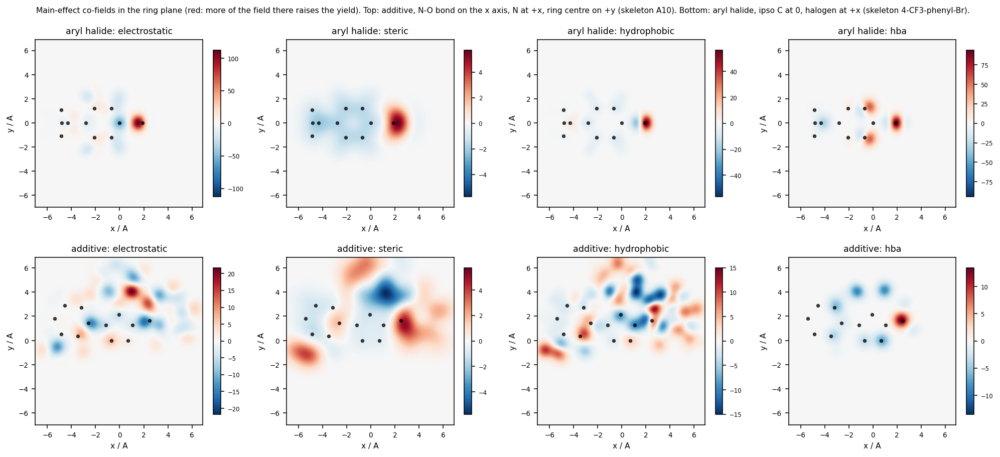
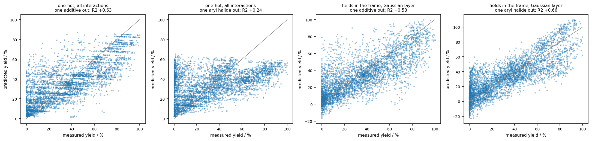

# A reaction yield as the activity: the Buchwald-Hartwig screen with its components in frames

3955 palladium-catalysed C-N couplings (Ahneman et al., Science 2018): 15 aryl halides, 4 ligands, 3 bases, 22 isoxazole additives. One kernel over reactions, the product over the four components of (1 + the kernel of that component); ligand and base by name, the aryl halide and the additive in the six ways of the rows below. Every setting and ridge is chosen inside the training part by a three-fold cross-validation of the same kind as the split. Score: R², the coefficient of determination on the test part.

## R² by method and split

| method | random 70/30, mean of 10 (sd) | additive tests 1-4, mean | test 1 | test 2 | test 3 | test 4 | one additive out, pooled | one aryl halide out, pooled |
|---|---:|---:|---:|---:|---:|---:|---:|---:|
| one-hot, main effects | +0.700 (0.008) | +0.589 | +0.630 | +0.641 | +0.540 | +0.544 | +0.535 | +0.194 |
| one-hot, all interactions | +0.909 (0.005) | +0.683 | +0.733 | +0.737 | +0.639 | +0.623 | +0.626 | +0.243 |
| Morgan fingerprints | +0.937 (0.003) | +0.727 | +0.841 | +0.822 | +0.701 | +0.544 | +0.713 | +0.696 |
| RDKit descriptors | +0.909 (0.005) | +0.612 | +0.631 | +0.657 | +0.638 | +0.522 | +0.570 | +0.720 |
| fields, no frame | +0.909 (0.005) | +0.670 | +0.798 | +0.709 | +0.681 | +0.492 | +0.657 | +0.724 |
| fields in the frame | +0.841 (0.006) | +0.537 | +0.668 | +0.608 | +0.588 | +0.284 | +0.545 | +0.720 |
| fields, no frame, Gaussian layer | +0.910 (0.007) | +0.631 | +0.728 | +0.661 | +0.664 | +0.469 | +0.629 | +0.709 |
| fields in the frame, Gaussian layer | +0.917 (0.003) | +0.545 | +0.716 | +0.566 | +0.603 | +0.295 | +0.579 | +0.659 |

RMSE in yield percent:

| method | random 70/30 | additive tests | one additive out | one aryl halide out |
|---|---:|---:|---:|---:|
| one-hot, main effects | 14.9 | 17.4 | 18.6 | 24.5 |
| one-hot, all interactions | 8.2 | 15.3 | 16.7 | 23.7 |
| Morgan fingerprints | 6.8 | 13.9 | 14.6 | 15.1 |
| RDKit descriptors | 8.2 | 16.9 | 17.9 | 14.4 |
| fields, no frame | 8.2 | 15.4 | 16.0 | 14.3 |
| fields in the frame | 10.9 | 18.3 | 18.4 | 14.4 |
| fields, no frame, Gaussian layer | 8.2 | 16.4 | 16.6 | 14.7 |
| fields in the frame, Gaussian layer | 7.9 | 18.1 | 17.7 | 15.9 |

## Published on the same splits

R² from Table 1 of Schwaller et al., Mach. Learn.: Sci. Technol. 2 (2021) 015016.

| method | random 70/30 | test 1 | test 2 | test 3 | test 4 | tests 1-4, mean |
|---|---:|---:|---:|---:|---:|---:|
| DFT descriptors, random forest (Ahneman 2018) | 0.92 | 0.8 | 0.77 | 0.64 | 0.54 | 0.69 |
| one-hot, random forest | 0.89 | 0.69 | 0.67 | 0.49 | 0.49 | 0.58 |
| multiple fingerprint features (Sandfort 2020) | 0.927 | 0.85 | 0.71 | 0.64 | 0.18 | 0.60 |
| Yield-BERT (Schwaller 2021) | 0.951 | 0.84 | 0.84 | 0.75 | 0.49 | 0.73 |

## Pairs of methods

Difference in R². For the two leave-one-out designs: on the pooled out-of-fold predictions, with a 95% interval from 1000 bootstrap samples of the held-out components. For the published splits: the mean of the paired differences, with the smallest and the largest.

| design | method | minus | difference in R² | interval or range |
|---|---|---|---:|---|
| one additive out | fields in the frame, Gaussian layer | one-hot, main effects | +0.043 | [-0.048, +0.146] |
| one aryl halide out | fields in the frame, Gaussian layer | one-hot, main effects | +0.464 | [+0.262, +0.699] |
| random | fields in the frame, Gaussian layer | one-hot, main effects | +0.216 | [+0.211, +0.232] |
| additive tests | fields in the frame, Gaussian layer | one-hot, main effects | -0.044 | [-0.249, +0.086] |
| one additive out | fields in the frame, Gaussian layer | one-hot, all interactions | -0.047 | [-0.138, +0.058] |
| one aryl halide out | fields in the frame, Gaussian layer | one-hot, all interactions | +0.416 | [+0.199, +0.669] |
| random | fields in the frame, Gaussian layer | one-hot, all interactions | +0.008 | [+0.002, +0.013] |
| additive tests | fields in the frame, Gaussian layer | one-hot, all interactions | -0.138 | [-0.328, -0.016] |
| one additive out | fields in the frame, Gaussian layer | Morgan fingerprints | -0.134 | [-0.199, -0.073] |
| one aryl halide out | fields in the frame, Gaussian layer | Morgan fingerprints | -0.037 | [-0.160, +0.067] |
| random | fields in the frame, Gaussian layer | Morgan fingerprints | -0.020 | [-0.025, -0.017] |
| additive tests | fields in the frame, Gaussian layer | Morgan fingerprints | -0.182 | [-0.256, -0.098] |
| one additive out | fields in the frame, Gaussian layer | RDKit descriptors | +0.009 | [-0.079, +0.108] |
| one aryl halide out | fields in the frame, Gaussian layer | RDKit descriptors | -0.061 | [-0.131, +0.034] |
| random | fields in the frame, Gaussian layer | RDKit descriptors | +0.008 | [+0.003, +0.013] |
| additive tests | fields in the frame, Gaussian layer | RDKit descriptors | -0.067 | [-0.227, +0.085] |
| one additive out | fields in the frame, Gaussian layer | fields, no frame | -0.079 | [-0.166, +0.011] |
| one aryl halide out | fields in the frame, Gaussian layer | fields, no frame | -0.065 | [-0.115, -0.019] |
| random | fields in the frame, Gaussian layer | fields, no frame | +0.007 | [+0.002, +0.017] |
| additive tests | fields in the frame, Gaussian layer | fields, no frame | -0.125 | [-0.197, -0.078] |
| one additive out | fields in the frame, Gaussian layer | fields in the frame | +0.033 | [-0.028, +0.094] |
| one aryl halide out | fields in the frame, Gaussian layer | fields in the frame | -0.061 | [-0.130, +0.006] |
| random | fields in the frame, Gaussian layer | fields in the frame | +0.076 | [+0.068, +0.084] |
| additive tests | fields in the frame, Gaussian layer | fields in the frame | +0.008 | [-0.041, +0.048] |
| one additive out | fields in the frame, Gaussian layer | fields, no frame, Gaussian layer | -0.050 | [-0.133, +0.030] |
| one aryl halide out | fields in the frame, Gaussian layer | fields, no frame, Gaussian layer | -0.050 | [-0.139, +0.043] |
| random | fields in the frame, Gaussian layer | fields, no frame, Gaussian layer | +0.007 | [-0.001, +0.015] |
| additive tests | fields in the frame, Gaussian layer | fields, no frame, Gaussian layer | -0.085 | [-0.174, -0.012] |
| one additive out | fields in the frame | fields, no frame | -0.112 | [-0.184, -0.029] |
| one aryl halide out | fields in the frame | fields, no frame | -0.004 | [-0.076, +0.063] |
| random | fields in the frame | fields, no frame | -0.068 | [-0.079, -0.056] |
| additive tests | fields in the frame | fields, no frame | -0.133 | [-0.208, -0.093] |
| one additive out | fields, no frame | one-hot, all interactions | +0.032 | [-0.051, +0.128] |
| one aryl halide out | fields, no frame | one-hot, all interactions | +0.481 | [+0.276, +0.725] |
| random | fields, no frame | one-hot, all interactions | +0.000 | [-0.013, +0.008] |
| additive tests | fields, no frame | one-hot, all interactions | -0.013 | [-0.131, +0.066] |
| one additive out | fields, no frame | Morgan fingerprints | -0.056 | [-0.119, +0.007] |
| one aryl halide out | fields, no frame | Morgan fingerprints | +0.028 | [-0.081, +0.121] |
| random | fields, no frame | Morgan fingerprints | -0.028 | [-0.036, -0.023] |
| additive tests | fields, no frame | Morgan fingerprints | -0.057 | [-0.113, -0.020] |
| one additive out | fields, no frame | RDKit descriptors | +0.088 | [-0.005, +0.190] |
| one aryl halide out | fields, no frame | RDKit descriptors | +0.004 | [-0.083, +0.088] |
| random | fields, no frame | RDKit descriptors | +0.000 | [-0.013, +0.007] |
| additive tests | fields, no frame | RDKit descriptors | +0.058 | [-0.030, +0.167] |

## Why the linear frame kernel cannot fit the aryl halides one by one

A field is a sum of atom Gaussians, so in a shared frame the field of a molecule is close to the sum of the fields of its parts. Eigenvalues of the linear frame kernel (attenuation 2, raw), divided by the largest:

* aryl halide (15 molecules): 7 above 1e-3; 1.0e+00, 3.4e-01, 1.5e-01, 1.3e-01, 3.4e-02, 2.9e-02, 1.2e-03, 1.3e-04, 3.4e-06, 8.1e-07, 3.6e-07, 1.8e-07, 2.0e-08, 8.2e-09, 1.7e-09
* additive (22 molecules): 18 above 1e-3; 1.0e+00, 1.3e-01, 1.0e-01, 8.7e-02, 6.7e-02, 4.1e-02, 3.9e-02, 2.6e-02, 1.3e-02, 1.3e-02, 1.0e-02, 7.2e-03, 5.9e-03, 4.8e-03, 3.4e-03, 2.7e-03, 2.1e-03, 1.6e-03, 6.2e-04, 1.1e-04, 2.2e-07, 7.1e-08

The 15 aryl halides are every combination of 5 arenes and 3 halogens; 99.9991 % of their kernel lies in the span of an arene part plus a halogen part, which has rank 7. A linear model on this kernel is a Free-Wilson model in three dimensions: it can give each arene and each halogen an effect and cannot give a pair of them one. The Gaussian layer is not linear in the atom contributions, which is why it lifts the limit.

## What the selection chose

* one-hot, main effects, random: none, ridge 1 (6); none, ridge 0.316 (2); none, ridge 0.1 (1); none, ridge 3.16 (1)
* one-hot, main effects, additive tests: none, ridge 1 (2); none, ridge 3.16 (2)
* one-hot, main effects, one additive out: none, ridge 1 (12); none, ridge 3.16 (10)
* one-hot, main effects, one aryl halide out: none, ridge 10 (9); none, ridge 3.16 (3); none, ridge 1 (2); none, ridge 31.6 (1)
* one-hot, all interactions, random: none, ridge 0.316 (6); none, ridge 0.1 (4)
* one-hot, all interactions, additive tests: none, ridge 1e-05 (4)
* one-hot, all interactions, one additive out: none, ridge 1e-05 (20); none, ridge 0.0316 (1); none, ridge 1 (1)
* one-hot, all interactions, one aryl halide out: none, ridge 3.16 (7); none, ridge 0.316 (3); none, ridge 31.6 (1); none, ridge 1 (1); none, ridge 0.0316 (1); none, ridge 1e-05 (1); none, ridge 10 (1)
* Morgan fingerprints, random: none, ridge 0.1 (6); none, ridge 0.0316 (3); none, ridge 0.316 (1)
* Morgan fingerprints, additive tests: none, ridge 1 (2); none, ridge 0.316 (2)
* Morgan fingerprints, one additive out: none, ridge 0.316 (6); none, ridge 0.1 (6); none, ridge 1 (4); none, ridge 3.16 (2); none, ridge 0.0316 (2); none, ridge 1e-05 (1); none, ridge 10 (1)
* Morgan fingerprints, one aryl halide out: none, ridge 1e-05 (9); none, ridge 0.01 (2); none, ridge 0.0316 (2); none, ridge 0.0001 (1); none, ridge 0.1 (1)
* RDKit descriptors, random: width factor 0.06, ridge 0.316 (6); width factor 0.06, ridge 0.1 (4)
* RDKit descriptors, additive tests: width factor 0.25, ridge 10 (3); width factor 0.06, ridge 1e-05 (1)
* RDKit descriptors, one additive out: width factor 0.06, ridge 1e-05 (6); width factor 0.06, ridge 0.316 (5); width factor 0.125, ridge 1 (2); width factor 0.25, ridge 3.16 (2); width factor 0.125, ridge 3.16 (2); width factor 0.06, ridge 0.01 (1); width factor 0.5, ridge 10 (1); width factor 0.25, ridge 10 (1); width factor 0.125, ridge 0.316 (1); width factor 0.06, ridge 1 (1)
* RDKit descriptors, one aryl halide out: width factor 0.5, ridge 0.0316 (4); width factor 1, ridge 1 (3); width factor 1, ridge 0.1 (2); width factor 0.5, ridge 0.01 (2); width factor 0.5, ridge 0.00316 (2); width factor 0.5, ridge 0.001 (1); width factor 1, ridge 0.000316 (1)
* fields, no frame, random: width 0.07 A, ridge 0.1 (8); width 0.07 A, ridge 0.316 (2)
* fields, no frame, additive tests: width 0.07 A, ridge 3.16 (2); width 0.07 A, ridge 10 (1); width 0.1 A, ridge 10 (1)
* fields, no frame, one additive out: width 0.07 A, ridge 10 (9); width 0.07 A, ridge 31.6 (4); width 0.07 A, ridge 3.16 (4); width 0.07 A, ridge 1 (1); width 0.25 A, ridge 3.16 (1); width 0.15 A, ridge 3.16 (1); width 0.1 A, ridge 10 (1); width 0.1 A, ridge 3.16 (1)
* fields, no frame, one aryl halide out: width 0.07 A, ridge 0.0316 (2); width 0.1 A, ridge 0.1 (2); width 0.15 A, ridge 0.0316 (2); width 0.1 A, ridge 0.01 (2); width 0.1 A, ridge 0.0316 (2); width 0.07 A, ridge 0.01 (2); width 0.07 A, ridge 0.00316 (1); width 0.15 A, ridge 3.16 (1); width 0.1 A, ridge 0.316 (1)
* fields in the frame, random: alpha 5 cosine, ridge 0.316 (10)
* fields in the frame, additive tests: alpha 5 cosine, ridge 31.6 (1); alpha 5 cosine, ridge 3.16 (1); alpha 5 cosine, ridge 1e-05 (1); alpha 0.8 cosine, ridge 10 (1)
* fields in the frame, one additive out: alpha 5 cosine, ridge 31.6 (5); alpha 5 cosine, ridge 3.16 (5); alpha 5 cosine, ridge 10 (5); alpha 5 cosine, ridge 1 (3); alpha 5 cosine, ridge 100 (1); alpha 0.8 cosine, ridge 0.1 (1); alpha 5 cosine, ridge 0.316 (1); alpha 5 raw, ridge 3.16 (1)
* fields in the frame, one aryl halide out: alpha 5 cosine, ridge 1 (4); alpha 5 cosine, ridge 0.316 (3); alpha 5 cosine, ridge 3.16 (2); alpha 5 raw, ridge 0.316 (1); alpha 2 raw, ridge 0.316 (1); alpha 5 cosine, ridge 0.00316 (1); alpha 5 cosine, ridge 0.0316 (1); alpha 5 cosine, ridge 0.1 (1); alpha 5 cosine, ridge 0.01 (1)
* fields, no frame, Gaussian layer, random: width 0.1 A, gamma 8, ridge 0.316 (5); width 0.35 A, gamma 8, ridge 0.316 (5)
* fields, no frame, Gaussian layer, additive tests: width 0.35 A, gamma 8, ridge 0.316 (1); width 0.1 A, gamma 2, ridge 3.16 (1); width 0.1 A, gamma 8, ridge 3.16 (1); width 0.35 A, gamma 2, ridge 0.0316 (1)
* fields, no frame, Gaussian layer, one additive out: width 0.35 A, gamma 8, ridge 3.16 (6); width 0.1 A, gamma 0.5, ridge 3.16 (5); width 0.1 A, gamma 8, ridge 3.16 (4); width 0.35 A, gamma 8, ridge 1 (2); width 0.1 A, gamma 8, ridge 10 (2); width 0.1 A, gamma 0.5, ridge 1 (2); width 0.35 A, gamma 8, ridge 10 (1)
* fields, no frame, Gaussian layer, one aryl halide out: width 0.1 A, gamma 0.5, ridge 0.00316 (5); width 0.1 A, gamma 0.5, ridge 0.01 (3); width 0.1 A, gamma 0.5, ridge 0.000316 (3); width 0.1 A, gamma 0.5, ridge 1e-05 (2); width 0.1 A, gamma 0.5, ridge 0.001 (1); width 0.1 A, gamma 0.5, ridge 0.0316 (1)
* fields in the frame, Gaussian layer, random: alpha 8, gamma 8, ridge 0.316 (10)
* fields in the frame, Gaussian layer, additive tests: alpha 8, gamma 8, ridge 3.16 (1); alpha 8, gamma 2, ridge 0.1 (1); alpha 8, gamma 1, ridge 0.316 (1); alpha 2, gamma 2, ridge 0.0316 (1)
* fields in the frame, Gaussian layer, one additive out: alpha 8, gamma 8, ridge 10 (7); alpha 8, gamma 8, ridge 3.16 (2); alpha 8, gamma 1, ridge 1 (2); alpha 8, gamma 0.5, ridge 1 (2); alpha 8, gamma 0.5, ridge 0.316 (2); alpha 8, gamma 8, ridge 1 (1); alpha 8, gamma 1, ridge 0.1 (1); alpha 8, gamma 2, ridge 1 (1); alpha 8, gamma 0.5, ridge 0.0316 (1); alpha 8, gamma 0.5, ridge 0.01 (1); alpha 0.8, gamma 0.5, ridge 0.316 (1); alpha 8, gamma 1, ridge 3.16 (1)
* fields in the frame, Gaussian layer, one aryl halide out: alpha 8, gamma 0.5, ridge 3.16 (3); alpha 0.8, gamma 0.5, ridge 1 (2); alpha 8, gamma 1, ridge 3.16 (2); alpha 8, gamma 0.5, ridge 0.1 (2); alpha 8, gamma 0.5, ridge 1 (2); alpha 5, gamma 0.5, ridge 1 (1); alpha 8, gamma 0.5, ridge 0.316 (1); alpha 0.8, gamma 0.5, ridge 3.16 (1); alpha 8, gamma 1, ridge 1 (1)

## The main-effect co-fields of the linear frame model (alpha 5 cosine, ridge 10, fitted on every reaction)

The value of the co-field averaged over the named places of every molecule of that role, in the frame of the reacting bond. Positive: more of that field at that place raises the yield. The values are in yield percent per unit of field for the raw kernel and in arbitrary units for the cosine kernel; read the signs and the ratios.

**aryl halide** (main effect against the mean yield of the component: r = +0.968)

| field | halogen (15) | ipso carbon (15) | ortho atoms (30) | para atom (15) | first atom of the para substituent (9) |
|---|---:|---:|---:|---:|---:|
| electrostatic | +75.6 | -55.6 | -4.88 | -10.3 | -3.21 |
| steric | +4.84 | -1.5 | -1.54 | -1.69 | -2.19 |
| hydrophobic | +44.6 | -0.442 | -5.72 | -7.81 | +4.67 |
| hba | +84.8 | +0.687 | +19 | -0.325 | -28.2 |

| component | mean yield, % | main effect in the model |
|---|---:|---:|
| 2-pyridyl-I | 58.6 | +15.89 |
| 4-Et-phenyl-I | 52.6 | +11.49 |
| 2-pyridyl-Br | 52.4 | +12.47 |
| 3-pyridyl-I | 51.3 | +11.16 |
| 4-Et-phenyl-Br | 43.5 | +6.75 |
| 2-pyridyl-Cl | 43.5 | +7.05 |
| 3-pyridyl-Br | 43.0 | +7.11 |
| 4-CF3-phenyl-I | 33.7 | +7.55 |
| 4-MeO-phenyl-I | 32.5 | +5.97 |
| 4-CF3-phenyl-Br | 26.9 | +3.21 |
| 4-MeO-phenyl-Br | 25.9 | +1.92 |
| 3-pyridyl-Cl | 13.8 | +0.55 |
| 4-CF3-phenyl-Cl | 12.5 | -3.52 |
| 4-Et-phenyl-Cl | 3.9 | -2.07 |
| 4-MeO-phenyl-Cl | 1.9 | -4.02 |

**additive** (main effect against the mean yield of the component: r = +0.950)

| field | ring O (22) | ring N (22) | C3 (22) | C4 (22) | C5 (22) | first atom of a 3-substituent (13) | first atom of a 5-substituent (15) | first atom of a 4-substituent (5) |
|---|---:|---:|---:|---:|---:|---:|---:|---:|
| electrostatic | +6.66 | +1.63 | -4.02 | -4.59 | -4.7 | -12.3 | -12.3 | +0.724 |
| steric | -0.741 | -0.643 | -0.655 | -1.12 | -0.697 | +4.07 | +1.51 | -2.79 |
| hydrophobic | -1.84 | +3.75 | -10 | -8.42 | -2.49 | +1.51 | +3.28 | +6.07 |
| hba | -3.42 | -7.05 | +0.0314 | +0 | -0.0523 | +13.1 | -1.92 | -0.239 |

| component | mean yield, % | main effect in the model |
|---|---:|---:|
| A20 | 46.7 | +2.53 |
| A17 | 45.7 | +0.04 |
| A02 | 45.3 | -2.14 |
| A14 | 44.7 | -1.89 |
| A01 | 42.5 | -2.00 |
| A12 | 41.9 | -0.46 |
| A11 | 41.8 | -0.29 |
| A10 | 40.0 | -1.42 |
| A03 | 38.8 | -1.73 |
| A08 | 34.7 | -3.50 |
| A07 | 34.7 | -3.73 |
| A18 | 34.4 | -3.12 |
| A16 | 31.8 | -4.98 |
| A22 | 31.8 | -4.49 |
| A13 | 28.9 | -4.86 |
| A04 | 28.9 | -3.15 |
| A19 | 27.5 | -5.04 |
| A15 | 26.3 | -5.80 |
| A09 | 20.0 | -7.75 |
| A06 | 19.4 | -7.70 |
| A21 | 13.4 | -9.64 |
| A05 | 9.0 | -9.42 |

Run time of the stored methods 417.9 min.
