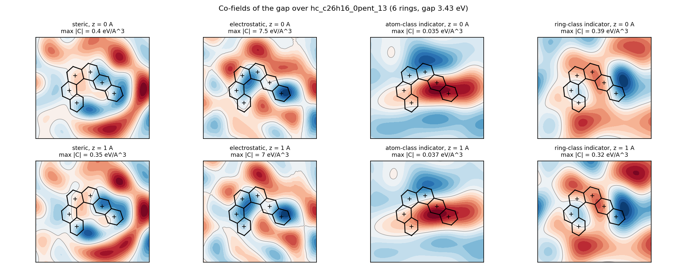
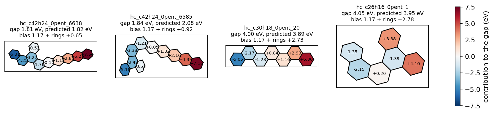

# Continuous Molecular Fields on COMPAS-1: a pilot

*One page for the collaborating group, 29 October 2026. The numbers are those of `table.md` in
this folder; `python benchmarks/run_compas.py` in the cmfqsar repository reproduces every one of
them, and `NOTES.md` records the data files, their checksums and every substitution.*

## What was done

The HOMO–LUMO gap of the 8,678 cata-condensed polybenzenoid hydrocarbons of COMPAS-1D
(B3LYP-D3BJ/def2-SVP; Wahab et al., *J. Chem. Inf. Model.* 2022) was modelled with Continuous
Molecular Fields (CMF): every molecule is a sum of atom-centred Gaussians, the model is kernel
ridge regression on the analytic overlap of those fields, and the fitted model is read back as
co-fields in space and as per-ring contributions. The molecules were put in one frame by a rule
(the inertia axes of the heavy atoms with a fixed sign convention), so no alignment was fitted.
Fields: steric (A), electrostatic from GFN2-xTB charges (B), indicator fields of the three carbon
classes rim / two-ring / three-ring (C), a ring-centred field with one Gaussian per ring centroid
per annulation class terminal / linear / angular / branched (D, new), and a ring field weighted by
the share of the Clar sextets (E, meant as a stand-in for an aromaticity field). Random 80/10/10
splits for five seeds, and size-extrapolation splits that train on fewer than N rings and test on
N rings. Baselines on the same splits: ridge regression on the counts of the atom classes, the ring
classes, the rings and the sextets (the additivity scheme that the indicator and ring fields become
when their width goes to infinity), a random forest on RDKit descriptors, and a straight line in
the number of rings.

## Main table

Test R² (mean ± standard deviation over the five random splits), the test RMSE in eV, then R² on
the size-extrapolation splits (N = 8, 9, 10 rings; 179, 619 and 2,270 training molecules).

| model | test R² | RMSE (eV) | MAE (eV) | N = 8 | N = 9 | N = 10 |
|---|---|---|---|---|---|---|
| A steric | 0.42 ± 0.04 | 0.30 | 0.24 | −0.48 | −0.40 | −1.47 |
| A, B steric + charges | 0.51 ± 0.03 | 0.28 | 0.22 | −0.69 | −0.40 | −1.00 |
| C atom-class indicators | 0.49 ± 0.02 | 0.29 | 0.22 | −0.02 | −0.49 | −1.15 |
| D ring-class indicators | 0.65 ± 0.02 | 0.24 | 0.18 | 0.52 | 0.51 | −0.04 |
| A, B, C | 0.60 ± 0.05 | 0.25 | 0.20 | −0.05 | −0.12 | −1.07 |
| C, D | 0.71 ± 0.08 | 0.21 | 0.16 | 0.50 | 0.50 | 0.31 |
| **A, B, C, D** | **0.78 ± 0.11** | **0.18** | **0.13** | **0.59** | **0.53** | **0.44** |
| A, B, C, D, E (Clar sextets) | 0.87 ± 0.02 | 0.14 | 0.11 | 0.67 | 0.78 | 0.70 |
| ridge on counts (additivity scheme) | 0.70 ± 0.01 | 0.22 | 0.17 | 0.63 | 0.65 | 0.67 |
| random forest, 66 RDKit descriptors | 0.91 ± 0.02 | 0.12 | 0.07 | 0.32 | 0.35 | −0.16 |
| straight line in the number of rings | 0.02 ± 0.03 | 0.39 | 0.31 | −0.18 | −0.08 | −0.02 |
| literature (COMPAS-1 papers) | TBD | TBD | TBD | TBD | TBD | TBD |

Cross-validated q² on the training part: 0.83 for A, B, C, D and 0.87 with the sextet field. The
spread of the A, B, C, D row over the seeds is one molecule: seed 0 holds benzene, the only
one-ring molecule, in its test part, and the model extrapolates its gap to 10–13 eV (computed
6.72); over the molecules of three rings and more the test RMSE is 0.164 ± 0.003 eV (0.138 with
the sextet field). The Nyström scaling experiment on the 34,072 molecules of COMPAS-1x is written
(`--stage scaling`) and not yet run: second milestone.

## The co-field

The co-fields change sign along the molecule: the ring-class co-field (right panels) is blue over
one end of the reference molecule and red over the other, and the atom-class co-field is blue
above one edge and red along the opposite one. The maps are drawn over the whole frame because
every training molecule contributes to them; what they mean for one molecule is the overlap with
its own field, which is what rule 3 sums. The per-ring contributions of the four test molecules add up to the prediction
exactly, but the individual values are large and cancel, and a ring on the right of the frame
counts positive and one on the left negative whatever its class: with a ridge of 1e-4 the
coefficients grow and the co-field acquires a smooth component across the frame. The sum is the
physics; the single values read position as much as chemistry, and a decomposition against a
reference (Shapley values) is the next thing to try. The refit of the main model in float64 for
these figures reproduces the table's test predictions, computed on float32 kernels, to 0.06 eV at
worst and gives the same test R² (0.593 on seed 0).

## Conclusions

- **The gap of a benzenoid is topology, and a field can carry topology.** The four ring-class
  fields alone (0.65) beat the steric, electrostatic and atom-class fields together (0.60); the
  Clar-sextet ring field is the largest single gain on top of everything else (0.78 → 0.87).
- **Only the ring fields extrapolate in size.** Every field set without one has a negative R² on
  the molecules larger than any it was trained on; every set with one is positive. The random
  forest on descriptors is the best model on the random splits (0.91) and among the worst on the
  size splits (0.32, 0.35, −0.16): it knows the isomers it saw.
- **The additivity scheme is the bar to clear, not the descriptors.** Ridge on the counts reaches
  0.70 on random and 0.63–0.67 on size splits; the four-group field model beats it on the first
  and not on the second, the set with the sextet field on both. What the field adds to the counts
  is read off the co-field and the per-ring contributions, which the counts do not have.

## Limitations

- A random split of an enumerated space tests interpolation among close isomers; the
  size-extrapolation split tests what a user would ask of the model, on few training molecules
  (the set is dominated by ten-ring molecules). The two answer different questions.
- The field scales were fixed over the whole set and the attenuations chosen on 2,500 training
  molecules; the chosen steric attenuation sits at the top of its grid and the ridge at the bottom
  (1e-4), so a wider grid is one more run.
- The electrostatic field of a hydrocarbon carries small charges; its small weight in the table is
  a statement about these molecules, not about the field.
- The few helicene-like molecules are not planar; the frame is defined for them but the two faces
  of it differ.

## Follow-ups

1. A NICS-weighted ring field (one DFT calculation per ring), which has to beat the Clar-sextet
   share rather than the set without it.
2. Peri-condensed systems (COMPAS-3): three-ring carbons and adjacent shared bonds; the typing and
   the ring classes are written for them and untested on them.
3. Hetero-atom systems (COMPAS-2) with indicator fields per hetero-atom type.
4. Δ-learning xTB → DFT on the 34k of COMPAS-1x, with the Nyström path that the script carries.
