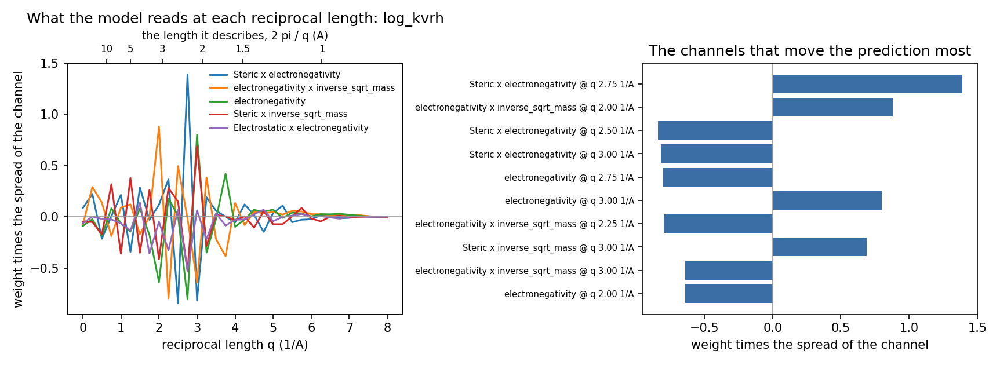
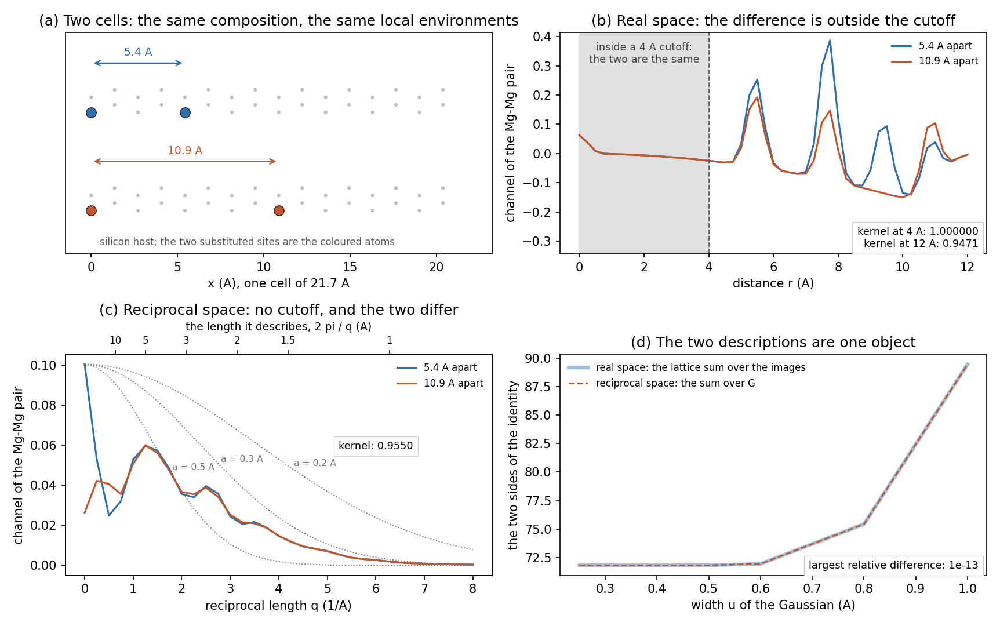

# Reciprocal-space channels of a crystal (plan item M6)

Nested cross-validation over the five published Matbench folds of a random subset of 1200 structures of each task. The setting of the descriptor, the mixing weight and the ridge are chosen inside every training fold. R2 over the held-out predictions; MAE in the unit of the task.

| The set | Structures | Atoms per cell | Reciprocal-lattice points below q = 8 1/A |
|---|---:|---:|---:|
| formation energy (eV/atom) | 1200 | 5.0 | 627 |
| bulk modulus (log10 GPa) | 1200 | 8.5 | 1320 |
| shear modulus (log10 GPa) | 1200 | 8.5 | 1320 |

| Descriptor | formation energy: R2 | MAE | bulk modulus: R2 | MAE | shear modulus: R2 | MAE |
|---|---:|---:|---:|---:|---:|---:|
| real space, 4 A | +0.504 | 0.3908 | +0.773 | 0.1195 | +0.735 | 0.1432 |
| real space, 6 A | +0.528 | 0.3780 | +0.747 | 0.1254 | +0.665 | 0.1564 |
| real space, 10 A | +0.504 | 0.3803 | +0.671 | 0.1395 | +0.635 | 0.1662 |
| reciprocal | +0.518 | 0.3756 | +0.778 | 0.1171 | +0.728 | 0.1439 |
| real space, 4 A + reciprocal | +0.537 | 0.3596 | +0.781 | 0.1144 | +0.749 | 0.1379 |
| real space, 6 A + reciprocal | +0.594 | 0.3457 | +0.775 | 0.1156 | +0.728 | 0.1440 |
| real space, 10 A + reciprocal | +0.553 | 0.3595 | +0.773 | 0.1204 | +0.711 | 0.1480 |

**What the reciprocal channels add to each cutoff.** The change in R2 when they are added to the real-space descriptor, with a 95 % interval from 2000 bootstrap resamples of the structures.

| Real-space cutoff | formation energy | bulk modulus | shear modulus |
|---|---:|---:|---:|
| 4 A | +0.033 [-0.038, +0.082] | +0.008 [-0.005, +0.022] | +0.015 [+0.002, +0.027] |
| 6 A | +0.066 [+0.045, +0.090] | +0.027 [+0.009, +0.046] | +0.063 [+0.041, +0.087] |
| 10 A | +0.050 [+0.023, +0.079] | +0.102 [+0.052, +0.172] | +0.076 [+0.051, +0.103] |

**The mixing weight chosen.** How much of the kernel the training folds gave to the reciprocal channels, averaged over the five folds.

| Real-space cutoff | formation energy | bulk modulus | shear modulus |
|---|---:|---:|---:|
| 4 A | 0.40 | 0.25 | 0.25 |
| 6 A | 0.55 | 0.55 | 0.40 |
| 10 A | 0.55 | 0.75 | 0.75 |

## The identity between the two descriptions

The real-space lattice sum of a Gaussian against the sum over the reciprocal lattice, over 40 structures of each task: the largest relative difference over the pairs of field types, median and worst over the structures. The two sides are computed by the neighbour list of `periodic.py` and by the structure factors of `reciprocal.py`, so the agreement is evidence for both.

| The set | u = 0.3 A | u = 0.5 A | u = 0.8 A |
|---|---:|---:|---:|
| shear modulus | 9.0e-14 (worst 7.8e-13) | 1.0e-13 (worst 3.6e-13) | 1.5e-13 (worst 1.6e-11) |
| bulk modulus | 9.0e-14 (worst 7.8e-13) | 1.0e-13 (worst 3.6e-13) | 1.5e-13 (worst 1.6e-11) |
| formation energy | 9.4e-14 (worst 2.1e-13) | 1.0e-13 (worst 4.9e-13) | 1.5e-13 (worst 1.1e-12) |

## The width of the field as a resolution

The reciprocal channels alone on the bulk modulus set, over a grid of widths `a` of the Gaussian field and resolution limits `q_max`. The form factor is exp(-a^2 q^2), so a wide field keeps only the first few reflections.

| Width a (A) | q_max 8 1/A: R2 | q_max 12 1/A: R2 |
|---|---:|---:|
| 0.15 | +0.785 | +0.783 |
| 0.2 | +0.779 | +0.778 |
| 0.3 | +0.764 | +0.764 |
| 0.4 | +0.741 | +0.741 |
| 0.5 | +0.710 | +0.710 |
| 0.7 | +0.587 | +0.587 |

## The pattern in q

A linear model on the reciprocal channels of the bulk modulus set (q_max 8 1/A, field width 0.3 A), read back. Each channel is reported as its weight times the spread of that channel over the training structures, which is how much it moves the prediction and is the ranking `top_channels` uses; a positive value means that more intensity at that reciprocal length raises the property, and the plane spacing is 2 pi / q. Neighbouring channels are strongly correlated, so single weights alternate in sign and it is the envelope over q that carries the reading.

| Channel | Weight x spread | q (1/A) | Spacing (A) |
|---|---:|---:|---:|
| Steric x electronegativity @ q 2.75 1/A | +1.3888 | 2.75 | 2.28 |
| electronegativity x inverse_sqrt_mass @ q 2.00 1/A | +0.8805 | 2.00 | 3.14 |
| Steric x electronegativity @ q 2.50 1/A | -0.8410 | 2.50 | 2.51 |
| Steric x electronegativity @ q 3.00 1/A | -0.8188 | 3.00 | 2.09 |
| electronegativity @ q 2.75 1/A | -0.8027 | 2.75 | 2.28 |
| electronegativity @ q 3.00 1/A | +0.8010 | 3.00 | 2.09 |
| electronegativity x inverse_sqrt_mass @ q 2.25 1/A | -0.7965 | 2.25 | 2.79 |
| Steric x inverse_sqrt_mass @ q 3.00 1/A | +0.6873 | 3.00 | 2.09 |
| electronegativity x inverse_sqrt_mass @ q 3.00 1/A | -0.6404 | 3.00 | 2.09 |
| electronegativity @ q 2.00 1/A | -0.6376 | 2.00 | 3.14 |

## What a reciprocal channel adds, on two cells built for the purpose

Two cells of a silicon host with two substituted sites, 5.4 and 10.9 angstrom apart: the same composition and the same local environment around every atom. The kernel of the pair is 1.000000 for the real-space descriptor with a 4 angstrom cutoff, which cannot tell them apart at all; 0.9471 with a 12 angstrom cutoff; and 0.9550 for the reciprocal channels, which have no cutoff. The two sides of the identity agree to 1e-13.

