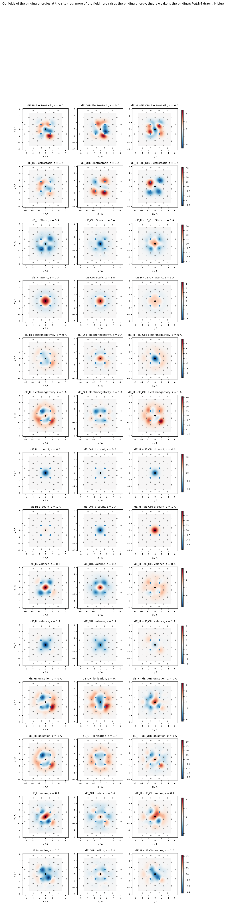
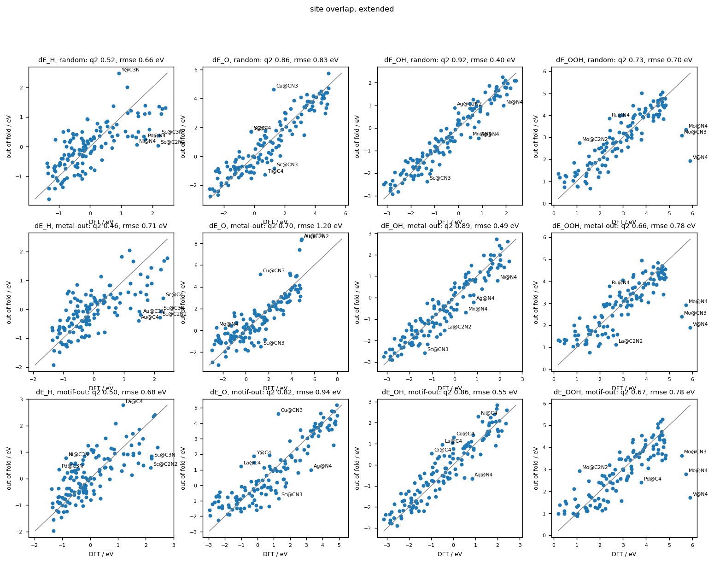

# A single-atom site as the sample: the field around the metal against the H, O, OH and OOH binding energies

The 139 catalysts of He, Wang and Ouyang (Chem. Mater. 2023) with a relaxed bare sheet: 28 metals (Ag, Au, Cd, Co, Cr, Cu, Fe, Hf, Ir, La, Mn, Mo, Nb, Ni, Os, Pd, Pt, Re, Rh, Ru, Sc, Ta, Ti, V, W, Y, Zn, Zr) in the motifs C2N2, C3N, C4, CN3, N4. The targets are electronic binding energies against computed gas references (H2 -6.772 eV, H2O -14.234 eV, PBE+D2 at the settings of the set). Folds: 10 random, one per metal, one per motif; every method chooses its kernel and ridge in an inner cross-validation of the same kind. Differences carry a 95% bootstrap interval over catalysts.

* 40 bare sheets were relaxed with DFT+U in the source data while every adsorbed state was relaxed without it; 35 of them have a plain-PBE energy recomputed here and 5 carry no binding energy
* 1 bare sheets have a source run with an energy inconsistent with its adsorbed states; 0 of them have a plain-PBE energy recomputed here and 1 carry no binding energy
* 15 adsorbed states ended as another species (an O-O or O-H bond broken) and carry no binding energy: Os@C3N OOH, Re@C3N OOH, Os@C2N2 OOH, Re@C2N2 OOH, W@C2N2 OOH, Cr@CN3 OOH, Os@CN3 OOH, Re@CN3 OOH, Ru@CN3 OOH, Ta@CN3 OOH, Nb@N4 OOH, Os@N4 OOH, Re@N4 OOH, Ta@N4 OOH, Ti@N4 OOH
* Ag@C4: OOH ended 2.91 A from the metal, on the sheet rather than on the site; kept
* Au@C4: OOH ended 2.69 A from the metal, on the sheet rather than on the site; kept
* Ag@C3N: OOH ended 2.85 A from the metal, on the sheet rather than on the site; kept
* Au@C3N: OOH ended 2.82 A from the metal, on the sheet rather than on the site; kept
* La@C2N2: H ended 2.93 A from the metal, on the sheet rather than on the site; kept
* Sc@C2N2: H ended 2.60 A from the metal, on the sheet rather than on the site; kept
* Au@CN3: OOH ended 2.73 A from the metal, on the sheet rather than on the site; kept

## The targets

| target | n | mean, eV | sd, eV |
|---|---:|---:|---:|
| dE_H | 133 | +0.01 | 0.96 |
| dE_O | 133 | +0.96 | 2.21 |
| dE_OH | 133 | -0.41 | 1.47 |
| dE_OOH | 119 | +2.96 | 1.35 |

## q² by method, random folds

| method | dE_H | dE_O | dE_OH | dE_OOH | mean |
|---|---:|---:|---:|---:|---:|
| one-hot metal and motif | +0.41 | +0.82 | +0.85 | +0.62 | +0.68 |
| metal properties and N count | +0.52 | +0.91 | +0.89 | +0.70 | +0.75 |
| periodic autocorrelation, whole cell | +0.58 | +0.91 | +0.94 | +0.76 | +0.80 |
| site invariant, classic | +0.39 | +0.72 | +0.83 | +0.69 | +0.66 |
| site overlap, classic | +0.39 | +0.74 | +0.87 | +0.71 | +0.68 |
| site invariant, extended | +0.58 | +0.91 | +0.94 | +0.75 | +0.79 |
| site overlap, extended | +0.52 | +0.86 | +0.92 | +0.73 | +0.76 |
| site invariant, indicator | +0.49 | +0.88 | +0.90 | +0.73 | +0.75 |
| site overlap, indicator | +0.57 | +0.89 | +0.93 | +0.76 | +0.79 |

RMSE in eV, random folds:

| method | dE_H | dE_O | dE_OH | dE_OOH |
|---|---:|---:|---:|---:|
| one-hot metal and motif | 0.73 | 0.93 | 0.57 | 0.83 |
| metal properties and N count | 0.66 | 0.65 | 0.50 | 0.74 |
| periodic autocorrelation, whole cell | 0.62 | 0.68 | 0.36 | 0.67 |
| site invariant, classic | 0.75 | 1.18 | 0.61 | 0.75 |
| site overlap, classic | 0.75 | 1.12 | 0.54 | 0.72 |
| site invariant, extended | 0.62 | 0.67 | 0.37 | 0.68 |
| site overlap, extended | 0.66 | 0.83 | 0.40 | 0.70 |
| site invariant, indicator | 0.69 | 0.76 | 0.45 | 0.71 |
| site overlap, indicator | 0.63 | 0.72 | 0.38 | 0.66 |

## q² by method, metal-out folds

| method | dE_H | dE_O | dE_OH | dE_OOH | mean |
|---|---:|---:|---:|---:|---:|
| one-hot metal and motif | -0.01 | -0.07 | -0.07 | -0.07 | -0.06 |
| metal properties and N count | +0.55 | +0.86 | +0.89 | +0.66 | +0.74 |
| periodic autocorrelation, whole cell | +0.49 | +0.87 | +0.90 | +0.72 | +0.74 |
| site invariant, classic | +0.21 | +0.63 | +0.74 | +0.59 | +0.54 |
| site overlap, classic | +0.30 | +0.62 | +0.85 | +0.69 | +0.61 |
| site invariant, extended | +0.57 | +0.86 | +0.90 | +0.64 | +0.74 |
| site overlap, extended | +0.46 | +0.70 | +0.89 | +0.66 | +0.68 |
| site invariant, indicator | -0.03 | +0.08 | +0.14 | +0.08 | +0.07 |
| site overlap, indicator | +0.10 | +0.18 | +0.50 | +0.43 | +0.30 |

RMSE in eV, metal-out folds:

| method | dE_H | dE_O | dE_OH | dE_OOH |
|---|---:|---:|---:|---:|
| one-hot metal and motif | 0.96 | 2.29 | 1.52 | 1.40 |
| metal properties and N count | 0.64 | 0.81 | 0.49 | 0.79 |
| periodic autocorrelation, whole cell | 0.69 | 0.80 | 0.45 | 0.72 |
| site invariant, classic | 0.85 | 1.35 | 0.75 | 0.87 |
| site overlap, classic | 0.80 | 1.36 | 0.57 | 0.76 |
| site invariant, extended | 0.63 | 0.84 | 0.47 | 0.81 |
| site overlap, extended | 0.71 | 1.20 | 0.49 | 0.78 |
| site invariant, indicator | 0.97 | 2.12 | 1.36 | 1.30 |
| site overlap, indicator | 0.91 | 2.00 | 1.04 | 1.02 |

## q² by method, motif-out folds

| method | dE_H | dE_O | dE_OH | dE_OOH | mean |
|---|---:|---:|---:|---:|---:|
| one-hot metal and motif | +0.38 | +0.84 | +0.86 | +0.63 | +0.68 |
| metal properties and N count | +0.51 | +0.91 | +0.90 | +0.73 | +0.76 |
| periodic autocorrelation, whole cell | +0.51 | +0.89 | +0.91 | +0.63 | +0.74 |
| site invariant, classic | +0.36 | +0.44 | +0.70 | +0.61 | +0.53 |
| site overlap, classic | +0.28 | +0.63 | +0.87 | +0.68 | +0.61 |
| site invariant, extended | +0.48 | +0.86 | +0.92 | +0.71 | +0.74 |
| site overlap, extended | +0.50 | +0.82 | +0.86 | +0.67 | +0.71 |
| site invariant, indicator | +0.56 | +0.89 | +0.92 | +0.74 | +0.78 |
| site overlap, indicator | +0.45 | +0.88 | +0.91 | +0.69 | +0.73 |

RMSE in eV, motif-out folds:

| method | dE_H | dE_O | dE_OH | dE_OOH |
|---|---:|---:|---:|---:|
| one-hot metal and motif | 0.75 | 0.90 | 0.55 | 0.83 |
| metal properties and N count | 0.67 | 0.65 | 0.45 | 0.71 |
| periodic autocorrelation, whole cell | 0.67 | 0.72 | 0.45 | 0.82 |
| site invariant, classic | 0.77 | 1.65 | 0.81 | 0.84 |
| site overlap, classic | 0.81 | 1.35 | 0.54 | 0.77 |
| site invariant, extended | 0.69 | 0.83 | 0.42 | 0.73 |
| site overlap, extended | 0.68 | 0.94 | 0.55 | 0.78 |
| site invariant, indicator | 0.63 | 0.75 | 0.41 | 0.68 |
| site overlap, indicator | 0.71 | 0.78 | 0.45 | 0.75 |

## site overlap, extended against the references: difference in q² with its interval

| design | reference | dE_H | dE_O | dE_OH | dE_OOH |
|---|---|---:|---:|---:|---:|
| random | one-hot metal and motif | +0.10 [-0.04, +0.26] | +0.03 [-0.01, +0.07] | +0.07 [+0.03, +0.12] | +0.11 [+0.04, +0.18] |
| random | metal properties and N count | +0.00 [-0.12, +0.14] | -0.06 [-0.10, -0.02] | +0.04 [-0.01, +0.11] | +0.04 [-0.02, +0.10] |
| random | periodic autocorrelation, whole cell | -0.06 [-0.18, +0.05] | -0.05 [-0.08, -0.02] | -0.02 [-0.04, +0.00] | -0.02 [-0.10, +0.05] |
| random | site invariant, classic | +0.13 [-0.00, +0.28] | +0.14 [+0.06, +0.23] | +0.10 [+0.05, +0.15] | +0.05 [-0.01, +0.11] |
| random | site invariant, extended | -0.06 [-0.15, +0.03] | -0.05 [-0.08, -0.02] | -0.01 [-0.03, +0.01] | -0.02 [-0.07, +0.04] |
| random | site invariant, indicator | +0.03 [-0.10, +0.15] | -0.02 [-0.07, +0.01] | +0.02 [-0.01, +0.06] | +0.01 [-0.07, +0.10] |
| metal-out | one-hot metal and motif | +0.47 [+0.31, +0.62] | +0.78 [+0.69, +0.87] | +0.96 [+0.93, +1.01] | +0.73 [+0.53, +0.90] |
| metal-out | metal properties and N count | -0.10 [-0.22, +0.03] | -0.16 [-0.24, -0.09] | -0.00 [-0.04, +0.04] | +0.01 [-0.07, +0.08] |
| metal-out | periodic autocorrelation, whole cell | -0.03 [-0.17, +0.11] | -0.17 [-0.24, -0.10] | -0.01 [-0.05, +0.02] | -0.05 [-0.11, +0.00] |
| metal-out | site invariant, classic | +0.25 [+0.10, +0.43] | +0.08 [-0.06, +0.21] | +0.15 [+0.09, +0.22] | +0.08 [-0.01, +0.17] |
| metal-out | site invariant, extended | -0.12 [-0.26, +0.02] | -0.15 [-0.23, -0.09] | -0.01 [-0.05, +0.03] | +0.02 [-0.04, +0.09] |
| metal-out | site invariant, indicator | +0.49 [+0.33, +0.65] | +0.62 [+0.50, +0.75] | +0.75 [+0.69, +0.84] | +0.59 [+0.42, +0.73] |
| motif-out | one-hot metal and motif | +0.12 [-0.06, +0.30] | -0.02 [-0.06, +0.02] | +0.00 [-0.05, +0.05] | +0.04 [-0.03, +0.13] |
| motif-out | metal properties and N count | -0.01 [-0.17, +0.15] | -0.10 [-0.15, -0.06] | -0.04 [-0.10, +0.01] | -0.06 [-0.13, +0.01] |
| motif-out | periodic autocorrelation, whole cell | -0.01 [-0.16, +0.16] | -0.08 [-0.13, -0.03] | -0.05 [-0.09, -0.01] | +0.03 [-0.07, +0.17] |
| motif-out | site invariant, classic | +0.14 [-0.03, +0.31] | +0.38 [+0.25, +0.53] | +0.16 [+0.08, +0.25] | +0.06 [-0.03, +0.15] |
| motif-out | site invariant, extended | +0.02 [-0.12, +0.16] | -0.04 [-0.09, -0.00] | -0.06 [-0.10, -0.03] | -0.04 [-0.12, +0.04] |
| motif-out | site invariant, indicator | -0.06 [-0.20, +0.09] | -0.07 [-0.12, -0.02] | -0.06 [-0.11, -0.02] | -0.08 [-0.17, +0.02] |

## What the overlap models chose

* random, dE_H: rho=0.2 alpha=2 cosine lam=0.01 (5 folds); rho=0.2 alpha=1 raw lam=0.01 (2 folds); rho=0.2 alpha=2 raw lam=0.1 (1 folds)
* random, dE_O: rho=0.2 alpha=2 cosine lam=0.001 (5 folds); rho=0.1 alpha=2 cosine lam=0.001 (2 folds); rho=0.2 alpha=1 raw lam=0.001 (1 folds)
* random, dE_OH: rho=0.1 alpha=2 raw lam=0.01 (4 folds); rho=0.2 alpha=1 raw lam=0.01 (3 folds); rho=0.2 alpha=2 raw lam=0.01 (2 folds)
* random, dE_OOH: rho=0.2 alpha=0.5 raw lam=0.01 (4 folds); rho=0.1 alpha=2 cosine lam=0.01 (2 folds); rho=0.05 alpha=0.5 raw lam=0.001 (2 folds)
* metal-out, dE_H: rho=0.2 alpha=2 cosine lam=0.01 (24 folds); rho=0.2 alpha=2 cosine lam=0.001 (1 folds); rho=0.2 alpha=2 cosine lam=0.1 (1 folds)
* metal-out, dE_O: rho=0.05 alpha=2 raw lam=0.1 (6 folds); rho=0.05 alpha=2 raw lam=0.01 (4 folds); rho=0.1 alpha=1 raw lam=0.001 (3 folds)
* metal-out, dE_OH: rho=0.05 alpha=0.5 raw lam=0.001 (9 folds); rho=0.1 alpha=0.5 raw lam=0.001 (8 folds); rho=0.2 alpha=2 cosine lam=0.001 (4 folds)
* metal-out, dE_OOH: rho=0.2 alpha=0.5 raw lam=0.1 (13 folds); rho=0.2 alpha=0.5 raw lam=0.01 (9 folds); rho=0.2 alpha=1 raw lam=0.1 (1 folds)
* motif-out, dE_H: rho=0.05 alpha=2 raw lam=0.01 (2 folds); rho=0.1 alpha=2 raw lam=0.01 (1 folds); rho=0.2 alpha=1 raw lam=0.1 (1 folds)
* motif-out, dE_O: rho=0.2 alpha=2 raw lam=0.01 (2 folds); rho=0.2 alpha=2 raw lam=0.1 (2 folds); rho=0.2 alpha=0.5 raw lam=0.01 (1 folds)
* motif-out, dE_OH: rho=0.2 alpha=1 raw lam=0.01 (2 folds); rho=0.2 alpha=2 raw lam=0.01 (2 folds); rho=0.1 alpha=0.5 raw lam=0.001 (1 folds)
* motif-out, dE_OOH: rho=0.2 alpha=2 raw lam=0.1 (3 folds); rho=0.2 alpha=1 cosine lam=0.01 (1 folds); rho=0.05 alpha=2 raw lam=0.01 (1 folds)

## The GP variance against the error

| design | target | 95% interval covers | rank correlation of predicted sd with error |
|---|---|---:|---:|
| metal-out | dE_H | 92% | +0.11 |
| metal-out | dE_O | 86% | -0.08 |
| metal-out | dE_OH | 91% | +0.09 |
| metal-out | dE_OOH | 95% | +0.04 |
| random | dE_H | 92% | +0.12 |
| random | dE_O | 92% | +0.09 |
| random | dE_OH | 94% | -0.05 |
| random | dE_OOH | 96% | -0.07 |

## The four endpoints together (kernel rho=0.2 alpha=2 cosine)

Multi-task fit with the task correlation chosen by cross-validation: rho 0.3, ridge 0.001. Mean q² over the four endpoints +0.779 shared against +0.775 with four separate fits.

| endpoint | q² shared | q² alone |
|---|---:|---:|
| dE_H | +0.565 | +0.556 |
| dE_O | +0.873 | +0.872 |
| dE_OH | +0.917 | +0.917 |
| dE_OOH | +0.759 | +0.756 |

The bifunctional difference dE_H - dE_OH (sd 1.22 eV, 133 catalysts): q² +0.812 (RMSE 0.53 eV) from the shared fit, +0.787 (RMSE 0.56 eV) as the difference of the two single-endpoint predictions.

## Overpotentials from the out-of-fold binding energies

Free energies with the corrections {'H': 0.24, 'O': 0.05, 'OH': 0.35, 'OOH': 0.4} eV; eta_HER = |dG_H|, eta_ORR = 1.23 V minus the limiting potential of the four-electron associative path. The bifunctional score of a site is the larger of its two overpotentials.

| design | HER mae, V | HER rank r | ORR mae, V | ORR rank r | bifunctional rank r | best 10 recovered |
|---|---:|---:|---:|---:|---:|---:|
| random | 0.44 | +0.50 | 0.31 | +0.88 | +0.89 | 4/10 |
| metal-out | 0.44 | +0.41 | 0.46 | +0.79 | +0.82 | 5/10 |
| motif-out | 0.40 | +0.56 | 0.37 | +0.83 | +0.86 | 6/10 |

Best 10 bifunctional sites by DFT: Co@N4, Co@CN3, Co@C2N2, Rh@N4, Rh@CN3, Co@C3N, Ir@CN3, Ir@N4, Ag@N4, Pt@C3N.
Best 10 by the random-fold predictions: Co@N4, Co@CN3, Ir@CN3, Ni@CN3, Co@C4, Ni@N4, Co@C2N2, Pd@C3N, Zn@CN3, Cd@CN3.

## The co-fields at named points (extended fields, rho 0.2, alpha 2, cosine kernel)

Value of the co-field per unit of field weight, in eV, averaged over the atoms of a shell (Fe@N4 as the reference geometry). A positive value says more of that field at that place raises the binding energy, that is weakens the binding.

| field | place | H | OH | OOH | H - OH |
|---|---|---:|---:|---:|---:|
| electrostatic | metal | -1.169 | -0.446 | -0.515 | -0.723 |
| electrostatic | first shell | +0.416 | -0.222 | +0.158 | +0.638 |
| electrostatic | second shell | +0.053 | +0.112 | -0.246 | -0.059 |
| electrostatic | 2 A above the metal | -1.001 | -0.750 | +0.493 | -0.252 |
| steric | metal | +3.141 | +1.932 | +0.670 | +1.209 |
| steric | first shell | -1.479 | -0.583 | -0.054 | -0.896 |
| steric | second shell | -0.541 | -0.141 | +0.301 | -0.399 |
| steric | 2 A above the metal | -0.241 | -0.150 | -0.396 | -0.091 |
| prop:electronegativity | metal | -0.787 | +3.146 | +4.622 | -3.933 |
| prop:electronegativity | first shell | -0.323 | -0.668 | -1.850 | +0.345 |
| prop:electronegativity | second shell | +0.815 | +0.173 | +0.376 | +0.642 |
| prop:electronegativity | 2 A above the metal | +0.007 | -0.203 | +0.030 | +0.209 |
| prop:d_count | metal | -1.203 | -2.348 | -0.396 | +1.145 |
| prop:d_count | first shell | -0.027 | -0.012 | -0.022 | -0.016 |
| prop:d_count | second shell | -0.000 | -0.000 | -0.000 | -0.000 |
| prop:d_count | 2 A above the metal | -0.617 | -0.011 | +0.851 | -0.606 |
| prop:valence | metal | -3.507 | -2.449 | -2.335 | -1.058 |
| prop:valence | first shell | -2.865 | -3.088 | -3.430 | +0.222 |
| prop:valence | second shell | -0.234 | -0.845 | -0.395 | +0.611 |
| prop:valence | 2 A above the metal | -1.812 | -0.012 | -0.262 | -1.800 |
| prop:ionisation | metal | +0.013 | -1.030 | -1.546 | +1.043 |
| prop:ionisation | first shell | -0.712 | +0.554 | -0.758 | -1.266 |
| prop:ionisation | second shell | +0.652 | +1.182 | +1.220 | -0.531 |
| prop:ionisation | 2 A above the metal | -0.004 | +0.014 | +0.214 | -0.017 |
| prop:radius | metal | -0.733 | -0.275 | +0.517 | -0.458 |
| prop:radius | first shell | -0.811 | -0.219 | -0.530 | -0.592 |
| prop:radius | second shell | -0.276 | -0.340 | +0.209 | +0.065 |
| prop:radius | 2 A above the metal | -0.088 | +0.315 | +0.863 | -0.403 |

Run time 6.4 min.
