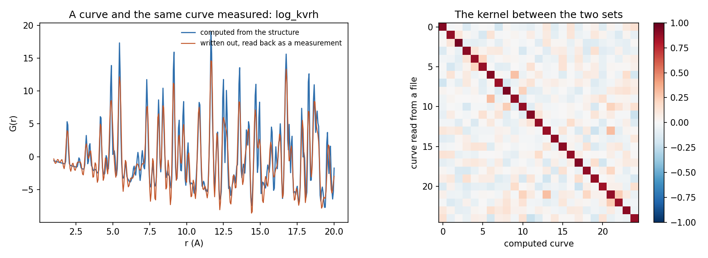

# A measured scattering curve as the sample (plan item M12)

No experimental data is used here. The curves are computed from structures and then put through what an instrument does to them, so what follows says how good a measurement would have to be, not that a measurement worked.

## The curve is the untyped descriptor

G(r) computed as the one-field periodic autocorrelation, against G(r) summed over the neighbour list from its definition, on 30 structures of each task: the largest relative difference over the curve, median and worst over the structures. The identity is exact in the limit of a narrow channel, so the error falls with the channel width.

| The set | channel 0.1 A | channel 0.05 A | channel 0.02 A |
|---|---:|---:|---:|
| shear modulus | 6.9e-04 (worst 2.1e-03) | 8.2e-05 (worst 3.2e-04) | 5.5e-06 (worst 2.1e-05) |
| bulk modulus | 6.9e-04 (worst 2.1e-03) | 8.2e-05 (worst 3.2e-04) | 5.5e-06 (worst 2.1e-05) |
| formation energy | 5.9e-04 (worst 1.2e-03) | 6.2e-05 (worst 1.4e-04) | 3.8e-06 (worst 6.2e-06) |

## What summing away the types costs

Nested cross-validation over the five published Matbench folds of 600 structures of each task, the protocol of `run_reciprocal.py`. The typed descriptor is the periodic autocorrelation with one block per pair of field types; the total curve is G(r), which is the one block an experiment can measure.

| Descriptor | formation energy: R2 | MAE | bulk modulus: R2 | MAE | shear modulus: R2 | MAE |
|---|---:|---:|---:|---:|---:|---:|
| the typed descriptor | +0.418 | 0.4076 | +0.771 | 0.1196 | +0.684 | 0.1546 |
| the total curve, xray | +0.012 | 0.5409 | +0.303 | 0.2315 | +0.192 | 0.2595 |
| the total curve, neutron (covered subset) | +0.101 | 0.5209 | +0.093 | 0.2857 | +0.086 | 0.2896 |
| the typed descriptor (neutron subset) | +0.467 | 0.3963 | +0.783 | 0.1257 | +0.717 | 0.1568 |

**The difference, with a 95 % interval from 2,000 bootstrap resamples of the structures.** A negative number is what the typing is worth.

| The curve | formation energy | bulk modulus | shear modulus |
|---|---:|---:|---:|
| xray | -0.406 [-0.498, -0.311] | -0.469 [-0.560, -0.389] | -0.492 [-0.579, -0.414] |
| neutron | -0.366 [-0.448, -0.287] | -0.690 [-0.811, -0.577] | -0.630 [-0.716, -0.538] |

Where a source covers fewer than all the structures, it is because the module tabulates no scattering length for one of their elements and refuses to guess one.

## What a measurement would have to be

The same curves (xray) put through what an instrument does to them. **Matched** fits and tests on curves degraded alike, which is what a laboratory with a set of measurements has. **Transfer** fits on the computed curves and predicts the degraded ones, which is what someone with a structure database and a measurement in hand does. The last column is how much the curve itself changed, as its correlation with the computed one.

| What the measurement does | formation energy: matched | transfer | bulk modulus: matched | transfer | shear modulus: matched | transfer | Curve |
|---|---:|---:|---:|---:|---:|---:|---:|
| as computed | -0.001 | -0.001 | +0.003 | +0.003 | -0.050 | -0.050 | +1.000 |
| Q_max 25 1/A | +0.010 | +0.006 | +0.278 | -0.009 | +0.156 | -0.061 | +0.946 |
| Q_max 20 1/A | +0.030 | +0.023 | +0.327 | +0.001 | +0.235 | -0.049 | +0.891 |
| Q_max 15 1/A | +0.028 | +0.024 | +0.385 | +0.022 | +0.295 | -0.025 | +0.791 |
| Q_max 10 1/A | +0.050 | +0.018 | +0.432 | +0.054 | +0.344 | -0.002 | +0.629 |
| Q_max 20, noise 2 % | +0.029 | +0.022 | +0.324 | +0.001 | +0.225 | -0.049 | +0.891 |
| Q_max 20, noise 10 % | +0.026 | +0.021 | +0.150 | +0.001 | +0.040 | -0.049 | +0.889 |
| Q_max 20, density off 2 % | +0.031 | +0.023 | +0.327 | +0.001 | +0.235 | -0.049 | +0.890 |
| Q_max 20, density off 10 % | +0.046 | +0.025 | +0.336 | +0.006 | +0.242 | -0.044 | +0.887 |
| Q_max 20, r above 2 A | +0.028 | +0.021 | +0.260 | +0.001 | +0.118 | -0.051 | +0.889 |
| Q_max 20, r below 10 A | +0.089 | -0.030 | +0.438 | +0.015 | +0.352 | -0.038 | +0.512 |
| a laboratory measurement | +0.018 | +0.029 | +0.302 | +0.010 | +0.215 | -0.038 | +0.708 |

## A file written and read back

25 curves of the bulk modulus set written in the two-column form the common programs write, with a header, then read back and matched against the structures they came from. 25 of 25 match their own structure best; the kernel with its own structure is 0.891 on average and with the others 0.001. The header read back: {'density': 0.050267, 'q_max': 20.0}.

