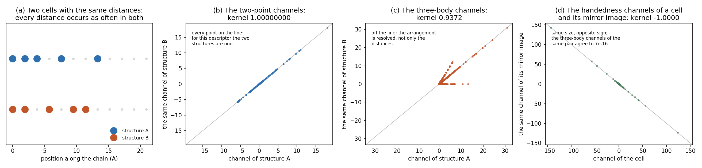

# Three-body channels and handedness for crystals (plan item M10)

## The two blind spots of a two-point descriptor

Two chains of five atoms on a ring of 12 sites, [0, 1, 2, 4, 7] and [0, 1, 3, 5, 6], which have the same multiset of distances between their atoms. The two-point channels give them a kernel of 1.00000000: for that descriptor they are one structure. The three-body channels give 0.9372.

A cell of four species with no symmetry, against its mirror image: the three-body channels differ by 6.9e-16 of the largest channel, so that block is blind to a reflection as every pair descriptor is; the handedness channels have the same size and the opposite sign (kernel -1.000000, the two sets summing to 3.2e-15 of the largest). Rocksalt, which is centrosymmetric, gives 2.5e-45 in every handedness channel.

## What the channels add on three Matbench tasks

Nested cross-validation over the five published folds of 600 structures of each task, the protocol of `run_reciprocal.py`. "Both" mixes the two kernels as `K = (1 - t) K_two_point + t K_three_body`, with `t` chosen inside every training fold.

| Descriptor | formation energy: R2 | MAE | bulk modulus: R2 | MAE | shear modulus: R2 | MAE |
|---|---:|---:|---:|---:|---:|---:|
| the two-point descriptor | +0.453 | 0.3950 | +0.781 | 0.1167 | +0.699 | 0.1527 |
| the three-body channels | +0.542 | 0.3612 | +0.789 | 0.1167 | +0.727 | 0.1469 |
| both | +0.515 | 0.3734 | +0.799 | 0.1129 | +0.721 | 0.1466 |

**The difference against the two-point descriptor, with a 95 % interval from 2,000 bootstrap resamples of the structures.**

| Descriptor | formation energy | bulk modulus | shear modulus |
|---|---:|---:|---:|
| the three-body channels | +0.089 [+0.041, +0.140] | +0.009 [-0.022, +0.041] | +0.028 [-0.003, +0.065] |
| both | +0.062 [+0.013, +0.112] | +0.018 [-0.006, +0.044] | +0.022 [-0.006, +0.055] |

## The set where the arrangement is the signal

The 2DMD defect series (plan item M14): one host lattice, one supercell, and a different arrangement of one to three point defects in every cell. The three-body channels of the whole cells against the two-point channels of the same cells, with the same folds, the same ridge grid and the same Gaussian layers. **Random folds** holds out a fifth of the cells; **one and two defects to three** trains on the 131 cells with one or two defects and predicts the rest, which is where a description that cannot see the arrangement fails.

| The set | Descriptor | random folds: R2 | meV per site | one and two defects to three: R2 | meV per site |
|---|---|---:|---:|---:|---:|
| MoS2 | two-point, 10 A | +0.9997 | 8.3 | -0.015 | 1222 |
| MoS2 | arrangement (M14) | +1.0000 | 1.8 | +1.000 | 4 |
| MoS2 | three-body, 4 to 5 A | +0.9972 | 36.0 | +0.940 | 240 |
| MoS2 | both | +0.9988 | 25.6 | +0.021 | 1201 |
| WSe2 | two-point, 10 A | +0.9989 | 15.7 | +0.060 | 1096 |
| WSe2 | arrangement (M14) | +0.9998 | 5.2 | +0.996 | 54 |
| WSe2 | three-body, 4 to 5 A | +0.9861 | 38.3 | +0.954 | 198 |
| WSe2 | both | +0.9977 | 23.8 | +0.091 | 1078 |

